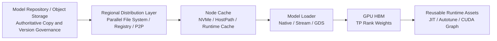

# Large Model Weight Distribution and Loading Acceleration: Community and Commercial Solution Selection

Slow large model scaling is usually summarized as "slow model download." That description is too coarse.

The same weights may first move from the model repository into object storage, then pass through a shared file system or P2P network to reach node NVMe, after which the inference engine handles deserialization, CPU-to-GPU transfer, quantization post-processing, and kernel compilation. If you optimize only one segment, the bottleneck easily shifts to the next.

Current test materials also illustrate the scale of the problem: a GLM-5.2 FP8 weight set contains 141 Safetensors shards; a previously tested DeepSeek V4 Flash with roughly 156 GiB and 48 shards still took several minutes to load and initialize the Runtime even when the node local disk already had a cache hit. Shared storage being "mountable and readable" does not mean it can still stably support concurrent startup of all instances during a release storm.

This special topic does not simply rank community projects and commercial products into a leaderboard. Instead, it first answers three questions:

1. Which segment does each solution optimize, and does it actually cover the current bottleneck;
2. Does it require changing the model format, inference engine, node storage, or network;
3. Whether the GPU waiting time saved is worth the added infrastructure and operational complexity.

## 1. First Break the Weight Delivery Chain into Five Layers



The five layers solve different problems:

| Layer | Core Problem | Typical Means | Common Misjudgment |
| --- | --- | --- | --- |
| Authoritative Copy | Model version, Digest, permissions, and rollback | Object storage, model repository, OCI Registry | Treating each Pod's temporary download directory as a model repository |
| Regional Distribution | How to avoid overwhelming the source when multiple nodes fetch the same model simultaneously | Lustre-class parallel file systems, Dragonfly P2P, regional replicas | Successful shared mount equals the ability to withstand a startup storm |
| Node Cache | Whether a node restart or reuse can avoid fetching from source again | NVMe, KServe LocalModelCache, Fluid Runtime | Using lock-free HostPath scripts to handle concurrent downloads and GC |
| Loader | How files are read with high concurrency and enter each TP Rank | vLLM Native, Run:ai Model Streamer, Tensorizer, GDS | Disk read completion equals model Ready |
| Runtime Assets | Whether JIT, Autotune, Kernel, and Graph can be reused | Precompiled cache, ModelExpress, fixed compatibility fingerprint | Saving only weights while ignoring minutes of on-site compilation |

Business availability time can be approximated as:

```text
T_ready = T_schedule + T_image + T_distribute + T_load + T_runtime + T_warmup
```

Streaming loading allows some stages to overlap, so the final result is not a mechanical sum; but at minimum, each stage must be instrumented separately to know whether optimization hit the critical path.

## 2. Community Solutions: They Are Not the Same Kind of Product

### 2.1 Minimal Baseline: Direct Read from Object Storage or Shared File System

The simplest approach is to have an Init Container download from object storage, or have the Engine directly read a shared file system such as CFS Turbo, Lustre, or CephFS.

It suits scenarios with few replicas and low release frequency, and serves as the control group for all more complex solutions. Parallel file systems provide a unified path and high aggregate bandwidth, but metadata concurrency, a large number of shards in a single directory, client caching, first-read source fetch, and simultaneous loading across multiple nodes still need to be tested. It solves the problem of "every node needing to keep a full authoritative copy," but it does not naturally equal a hot node cache, nor does it eliminate CPU-to-GPU transfer and Runtime initialization.

The current environment can first keep the parallel file system as the shared delivery layer, then pre-warm hot models to node NVMe. This avoids immediately introducing a new control plane while still separating the two variables of "shared storage read" and "local loading."

### 2.2 KServe LocalModelCache: Turning Node Cache into a Manageable Object

[KServe Local Model Cache](https://kserve.github.io/website/docs/model-serving/generative-inference/modelcache/localmodel/) uses resources such as `LocalModelCache` and `LocalModelNodeGroup` to describe models, target nodes, and local paths. A controller tracks node cache status, and model serving then reuses local copies.

It solves several more problems than hand-written Init Containers:

- Cache status enters the Kubernetes API, eliminating the need to log into nodes manually for judgment;
- Pre-warming can be done by node group and coordinated with model serving scheduling;
- Model version, cache path, and Pod lifecycle are no longer fully coupled.

It is best suited for teams already using KServe, or teams that want to manage NVMe cache with Kubernetes CRDs. The cost is new controllers, node permissions, disk quotas, and GC rules; it also does not automatically accelerate the GPU Loader.

### 2.3 Fluid, Alluxio, and JuiceFS: Using a Data Orchestration Layer for Caching

[Fluid](https://fluid-cloudnative.github.io/) abstracts datasets, Runtimes, pre-warming, and data-aware scheduling into Kubernetes resources, and can integrate cache runtimes such as Alluxio. [Alluxio](https://docs.alluxio.io/os/user/edge/en/overview/Architecture.html) provides multi-layer caching and underlying storage abstraction; [JuiceFS CSI](https://juicefs.com/docs/csi/guide/cache/) also supports client-side local caching and can pull data to nodes in advance through Warmup Jobs.

The advantage of this category is that datasets, checkpoints, and feature data beyond models can also reuse the same data plane. These solutions are more like general-purpose data infrastructure than dedicated model loaders. For inference pools with only a small number of fixed models, the control plane, cache consistency, and capacity governance may outweigh the benefits; for clusters where training, notebooks, and inference collectively consume large amounts of data, the reuse value is higher.

### 2.4 Dragonfly: Solving Large-Scale Fan-Out and Source Thundering Herd

[Dragonfly](https://d7y.io/docs/) uses a P2P network to turn nodes that have already downloaded data into Peers, reducing duplicate traffic on the Registry, object storage, or file server. It suits scenarios where dozens to hundreds of nodes pull the same weights or images simultaneously.

The community is also advancing [the combination of Harbor, ModelPack, and Dragonfly for model artifacts and distribution](https://d7y.io/blog/2026/03/11/cloud-native-ai-model-management-and-distribution-for-inference-workloads/): models are governed as OCI artifacts and then distributed to nodes via P2P. The project's publicly reported hundred-node, terabyte-scale numbers can be used to understand the direction of the upper bound, but they are results from the project's environment and cannot replace measurements on the target network, disk, and model shards.

Dragonfly optimizes "remote to node," not "node to GPU." If there are only two nodes, or the source has never been the bottleneck, introducing Scheduler, Seed Peer, Peer GC, and topology policies is often not worth the cost.

### 2.5 OCI Model Artifact and Kubernetes Image Volume: Unify Governance First

Packaging models as OCI Artifacts allows reuse of the Registry's Digest, signature, permissions, cross-region replication, and audit capabilities. Projects such as Harbor and ModelPack are advancing this path. [Kubernetes Image Volume](https://kubernetes.io/docs/concepts/storage/volumes/#image) can also expose OCI objects to containers as read-only Volumes, but its feature stage and CRI support need to be verified against the cluster version.

OCI mainly solves supply chain and delivery consistency. Extremely large manifests, hundreds of GiB layers, Registry GC, decompression temporary space, and runtime concurrent pulls still need stress testing; assuming that "because the model is now an image, it must be faster" is not valid.

### 2.6 Run:ai Model Streamer: Parallelizing Read and GPU Transfer

[The Run:ai Model Streamer extension for vLLM](https://docs.vllm.ai/en/latest/models/extensions/runai_model_streamer/) can concurrently read Safetensors from local file systems and object storage, and stream them to the GPU. Distributed mode also allows each TP Rank to read only the weights it needs, reducing serial loading and CPU memory pressure.

Two things need to be distinguished here: Model Streamer is a public component that can be integrated into vLLM images; NVIDIA Run:ai's full scheduling platform, enterprise capabilities, and support are commercial products. During evaluation, concurrent threads, object storage connection counts, TP, CPU/NUMA, and network must also be fixed; otherwise, "Streamer is faster" can easily just mean increased source-side concurrency.

### 2.7 Tensorizer, FastSafetensors, and ServerlessLLM: Changing Format or Implementation for the Loading Path

- [Tensorizer](https://docs.vllm.ai/en/latest/models/extensions/tensorizer/) pre-serializes models into a format suitable for streaming reads, loadable from disk, HTTP, or object storage; the benefit must be calculated together with the cost of additional conversion, version compatibility, and duplicate artifacts.
- [FastSafetensors](https://docs.vllm.ai/en/latest/models/extensions/fastsafetensor/) attempts to shorten the path through parallel reads and GPUDirect Storage, but depends on specific hardware, drivers, and version combinations, and should be accepted as an experimental capability.
- [ServerlessLLM](https://github.com/ServerlessLLM/ServerlessLLM) adopts a loading-optimized checkpoint layout, `O_DIRECT`, Pinned Memory, multi-tier storage, and storage-aware scheduling. The paper and project numbers show significant acceleration headroom, but format conversion and Runtime integration mean it is not a non-invasive replacement.

The common thread of these solutions is changing the artifact layout or Loader for loading speed. Before going live, output correctness, steady-state throughput, conversion pipeline, and rollback path must be compared, not just a one-time startup time in seconds.

### 2.8 ModelExpress: Copying Weights and Compiled Assets from Ready GPU Replicas

[ModelExpress](https://github.com/ai-dynamo/modelexpress) organizes sources into a loading cascade by priority: first copying GPU weights from compatible online Peers via NIXL/RDMA, then attempting Model Streamer and GDS, and finally falling back to native loading; it can also pass matching JIT/Kernel assets.

The value of this path is that during rolling releases, healthy replicas of the same model and Runtime usually already exist in the cluster, so there is no need to start again from cold storage. In the project's publicly disclosed Benchmarks, Peer weight copying in a specific B200, ConnectX-7, and DeepSeek-V4-Pro environment reached the tens-of-seconds range and significantly shortened API Ready; this is a project result, not a promise for the H20 environment.

The practical constraints are also stronger:

- The source and target GPU architecture, TP, quantization method, Runtime Image, and model Digest must be compatible;
- The data paths of RDMA, NIXL, and GPU Direct must be proven with metrics, not just by the presence of devices;
- For TP scenarios, it must be confirmed that each Rank reads only the tensors it needs. The project documentation also notes that certain GDS paths may cause each Rank to read the full Tensor, amplifying I/O instead;
- When no healthy Peer exists, fallback to object storage or local cache must be reliable;
- This is a fast-moving project, suitable for exploration and strict A/B testing, but should not yet be the sole recovery path.

## 3. Commercial Solutions: What You Buy Is Integration, SLA, and Operational Boundaries

Paid solutions do not necessarily have fundamentally different transfer algorithms. They typically package hardware topology, drivers, caching, monitoring, upgrades, and support together, reducing the integration boundaries the team must handle itself.

| Solution Category | Representative Solutions | Primary Value | Primary Cost and Constraints |
| --- | --- | --- | --- |
| Cloud object storage + managed parallel file system | Tencent Cloud COS/CFS Turbo, [Amazon FSx for Lustre](https://docs.aws.amazon.com/fsx/latest/LustreGuide/fsx-data-repositories.html), [Azure Managed Lustre](https://learn.microsoft.com/en-us/azure/azure-managed-lustre/blob-integration) | Managed capacity, aggregate throughput, object storage integration, and SLA | Capacity and throughput billing, first-read source fetch, availability-zone traffic, vendor lock-in |
| Enterprise inference artifacts | [NVIDIA NIM and NIM Operator Model Cache](https://docs.nvidia.com/nim-operator/latest/cache-llm.html) | Validated model Profiles, containers, cache CRDs, and enterprise support | Subscription and licensing, support matrix, constraints on how NIM runs |
| Enterprise AI scheduling platform | NVIDIA Run:ai | Scheduling, quotas, topology, observability, and enterprise support; can be combined with Model Streamer | Platform cost and integration boundaries; platform capabilities cannot be equated with the Loader itself |
| Commercial data platforms | Alluxio Enterprise, JuiceFS Enterprise/Cloud, etc. | Cross-storage caching, data governance, multi-cluster, and commercial support | Additional data control plane, node resource overhead, capacity- or node-based pricing |
| High-performance storage devices or services | NVMe-oF, parallel file systems, commercial Data Fabric | High aggregate bandwidth, low latency, and mature operational tooling | Network and storage hardware cost, topology design, capacity utilization |

Before selecting a commercial solution, require the vendor to complete acceptance testing on your own models, nodes, and concurrency scale. Providing only sequential read bandwidth or single-node best-case values is insufficient to prove that release storms, cache misses, and failure fallback meet the SLO.

## 4. Horizontal Selection Table

| Solution | Primary Optimization Layer | Changes Model Format | Depends on RDMA/GDS | Suitable Scale | Primary Risk |
| --- | --- | --- | --- | --- | --- |
| Init Container + object storage | Authoritative copy → node | No | No | Few replicas, baseline | Duplicate traffic, locks, and failure residue |
| Parallel file system direct read | Regional distribution | No | No | Medium-scale shared reads | Metadata, concurrent first reads, and cost |
| NVMe + DaemonSet/LocalModelCache | Node cache | No | No | Repeated node restarts | Capacity, GC, scheduling consistency |
| Fluid/Alluxio/JuiceFS | Data caching and orchestration | No | No | Training, development, and inference sharing data | Control plane and consistency complexity |
| Dragonfly | Large-scale P2P distribution | No | No | Tens to hundreds of nodes fan-out | Peer topology, source fetch, and GC |
| OCI Model Artifact | Artifact governance and replication | Requires repackaging | No | Multi-environment release | Extremely large layers and CRI/Registry compatibility |
| Run:ai Model Streamer | Parallel read and H2D | Usually no | Optional | vLLM, object storage, or local disk | Version, TP, and source concurrency |
| Tensorizer/ServerlessLLM | Artifact layout and Loader | Yes | Optional | Cold-start sensitive, maintainable conversion pipeline | Ecosystem compatibility and duplicate artifacts |
| ModelExpress | GPU Peer, Loader, JIT assets | Usually no | Required for Peer fast path | Rolling releases with compatible online replicas | Maturity, compatibility fingerprint, and fallback |
| NIM/managed storage/enterprise data platform | Multi-layer integration | Depends on product | Depends on product | Teams wanting to shrink self-managed boundaries | Cost, lock-in, and black-box tuning |

"Community" and "paid" are not mutually exclusive. The more common combination is: open-source controllers and loaders, plus paid object storage, parallel file systems, NVMe, and network; or validating with the community edition first, then purchasing enterprise support and managed services.

## 5. How to Choose in the Current H20 Environment

The existing environment already has four pieces in place: object storage, CFS Turbo/Lustre-class shared paths, node-local NVMe, and H20 nodes. The priority should not be to immediately deploy another platform, but to run layered A/B tests on the same model and the same Runtime.

### P0: Establish an Uncontested Baseline

Using the same GLM-5.2 FP8 weights, the same image, TP=8, and the same H20 model, test separately:

1. Cold-cache direct read from the shared parallel file system;
2. Hot-cache direct read from the shared parallel file system;
3. Pre-copy to node NVMe followed by native loading;
4. Node NVMe hot-cache restart.

This step only changes the storage entry point. In earlier measurements of DeepSeek V4 Flash on NVMe versus regular attached disks, the weight phase was shortened by only about 29 seconds, indicating that when JIT and CUDA Graph occupy more time, a faster disk does not shorten Ready time in proportion to bandwidth.

### P1: Productize the NVMe cache

If stable NVMe hits deliver measurable benefits, then choose KServe LocalModelCache, Fluid, or a DaemonSet with a focused responsibility scope that manages pre-warming, Digest, locking, atomic completion markers, quotas, and GC. Do not build complex P2P first and then patch in the most basic cache correctness afterward.

### P2: Compare the native Loader with a streaming Loader

Add Run:ai Model Streamer to a vLLM-compatible version, reading from the shared path, NVMe, and object storage respectively. Fix the read range per TP Rank, and record CPU, Host Memory, object storage QPS, H2D bandwidth, and load time. Only freeze the image if the Loader phase drops significantly and output and throughput show no regression.

### P3: Introduce Dragonfly only after the origin is truly saturated

Scale the replica count progressively through 1, 2, 4, and 8. If origin throughput reaches its ceiling and per-node completion time degrades significantly with scale, then use Dragonfly to compare origin egress, total duplicate bytes, P95 completion time, and failure retries. A two-node experiment is insufficient to demonstrate the scale benefits of P2P.

### P4: Use ModelExpress to validate the rolling-release fast path

On two nodes whose hardware, Runtime, and model fingerprints are completely identical, keep one Ready source instance and verify that the target instance can sequentially complete: Peer discovery, NIXL/RDMA channel establishment, per-TP-Rank replication, reuse of compatible JIT assets, and validation through deterministic requests; then actively disrupt the Peer and confirm that fallback to NVMe or shared storage works.

ModelExpress is prioritized for "rolling release when a healthy replica already exists," not as a replacement for the authoritative replica in object storage.

## 6. A Reproducible Test Matrix

### 6.1 Fixed Variables

- Model name, Revision, Digest, shard count, and total byte count;
- Runtime Image Digest, vLLM/SGLang, CUDA, driver, and Loader versions;
- GPU model, TP, node count, CPU/NUMA, memory, and network topology;
- Context length, quantization parameters, CUDA Graph, and compilation switches;
- Four states: cold page cache, hot page cache, node cache hit, and Peer hit.

### 6.2 Time Points

```text
t0  Pod 创建
t1  镜像与存储可用
t2  模型版本与缓存状态确认
t3  权重读取开始
t4  权重读取完成
t5  GPU 权重加载完成
t6  JIT / Autotune 完成
t7  CUDA Graph / Warm-up 完成
t8  健康检查通过
t9  第一条确定性请求正确返回
```

Report at least the p50/p95 of `t4-t3`, `t5-t3`, `t8-t0`, and `t9-t0`. Reporting only `model loaded` from process logs will miss scheduling, mounting, JIT, Graph, and business-request validation.

### 6.3 Cost and Correctness Metrics

| Dimension | Metric |
| --- | --- |
| Distribution | Origin egress, duplicate bytes, per-node throughput, object storage QPS, failures and retries |
| Node | NVMe usage, cache hit rate, GC duration, CPU, memory, and Page Cache |
| GPU | H2D/RDMA effective bandwidth, GPU idle wait time, power consumption during loading |
| Service | Ready p50/p95, first-request TTFT, steady-state throughput and latency |
| Correctness | Fixed Prompt/Seed output, Logprob or validation set, anomalous tokens, weight version |
| Cost | GPU wait minutes, storage capacity, network traffic, resident Peer and platform subscription fees |

## 7. Failure Paths That Must Be Designed in Advance

Regardless of whether a community or commercial solution is adopted, the following must be verified:

- An interrupted download must not mark a partial artifact as a cache hit;
- Concurrent starts on the same node produce only one effective download;
- Digest or signature mismatch causes a load rejection and leaves a locatable event;
- When node disk space is insufficient, there is a clear retention version and GC order;
- When a P2P Peer disappears, data is corrupted, or the network degrades, fallback to the authoritative replica works;
- Incompatible Loader, TP, quantization, or GPU architecture must not incorrectly reuse weights or compilation caches;
- Credentials are injected only through Secrets and workload identity; logs and public documentation must not contain keys, bucket addresses, internal IPs, or cluster identifiers.

## 8. Conclusion

For the current environment, the recommended combination is not a single product but a path of progressive layering:

```text
对象存储保留不可变权威副本
  → 并行文件系统承担共享交付
  → 节点 NVMe 缓存热点模型
  → 用流式 Loader 优化读取与 H2D
  → 达到规模阈值后引入 Dragonfly P2P
  → 有兼容在线副本和 RDMA 时探索 ModelExpress
```

When replica counts are small and models are stable, shared storage plus NVMe pre-warming is usually the most cost-effective; when dozens of nodes scale out simultaneously, P2P begins to solve the real origin fan-out problem; only when rolling release must be extremely fast and hardware and Runtime compatibility fingerprints can be maintained long-term is GPU Peer with compilation-asset reuse worth the investment.

The final acceptance goal should be "at a specified cache state and replica scale, what are the P95 business Ready time, origin traffic, and per-scale-up cost," not "how many acceleration components were deployed."

Further reading:

- [GLM-5.2 FP8 measured on 8×H20 141GB with AIBrix + vLLM](glm52-fp8-h20-aibrix-vllm.md): load time for 141 weight shards, compilation pre-warming, Gateway routing, and throughput measurements;
- [From half an hour to five minutes: full-chain cold-start optimization for large models](llm-cold-start-optimization.md): JIT, CUDA Graph, and recovery paths after weight loading;
- [Distributing a 70B model to a hundred nodes](model-distribution-100-nodes.md): batched pre-warming, P2P, and origin thundering-herd experiments;
- [Large models and data artifacts](../data/model-artifacts.md): model versioning, Digest, OCI, and supply-chain governance.
