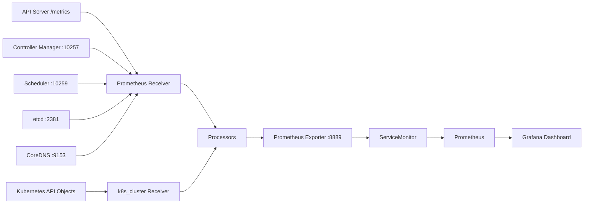

# OpenTelemetry × Grafana in Practice: Observing the Kubernetes Control Plane and Cluster State

Kubernetes' API Server, Scheduler, Controller Manager, etcd, and CoreDNS all expose Prometheus metrics. When Prometheus and Grafana are already in place, you can still insert an OpenTelemetry Collector between them: it centralizes scattered scrape targets, cluster object state, resource attributes, filtering rules, and label governance into a single versionable telemetry pipeline.

This article uses an existing Kubernetes 1.30 cluster with Prometheus Operator and Grafana for hands-on testing. The final pipeline is as follows:




Two pipelines need to be distinguished here: Prometheus metrics describe overall trends over a period of time, while traces record the call process composed of multiple Spans within a single request. Capturing `/metrics` does not mean you have Spans; the application or Kubernetes component must actually send OTLP traces before the request waterfall can be reconstructed in Tempo.

The full manifest and importable Dashboards are located at [`examples/opentelemetry-kubernetes-components`](https://github.com/runzhliu/aik8s/tree/main/examples/opentelemetry-kubernetes-components).

## 1. What This Pipeline Solves

The OpenTelemetry Collector here handles four tasks:

| Task | Approach | Benefit |
| --- | --- | --- |
| Unified collection | Prometheus receiver scrapes the control plane and DNS; `k8s_cluster` receiver reads object state | One configuration describes all inputs |
| Unified identity | Writes resource attributes such as `cluster.name` and `telemetry.pipeline` | More stable multi-cluster queries and attribution |
| Unified governance | Pre-scrape allowlist, in-pipeline label aggregation, memory limits, and batching | Controls metric volume and Collector jitter |
| Unified egress | Prometheus exporter exposes `/metrics`, ServiceMonitor hands off to existing Prometheus | Preserves PromQL, alerts, and the Grafana ecosystem |

Prometheus continues to handle storage, querying, and alerting after scraping; Grafana handles visualization. The Collector turns collection and processing policy into a portable pipeline, and OTLP, Remote Write, or other exporters can be added later.

## 2. Which Components Were Covered in Testing

| Data source | Integration method | Key metrics | Typical issues |
| --- | --- | --- | --- |
| API Server | HTTPS `/metrics` + ServiceAccount Token | Request volume, P95, inflight, APF queueing and rejection | Whether the API is slow or rate-limited |
| Controller Manager | HTTPS `10257` + Token | leader, workqueue, REST Client | Whether controllers are backed up |
| Scheduler | HTTPS `10259` + Token | pending queue, attempt, P95 | Why Pods wait, whether scheduling is slow |
| etcd | HTTP metrics listener | leader, proposal, WAL fsync, DB size | Whether consensus and disk are abnormal |
| CoreDNS | Service `9153` | QPS, rcode, request latency, cache | Whether service discovery errors or slows down |
| Kubernetes objects | `k8s_cluster` receiver | Node Condition, Pod Phase, Deployment replicas | Whether cluster state deviates from desired state |
| Collector itself | Collector `8888` | accepted/refused/failed points, RSS | Whether the observability pipeline itself is healthy |

All six scrape targets succeeded in this round, and the Collector Pod had no restarts. Below is the actual test page from Grafana in the light theme; the screenshot has removed addresses, cluster names, and user information:


The state snapshot at the time of the screenshot is as follows. It is used to prove that the pipeline and queries actually work and does not represent a capacity baseline for other clusters.

| Item | Test snapshot |
| --- | ---: |
| OTel scrape targets | 6 / 6 online |
| Ready Nodes | 11 |
| API Server request rate | approximately 57 req/s |
| etcd leader | 1 |
| Scheduler unschedulable queue | 2 |
| Deployment desired / available | 105 / 104 |
| Pod Pending / Running | 11 / 249 |
| `otel_k8s_*` active series | 7,338 |
| Collector `/metrics` text size | approximately 2.15 MB |
| Collector CPU / memory | approximately 25m / 298 MiB |

Putting cluster objects and Collector self-monitoring on the same page makes it possible to promptly detect silent failures such as "the dashboard still has data, but the collection pipeline has already dropped points":


## 3. Confirm the Metric Entry Points First

Whether component metrics are reachable from the Pod network is determined by the Kubernetes distribution and control plane startup parameters. Before deploying the Collector, confirm the listen address, protocol, authentication, and certificates one by one.

### 3.1 API Server

The API Server's `/metrics` goes through authentication and authorization. The Collector uses the ServiceAccount Token and CA mounted into the Pod:

```yaml
- job_name: otel-kube-apiserver
  scheme: https
  bearer_token_file: /var/run/secrets/kubernetes.io/serviceaccount/token
  tls_config:
    ca_file: /var/run/secrets/kubernetes.io/serviceaccount/ca.crt
    server_name: kubernetes
  static_configs:
    - targets: ["kubernetes.default.svc.cluster.local:443"]
```

The ClusterRole also needs non-resource URL permissions:

```yaml
- nonResourceURLs: ["/metrics"]
  verbs: ["get"]
```

Giving only `pods` and `nodes` `get/list/watch` permissions is not enough to read this non-resource path.

### 3.2 Controller Manager and Scheduler

Modern kubeadm clusters often expose metrics through the HTTPS endpoints of `10257` and `10259` and require a Bearer Token. In the test environment, these two ports on the nodes were reachable from the Pod network:

```yaml
- job_name: otel-kube-scheduler
  scheme: https
  bearer_token_file: /var/run/secrets/kubernetes.io/serviceaccount/token
  tls_config:
    insecure_skip_verify: true
  static_configs:
    - targets: ["${env:CONTROL_PLANE_IP}:10259"]
```

The example skips server certificate verification for easier cross-distribution demonstration. In production, mount the correct CA, verify the server certificate, and restrict source ranges with NetworkPolicy and node firewalls.

### 3.3 etcd

The etcd metrics listener may use a separate `2381` HTTP port, or it may not be open to the Pod network at all. Once the port is exposed, only monitoring components should be allowed to access it. Business Namespaces should not connect directly to the etcd port on control plane nodes.

### 3.4 CoreDNS

CoreDNS usually exposes metrics on `:9153`. First verify the actual Service name and port:

```bash
kubectl -n kube-system get service kube-dns -o yaml
kubectl -n kube-system get configmap coredns -o yaml
```

## 4. Use Two Receivers to Cover Components and Objects

The Prometheus receiver is responsible for scraping existing `/metrics` endpoints. The `k8s_cluster` receiver reads the Kubernetes API through informers and generates cluster state metrics such as Node Condition, Pod Phase, and Deployment desired/available.

The `k8s_cluster` receiver should run as a single instance. Multiple identical replicas will produce duplicate metrics for the same set of cluster objects. For high availability, leader election or an active/standby approach can be used to keep one effective collector.

Key configuration is as follows:

```yaml
receivers:
  k8s_cluster:
    auth_type: serviceAccount
    collection_interval: 30s
    node_conditions_to_report:
      - Ready
      - MemoryPressure
      - DiskPressure
      - PIDPressure

  prometheus/control-plane:
    config:
      global:
        scrape_interval: 30s
        scrape_timeout: 15s
      scrape_configs:
        # API Server、Controller Manager、Scheduler、etcd、CoreDNS
```

Node, Pod, and Container CPU, memory, network, and filesystem usage belong to kubelet resource statistics. In production, an `kubeletstats` receiver DaemonSet is typically deployed on each node, with results forwarded to a Gateway or Prometheus.

## 5. Metric Allowlisting Only Solves Half the Problem

The first version of the configuration already used `metric_relabel_configs` to keep only the metrics needed by the dashboard, but the Collector `/metrics` still reached **30,760,596 bytes**. The main source was the label combinations of `verb`, `resource`, `subresource`, `scope`, `component`, etc. in the API Server histograms.

Filtering metric names alone does not limit how many time series a single metric can combine into. The second version used `metrics_transform` aggregation in the Collector to retain dimensions:

```yaml
processors:
  metrics_transform/reduce-cardinality:
    transforms:
      - include: apiserver_request_duration_seconds
        action: update
        operations:
          - action: aggregate_labels
            label_set: [verb]
            aggregation_type: sum

      - include: apiserver_request_total
        action: update
        operations:
          - action: aggregate_labels
            label_set: [verb, code]
            aggregation_type: sum
```

After optimization, the `/metrics` was **2,146,284 bytes**, a reduction of approximately **93%**, while retaining the `verb`, `code`, `priority_level`, `reason`, `result`, and `rcode` dimensions needed by the current dashboard.


This optimization has a clear cost: labels such as `resource` and `subresource` that were aggregated away can no longer be used for fine-grained troubleshooting. The production strategy should be derived backward from the retained Dashboards, Recording Rules, Alert Rules, and troubleshooting queries: list the requirements first, then remove labels.

Monitor at least the following four categories of metrics:

```promql
count({__name__=~"otel_k8s_.*"})

rate(otel_k8s_otelcol_receiver_accepted_metric_points_total[5m])

rate(otel_k8s_otelcol_receiver_refused_metric_points_total[5m])

rate(otel_k8s_otelcol_exporter_send_failed_metric_points_total[5m])
```

## 6. How to Set Collector Memory Protection

The Collector was initially configured in this round as follows:

```yaml
memory_limiter:
  limit_mib: 384
  spike_limit_mib: 96
```

Its soft threshold is equivalent to 288 MiB. When control plane histograms arrived in batches, forced GC appeared frequently in the logs. After the first adjustment to `limit_mib: 512` and `spike_limit_mib: 128`, the soft threshold became 384 MiB, but transient memory before batch conversion still reached 390–411 MiB; GC frequency decreased but did not disappear. After the second calibration, the following was used:

```yaml
memory_limiter:
  check_interval: 1s
  limit_mib: 640
  spike_limit_mib: 128

resources:
  requests:
    cpu: 100m
    memory: 384Mi
  limits:
    cpu: 500m
    memory: 1Gi
```

These numbers are the starting point for the current cluster. The actual configuration should be based on capacity testing that accounts for scrape interval, histogram bucket count, active series, batch size, Exporter blocking time, and peak RSS, and the memory limiter's hard limit should be set below the container memory limit, leaving headroom for the Go runtime and non-managed memory.

In the first three-minute observation window after the second rolling update, the Pod maintained 0 restarts and the logs no longer showed memory limiter forced GC. This window is sufficient to validate the adjustment direction, but the formal capacity baseline should still observe a full business cycle and use P95/P99 RSS and dropped-point metrics to determine resource headroom.

## 7. Integrating with Existing Prometheus

The Prometheus exporter adds a unified prefix to metrics and projects only the necessary resource labels:

```yaml
exporters:
  prometheus:
    endpoint: 0.0.0.0:8889
    namespace: otel_k8s
    enable_open_metrics: true
    without_scope_info: true
    resource_constant_labels:
      included:
        - cluster.name
        - telemetry.pipeline
        - k8s.*
```

Whether the ServiceMonitor takes effect depends on the `serviceMonitorSelector` of the Prometheus CR. First check the selector, then make the ServiceMonitor's labels match it:

```bash
kubectl -n monitoring get prometheus -o yaml \
  | sed -n '/serviceMonitorSelector:/,/podMonitorSelector:/p'
```

```yaml
apiVersion: monitoring.coreos.com/v1
kind: ServiceMonitor
metadata:
  labels:
    release: kube-prometheus-stack
spec:
  selector:
    matchLabels:
      app.kubernetes.io/name: otel-k8s-components
  endpoints:
    - port: prometheus
      interval: 30s
      scrapeTimeout: 15s
      honorLabels: true
```

The ServiceMonitor object being created successfully does not mean Prometheus has already selected and scraped it. During acceptance testing, also check the Prometheus Targets and query:

```promql
max by (job) (
  otel_k8s_up{
    telemetry_pipeline="otel-k8s-components",
    job=~"otel-kube-.*|otel-etcd|otel-coredns|otel-collector-self"
  }
)
```

## 8. How to Read the Grafana Dashboard

The public example provides two Dashboards: `grafana-dashboard.json` is the 16-panel metrics version; `grafana-observability-dashboard.json` is the 20-panel Prometheus + Tempo combined version. The latter adds key status, recent traces, failed traces, and slow traces at the top, and clicking a record continues to the Tempo waterfall view. When importing the combined version, select the Prometheus and Tempo data sources separately.

The viewing order can follow "collection pipeline—trace search—control plane entry—scheduling and control loops—storage and DNS—Collector itself."

Below is a screenshot of the combined Dashboard in the Grafana light theme from the test environment. The three tables at the top come directly from Tempo TraceQL queries; the curves at the bottom come from Prometheus; the red dashed annotations mark the start and end of the controlled load. The screenshot hides addresses and cluster identifiers, and the traces are demo data generated for this article.


### First Row: Whether the Collection Pipeline Is Established

- **OTel collection tasks online**: aggregated across the six target categories via `up`; if fewer than expected, first check protocol, port, token, and certificate.
- **Ready nodes**: sourced from the `k8s_cluster` receiver; it reflects Node Conditions and is not equivalent to all workloads being healthy.
- **API Server QPS**: total request rate over a five-minute window, used to identify traffic spikes.
- **etcd Leader**: should remain stable at 1; if leader is lost, immediately investigate etcd and control-plane logs together.

### API Server and APF

```promql
sum by (verb) (
  rate(otel_k8s_apiserver_request_total{telemetry_pipeline="otel-k8s-components"}[5m])
)
```

The P95 query excludes `WATCH` and `CONNECT`. The duration semantics of these two long-lived connection types differ from ordinary REST requests; mixing them into the same latency chart inflates the vertical axis and masks changes in GET, LIST, CREATE, and other requests.

```promql
histogram_quantile(
  0.95,
  sum by (le, verb) (
    rate(otel_k8s_apiserver_request_duration_seconds_bucket{
      telemetry_pipeline="otel-k8s-components",
      verb!~"WATCH|CONNECT"
    }[5m])
  )
)
```

The APF panel observes `current_inqueue_requests` and `rejected_requests_total`. A continuously rising queue indicates insufficient execution seats for certain PriorityLevels; growing Reject counts should be checked together with FlowSchema, PriorityLevelConfiguration, and client retry behavior.


In the figure, the current APF queue depth is 0, which only means no requests were waiting for a seat at the sampling moment. It does not prove APF never throttled; you must also observe the increment of `rejected_requests_total`, in-flight requests, seats per PriorityLevel, and client retries.

### Scheduler and Controller Manager

The Scheduler panel expands `pending_pods` by queue and shows the scheduling attempt P95. When `unschedulable` remains non-zero, proceed to investigate Pod Events, resource requests, affinity, taints, PVCs, Gang, or queue quotas.

The Controller Manager workqueue depth uses a Top 10 view to show the controllers with the largest backlog. Queue depth, add rate, and processing latency should be analyzed together; an instantaneous depth value alone cannot distinguish short-lived jitter from a sustained processing capacity shortfall.


### etcd, CoreDNS, and Collector Self-Monitoring

- etcd: focus on leader, pending/failed proposals, WAL fsync, and backend commit;
- CoreDNS: focus on total QPS, error rcodes such as SERVFAIL, latency, and cache hit rate;
- Collector: focus on accepted, refused, and send_failed points plus RSS, to avoid silent data loss in the observability pipeline.


### Validating Charts with Controlled Load

A flat curve during steady state only proves "data exists"; it is hard to demonstrate that queries, units, and aggregations remain correct under change. In this round, 30 schedulable lightweight Pods and 30 intentionally unschedulable lightweight Pods were created in a dedicated namespace, while 4 concurrent processes continuously read the API Server for 240 seconds. The 4 processes completed 4,478 requests in total, with 0 failures.

| Metric | Before load | Peak during load | Observation |
| --- | ---: | ---: | --- |
| API Server QPS | 55.7 req/s | 85.4 req/s | Increased by approximately 53.3% |
| API Server P95 | — | 75.7 ms | No second-level long tail observed |
| Scheduler unschedulable queue | 2 | 32 | Aligned with the 30 intentionally Pending Pods |
| APF current queue depth | 0 | 0 | No requests waiting for execution seats |
| APF Reject increment | 0 | 0 | No flow-control rejection triggered |
| Collector RSS | — | 754 MiB | Collection pipeline remained operational |


This data shows the load intensity was sufficient to produce identifiable step changes in the API Server and Scheduler, while staying below the APF throttling threshold. The Dashboard marks the start and end times using the `otel-loadtest` annotation, making it easy to align changes with the experiment window. After the experiment, the test namespace was fully deleted; no APF, etcd, or control-plane startup parameters were adjusted throughout.

## 9. How to Read Spans: Reconstructing a Request with Tempo

To validate the trace pipeline, the experiment sent 60 groups of publish requests to the Collector's OTLP/HTTP endpoint, each group containing one Root Span and multiple child spans, which the Collector then wrote to Tempo via OTLP/gRPC. Successful requests covered manifest validation, Kubernetes API calls, waiting for Deployment Ready, and readiness checks; failed requests recorded the error status on the Kubernetes API child span while preserving the Root Span's failure status.

| Item | Actual configuration |
| --- | --- |
| OpenTelemetry Collector | 0.160.0, OTLP/HTTP receiver, OTLP/gRPC exporter |
| Tempo | 3.0.3, single instance, 10 GiB PVC |
| Grafana | 13.1.2, Tempo data source health check passed |
| Demo data | 60 traces; 8 failed, 42 exceeded 500 ms duration |

The figure below is generated from real Trace data returned by Tempo, with trace IDs, span IDs, and environment identifiers removed; it preserves the actual parent-child relationships, start times, durations, and error states.


### 9.1 What Trace, Span, and Waterfall Charts Are

- **Trace** is one end-to-end request; the entire chain shares the same `trace_id`;
- **Span** is one step within it; each segment has its own `span_id`, start time, duration, status, and attributes;
- **Parent-child relationships** are connected via `parent_span_id` and describe who called whom;
- **Horizontal position in the waterfall** indicates when the step started, and bar length indicates duration; overlapping bars suggest steps may have run in parallel.

When troubleshooting, first look at the Root Span's total duration, then follow the critical path to find the longest child span. When a request fails, first open the red or `ERROR` span and inspect status, events, and attributes; then correlate API Server, Scheduler, application logs, and resource metrics from the same time window. A slow Root Span does not mean every child span is slow; the cumulative time of multiple serial child spans and gaps not covered by instrumentation can also constitute the dominant latency.

### 9.2 Querying Spans in Grafana Explore

After configuring the Tempo data source in Grafana, enter **Explore** and select Tempo. The three TraceQL queries below retrieve all requests, failed requests, and slow requests for the demo service:

```traceql
{ resource.service.name = "otel-k8s-span-demo" }
{ resource.service.name = "otel-k8s-span-demo" && status = error }
{ resource.service.name = "otel-k8s-span-demo" && duration > 300ms }
```

After opening a trace from the search results, check in order:

1. The Root Span's total duration and final status;
2. The slowest or erroring child span;
3. The span's `kind`, operation, HTTP status code, and Kubernetes resource attributes;
4. Whether the event timeline contains retries, timeouts, or exceptions;
5. Metrics and Logs from the same time window.

The `send-demo-traces.py` in the public example uses only the Python standard library, making it easy to reproduce this set of parent-child spans. It is meant to illustrate how to read traces, not to impersonate native kube-apiserver spans.

### 9.3 Why the API Server Does Not Yet Have Spans

What the earlier part of this article captured is the kube-apiserver `/metrics`. To make kube-apiserver produce native spans, tracing must be enabled via `--tracing-config-file`. Kubernetes 1.30 can use the following configuration, starting with a 1% sampling rate:

```yaml
apiVersion: apiserver.config.k8s.io/v1alpha1
kind: TracingConfiguration
endpoint: 127.0.0.1:4317
samplingRatePerMillion: 10000
```

For kubeadm-managed static Pods, you can create `/etc/kubernetes/tracing/tracing-config.yaml` on each control-plane node, then modify `/etc/kubernetes/manifests/kube-apiserver.yaml`:

```yaml
spec:
  containers:
    - name: kube-apiserver
      command:
        - kube-apiserver
        - --tracing-config-file=/etc/kubernetes/tracing/tracing-config.yaml
      volumeMounts:
        - name: tracing-config
          mountPath: /etc/kubernetes/tracing
          readOnly: true
  volumes:
    - name: tracing-config
      hostPath:
        path: /etc/kubernetes/tracing
        type: DirectoryOrCreate
```

`127.0.0.1:4317` requires a host-network OTel Agent on the same control-plane node to receive OTLP/gRPC, which the Agent then forwards to an in-cluster Gateway or Tempo. This avoids depending on cluster DNS for static Pods and prevents exposing an unauthenticated OTLP receive port to a broader network. Multi-control-plane clusters require configuring the Agent and kube-apiserver on each node individually.

Changes to the static Pod manifest trigger kubelet to recreate kube-apiserver. Before making formal changes, validate the configuration API with the corresponding version's binary, confirm the local Agent is listening and the backend is writable, and keep the original manifest. To roll back, remove `--tracing-config-file`, the volumeMount, and the volume. Do not set the sampling rate directly to `1000000`; increase it gradually based on API QPS, span size, Tempo write volume, and retention period.

The configuration API in Kubernetes' current documentation has been upgraded to `apiserver.config.k8s.io/v1`; older versions cannot directly copy examples from newer versions. The v1alpha1 example in this article targets Kubernetes 1.30; after a cluster upgrade, re-validate against the target version.

## 10. Deployment Approach for Multi-Control-Plane Clusters

A single-control-plane environment can schedule one Collector onto the control-plane node and scrape the local control-plane endpoints via `status.hostIP`. Multi-control-plane environments must consider two categories of data separately:

| Data | Recommended instance count | Reason |
| --- | ---: | --- |
| `k8s_cluster` cluster object state | 1 active instance | Multiple instances would duplicate the same set of object metrics |
| API Server / Controller / Scheduler / etcd component metrics | Every component instance must be covered | A single endpoint cannot represent the remaining control-plane nodes |
| kubeletstats node resource metrics | 1 Agent per node | kubelet metrics are node-local data |

A viable architecture is "one cluster-state Deployment + one control-plane DaemonSet + one all-node DaemonSet." Each Collector type uses a different `telemetry.pipeline`; Prometheus retains `instance`, `node`, and `cluster.name`, then forms a cluster-level view through Recording Rules.

## 11. Recommended Additional Alerts

| Alert | Starting condition | Description |
| --- | --- | --- |
| OTel target down | `max by(job)(otel_k8s_up) == 0` sustained for 5m | Alert per job to avoid aggregate values masking single-point failures |
| Collector refused | refused points rate greater than 0 | Commonly caused by memory pressure or downstream blocking |
| Collector send failure | send failed points rate greater than 0 | Investigate together with Prometheus scrape and exporter logs |
| API P95 slowdown | Non-WATCH/CONNECT P95 exceeds baseline | Set thresholds per verb |
| APF queueing or rejection | inqueue growing continuously or reject growing | Group by priority level |
| Scheduler backlog | unschedulable consistently above baseline | Investigate together with Pending Pod reasons |
| etcd leader anomaly | leader not equal to 1 | High-priority control-plane alert |
| CoreDNS errors | Error rate such as SERVFAIL exceeds baseline | Investigate together with upstream DNS and network |

Thresholds should be calibrated using each cluster's historical percentiles and error budgets; the conditions in the table only indicate the alert direction.

## 12. Production Readiness Checklist

- Restrict network access to the metrics ports of API Server, Controller Manager, Scheduler, and etcd to the minimum required scope;
- Validate certificates with the correct CA and avoid retaining `insecure_skip_verify` long-term;
- Pin the Collector image version and check receiver, processor, and metric naming changes before upgrading;
- Keep only one active instance of `k8s_cluster`, and ensure multi-control-plane collection targets fully cover all nodes;
- Use `metric_relabel_configs` to control metric names and `metrics_transform` to control label dimensions;
- Record active series, per-scrape size, scrape duration, Collector RSS, and dropped-point metrics;
- Grafana Panels should use explicit units, windows, groupings, and aggregation methods;
- A healthy Dashboard only confirms the presentation layer passes; still check Prometheus Targets, Collector logs, and raw queries;
- Configuration changes should go through Git management, retaining before/after evidence of series counts and resource consumption.

## References

- [OpenTelemetry Collector on Kubernetes](https://opentelemetry.io/docs/platforms/kubernetes/collector/)
- [OpenTelemetry Collector Prometheus Receiver](https://github.com/open-telemetry/opentelemetry-collector-contrib/tree/main/receiver/prometheusreceiver)
- [OpenTelemetry Collector Kubernetes Cluster Receiver](https://github.com/open-telemetry/opentelemetry-collector-contrib/tree/main/receiver/k8sclusterreceiver)
- [OpenTelemetry Collector Kubelet Stats Receiver](https://github.com/open-telemetry/opentelemetry-collector-contrib/tree/main/receiver/kubeletstatsreceiver)
- [OpenTelemetry Collector Metrics Transform Processor](https://github.com/open-telemetry/opentelemetry-collector-contrib/tree/main/processor/metricstransformprocessor)
- [Grafana Dashboards](https://grafana.com/docs/grafana/latest/dashboards/)
- [Kubernetes System Component Traces](https://kubernetes.io/docs/concepts/cluster-administration/system-traces/)
- [Grafana Tempo: TraceQL](https://grafana.com/docs/tempo/latest/traceql/)
- [Grafana Tempo deployment modes](https://grafana.com/docs/tempo/latest/set-up-for-tracing/setup-tempo/deploy/)
