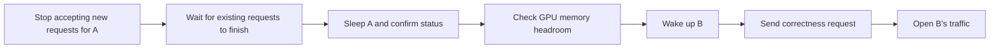

# vLLM Sleep Single-GPU Dual-Model Field Test: Recovery Time, GPU Memory, and DRA Design

Enterprises often have models that are used daily, but requests are separated by minutes or even hours. When there are no requests, GPU compute utilization may be very low, yet the weights and allocated KV Cache still occupy GPU memory. If the model process is stopped to free up space, the next time requires waiting for engine initialization and weight loading.

vLLM Sleep Mode allows a model to enter sleep: the process remains, and most GPU memory is temporarily released. Wake Up then restores the engine. This lets other tasks use idle periods and lets the original model return to a serviceable state faster on next use.

This time, a single L20 runs Qwen3.8-27B-FP8 and Qwen3-1.7B to answer three questions: whether the GPU memory after sleep is sufficient to hand over to another model, how much faster wake-up is compared to process restart, and whether short-term throughput changes after recovery. The DRA section discusses device sharing design; the actual experiment uses two independent engines in the same container.

For the 27B model, the Level 1 recovery to first token median is **1.86 seconds**, while process restart under the same Pod cache condition is **55.63 seconds**. All 19 model handovers succeeded, and C4 output throughput before and after recovery was 92.64 and 92.68 tok/s, respectively.

## Where the Benefits of Sleep/Wake Specifically Land

### About 54 Seconds Less Waiting on Next Use

Suppose an internal Q&A model has just finished a request and then needs to hand the GPU to another task. If the model process is terminated directly, the next Q&A requires restarting the engine; Level 1 sleep keeps the weights in CPU memory and then moves them back to the GPU.

In this round, the two recovery paths for the 27B model took 55.63 seconds and 1.86 seconds, respectively, a difference of about **53.77 seconds**. For users, the model preparation wait that was nearly a minute is reduced to about two seconds. This is the difference in time to first token for a short answer; long prompts also add prefill time. If another task is still using the GPU, you must also wait for it to drain and return the GPU memory; the 1.86 seconds does not include this queuing time.

The cost of engine restart is not just reading weight files. Process startup, CUDA environment and memory allocator initialization, execution graph preparation, etc., also take time. Sleep retains the initialized process, allowing reuse of preparation results such as compilation and CUDA Graphs; Level 1 also avoids restoring weights from model files again. This round did not separately measure the time of these steps; 53.77 seconds is the measured difference of the full recovery path. [vLLM official explanation of initialization overhead](https://vllm.ai/blog/2025-10-26-sleep-mode)

### About 32 GiB of GPU Memory Can Be Handed to Other Tasks When Idle

After both engines are initialized, when A is awake and B is asleep, the entire card uses about 33.05 GiB of GPU memory; when both are asleep, it is about 1.03 GiB. This state change frees about **32.02 GiB**, approximately **96.9%** of the original usage. This includes weights and cache space; the difference cannot be entirely attributed to weight size.

These spaces give other models the opportunity to run on the same card. In this round, after A hands over GPU memory and B is awakened, and B returns it after use, the measured A→B and B→A time to first token are 1.82 seconds and 2.26 seconds, respectively. Therefore, a sleeping model can both retain the ability to recover quickly and yield GPU memory when idle.

Deployment benefits depend on whether the freed space is actually utilized. If no other task takes over after sleep, the card is still allocated to the original Pod, and billing based on the entire card does not automatically decrease because GPU memory usage drops. Only when device sharing, mutual exclusion control, and task orchestration work together can idle periods be converted into more workload, or the number of GPUs that need long-term exclusive use be reduced in capacity planning. This article did not measure billing savings, nor did it prove that this A/B pair must occupy two separate cards.

### Trading CPU Memory for Shorter Recovery Wait

Level 1 keeps a full weight backup in host memory. It is suitable for models that will be used again later, provided CPU memory is sufficient. Level 2 does not retain a full weight copy; recovery requires reloading weights. In this round, the 27B model recovered in 14.91 seconds, slower than Level 1 but still shorter than the 55.63 seconds for process restart.

| How idle models are handled | What is retained when idle | Cost of next use |
| --- | --- | --- |
| Always awake | Engine, GPU weights and cache space | Can directly receive generation requests; GPU memory always occupied |
| Stop model process | Model files; engine needs to be rebuilt | Restart, initialize, load weights, and prepare execution |
| Level 1 sleep | Initialized engine, CPU weight copy | Move weights back and restore cache space; host memory usage increases |
| Level 2 sleep | Initialized engine and some buffers | Reload weights and restore cache space; reduces host memory needed for weight backup |

After recovery, C4 throughput remains about 92.6 tok/s. This result supports that short-term performance after recovery does not significantly degrade; the direct benefits of Sleep are reflected in GPU memory reuse and preparation wait. This round did not observe a significant improvement in sustained decoding speed.

## Measured Results

### How Much Time Recovery Saves Compared to Restart

| Model | First start to first token | Process restart under cache condition | Level 1 recovery to first token | Level 2 reload to first token |
| --- | ---: | ---: | ---: | ---: |
| Qwen3.8-27B-FP8 | 219.20 s | 55.63 s | 1.86 s | 14.91 s |
| Qwen3-1.7B | 84.06 s | 36.05 s | 0.24 s | 2.17 s |

First start is listed separately; process restart under cache condition is the median of 2 runs. Level 1 is the median of 5 runs per model, Level 2 is the median of 3 runs per model. Recovery is measured to the first valid content token, including the correctness request after recovery, not just the HTTP control interface return.

Also consider the "first sleep" separately: the 27B model's first Level 1 sleep took **18.47 seconds**, and the subsequent four took 1.33–1.34 seconds; the 1.7B model's first took 2.07 seconds, and the subsequent four took 0.17–0.19 seconds. This round did not separately analyze host memory allocation and transfer overhead, so the numbers for subsequent switches cannot replace the cost of the first sleep.


### How GPU Memory Changes During Alternating Operation

| Handover direction | Count | Median time to first token | Min–max |
| --- | ---: | ---: | ---: |
| A→B | 10 | 1.82 s | 1.78—2.18 s |
| B→A | 9 | 2.26 s | 2.23—2.28 s |

There were 19 real model handovers, all 19 successful; the first activation from the dual-sleep state is measured separately and not included in the direction statistics.

After both engines are initialized, physical GPU memory is about **33.05 GiB** when A is running, about **8.31 GiB** when B is running, and about **1.03 GiB** remains when both are asleep. Sleep releases most of the weights and cache space, but the process and CUDA environment still exist, so GPU memory does not go to zero.

This set of models did not have a control for simultaneous wake-up or concurrent coexistence. Based on independent measurements, the combined GPU memory requirements of the two models may still be within the L20 capacity, but actual coexistence would require adjusting and verifying the initialization budget. This article validates warm standby recovery and mutually exclusive handover; it cannot be used to conclude that this set of models must rely on Sleep to deploy, or that serial switching is more cost-effective than parallel coexistence.


The GPU memory in the figure is the total usage of this physical GPU, showing the changes between about 33 GiB and 8 GiB during alternating wake-ups of A and B, as well as the trough when both are asleep. The curve is queried with a fixed historical window; Prometheus collects every 2 seconds, so extremely short switching troughs may fall between two sampling points.

### Short-Term Throughput After Recovery

| Model | Phase | Concurrency | Complete streams / planned | Output throughput tok/s | P95 TTFT ms | P95 TPOT ms |
| --- | --- | ---: | ---: | ---: | ---: | ---: |
| A | Before recovery | 1 | 16/16 | 25.35 | 125.97 | 38.96 |
| A | Before recovery | 4 | 16/16 | 92.64 | 240.95 | 41.93 |
| A | After Level 1 recovery | 1 | 16/16 | 25.35 | 124.43 | 38.96 |
| A | After Level 1 recovery | 4 | 16/16 | 92.68 | 227.02 | 41.93 |
| B | Before recovery | 1 | 16/16 | 175.85 | 19.66 | 5.58 |
| B | Before recovery | 4 | 16/16 | 655.61 | 34.65 | 5.89 |
| B | After Level 1 recovery | 1 | 16/16 | 175.89 | 19.19 | 5.57 |
| B | After Level 1 recovery | 4 | 16/16 | 657.60 | 39.30 | 5.88 |

Each phase and concurrency configuration is 8 requests × 2 rounds. Throughput is the median of the two rounds; P95 is calculated from the combined successful requests of these two rounds. This load has very short input and fixed output of 128 tokens, so it cannot be used to infer long-context or long-running performance.


In the figure, blue is A, orange is B; solid lines are before recovery, dashed lines are after recovery. The curve records the throughput Gauge of the most recently completed round; a flat segment indicates the reading has not yet been updated, not an instantaneous decoding rate.


This figure uses the client histogram's `sum/count` to calculate a one-minute sliding average, selecting only C4 performance requests. The mean in the figure differs from the whole-round P95 in the table; the two models form two curve segments before and after recovery. Model A's performance prompt is 26 tokens, and model B's is 25 tokens.

Per-request records total 170, with 170 complete streams successful and 0 failures. The public [statistics](../../assets/practices/vllm-sleep-l20/benchmark-summary.json) retain sample size, scope, configuration, statistical methods, and unexecuted items.

## What Sleep Mode Retains

vLLM's Sleep Mode lets the engine temporarily release most GPU memory while the serving process remains. When the model is used again, the already-initialized engine can be restored, reducing the overhead of re-establishing the execution environment.

| Method | Weights | KV Cache | Recovery path |
| --- | --- | --- | --- |
| Level 1 | Moved to CPU memory | Content discarded | Restore weights from CPU and reallocate cache |
| Level 2 | Content discarded; some model buffers retained | Content discarded | Allocate weight space, reload weights, restore cache |
| Serving process restart | Reloaded | Re-established | Start process, initialize engine, load weights, and prepare execution |

Level 1 is suitable for models that will continue to use the same weights later; Level 2 is suitable for scenarios where old weights do not need to be retained or host memory is insufficient. The latter requires explicitly reloading weights. In this experiment, Level 2 recovery still uses the original model; the alternating operation of models A/B is done by two independent engines. [vLLM 0.31.0 Sleep Mode](https://docs.vllm.ai/en/v0.31.0/features/sleep_mode/)

The KV Cache content of the original request is not restored upon wake-up. Even if a conversation retains history at the application layer, the next request still needs to reprocess the required context. Therefore, "producing a short answer quickly" and "low cost of restoring a long conversation" need to be measured separately.

## How Measurement Avoids Confusion

This time, only one L20 is requested, and the two vLLM processes are in the same container. First, complete A's independent tests, then put A to sleep; then initialize and test B, and finally let the two initialized engines alternately use GPU memory. Other workloads exist on the node, and CPU and shared storage are not exclusive.

| Item | Configuration |
| --- | --- |
| Runtime | vLLM 0.31.0, CUDA 13.0, PyTorch 2.13.0+cu130 |
| GPU | Single NVIDIA L20, driver 580.173.02, NVML reports total GPU memory 46,068 MiB |
| Model A | Qwen3.8-27B-FP8, text-only path |
| Model B | Qwen3-1.7B, BF16 |
| Parallelism and window | TP=1, serving context 4,096 tokens, up to 4 running requests |
| Cache budget | Fixed 4 GiB per engine, Prefix Cache disabled |
| Execution | Default compilation and CUDA Graph retained; enforce-eager not used |
| Requests | temperature=0, thinking disabled, SSE streaming returns usage |
| Baseline | 1 first start per model, 2 process restarts within the same Pod; recorded separately |
| Sleep recovery | Level 1 5 times per model, Level 2 3 times per model |
| Short-term load test | C1/C4 before and after recovery; 8 requests × 2 rounds per configuration, fixed output 128 tokens |
| Alternating operation | 20 activation events, of which the 1st is the initial activation after both models are asleep, followed by 19 model handovers |

Fixing the KV Cache capacity is a key condition. Automatically deriving the budget from the current "remaining GPU memory" would give different capacities to B, which starts later, and A, which starts first. With a fixed budget, the before-and-after sleep comparison of the two engines is easier to interpret; this also means this article does not test the maximum capacity of large-context serving.

The correctness request is:

```text
只回答一个数字，不要解释：3 加 4 等于多少？
```

It must fully receive the content `7`, the end marker `[DONE]`, and valid token usage to pass. The performance request is:

```text
用中文简要解释 Kubernetes 的 Pod 和 Deployment 的关系。
```

The performance request uses `ignore_eos=true`, forcing 128 output tokens to fix the workload rather than evaluate answer quality. It is a performance sample with short input, short output, closed-loop fixed concurrency, and does not include open arrival rates, long prompts, tool calls, or generation quality scoring.

Timing distinguishes three boundaries:

- **Wake-up API duration**: from initiating the recovery call to recovery completion. Level 2 includes weight reloading.
- **Recovery to first token**: recovery call duration plus the TTFT (Time to First Token) of the immediately following correctness request; timing does not include the wait during sleep.
- **Handover to first token**: from starting to sleep the current model to the target model recovering and returning the first content segment; includes the cost of the old model releasing GPU memory, state, and GPU memory checks.

Both first start and process restart are measured to the first content segment of the first correctness answer. The restart occurs in the same Pod, the image is already pulled, model files are readable, and compilation cache may also hit; therefore, the restart in the table is not a full cold start of a Kubernetes Pod.

Throughput is the number of successfully output tokens in a round divided by the wall-clock time of that round. TPOT (Time per Output Token) is calculated by dividing the time from the first segment to the last segment by the number of output tokens minus one, and is affected by SSE chunking. Latency P95 uses the nearest-rank method; each performance configuration has only 16 requests, so P95 is close to the maximum sample; the table also retains the success count and the original planned denominator.

## How to Control Alternating Operation on a Single Card

Running state and resource allocation are two separate states. After Sleep succeeds, the Pod quota of `nvidia.com/gpu` is still occupied; Kubernetes does not automatically allocate the entire card to another exclusive GPU Pod just because NVML GPU memory usage drops.

This experiment places A and B in the same container, reusing a single GPU allocation. The switching controller executes in the following order:



In the test, the sleep interface is called only after each round of requests finishes, so in-flight requests are not intentionally interrupted. Production entry points should have independent draining, mutual exclusion, and timeout logic. The current version of the sleep interface defaults to `abort` mode; calling it directly does not equal completing graceful draining.

Failure recovery must also maintain a single owner: when B fails to wake up, confirm that B has returned to a controllable sleep or stopped state before attempting to recover A. Do not blindly retry waking B while A's GPU memory has not yet been released. GPU memory exhaustion, host memory shortage, and controller process crashes must be handled separately.

## Minimal Interface Verification

The following is a single-engine interface example from vLLM 0.31.0; replace the model directory with your own path. When two engines run alternately, draining and switching control must be added on top of this.

```bash
VLLM_SERVER_DEV_MODE=1 vllm serve /models/Qwen3-1.7B \
  --host 127.0.0.1 --port 8000 --served-model-name demo \
  --enable-sleep-mode --tensor-parallel-size 1 \
  --max-model-len 4096 --max-num-seqs 4 \
  --max-num-batched-tokens 4096 \
  --kv-cache-memory-bytes 4294967296 \
  --gpu-memory-utilization 0.85 --no-enable-prefix-caching

# 在途请求结束后，Level 1 休眠和恢复。
curl -X POST 'http://127.0.0.1:8000/sleep?level=1'
curl 'http://127.0.0.1:8000/is_sleeping'
curl -X POST 'http://127.0.0.1:8000/wake_up'

# Level 2 需要重新加载权重；先恢复权重空间，最后恢复缓存。
curl -X POST 'http://127.0.0.1:8000/sleep?level=2'
curl -X POST 'http://127.0.0.1:8000/wake_up?tags=weights'
curl -X POST 'http://127.0.0.1:8000/collective_rpc' \
  -H 'Content-Type: application/json' -d '{"method":"reload_weights"}'
curl -X POST 'http://127.0.0.1:8000/wake_up?tags=kv_cache'
```

After a successful return from the control interface, a real generation request must still be sent. `is_sleeping=false` only indicates that the engine has recovered the corresponding resources; it cannot replace checks of complete output, usage, and answer correctness. When development mode is enabled, these interfaces should be restricted to the trusted control path. [Online interface documentation for the current version](https://docs.vllm.ai/en/v0.31.0/features/sleep_mode/)

## If Further Combined with DRA

DRA (Dynamic Resource Allocation) provides Kubernetes with a device declaration and allocation mechanism; `ResourceClaim` expresses device requests, and `ResourceSlice` describes the device resources published by the driver. It can support device sharing designs, but the engine's sleep state and actual GPU memory usage still need to be managed by the business controller. [Kubernetes DRA](https://kubernetes.io/docs/concepts/resource-management/dynamic-resource-allocation/)

This article completes same-container GPU reuse; the test environment did not enable the DRA API. The following is a deployment design analysis.

| Deployment Method | Can the Same GPU Card Be Shared | What Else Is Needed |
| --- | --- | --- |
| Two exclusive `nvidia.com/gpu: 1` Pods | When the first Pod has not exited, the second Pod cannot obtain the same exclusive allocation via Sleep | Switch to a resource mechanism that supports sharing |
| Two engines in a single container | The approach adopted in this article | Draining, mutual exclusion, GPU memory and host memory protection |
| Multiple Pods jointly referencing the same ResourceClaim | Depends on the device driver and sharing configuration | Verify driver support, unify controller management of active models |
| Different ResourceClaims using consumable capacity | Versions and drivers that support this feature can place multiple requests on the same device | Clarify capacity semantics, admission policy, and runtime protection |

The `ConsumableShares` of the NVIDIA DRA driver is currently an Alpha feature disabled by default, and its guide requires Kubernetes 1.34 or later. It provides scheduling accounting for requested capacity and cannot be treated as runtime hard isolation of GPU memory. When accounting by GPU memory quota, Sleep does not automatically return the original ResourceClaim's quota; to have two large models alternately exceed their respective static shares, additional coordination policy is needed, not merely enabling a single sharing switch. [NVIDIA consumable capacity guide](https://dra-driver-nvidia-gpu.sigs.k8s.io/docs/guides/gpu-allocation/consumable-capacity/)

A design more suitable for verification is: two resident engines obtain device access that permits sharing, and the controller grants a unique "active model" lease; the entry point routes only to the lease owner. DRA is responsible for which Pods can use the device, and the controller is responsible for who may allocate weights and cache at any given moment. When a lease expires, the controller restarts, or a Pod loses connectivity, first verify the actual device processes to avoid two controllers waking two models simultaneously.

## Deployment Recommendations

The deployment can be understood from a scenario where a low-frequency internal Q&A and batch classification share a GPU: after Q&A model A finishes a batch of requests, the entry point waits for an idle window and drains in-flight requests; the controller puts A to sleep, then wakes classification model B. B processes a batch of tasks consecutively, returns GPU memory when finished, and A recovers. When a user temporarily accesses model A while it is asleep, the entry point must trigger a wake-up and make the request wait; it must not send the request directly to an engine that has not yet recovered. This scenario is a deployment design example; no full business scheduling was run in this round.

The longer the batch processing time, the more easily the few seconds of switching cost can be amortized. If A and B requests interleave densely and every request triggers a switch, sleep, data movement, and re-prefill will consume a large amount of time. A production controller should set idle thresholds, minimum residency times, or batch-based switching, and decide whether to share based on the acceptable waiting time of both business types.

The first sleep and first wake-up should be rehearsed separately during launch preparation. In this round, A's first sleep took 18.47 seconds, and only later dropped to approximately 1.34 seconds; the first business handover must not be scheduled using subsequent steady-state switching numbers.

| Business Scenario | Specific Value of Using Sleep | Main Cost or Condition |
| --- | --- | --- |
| Occasionally accessed internal Q&A, evaluation models | Releases GPU memory when idle; reduces re-initialization wait on next access | Accept second-level recovery wait; Level 1 must reserve host memory |
| Multiple models executing alternately by batch or time slot | Reuses the GPU with already initialized engines, amortizing switching cost | Requires a sharing mechanism and unified scheduling; business time slots must not conflict continuously |
| Training and sampling run in phases | Yields inference weights and cache space during non-sampling phases | When updating weights, evaluate Level 2 and the reload process; training was not tested in this round |
| Continuous high QPS, millisecond-level first-response online services | Resident models usually more easily meet latency targets | Sleep benefit is limited; switching wait and cache rebuild may become bottlenecks |

Capacity planning should compute GPU requirements based on the number of models that **must be awake simultaneously** at peak, plus sleep residue and safety margin. Sleep can exploit business off-peak periods, but the capacity demand when business arrives concurrently still exists.

1. **Measure GPU memory peak first, then decide the model combination.** Evaluate by summing the target model's peak at runtime, the residue of other sleeping processes, and a safety margin; do not simply add weight file sizes.
2. **Level 1 must reserve host memory.** Occupancy increases after weights are moved into CPU. Multi-model warm standby must verify container memory limits, node available memory, and OOM risk. The sum of process RSS includes duplicate counting of shared pages; actual Pod capacity should be evaluated in conjunction with cgroup memory readings.
3. **Clarify the recovery target.** Distinguish between "ready to accept requests again," "first token generated," and "full re-prefill of a long conversation completed"; only the first target underestimates user wait time.
4. **Fix the cache budget for each engine.** Avoid initialization order and other processes changing automatic capacity estimation; retain the configuration hash and device state for each switch. Weight recovery depends on host memory and the PCIe path; also check the NUMA placement and memory bandwidth between GPU and CPU; this round did not bind a dedicated CPU set.
5. **Keep development control interfaces on the trusted control path.** The sleep, wake, and collective RPC in this experiment only listen on the loopback address; ordinary service entry points do not expose them.
6. **Design the controller and gateway together.** Request draining, switching locks, wake-up probes, failure rollback, and debouncing are indispensable. Frequent switching turns part of inference time into data movement time.

The value of Sleep lies in preserving engine initialization results, allowing low-frequency models to return to service relatively quickly. Whether it is worthwhile depends on the low-frequency request interval, weight recovery time, CPU memory budget, and cache rebuild cost.

## Interactive Verification

Qwen3-1.7B was connected to an existing chat interface, using real requests to explain the relationship between Pod and Deployment. This sample is independent of the 170 formal requests; it only verifies the interaction path and is not used as a measurement source for throughput or TTFT.


