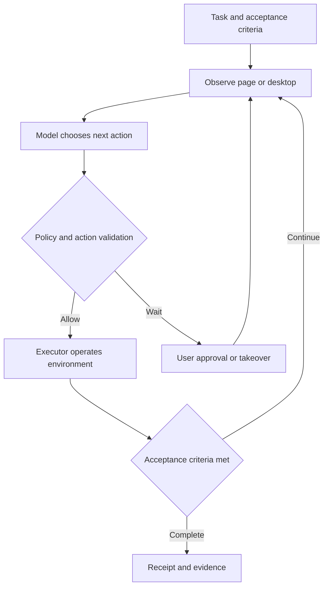
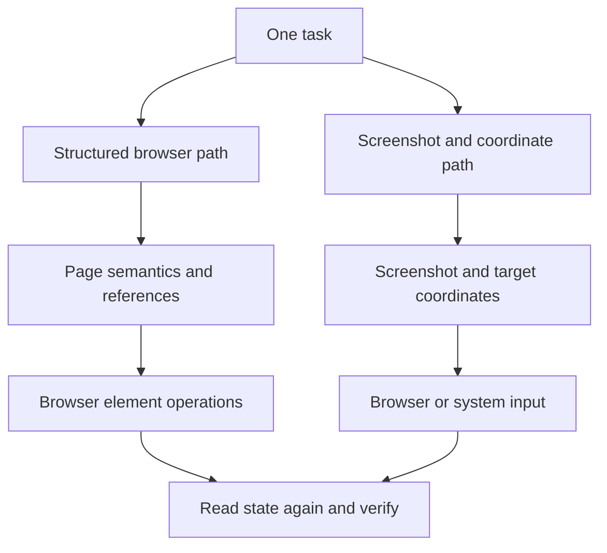
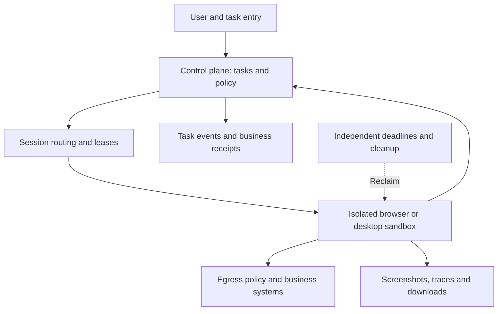

# Agent Computer Use and Browsers: Implementation, Codex Open Source, and Project Selection

An agent that opens a page, finds a ticket, fills in a note and submits it might be using several different mechanisms: a business API, page elements, or screenshots and pointer coordinates. All look like “operating a browser” to the user, yet their costs, observability and failure modes differ.

This article follows three questions: what does the model observe, how do its actions reach the environment, and how is the result verified? Documentation and source were checked on **2026-10-23**. A local browser executor rehearsal was actually run. It makes no model calls and is not a task-success benchmark for any framework.

## 1. Computer Use and Browser are not entirely separate capabilities

Computer Use generally means operating through a computer interface. A browser agent limits that scope to a browser, but can use page structure, screenshot coordinates, or both. A product's Browser may also mean a hosted browser environment rather than one particular model tool.

Separate these layers first:

| Name | Input or observation | Where actions execute | Suitable problems |
| --- | --- | --- | --- |
| Search and fetching | Search results and page text | Search or fetch service | Public information without interaction |
| Business API tools | Structured fields and business state | Business service | Queries, writes and transactions with stable APIs |
| Structured browser tools | Elements, roles, names and states | Browser automation driver | Forms, administration and web testing |
| Browser visual control | Page screenshots | Browser pointer and keyboard interfaces | Canvases, complex layouts and visual inspection |
| Desktop Computer Use | Desktop screenshots, potentially system accessibility data | OS or desktop driver | Multiple apps, native apps and system dialogs |
| MCP | Tool definitions, calls and results | The MCP Server's execution environment | Connecting the capabilities above to an agent |

API means Application Programming Interface; MCP means Model Context Protocol. MCP connects tools; it does not automatically provide a browser, planner or isolation. A headless browser can capture screenshots and receive pointer events. Screenshots do not require a full desktop.

When a business API covers the task, I would start there. Add a browser when the UI needs verification or no API exists, then consider desktop control when the task leaves the webpage. This is an engineering selection order, not a universal performance ranking.

## 2. The core is an observe, decide, execute and verify loop

The model does not hold the mouse. It receives observations and proposes actions. The application's Harness—the runtime coordinating models, tools, state and permissions—hands actions to an executor and returns actual results to the model. [OpenAI Computer Use guide](https://developers.openai.com/api/docs/guides/tools-computer-use)



For a ticket operation, completion is not “click Submit, then say done.” Read the intended ticket, establish the account and target, execute an authorized action, then read the ticket state or business receipt. Generating a tool call, successfully clicking, and committing a backend write are different stages.

Browsers navigate, load asynchronously, open dialogs and lose authentication. Observations therefore need time and session context. An action performed on the wrong page may have valid arguments and still affect the wrong object.

## 3. How a browser agent understands a page

### 3.1 What DOM, accessibility trees and screenshots provide

DOM means Document Object Model: the page's nodes and attributes. An accessibility tree is the browser's semantic representation for assistive technologies, commonly describing buttons, textboxes, names, checked states and hierarchy. It is not an unchanged copy of the full DOM.

A styled button appears as a labeled region in a screenshot, but can appear as “a button named Confirm review” in an accessibility snapshot. The model can choose an element without first estimating coordinates. Playwright supports generating and asserting accessibility snapshots. [Playwright accessibility snapshots](https://playwright.dev/docs/aria-snapshots)

Structured observations have limits. Poor page semantics, unexpanded virtual lists, content not collected across frames, and pixel-only canvases can leave gaps. Screenshots add layout, images and overlap information, but visual interpretation also depends on resolution and page changes.

### 3.2 CDP connects the browser to the executor

CDP means Chrome DevTools Protocol. Drivers use it to connect to Chromium, obtain page, DOM and accessibility information, and perform supported browser operations. It is neither a business HTTP API nor a universal controller for arbitrary desktop applications.

In browser-use, page observation requests DOM snapshot and accessibility-tree information through CDP, then organizes it for model consumption. The serializer also maintains a mapping between element numbers and actual nodes. Filtering and organizing page information is the important work here, rather than sending the entire page source to the model. [DomService source](https://github.com/browser-use/browser-use/blob/3df5806a0d097a1546d92c49bcf1b28c9972c3bd/browser_use/dom/service.py), [serialization and node mapping](https://github.com/browser-use/browser-use/blob/3df5806a0d097a1546d92c49bcf1b28c9972c3bd/browser_use/dom/serializer/serializer.py)

### 3.3 How an element reference becomes a click

Playwright MCP typically captures an accessibility snapshot, assigns references, lets the model choose one, then resolves and clicks the actual element. Its current documentation uses the action parameter `target`; fields in older articles should not be copied blindly. References may become stale after page changes, requiring a new observation. [Playwright MCP snapshots and references](https://playwright.dev/mcp/snapshots)

In source, `browser_snapshot` requests a snapshot; `browser_click` resolves the target and invokes a Locator click. Implementation now lives in the Playwright monorepo, so reading only the MCP package entry point misses the execution layer. [Snapshot and click implementation](https://github.com/microsoft/playwright/blob/20a2087ea43412b90c172c88faef80786ee18b8b/packages/playwright-core/src/tools/backend/snapshot.ts), [reference resolution](https://github.com/microsoft/playwright/blob/20a2087ea43412b90c172c88faef80786ee18b8b/packages/playwright-core/src/tools/backend/tab.ts)

Locator clicks check properties such as visibility, stability and receiving events before acting. Raw coordinate clicks generally lack those element-level guarantees. Passing actionability checks still does not prove that the subsequent business operation succeeded. [Playwright auto-waiting](https://playwright.dev/docs/actionability)

## 4. How screenshot-based Computer Use controls a desktop

Another path presents images to a model and receives clicks, typing and scrolling actions. The executor translates coordinates and keys into browser or system input, then captures a new screenshot. Browser visual control and desktop control differ primarily in execution scope, not in whether images are used.



Anthropic's open sample provides a concrete implementation: a Linux container starts Xvfb (X Virtual Framebuffer), a window manager and VNC (Virtual Network Computing) processes. Its tool maps pointer and keyboard actions to xdotool calls and handles screenshots and coordinate scaling. The loop feeds tool results back to the model. Xvfb supplies the virtual screen; VNC and noVNC enable remote human viewing or control, not model reasoning. [Desktop startup](https://github.com/anthropics/claude-quickstarts/blob/9ec32b91df50b0d4906cae64b13c6298055ff40d/computer-use-demo/image/start_all.sh), [Computer tool implementation](https://github.com/anthropics/claude-quickstarts/blob/9ec32b91df50b0d4906cae64b13c6298055ff40d/computer-use-demo/computer_use_demo/tools/computer.py), [model and tool loop](https://github.com/anthropics/claude-quickstarts/blob/9ec32b91df50b0d4906cae64b13c6298055ff40d/computer-use-demo/computer_use_demo/loop.py)

This public implementation does not establish that every commercial product uses Xvfb or xdotool. Native desktop drivers may also combine system accessibility capabilities. OpenAI documents Screen Recording and Accessibility permissions for macOS Computer Use, but those requirements do not reveal its complete internal implementation. [Computer Use product documentation](https://learn.chatgpt.com/docs/computer-use)

Coordinates also require explicit units. Browsers commonly use CSS pixels; screenshots can use device pixels or be cropped and resized. Coordinates predicted on a half-size image require scaling, and cropped images require an offset. Recheck observations after zooming, scrolling or moving windows. [Driver coordinate guidance](https://developers.openai.com/api/docs/guides/tools-computer-use-sdk-drivers)

## 5. Which parts of Codex are open source?

**Codex has an open-source Agent Harness, but this does not mean the entire product or every Computer Use capability is open source**. The official component list includes the CLI (Command-Line Interface), SDK (Software Development Kit) and app-server, and explicitly distinguishes the proprietary IDE extension and cloud service. [Official open-source component list](https://learn.chatgpt.com/docs/open-source)

| Part | Verifiable public boundary | What it lets developers study |
| --- | --- | --- |
| Codex CLI / core Harness | Available in the public Apache-2.0 repository | Tool calls, context, runtime state and policy handling |
| Codex app-server | Source and client protocol are public | Integrating sessions, events and approvals into an application |
| Codex SDK | Officially listed as open source | Starting and coordinating Codex tasks programmatically |
| Codex IDE extension and Codex Cloud | Officially listed as not open source | CLI source cannot establish all product internals |
| Model weights and hosted inference | Separate layers from the open Harness | An open client does not imply open model weights |
| Specific desktop / built-in Browser control drivers | Product docs describe capabilities and permissions, not proof of a fully open implementation | Inspect source and licenses component by component |

License and scope were checked separately: [Codex repository license](https://github.com/openai/codex/blob/8531184b49bcb160175a84e140b659a83a426df7/LICENSE), [official explanation of the open Harness](https://developers.openai.com/blog/codex-as-a-platform).

### 5.1 The MCP call path visible in source

Codex's MCP Handler receives tool arguments, prepares the corresponding MCP call and dispatches it through the call implementation. Result handling also involves text, images and truncation policies. Approval-related logic appears in the call path. A browser MCP Server may operate in another process or on another machine. [MCP Handler](https://github.com/openai/codex/blob/8531184b49bcb160175a84e140b659a83a426df7/codex-rs/core/src/tools/handlers/mcp.rs), [MCP calls and approval handling](https://github.com/openai/codex/blob/8531184b49bcb160175a84e140b659a83a426df7/codex-rs/core/src/mcp_tool_call.rs)

Connecting Codex to Playwright MCP therefore produces a public, inspectable browser execution path. It is useful for studying how a model operates pages through tools, but is not a complete reproduction of the desktop product's Computer Use implementation.

The directions are different: app-server connects your application to the Codex runtime; a browser MCP Server supplies tools to the agent. They are not the same service. The CLI's local filesystem sandbox also does not automatically restrict a remote MCP Server's browser privileges. [app-server implementation and protocol](https://github.com/openai/codex/blob/8531184b49bcb160175a84e140b659a83a426df7/codex-rs/app-server/README.md), [Codex MCP integration](https://learn.chatgpt.com/docs/extend/mcp?surface=cli)

### 5.2 The built-in browser is more than remote fetching

Official product documentation says Codex can operate the desktop application's built-in browser, inspect rendered state and capture screenshots; Developer mode can provide controlled CDP access. This establishes product capabilities, not that every underlying module is open source. [Browser product documentation](https://learn.chatgpt.com/docs/browser)

## 6. What to study in the open-source projects

This compares component responsibilities, not scores on a common benchmark. Licenses apply to the listed repositories or sample code, not to model services, hosted platforms and every dependency's terms.

| Project | Primary role | Useful implementation areas | Typical integration | Code license |
| --- | --- | --- | --- | --- |
| Codex | General coding Agent Harness | Tools, sessions, approvals and app-server | CLI, SDK, app-server and MCP | Apache-2.0 |
| Playwright MCP | Browser tool service | Accessibility snapshots, references and browser actions | Existing MCP Host | Apache-2.0 |
| browser-use | Python browser agent library | Observations, model actions, node mappings and browser events | Python agent or tool integration | MIT |
| Stagehand | Browser automation SDK | Natural-language actions, observations and structured extraction | Application code and agent frameworks | MIT |
| Anthropic computer-use-demo | Desktop Computer Use reference sample | Screenshots, system input, scaling and model loop | Linux desktop sample | MIT |

### 6.1 Playwright MCP: adding a browser to an existing agent

It does not plan the whole business workflow. The upper-level agent chooses the next step; the MCP service owns browser state and actions. This separation is straightforward for a team that already has a coding agent and needs browser control. Vision Mode is another option for canvas or visual interactions; the project is not limited to text trees. [Playwright MCP project](https://github.com/microsoft/playwright-mcp), [Vision Mode](https://playwright.dev/mcp/vision-mode)

### 6.2 browser-use: studying a complete web agent loop

Beyond page extraction, follow its tools, browser events and action Watchdog to see how a model-selected target is located and operated. Here Watchdog means a browser event-handling component, not an independent host-level failure supervisor. [Tool service](https://github.com/browser-use/browser-use/blob/3df5806a0d097a1546d92c49bcf1b28c9972c3bd/browser_use/tools/service.py), [action Watchdog](https://github.com/browser-use/browser-use/blob/3df5806a0d097a1546d92c49bcf1b28c9972c3bd/browser_use/browser/watchdogs/default_action_watchdog.py)

Separate the library from Browser Use Cloud. Running the library locally does not automatically supply hosted browsers, production session management or identical networking capabilities. [browser-use project and license](https://github.com/browser-use/browser-use/tree/3df5806a0d097a1546d92c49bcf1b28c9972c3bd)

### 6.3 Stagehand: inserting model capabilities into deterministic programs

Stagehand wraps finding elements and extracting information in higher-level interfaces that can be composed with ordinary programs. Current V4 documentation distinguishes natural-language actions from deterministic execution of previously observed actions. That provides an interface for reusing confirmed targets and avoiding repeated inference, without eliminating the need for observation in every task. [Stagehand act documentation](https://docs.stagehand.dev/v4/basics/act)

Version matters when reading tutorials. The SDK checked here is 4.3.0; older imports and calls should not be copied unchanged. The public repository also includes extension and communication implementations. Inspect actual runtime components rather than only top-level SDK methods when building an integration. [Stagehand project](https://github.com/browserbase/stagehand/tree/b98abd90086707de575c9ae6ac9af1a436e76d18), [V3 to V4 migration](https://docs.stagehand.dev/v4/migrations/v3)

### 6.4 Desktop samples: understanding the final input layer

A desktop sample is an accessible starting point for tracing model actions into pointer movement, typing and screenshots. Its container privileges, networking, authentication and retention still need separate design; it is not automatically a production multi-tenant platform. [Anthropic official Computer Use documentation](https://platform.claude.com/docs/en/agents-and-tools/tool-use/computer-use-tool)

## 7. A real rehearsal: why clicking does not mean completion

The repository includes a [runnable local example](https://github.com/runzhliu/aik8s/tree/main/examples/agent-browser-mechanics). It creates only a temporary local HTTP server and Chromium page, using Playwright 1.64.1 and a 1200×675 viewport to demonstrate executor mechanics. The fixture, action script and assertions are inspectable.

**There is no model inference, MCP protocol execution or desktop OS control in this rehearsal**. Actions are scripted. The old coordinates are calculated from layout information, not predicted by a visual model. All three images are real browser screenshots, not a product interface or framework benchmark result.

### 7.1 Obtain current page facts first

The left side is the ticket fixture. The right side contains the workspace accessibility snapshot returned by an actual `ariaSnapshot()` call. A button has a location in the image and a role and name in the tree: different observations of the same page.


Only the left workspace is snapshotted, avoiding recursive ingestion of the evidence panel itself. Real agents also need scoped observations so logs, debugging panels and historical results do not overwhelm context.

### 7.2 Old coordinates fail after a layout change

The script records the confirmation button's center, then expands diagnostic content. The button moves from its inline location to a lower row. Clicking the old point leaves the state pending. The updated snapshot and this run's action record appear on the right.


This does not establish that vision always fails or semantic targeting always succeeds. It verifies one specific failure: replaying coordinates after an observation becomes stale may do nothing, or hit another control. Refresh the observation instead of endlessly retrying the same point.

### 7.3 Re-target, then verify the result

Finally, the script resolves the button by its current role and name, clicks once and reads the state. It then reloads the page and checks that the fixture's result remains in browser local storage.


| Check | Observed result | What it establishes |
| --- | --- | --- |
| Workspace accessibility snapshot | Includes textbox, buttons and status | This page supports structured observation |
| Replay old coordinates after layout change | State remains pending | The old click did not complete the target action |
| Resolve the current button semantically | State changes to reviewed | Element control works in this fixture |
| Read state after reload | Reviewed state remains | Local persistence is readable again, not backend transaction verification |

The essential calls reduce to the following. The full runner also checks the layout change, saves snapshots and cleans up after failure.

```javascript
const before = await page.locator('#workspace').ariaSnapshot();
const button = page.getByRole('button', { name: 'Confirm review', exact: true });
await button.click();
assert.equal(await page.locator('#status').getAttribute('data-state'), 'done');
await page.reload();
assert.equal(await page.locator('#status').getAttribute('data-state'), 'done');
```

Reproduce locally:

```bash
cd examples/agent-browser-mechanics
npm install
npx playwright install chromium
npm run demo
```

The output directory contains screenshots, before/after snapshots and result JSON. The [recorded result JSON](../../assets/rag-agent/agent-computer-browser/run-result.json) preserves this run's checks. In a production system, replace “read completed” with business-specific acceptance, such as reading a receipt for the correct order or querying the committed state.

## 8. Why some agents use code execution or a persistent REPL

REPL means Read–Eval–Print Loop. An agent can retain browser objects in a persistent runtime, execute short code snippets, preserve tabs, variables and sessions, then return concise text and necessary screenshots. This permits deterministic steps to be batched while retaining observation at uncertain boundaries. [OpenAI custom tools and code runtime guidance](https://developers.openai.com/api/docs/guides/tools-computer-use-integration)

Combining ten calls into one script does not automatically make it reliable. If the first four steps commit data and the fifth times out, rerunning the entire script can duplicate submissions. I recommend ending batches at business-state boundaries, retaining completed actions and receipts, then deciding where to resume.

Persistent JavaScript variables are not a recovery mechanism either. After runtime failure, verify browser pages, cookies, files and task events separately. See [resuming interrupted long-running agents](agent-long-running-durable-execution.md) for state design.

## 9. Enterprise deployment: browser sessions are stateful execution environments

To a Kubernetes platform, a browser is more than a horizontally scalable HTTP service. A session includes pages, cookies, tabs, downloaded files and ongoing actions. A remote debugging connection that lands on a different instance generally cannot simply continue the original operation.

This is a proposed architecture, not a reverse-engineered description of any product:



Design choices worth making early:

- **Isolate sessions by tenant or task**. Avoid accidentally sharing authenticated browsers. BrowserContext isolates some browser state but does not replace an OS or VM boundary.
- **Bind sessions to execution instances**. Map each session identifier to its browser. Load balancing a persistent connection does not make session migration automatic.
- **Treat credentials as execution identity**. A browser with login cookies may have real write permissions. Prefer user-controlled login or credential brokering; keep passwords out of model context, screenshots and logs.
- **Separate task retries from action retries**. Reads may be retried; submissions, publication and payments require checking whether side effects already happened.
- **Control egress and retain evidence**. Restrict destinations and download paths. Correlate screenshots, traces, model calls and business receipts while limiting sensitive-data retention.
- **Set independent deadlines and cleanup**. Browsers, desktop processes and storage can remain after model output stops. Both control and execution planes need verifiable reclamation.

These are engineering recommendations derived from session state and side effects. Isolation strength depends on task risk. See [Agent Sandbox selection and analysis](agent-sandbox-selection.md) for runtime choices.

## 10. Evaluate the capability beyond a recording

I would separate outcome correctness, process constraints and operational cost rather than count clicks.

| Dimension | Suggested measurements | Common misinterpretation |
| --- | --- | --- |
| Outcome correctness | Independently verified completion and correct-target rate | A model claim or page notification is not proof of a business write |
| Reliability | Recovery after redesigns, dialogs, timeouts and authentication expiry | Testing only a fixed page and smooth path |
| Side effects | Duplicate submissions, wrong-target operations and unauthorized actions | Automatic retries without checking completed effects |
| Efficiency | End-to-end duration, model turns, screenshot volume and total cost | Comparing only model response or click latency |
| Operability | Trace completeness, takeover time and cleanup success | A successful demo without raw actions and errors |

Fix the model, task set, page revision, browser version, initial authentication, network, retry budget and acceptance criteria when comparing frameworks. Structured snapshots can avoid image inputs in some tasks, but that does not imply a fixed cost-reduction percentage. Cropping, context size, model turns and failure recovery all affect total cost.

Page text, instructions in screenshots and downloads are task data, not new authorization. Cross-account operations, external transmission and irreversible actions need explicit executor policy. Reliable account authorization and correct result verification often determine production readiness more than additional clicking tricks.

## 11. Choosing the first implementation path

If you already use Codex, connect a browser tool in an isolated environment and inspect actual calls and results before trying to reproduce an entire desktop product. For a custom web agent, browser-use is a useful observation/action-loop reference. For inserting selected model capabilities into fixed workflows, examine Stagehand. For native or cross-app tasks, use a desktop Computer Use sample to trace system input.

These approaches can be combined. A task can query state through an API, operate a page with missing APIs through a browser, and verify visual output with a screenshot. Each step needs an explicit observation, permission and acceptance rule.

## 12. Source snapshots and further reading

The following commits were actually inspected. They are source snapshots, not claims about the latest stable release of each project. Short-hash links resolve to fixed commits so later directory moves do not change the basis of this analysis.

| Repository | Inspected commit | Inspected areas |
| --- | --- | --- |
| openai/codex | [8531184b](https://github.com/openai/codex/tree/8531184b49bcb160175a84e140b659a83a426df7) | License, MCP Handler, calls and approvals, app-server |
| microsoft/playwright-mcp | [0c4107ac](https://github.com/microsoft/playwright-mcp/tree/0c4107acbecb75472b23c05c0e42471a0011874f) | Package entry, version and source relocation notice |
| microsoft/playwright | [20a2087e](https://github.com/microsoft/playwright/tree/20a2087ea43412b90c172c88faef80786ee18b8b) | Snapshot, target resolution and click implementation |
| browser-use/browser-use | [3df5806a](https://github.com/browser-use/browser-use/tree/3df5806a0d097a1546d92c49bcf1b28c9972c3bd) | DOM, serialization, tools and action Watchdog |
| browserbase/stagehand | [b98abd90](https://github.com/browserbase/stagehand/tree/b98abd90086707de575c9ae6ac9af1a436e76d18) | V4 SDK, browser runtime interfaces and license |
| anthropics/claude-quickstarts | [9ec32b91](https://github.com/anthropics/claude-quickstarts/tree/9ec32b91df50b0d4906cae64b13c6298055ff40d/computer-use-demo) | Desktop startup, execution, model/tool loop and license |

Continue with [Agent Harness technology overview](agent-harness-technology-overview.md) and [agent evaluation methods](agent-evaluation-overview.md).
