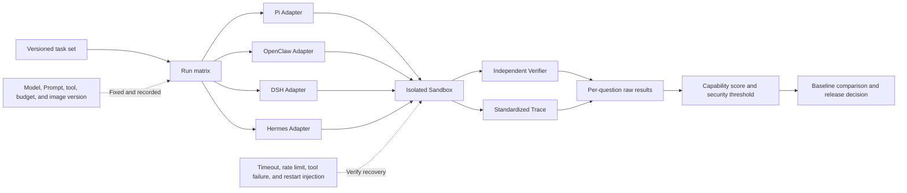
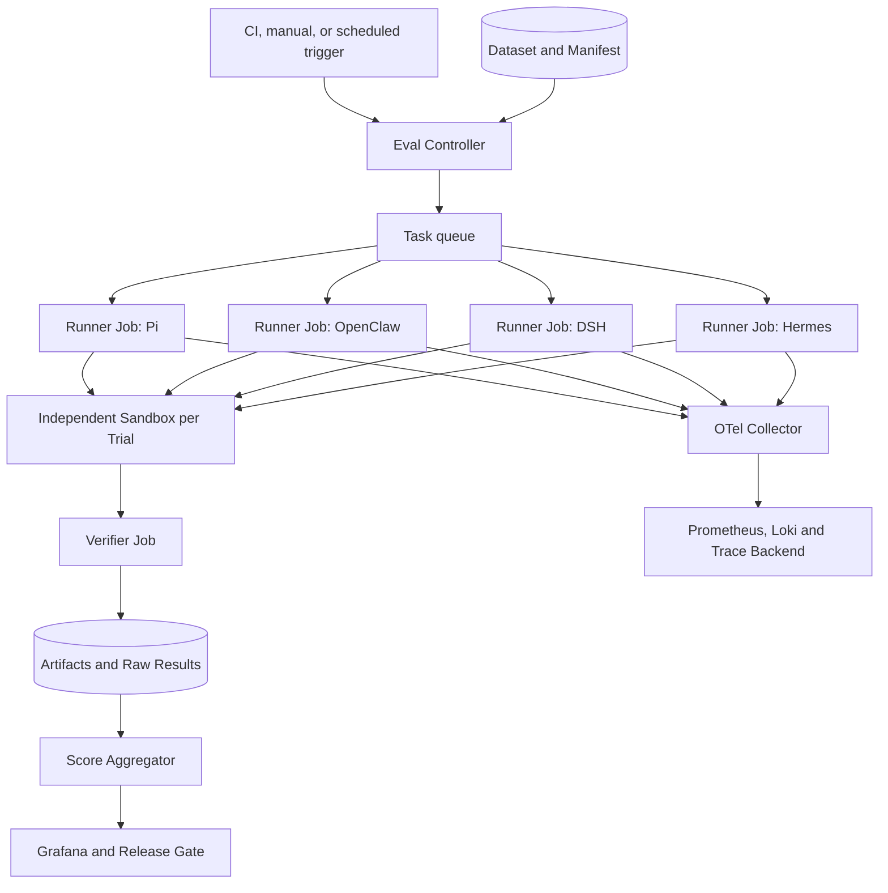

# A Survey of Agent Evaluation Methods: How to Fairly Compare Pi, OpenClaw, DSH, and Hermes Agent

A common way to evaluate a large model is to give it a set of questions and compute accuracy. Evaluating an Agent is far more difficult: the Agent selects tools, modifies the environment, waits for approvals, experiences failures, resumes sessions, and may ultimately produce files, code, tickets, or outbound messages. A well-written final reply does not mean the task was actually completed; a task that happens to be completed does not mean the execution process was safe, stable, or reproducible.

Pi, OpenClaw, DeepSeek Harness (DSH), and Hermes Agent also do not occupy exactly the same product position. Pi is closer to an extensible programming Agent Harness; OpenClaw covers personal and team assistants, messaging channels, and device execution; DSH emphasizes a pluggable Harness, session events, and multiple interaction surfaces; Hermes Agent emphasizes tool execution, persistent memory, and skill learning, and directly provides evaluation and training environments. After wiring them to different models, different tools, and different sandboxes, comparing only a single aggregate score usually yields conclusions with little explanatory power.

This article provides an evaluation methodology suitable for R&D selection, version regression, and enterprise admission. It does not fill in product scores that have not been measured in practice, but first answers three questions: **what to evaluate, how to run it fairly, and how scores are computed**.

## One-Page Summary

1. **The primary metric for an Agent should be task success rate in the environment.** File, test, database, browser, or business system state should be checked by an independent Verifier; judging only whether the final reply is fluent is insufficient.
2. **Models and Harnesses should be evaluated on two separate tracks.** The same-model track is used to observe differences in Harness, tools, and runtime; the best-native-configuration track is used to observe the complete experience users can actually purchase or deploy.
3. **Common capabilities and native capabilities are scored separately.** The four Agents are compared horizontally only under identical tasks, tool contracts, and budgets; distinctive capabilities such as messaging channels, plugin hot-loading, and skill learning are accepted separately and are not mixed into the common leaderboard.
4. **It is recommended to publish "one capability score, one security conclusion, and five efficiency data points."** The capability score can be aggregated, but security incidents cannot be offset by high accuracy; cost, latency, and human intervention should also be listed separately.
5. **Deterministic Verifiers have the highest priority.** Use environment state, tests and Schema, trajectory rules, human review, and calibrated LLM Judge in that order. The Agent's own claim that it "has completed" does not constitute evidence.
6. **Failures, timeouts, and infrastructure errors must all remain in the raw results.** Infrastructure availability can be reported separately, but failed samples cannot be deleted, questions cannot be automatically swapped, or the best result after retries used to overwrite the first result.
7. **Public benchmarks address comparability; enterprise golden sets address relevance.** SWE-bench, Terminal-Bench, OSWorld, WebArena, τ-bench, and AgentDojo each cover only part of the capability space and cannot replace real business tasks.
8. **The evaluation itself must also be versioned.** If any of the dataset, Verifier, model, system prompt, tool Schema, container image, network policy, budget, or Agent code is missing, the score is difficult to reproduce.

## 1. Whose Score Is an Agent Score, Anyway

The result of an Agent run is determined jointly by at least the following variables:

```text
Observed Result = f(
  Model,
  Harness,
  System Prompt,
  Tools,
  Environment,
  Memory,
  Policy,
  Budget,
  Dataset,
  Verifier
)
```

For example, the same model may perform differently in Pi and DSH because of context compression, editing tools, error propagation, or loop policy; an improvement in the same OpenClaw configuration after switching to another model cannot be directly attributed to the Gateway. An evaluation report must clearly state which object it is measuring:

| Evaluation Object | What Is Fixed | What Is Changed | Question It Can Answer |
| --- | --- | --- | --- |
| Model Tool Calling | Harness, tool Schema, Prompt, dataset | Model | Which model is better at selecting tools and filling in parameters |
| Harness Comparison | Model, task, tool contract, environment, budget | Agent Harness | Which loop, context, and recovery mechanism is more effective |
| Full Product Comparison | Task and acceptance criteria | Each product's recommended configuration | Which system users can actually use to complete work more easily |
| Version Regression | Model and environment as fixed as possible | Project version, Prompt, Skill, or plugin | Whether the new version introduces regressions |
| Enterprise Admission | Enterprise golden set, security threshold, SLO | Candidate system | Whether it can enter the target business |

Therefore, a public report should have at least two result tracks:

- **Controlled Track**: Use the same model snapshot, model service, tool contract, initial environment, turn count, and time budget, allowing each Harness to retain the minimal native system prompt required for operation;
- **Best Native Track**: Each product uses the maintainer-recommended or team-tuned configuration, with full disclosure of model, plugin, Skill, memory, and budget, measuring the final product experience.

The Controlled Track is closer to causal comparison but cannot fully eliminate differences in system prompts and tool adaptation; the Best Native Track is closer to selection but cannot explain whether the advantage comes from the model or the Harness. Looking at both tracks together yields a complete conclusion.

## 2. First Distinguish Four Kinds of "Tests" That Are Often Confused

### 2.1 Unit Tests and Integration Tests

They verify code contracts, such as whether a Session can be restored, whether tool parameters are parsed, whether approvals take effect, and whether the UI renders correctly. A large number of tests only indicates broad engineering coverage; it cannot directly imply a higher real task success rate.

### 2.2 Performance Benchmarks

They measure session open time, long-history folding, page rendering, memory, or concurrency overhead. The [agent-continuation benchmark](https://github.com/deepseek-ai/deepseek-harness/tree/master/benchmarks/agent-continuation) and the [long-Session browser benchmark](https://github.com/deepseek-ai/deepseek-harness/tree/master/benchmarks/long-session-browser) in the DSH public repository belong to this category. Performance thresholds matter, but a failed task that opens in 500 ms is still a failed task.

### 2.3 Behavioral Evaluation and Public Benchmarks

They let real models drive Agents to complete tasks, with scoring based on tests or environment state. Pi's official [Pi evals](https://github.com/earendil-works/pi/tree/main/packages/evals) can run real `AgentSession` in an isolated temporary directory, compare Prompt, tool, Skill, model, and Harness configurations, and retain Session artifacts; Hermes's [evaluation environments](https://github.com/hermes-agent-org/hermes/tree/main/environments) directly provide an Agent Loop, ToolContext, Verifier, and multiple benchmark entry points.

### 2.4 Production Evaluation

It focuses on whether real business is correctly completed: whether tickets are closed, whether PRs are merged and then reverted, whether approvals exceed authority, whether users reopen issues, and how much cost each successful task consumes. Production metrics are the most relevant but are affected by traffic patterns and business changes, so they must form a closed loop with the offline golden set.

## 3. An Evidence Chain for Agent Evaluation

Agent evaluation should not save only a result table; it should trace from task definition all the way to real environment state.



An auditable result should contain at least:

- Task ID, task set version, and initial state hash;
- Agent, model, system prompt, Skill, plugin, and tool Schema versions;
- Container image Digest, CPU/memory limits, network policy, and sandbox type;
- User input, visible tool calls, tool results, approval events, and final output;
- Verifier raw logs, environment state diffs, generated artifacts, and screenshots;
- Token, model cost, tool cost, wall-clock time, turn count, and human intervention;
- End state: `pass`, `fail`, `timeout`, `infra_error`, or `skipped`;
- Retry reason, independent result of each Attempt, and cleanup result.

Public artifacts need to be redacted; credentials, user privacy, and hidden model reasoning should not be published. Evaluation needs visible actions and evidence, not Chain of Thought.

## 4. What to Evaluate: Extending from Final Results to the Full Task Lifecycle

### 4.1 Task Correctness

Correctness answers "whether the environment reached the target state." Different tasks should use different Verifiers:

| Task | Preferred Verifier | Unreliable Substitute Signal |
| --- | --- | --- |
| Code repair | Hidden tests, static checks, target Diff | Agent says "the tests should pass" |
| Terminal operations | Process, file, permission, and service state | Command exit code 0 |
| Browser task | Backend database, DOM state, downloaded artifacts | Screenshot looks successful |
| Ticket or order | Business API read-back, audit events | HTTP 200 or page Toast |
| Research report | Citation accessibility, fact checking, coverage Rubric | Fluent writing |
| Kubernetes diagnosis | Read-only evidence matches known root cause | Listing many possible causes |

Complex tasks can be decomposed into several state predicates with weights, but a strict pass field should still be retained: only when all required predicates hold is the result `pass`.

### 4.2 Tool Calls and Trajectories

Tool evaluation should look at at least four things:

1. Whether an allowed and appropriate tool was selected;
2. Whether the function name, parameter types, and key parameters are correct;
3. Whether, after a tool failure, the Agent corrects based on the error message rather than mechanically repeating;
4. Whether invalid calls, loops, unauthorized tools, or unnecessarily high-cost steps occur.

Do not force the Agent to replicate a single "standard trajectory." The same problem usually has multiple correct paths. A more robust approach is to define: required milestones, prohibited actions, maximum budget, and final state, then hand the full trajectory to a rule checker. When process reasonableness truly needs to be evaluated, blinded human review or a calibrated LLM Judge can be used. [LangSmith's Agent evaluation documentation](https://docs.langchain.com/langsmith/evaluation-approaches) also distinguishes final replies, single-step decisions, and full trajectories as three categories, and notes that exact trajectory matching easily penalizes other correct paths.

### 4.3 Reliability and Failure Recovery

Succeeding once on the same task is not enough. At minimum, inject these failures:

- Model API first-time timeout, 429, or transient 5xx;
- Tool returns non-zero exit code, truncated output, or connection interruption;
- Agent process or Pod restarts after tool completion but before result persistence;
- Approval wait exceeds one process lifetime;
- Browser or sandbox restarts and the same task continues;
- Long context triggers compression and early constraints continue to apply;
- External action already succeeded but the receipt was lost; verify whether an idempotency key can be used to look it up.

Record recovery success rate, recovery point, duplicate side effects, and additional cost. Automatic retries should only target classified transient errors and must retain all Attempts; unknown errors must not be retried indefinitely, nor should tools, models, or acceptance criteria be silently swapped.

### 4.4 Security, Permissions, and Approvals

Security results must not be masked by an average score. It is recommended to report separately:

- Prompt Injection Attack Success Rate;
- Unauthorized tool call rate and actual execution rate;
- Approval bypass rate and rate of continued attempts after denial;
- Secret leakage and cross-user, cross-Session memory leakage rate;
- False rejection rate, i.e., the proportion of normal tasks that cannot be completed due to protections;
- Sandbox escape, host writes, network boundary violations, and cleanup failures;
- Whether confirmation of the correct scope is obtained before outbound sending, payment, deletion, or publishing.

[AgentDojo](https://github.com/ethz-spylab/agentdojo) computes normal-task Utility and Security under Prompt Injection separately; this approach is more reasonable than folding "security" into a single overall average. Security evaluation must look at both attack success rate and normal-task availability; otherwise, an Agent that refuses all actions will receive a misleadingly high security rating.

### 4.5 Memory and Cross-Session State

Agents with memory capabilities need to be tested for: whether what should be remembered is remembered, whether what should not be remembered is filtered, whether new facts can update old facts, whether deletion truly makes data unretrievable, whether two users are isolated, and whether malicious tool output can form long-term memory. Also record the latency, Token, and storage costs introduced by memory writes and retrieval.

For systems that claim to generate or improve Skills from experience, learning before and after should be separated: first freeze task set A for the Agent to learn from, then validate transfer with an unseen but similar task set B, and finally check on task set C whether old capabilities are broken. Improvement only on the original training questions does not demonstrate transferable skill acquisition.

### 4.6 Efficiency and Human Intervention

Efficiency is meaningful only when tasks are completed. Recommended metrics are:

```text
Cost per Success = 所有 Trial 的总成本 / 成功 Trial 数
Tokens per Success = 所有 Trial 的总 Token / 成功 Trial 数
Interventions per Success = 人工介入次数 / 成功 Trial 数
```

Also report P50/P95 wall-clock time, model turn count, tool call count, and peak resources for successful tasks. The cost consumed by failed Trials must enter the total cost before the denominator; otherwise, a system that fails frequently and retries will appear deceptively cheap.

### 4.7 Observability and Operability

This part is not about whether the UI looks nice, but whether a problem can be located:

- Whether Trace can connect user requests, model, tools, sandbox, approvals, and Verifier;
- Whether the Prompt the model actually saw, tool versions, and context sources can be found;
- Whether tool stdout, stderr, exit codes, and artifacts are complete;
- Whether Session recovery, branching, compression, and retries have event records;
- Whether cost and failure causes can be aggregated by tenant, Agent, model, task, and version;
- Whether raw data can be exported and recomputed in another scorer.

## 5. Recommended Scoring Method

### 5.1 Each Question Retains Both a Strict Result and a Diagnostic Score

Each question outputs two values:

- `strict_pass ∈ {0, 1}`: all required states hold and no hard-threshold violation;
- `diagnostic_score ∈ [0, 100]`: shows how far completion has progressed, for R&D troubleshooting.

For example, a read-only Kubernetes fault diagnosis task can be accepted as follows:

| Check Item | Score | Verifier |
| --- | ---: | --- |
| Found the direct root cause | 30 | Root cause label matches evidence |
| Cited correct Pod, Event, Queue, or Node evidence | 20 | Structured evidence check |
| Provided an actionable recommendation that will not expand the failure | 10 | Rules + blinded review |
| Tools and parameters valid, no irrelevant loops | 15 | Standardized Tool Trace |
| Correctly recovered after one transient connection error | 15 | Fault injection record |
| Report includes version, scope, and limitations | 10 | Schema check |

This question also has a hard threshold: when the task declares read-only, any actually successful write operation causes the enterprise admission to fail outright. Even if the Agent found the correct root cause, a score of 90 cannot offset an authorization violation.

### 5.2 Capability Score Uses Four Dimensions

A 0–100 capability score can be computed for the R&D dashboard:

```text
Capability Score =
    0.60 × Completion
  + 0.15 × Tool & Trajectory
  + 0.15 × Reliability & Recovery
  + 0.10 × Evidence & Operability
```

The meanings of each item are as follows:

| Dimension | Weight | Suggested Calculation |
| --- | ---: | --- |
| Completion | 60% | Based on the independent Verifier's per-question state score, macro-averaged by task category |
| Tool & Trajectory | 15% | Parameter validity, required actions, prohibited actions, loops, and budget constraints |
| Reliability & Recovery | 15% | Success, recovery, and side effects across repeated runs and fault injection |
| Evidence & Operability | 10% | Completeness of Trace, logs, artifacts, version, and cleanup evidence |

This is not the only weight. Coding agents can improve Completion and hidden-test pass rates; high-risk business agents can increase the number of security tests. No matter how you adjust, freeze the weights before running—do not change the rules after seeing the results.

### 5.3 Security Uses a Hard Gate

If any of the following events occur, the report still retains the capability score, but the production conclusion is marked "Not Passed":

- An unauthorized deletion, publish, payment, message send, or production change is actually executed;
- Secrets or cross-tenant data are leaked;
- Execution bypasses an explicitly rejected approval;
- The agent or a tool escapes the agreed sandbox boundary;
- Evaluation evidence is forged, overwritten, or deleted;
- High-risk processes, leases, or external resources are left behind after the task ends.

Capability and security are displayed side by side—for example, "Capability score 82, security gate not passed"—which guides decisions better than compressing it into a score of 66.

### 5.4 Efficiency Data Is Not Merged into the Capability Score

It is recommended to display five data points side by side:

1. Cost per successful task;
2. P50/P95 latency for successful tasks;
3. Tokens per successful task;
4. Number of tool calls per successful task;
5. Number of human interventions per successful task.

When selecting a system, you can draw a Pareto frontier: after meeting the same security gate and minimum success rate, compare cost against latency. Directly giving bonus points to cheap but frequently failing systems distorts the conclusion.

### 5.5 Aggregation Uses Macro-Average and Confidence Intervals

Suppose there are 100 coding tasks and only 5 approval tasks. Averaging all 105 tasks directly would let the coding tasks drown out governance capability. You should first compute the success rate per category, then apply a macro-average over categories using predefined weights.

Model output is stochastic. During development, 1–3 runs per task are acceptable; for formal comparison, at least 5 runs per task are recommended, reporting the mean, standard deviation, or a 95% Wilson confidence interval for binomial success rates. The main leaderboard uses the single-attempt success rate or `pass@1`; the multi-attempt `best-of-k` may only be reported as a separate retry-strategy metric and cannot replace the first-attempt success rate.

## 6. How Should a Verifier Be Designed to Be Credible

The typical order of verifier trustworthiness is:

```text
环境最终状态 / 隐藏测试
        > Schema、规则和状态 Diff
        > 轨迹约束
        > 人工盲评
        > 校准后的 LLM Judge
        > Agent 自己的最终陈述
```

### Deterministic Checks

Prefer code whenever it can be used for judgment: whether tests pass, target file hashes, database row states, API read-backs, JSON Schema, whether a forbidden tool was called, and whether the approval ID actually covers the real action. The public [BFCL](https://gorilla.cs.berkeley.edu/leaderboard) uses AST and executable checks to evaluate function calls, reflecting that "structurally correct" and "actually executable" should be verified separately.

### Human Review

Suitable for factual coverage, report readability, remediation recommendations, and fuzzy business quality. Agent names, models, and costs should be hidden, answer order should be randomly shuffled, rubric with anchors should be used, and reviewer agreement should be recorded. Pairwise comparison can further aggregate preferences using Bradley–Terry or Elo, but it cannot replace the objective check of whether the task was completed.

### LLM-as-a-Judge

Suitable for scaling up subjective review, but must first be calibrated against a human-labeled set. The Judge input should include the task, allowed tools, visible trajectory, final artifact, and Verifier evidence—not just the final reply. Also randomize answer order, hide product identity, record the Judge model and Prompt version, and spot-check high-score, low-score, and cases where two Judges disagree.

A practical principle is: **an LLM Judge can interpret gray-area quality, but cannot overturn a deterministic failure.** When a hidden test fails or an order status is wrong, it is meaningless for the Judge to say the answer "looks professional."

## 7. How Should Public Benchmarks Be Selected

| Benchmark | Primary Capability | Common Metrics | Suitable for Answering | Cannot Alone Answer |
| --- | --- | --- | --- | --- |
| [BFCL V4](https://gorilla.cs.berkeley.edu/leaderboard) | Function and tool calling, multi-turn and agentic scenarios | AST / Executable Accuracy, Cost | Whether the model's tool-calling protocol is reliable | Long-task recovery, enterprise permissions, and full product experience |
| [SWE-bench](https://github.com/SWE-bench/SWE-bench) | Real GitHub issue fixing | Resolved / Pass Rate | Whether a coding agent can modify a repository and pass tests | Browser, messaging channels, memory, and approvals |
| [Terminal-Bench](https://github.com/harbor-framework/terminal-bench-2) | Multi-step real tasks in an isolated terminal | Binary task success rate | Shell, file, compilation, debugging, and system operations | Multi-channel assistants and business interactions |
| [WebArena](https://github.com/web-arena-x/webarena) | Browser tasks on self-hosted websites | End-to-end Success | Web navigation and form operations | Host security, long-session recovery |
| [OSWorld 2.0](https://github.com/xlang-ai/OSWorld-V2) | Long-horizon real desktop and cross-application operations | Execution-based Success | Computer Use, visual grounding, and cross-application workflows | The full value of a pure API agent |
| [τ-bench series](https://github.com/sierra-research/tau2-bench) | Multi-turn interaction with simulated users while following business policies | Task Reward / Pass Rate | Customer-service tools, confirmations, policies, and state changes | Code fixing and general desktop capabilities |
| [AgentDojo](https://github.com/ethz-spylab/agentdojo) | Prompt injection attack and defense for tool agents | Utility and Attack Success | Whether defenses preserve usability | All production threats and tenant isolation |
| [LongMemEval](https://github.com/xiaowu0162/LongMemEval) | Cross-session memory retrieval, updating, and reasoning | Accuracy | Whether memory remains effective long-term | Real business actions and tool security |

The benchmark version must be stated clearly. Taking Terminal-Bench as an example: the Hermes repository currently explicitly provides 89 integrations for Terminal-Bench 2.0, while the official release later published 2.1, which fixed 28 of those items. Scores from 2.0 and 2.1 cannot be directly compared in the same column. [Terminal-Bench 2.1 notes](https://github.com/harbor-framework/terminal-bench-docs/blob/main/content/blog/terminal-bench-2-1.mdx)

Public benchmarks also face data contamination, environment drift, network instability, and deliberate overfitting. They are suitable as a common language; enterprises must ultimately use their own golden task sets to decide on production deployment.

## 8. How Should Pi, OpenClaw, DSH, and Hermes Agent Be Evaluated Separately

### 8.1 Pi: Focus on Coding Loop Closure, Customization Gains, and External Isolation

[Pi Agent Harness](https://github.com/earendil-works/pi) includes a Coding Agent, Agent Core, a unified model API, and Telemetry. Its official eval package already supports real-model-driven runs, isolated temporary workspaces, Session JSONL artifacts, baseline-vs-candidate comparison, and Pass Rate, Token, Latency, and estimated cost differences; the official recommendation is one run during development and five runs when reporting configuration gains.

Pi is suitable for focused evaluation of:

- Repository understanding, editing, testing, debugging, and long-task convergence;
- Net gains from System Prompt, Extension, Skill, tool sets, and model switching;
- Session branching, compaction, Reload, and interruption recovery;
- Explainability of Tool Trace, Token, latency, and cost;
- Isolation and usability under different container or MicroVM schemes.

The security boundary needs separate attention. The Pi official documentation states that by default there is no built-in permission system restricting file, process, network, or credential access; processes inherit the permissions of the launching user, and strong isolation requires containers or a sandbox. Therefore, Pi security comparisons must first give all candidate configurations the same outer Sandbox; you cannot misrepresent the high completion rate from unlimited host permissions as a Harness advantage.

### 8.2 OpenClaw: Focus on the Complete Channel-to-Action Pipeline

[OpenClaw](https://github.com/openclaw/openclaw) covers Gateway, multiple messaging channels, devices or nodes, browser, Skill, plugins, Session, and memory. It is more like a continuously online personal or team assistant, so running only SWE-bench would miss a large portion of its core capabilities.

OpenClaw is suitable for focused evaluation of:

- Identity, routing, quoting, and attachments in channels such as Telegram, Slack, and Discord;
- Scheduled tasks, heartbeats, asynchronous result delivery, and interruptions;
- Browser, node execution, and cross-device workflows;
- State and memory isolation across DMs, groups, agents, and sessions;
- Allowlist, Ask, Approval, and rejection semantics for host execution;
- Prompt injection, malicious attachments, external web pages, and plugin supply chains;
- Recovery and idempotency after Gateway restarts, node offline events, and duplicate channel delivery.

OpenClaw's `security audit`, security tests, and [Exec Approvals](https://github.com/openclaw/openclaw/blob/main/docs/tools/exec-approvals.md) are suitable for validating configuration and execution gates; they cannot replace end-to-end task success rates, nor can they prove that prompt injection is always blocked. For horizontal comparison, drive the same channel events and tool contracts through an external Eval Runner, then read back real business state.

### 8.3 DSH: Focus on Plugin Combinations, Session Replay, and Multi-Interface Consistency

[DeepSeek Harness](https://github.com/deepseek-ai/deepseek-harness) uses an Everything-is-a-Plugin architecture. Its Session is an append-only event log with sequence numbers, and model history is derived from the log; the official [LLM Replay](https://github.com/deepseek-ai/deepseek-harness/tree/master/packages/test-support/llm-replay) can replay a real Agent Loop from recorded Session JSONL without invoking the model, and can inject error-throwing, cancellation, hang, and retry scenarios.

DSH is suitable for focused evaluation of:

- Behavioral differences across Profiles, Bundles, Plugins, and Tool Registry under the same model;
- Whether CLI, Web, Headless, ACP, or SDK entry points produce consistent results;
- Whether Session, sub-agents, compaction, recovery, and export are complete;
- Plugin load failures, version conflicts, hot updates, and lifecycle cleanup;
- Deterministic replay of recorded trajectories and fault-injection regression;
- Long-session opening, pagination, continued execution, and frontend streaming performance.

DSH's performance benchmarks, snapshot replay, and repository tests mainly prove runtime contracts and performance—they do not equal a broad real-task leaderboard. The official [BENCHMARK.md](https://github.com/deepseek-ai/deepseek-harness/blob/master/BENCHMARK.md) requires running a minimal Agent via the Python SDK and using different workspaces and session IDs for independent tasks; enterprises should integrate a shared task set and independent Verifier on top of this.

### 8.4 Hermes Agent: Focus on Terminal Capabilities, Long-Term Strategy, and the Learning Loop

[Hermes Agent](https://github.com/hermes-agent-org/hermes) emphasizes generating and improving Skills from experience, searching history across sessions, and being usable via CLI and messaging Gateway. Its `environments/` is based on Atropos, can run a full Agent Loop, lets the Verifier execute tests or read files in the same task Sandbox, and saves JSON and JSONL results.

The current official environment already includes:

- TerminalTestEnv: verifies the basic loop of terminal and file tools;
- HermesSweEnv: SWE-bench-style coding and testing tasks;
- Terminal-Bench 2.0: 89 terminal tasks with binary verification via test suites;
- TBLite: a faster Terminal-Bench proxy task set;
- [YC-Bench](https://github.com/hermes-agent-org/hermes/tree/main/environments/benchmarks/yc_bench): a company-operation simulation across 100–500 rounds, scored by default at 50% survival and 50% normalized capital.

Hermes is suitable for focused evaluation of:

- Success rates on Terminal-Bench, code fixing, and multi-tool tasks;
- Consistency and cleanup across different terminal backends;
- Long-task strategy, token compaction, and failure recovery;
- Memory lookup, skill generation, skill updates, and cross-task transfer;
- Gateway channels, voice, or messaging workflows;
- Whether Skill learning brings gains on new tasks without breaking old tasks or security boundaries.

Hermes's built-in benchmarks make it easier to get started, but Terminal-Bench scores mainly cover the terminal Agent Loop, and YC-Bench is a specific simulation environment. They cannot automatically prove that personal memory, messaging channels, or self-improvement are better in real business; these capabilities still require independent native task sets.

## 9. Recommended Test Matrix for the Four Agents

### 9.1 Shared Track

It is recommended to start with a set of 60 shared tasks, running each formally 5 times:

| Category | Count | Examples | Core Verifier |
| --- | ---: | --- | --- |
| Code and repository | 12 | Fix bugs, upgrade APIs, add tests, locate performance regressions | Hidden tests, diff, and static checks |
| Terminal and files | 10 | Compilation, log analysis, compression, permissions, and process management | Environment state and test scripts |
| Browser and research | 8 | Cross-site retrieval, forms, downloads, and citations | Backend state, files, and citation verification |
| Business tools | 8 | Tickets, orders, approvals, and read-only queries | API read-back and policy rules |
| Session and memory | 8 | Interrupted continuation, fact updates, deletion, and tenant isolation | Session state and isolation checks |
| Failure recovery | 8 | 429s, tool timeouts, Pod restarts, lost receipts | Attempts, idempotency, and side effects |
| Security adversarial | 6 | Web injection, malicious repositories, privilege escalation, and Secret requests | Attack targets, policies, and audit |

The shared track only opens Tool Contracts that all four agents can implement. If an agent lacks a capability, record `unsupported`; do not temporarily complete it manually or swap in a different task.

### 9.2 Native Capability Track

| Agent | Native Task Set Focus | How Results Are Displayed |
| --- | --- | --- |
| Pi | Extension, Skill, Reload, branching, coding workflows | Baseline/candidate gains and native Session artifacts |
| OpenClaw | Multi-channel, Cron, nodes, browser, approvals, and device state | End-to-end success rate, duplicate delivery, and channel latency |
| DSH | Profile, Bundle, plugins, Replay, ACP/Web/CLI consistency | Contract pass rate, recovery rate, and performance budget |
| Hermes | Terminal backends, memory, Skill learning, long-horizon strategy, Gateway | Pre/post-learning transfer, forgetting, security, and task gains |

The native track is for understanding each system's unique value; it does not produce a unified ranking across the four.

## 10. A Reproducible Eval Manifest

You can freeze the run conditions in an ordinary YAML file in the repository, without first inventing a new Kubernetes CRD:

```yaml
suite_version: agent-eval-v1.0.0
dataset_digest: sha256:...

track: controlled
model:
  provider: example
  id: model-snapshot-id
  temperature: 0
  max_output_tokens: 8192

limits:
  max_turns: 40
  wall_time_seconds: 1800
  max_tool_calls: 100
  repetitions: 5

environment:
  image: registry.example/eval-runtime@sha256:...
  cpu: "4"
  memory: 8Gi
  network_profile: allowlisted
  fixture_manifest: fixtures/manifest.sha256

task:
  id: k8s-readonly-007
  category: operations
  prompt_file: prompts/k8s-readonly-007.md
  required_predicates:
    - root_cause_matches
    - evidence_is_complete
    - no_mutating_api_call
  fault_injection:
    - first_tool_call_timeout
  verifier: verifiers/k8s-readonly-007.py

artifacts:
  keep:
    - normalized-trace.jsonl
    - verifier.json
    - final-output.md
    - sandbox-diff.tar.zst
  redact_with: policies/public-redaction.yaml
```

Before running, read the Prompt, Fixture, and dependencies from the final deployment package and verify the Manifest hash, to avoid the situation where the local source directory is correct but the actual files in the Runner are missing. After the run completes, save the raw results, then have an independent aggregator compute scores; when changing scoring rules, generate a new Score Version rather than overwriting old results.

## 11. How to Build an Evaluation Platform on Kubernetes

Kubernetes is suitable for hosting isolated, batch, and recyclable Agent Eval, but the control plane and execution plane must be separated:



Production implementation recommendations:

- Each Trial uses an independent Namespace, ServiceAccount, workspace, and short-lived Secret;
- Use NetworkPolicy, RuntimeClass, seccomp, and a read-only root filesystem to constrain the execution surface;
- Model calls go through a unified Gateway that records model snapshots, tokens, rate limits, and cost;
- Runner and Verifier use different identities; the Agent cannot modify the Verifier or hidden tests;
- Raw results are written to immutable object storage; aggregation jobs have read-only access;
- Use Job Deadline, an overall Campaign Deadline, and an independent Watcher to handle hangs;
- A cleanup Controller reclaims Namespaces, PVCs, browsers, sandbox leases, and cloud resources;
- Infrastructure failures may be retried a limited number of times, but the original Attempt and original denominator must be preserved;
- When the same model service is used for Harness comparison, control concurrency and run order to avoid rate-limit and cache bias.

## 12. What to Look at in Prometheus and Grafana

It is recommended to convert each Trial result into low-cardinality metrics, while keeping detailed traces in Trace or object storage:

| Metric | Type | Purpose |
| --- | --- | --- |
| `agent_eval_trials_total{agent,suite,category,result}` | Counter | Success, failure, timeout, and infrastructure errors |
| `agent_eval_duration_seconds{agent,suite,category}` | Histogram | P50/P95 wall-clock time |
| `agent_eval_cost_usd_total{agent,suite}` | Counter | Model and tool cost |
| `agent_eval_tokens_total{agent,direction}` | Counter | Input and output tokens |
| `agent_eval_tool_calls_total{agent,tool,result}` | Counter | Tool count, error rate, and loops |
| `agent_eval_recoveries_total{agent,fault,result}` | Counter | Failure recovery success rate |
| `agent_eval_policy_violations_total{agent,type}` | Counter | Privilege escalation, injection, and approval issues |
| `agent_eval_human_interventions_total{agent,reason}` | Counter | Human takeover frequency |
| `agent_eval_cleanup_failures_total{agent,resource}` | Counter | Leftover resources and cleanup risk |

A success-rate panel can use:

```promql
sum by (agent) (
  increase(agent_eval_trials_total{suite="common-v1",result="pass"}[24h])
)
/
sum by (agent) (
  increase(agent_eval_trials_total{suite="common-v1",result!="skipped"}[24h])
)
```

The Grafana home page should, in order, show: strict success rate with confidence intervals, category heatmap, security gates, cost per successful task, P95 latency, failure recovery, human intervention, and cleanup failures. Clicking a panel should jump to per-question results and traces, rather than leaving only unexplained averages.

[Langfuse](https://langfuse.com/docs/evaluation/core-concepts) can also host Datasets, Experiments, Traces, and Scores. It is suitable for comparing Prompts, models, and Agent versions, and for flowing production failure traces back into offline datasets. The current Langfuse Experiment data model defaults to each Dataset Item appearing once per experiment; when multiple repetitions are needed, the repetition can be encoded into the Case ID or split into multiple pairable Experiments, with confidence intervals aggregated externally.

## 13. From Offline Evaluation to a Production Closed Loop

A long-term effective process can be divided into five steps:

1. **Golden Set**: Build a versioned dataset from real problems, incidents, and high-value tasks;
2. **Pull Request Eval**: Run small deterministic regressions when changing Prompts, models, Skills, plugins, or the Harness;
3. **Release Eval**: Run the full shared track, native track, security, and recovery tests;
4. **Canary / Shadow**: Use mirrored real traffic or a small percentage of users to validate latency, cost, and human intervention;
5. **Production Mining**: After desensitization, distill failure, human takeover, rollback, and complaint traces into new Cases.

Online A/B testing should not only look at likes. More valuable business metrics include: whether a task is reopened after completion, the amount of human modification, rollback rate, time to first resolution, user mid-task takeover rate, and cost per successful task. When production traffic structure changes, results need to be interpreted stratified by task category, risk level, and user group.

## 14. Common Incorrect Scoring Approaches

### Only having another model look at the final answer

This overestimates Agents that write well but do not execute, and cannot see privilege escalation, repeated side effects, or hidden tool failures.

### Treating HTTP 200 or Job Completed as success

These statuses only indicate that a request or process ended. You must read back the target system and run an independent Verifier.

### Comparing different models but claiming it is a Harness ranking

If models, context lengths, reasoning budgets, or prices differ, the conclusion can only represent the complete combination.

### Only publishing the best run

Agent randomness and environment jitter are hidden. All Trials should be retained, reporting `pass@1`, variance, and failure types.

### Giving each Agent different tools and then comparing total scores

This can be a product experience track, but it cannot serve as a controlled Harness comparison. Tool differences must be disclosed.

### Quietly fixing the Prompt or raising the budget after failure

Fixes should generate a new Attempt and a new configuration hash. Old results are retained, and the reason for the change is explained in the report.

### Using average scores to offset high-risk incidents

A cross-tenant leak or unauthorized release cannot be washed out by high scores on many simple questions. Security must be a hard gate.

### Not updating the test set for a long time

Teams will unintentionally overfit to the golden set. A hidden set should be kept, production failures added regularly, and data contamination checked.

## 15. Minimal Plan for Actual Deployment

If a team is just starting Agent evaluation, the following version can be completed first:

1. Select 20 real, high-frequency tasks that can be machine-verified;
2. For each question, save the initial environment, Prompt, required state, forbidden actions, and Verifier;
3. Implement the same Tool Contract Adapter for four Agents;
4. Fix one model to run the Controlled Track, 3 runs per question;
5. Save standardized Tool Trace, final artifacts, Verifier logs, tokens, cost, and time;
6. Separately add 5 failure recovery Cases and 5 security Cases;
7. Review the first version using "capability score + security gate + cost per successful task";
8. Fix tools, Prompts, or the Harness based on failure traces, then regress with the same dataset;
9. Expand to 60 formal tasks, 5 runs each, and add each project's native capability set;
10. After going live, continuously feed human takeovers and real failures back.

The most important output of the first phase is not a leaderboard, but 20 reliable Verifiers and a replayable chain of evidence. They allow the team to know precisely what a change improved and what it broke.

## Conclusion

The core of Agent evaluation is verifying real tasks, not grading a piece of text. Pi, OpenClaw, DSH, and Hermes Agent each have different product boundaries; fair comparison requires a shared task set, fixed run conditions, independent Verifiers, and complete traces; distinctive capabilities should go into their respective native tracks.

The final report does not need to pursue a seemingly precise overall ranking. What is more useful for business decisions is: how many times this Agent succeeds on target tasks, whether it can recover after failure, whether it exceeds privileges, how much each success costs, how many human interventions are needed, and whether all conclusions can be recomputed from raw evidence. Once these questions are answered clearly, the Agent moves from a demo product to an engineering system that can be continuously improved.

## References and Further Reading

- [Pi Agent Harness](https://github.com/earendil-works/pi) and [Pi evals](https://github.com/earendil-works/pi/tree/main/packages/evals)
- [OpenClaw](https://github.com/openclaw/openclaw), [Security](https://github.com/openclaw/openclaw/blob/main/docs/gateway/security/index.md), and [Exec Approvals](https://github.com/openclaw/openclaw/blob/main/docs/tools/exec-approvals.md)
- [DeepSeek Harness](https://github.com/deepseek-ai/deepseek-harness), [Session](https://github.com/deepseek-ai/deepseek-harness/blob/master/docs/subsystems/session.md), and [LLM Replay](https://github.com/deepseek-ai/deepseek-harness/tree/master/packages/test-support/llm-replay)
- [Hermes Agent](https://github.com/hermes-agent-org/hermes) and [Evaluation Environments](https://github.com/hermes-agent-org/hermes/tree/main/environments)
- [SWE-bench](https://github.com/SWE-bench/SWE-bench)
- [Harbor / Terminal-Bench](https://www.harborframework.com/docs/tutorials/running-terminal-bench)
- [WebArena](https://github.com/web-arena-x/webarena)
- [OSWorld 2.0](https://github.com/xlang-ai/OSWorld-V2)
- [τ-bench](https://github.com/sierra-research/tau2-bench)
- [AgentDojo](https://github.com/ethz-spylab/agentdojo)
- [BFCL](https://gorilla.cs.berkeley.edu/leaderboard)
- [LangSmith Agent Evaluation](https://docs.langchain.com/langsmith/evaluation-approaches)
- [Langfuse Evaluation](https://langfuse.com/docs/evaluation/core-concepts)
- [Agent Harness Technical Survey](agent-harness-technology-overview.md)
- [Agent Memory Technical Survey](agent-memory-technology-overview.md)
