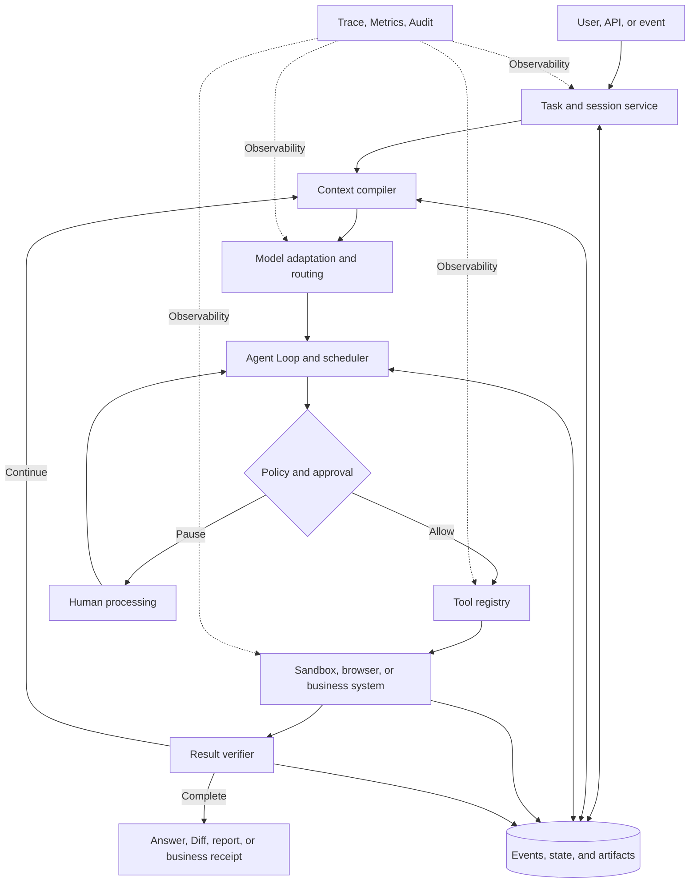
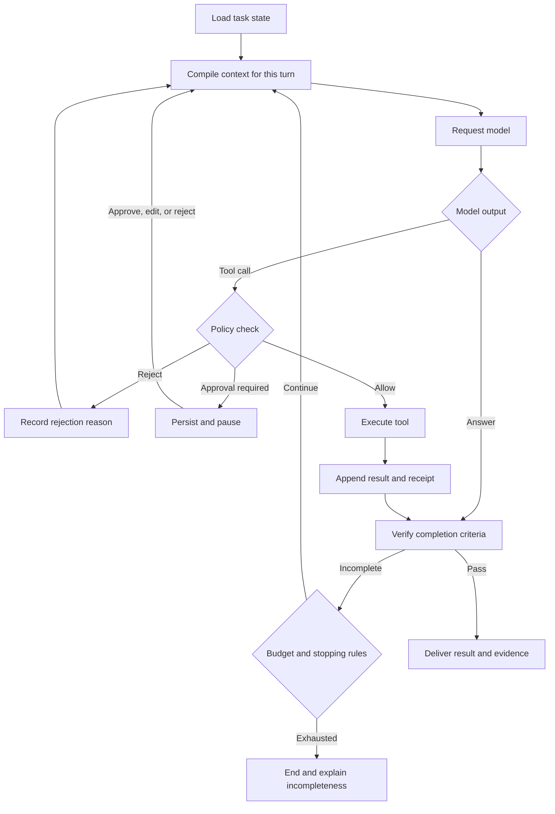
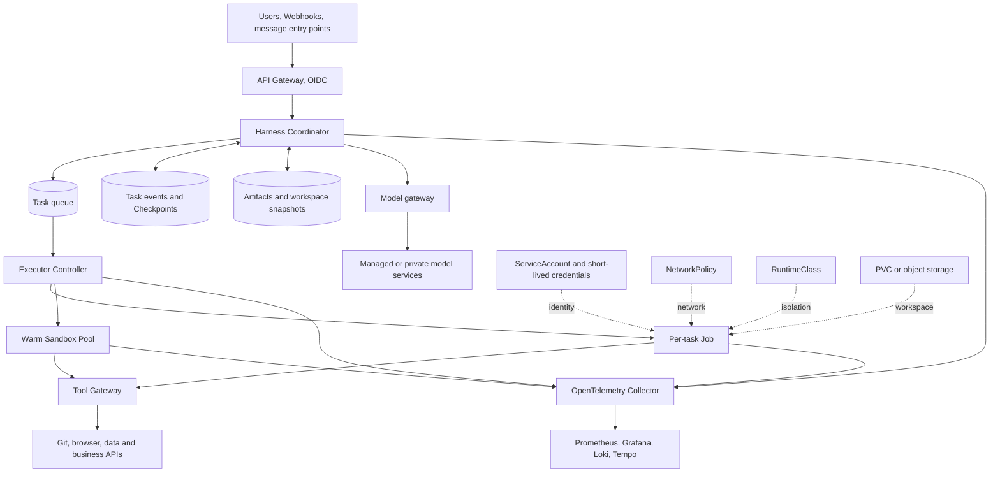

# Agent Harness Technical Overview: Beyond the Model, How Agents Continuously Complete Real-World Tasks

When the same model is integrated into different programming assistants, research agents, or enterprise platforms, the completion rate, speed, and safety can differ significantly. The difference comes not only from the prompt, but also from the system surrounding the model that is responsible for organizing context, calling tools, saving state, executing code, controlling permissions, and verifying results. This system is commonly referred to as the **Agent Harness**.

"Harness" originally means a set of straps and fittings, or a complete set of equipment. In the Agent domain, it emphasizes: connecting the model's reasoning capability to the real environment, while constraining what the model can do, how it leaves evidence, and where it resumes after failure. All references to Harness in this article refer to the **Agent Harness**, and are unrelated to the software delivery product of the same name, Harness.io.

## One-Page Summary

1. **A Harness is not a model wrapper, but the runtime and governance layer of an Agent.** The model proposes the next action; the Harness is responsible for preparing context, executing actions, saving state, enforcing permissions, deciding whether to continue, and delivering verifiable results.
2. **The number of tools is not the core metric; the quality of tool interfaces is.** Parameter semantics, return structures, error messages, idempotency, and feedback speed all directly affect the model's decision quality. SWE-agent calls this layer the Agent-Computer Interface (ACI).
3. **State must be independent of the process.** Long-running tasks encounter model rate limits, tool timeouts, Pod restarts, human approvals, and context compaction; an in-memory message list alone cannot reliably recover.
4. **"What the model suggests executing" and "what the system allows executing" must be separated.** The Harness should check identity, parameters, resources, network, budget, and approval policies at the tool call boundary, then hand approved actions to the sandbox or business system.
5. **The verifier determines whether a task is truly complete.** Tests passing, files existing, APIs returning 2xx, or the model saying "done" may all be only intermediate signals. Production Harnesses need machine-verifiable completion criteria defined per task.
6. **Deterministic workflows and autonomous agents should be used in combination.** Let code handle transactions, approvals, and irreversible operations; let the model handle understanding, planning, information extraction, and exception handling. This is usually more stable than a fully open loop.
7. **MCP, sandboxes, and model gateways are not complete Harnesses.** MCP solves the connection protocol, sandboxes solve execution isolation, and model gateways solve model access; the Harness orchestrates these capabilities into a recoverable, auditable task chain.
8. **Kubernetes is suitable for hosting a Harness, but does not automatically grant it reliability.** Production deployment still requires separating the control plane from the execution plane, using persistent events, task queues, least-privilege identities, network policies, isolated workspaces, and complete traces.

## 1. Understanding the Harness Through a Real-Life Scenario

Think of the model as an experienced engineer. Giving him only a chat box is like answering questions over the phone; giving him a computer, code repository, terminal, and browser is when he can actually modify and verify systems.

But enterprises don't just hand engineers a computer and admin password. They also provide tickets, access control, approvals, development environments, version management, monitoring, and auditing:

| Facility in a real organization | Corresponding capability in an Agent system |
| --- | --- |
| Tickets and acceptance criteria | Tasks, constraints, and completion criteria |
| Workbench and reference folders | Context, workspace, and memory |
| Tool cabinet | Tool Registry, MCP Server, enterprise connectors |
| Access control and approval forms | Identity, policy, Guardrail, Human-in-the-loop |
| Laboratory | Container, browser, VM, or remote Sandbox |
| Work logs and monitoring | Event Log, Trace, Metrics, Audit Log |
| Code review and quality inspection | Tests, rule validation, independent Verifier |

The model is responsible for judgment; the Harness provides the work discipline and infrastructure needed to complete the task. An expression convenient for engineering discussion is:

```text
Agent System = Model + Harness + Tools + Environment + Policy
```

Where the Model decides "what to suggest doing next," and the Harness decides "how to make this step happen safely, continuously, and verifiably in the real system." The official introduction of DeepSeek Harness also uses "Agent = Model + Harness" to emphasize this relationship. [DeepSeek Harness](https://www.deepseek.com/harness/en/)

## 2. How the Harness Differs from Adjacent Concepts

Different projects name Agent Runtime, Framework, Orchestrator, and Harness inconsistently. When evaluating, look at responsibilities rather than product names.

| Concept | Primary problem it solves | What it lacks when used alone |
| --- | --- | --- |
| Model API | Generating text, reasoning, and Tool Calls | Task state, actual execution, permissions, recovery, and acceptance |
| Agent SDK / Framework | Defining agents, tools, handoffs, and loops in code | May not provide isolated execution, multi-tenant governance, or production operations |
| Workflow engine | Fixed steps, branching, retries, and compensation | Dynamic planning and tool selection in open-ended tasks |
| Agent Runtime | Driving turns, state, and tool execution | Some Runtimes only provide low-level execution primitives, without a complete workbench and policies |
| MCP | Unifying the connection protocol between Agents and tools, resources, and prompts | Task loop, state, sandbox, approval, verification, and UI |
| Sandbox | Isolating code, Shell, browser, and file system | Model loop, context, business authorization, and task orchestration |
| Model gateway | Model routing, rate limiting, quotas, keys, and auditing | Tool execution, workspace, task state, and completion determination |
| Harness | Composing context, model, tools, state, execution, policy, and verification into a closed task loop | Still requires choosing the model, tools, storage, and infrastructure implementation |

In the [MCP architecture](https://modelcontextprotocol.io/specification/2025-06-18/architecture), the Host is responsible for permissions, connection lifecycle, context aggregation, and orchestration, while the Server exposes tools, resources, and prompts. It is a very important tool integration boundary for the Harness, but the protocol itself does not determine how the Agent loops, when it pauses, or how it resumes.

## 3. Logical Architecture of a Complete Harness



The most important boundary in this diagram is: **the model only proposes actions, the policy layer decides whether they can be executed, the execution environment produces facts, and the verifier judges whether the facts satisfy the goal.** Mixing these four together is the most common cause of privilege escalation, false completion, and unrecoverable failures.

### 3.1 Context Compiler

Context is not about stuffing the entire chat history directly into the model. The Harness needs to combine, based on the current task and token budget:

- System instructions, organizational rules, and user constraints;
- Current plan, pending items, and completion criteria;
- Tool definitions, parameter schemas, and permission scopes;
- Retrieval results, repository files, pages, and business data;
- Historical summaries, recent tool results, and failure reasons;
- Time, identity, environment, budget, and risk level.

Mature implementations also record what the model actually saw in each request. Otherwise, even if the raw conversation is saved, it is impossible to explain why the model made a particular decision at a particular step.

Context compaction should not only pursue brevity. Identity boundaries, explicit user constraints, unfinished items, sources, and receipts of external operations are information that must be preserved; repeated logs in tool output and content already persisted as state are what is suitable for trimming.

### 3.2 Model Adaptation and Routing

Beyond compatibility with different APIs, the model layer must also handle streaming output, Tool Calls, structured results, retries, rate limiting, caching, and degradation. Production systems should write the following versions together into the Trace:

```text
model + inference configuration + system prompt + tool schema + harness version
```

Recording only the model name is insufficient to reproduce an experiment. The same model with different tool descriptions, context ordering, or stopping conditions can produce different task performance.

### 3.3 Tools and ACI

Tools are the interface through which the model acts on the external world. A general-purpose Shell that is convenient for humans is not necessarily the best interface for a model; a narrow and clear `create_change_request()` is often more reliable than a set of vague HTTP or database tools.

A good tool interface typically has:

- Clear verbs, parameter types, units, and default values;
- Structured, stable, and length-controlled return values;
- Error codes that distinguish "parameter error, permission denied, temporary failure, business conflict";
- Query status, retry, cancel, and idempotency capabilities;
- Explicit declarations of read-only, reversible, approval-required, or irreversible;
- Resource IDs, version numbers, and receipts returned for verification.

The [SWE-agent paper](https://arxiv.org/abs/2405.15793) calls the computer interface designed for agents the ACI, and demonstrates through software engineering tasks that interface design itself significantly affects agent performance. Therefore, when evaluating a Harness, you cannot just count "how many tools are connected"; you must also test whether the model can stably understand and use these tools.

### 3.4 Agent Loop and Stopping Conditions

The minimal Agent Loop looks simple:



The truly difficult part is stopping semantics. The Harness must consider at least:

- Whether the task completion criteria pass verification;
- Maximum turns, tokens, cost, and wall-clock time;
- Repeated identical actions or no-progress loops;
- User cancellation, policy rejection, or human takeover;
- Whether downstream unavailability is worth retrying;
- Whether partial success and external side effects have already occurred.

Anthropic calls predefined code paths Workflows, and systems where the model dynamically determines the process and tool usage Agents, recommending starting with the simplest solution that meets the requirements. [Building Effective Agents](https://www.anthropic.com/engineering/building-effective-agents)

### 3.5 State, Event Logs, and Checkpoints

The state of a long-running task cannot exist only in the memory of a single process. It is recommended to divide information into three categories:

| Type | Content | Recommended storage method |
| --- | --- | --- |
| Fact events | User messages, model requests, Tool Calls, execution results, approvals, and state changes | Append-only event stream, preserving order and causal relationships |
| Derived state | Current step, plan, budget, tool state, and waiting reason | Computed from events and established as Checkpoints |
| Large artifacts | Repository snapshots, logs, screenshots, reports, Diffs, and data files | Object storage or persistent volumes; events store only references and hashes |

DeepSeek Harness uses an append-only Session Log, allowing resume, fork, search, and replay to be based on the same event stream; [LangGraph Persistence](https://docs.langchain.com/oss/python/langgraph/persistence) saves Checkpoints at execution steps to support Human-in-the-loop, failure recovery, and time travel. The implementations differ, but both embody the same principle: **task facts must outlive the process running the task.**

### 3.6 Execution Environment and Sandbox

Agents may execute Shell, Python, browser automation, file editing, compilation, or third-party CLIs. The isolation level should be chosen based on risk:

| Execution environment | Startup and resource cost | Isolation strength | Typical scenarios |
| --- | ---: | ---: | --- |
| Host process | Low | Low | Trusted single-user, local development |
| Container | Low | Medium | Routine code and data tasks |
| gVisor / Kata | Medium | Medium to high | Multi-user, unknown dependencies, and higher-risk code |
| MicroVM / VM | High | High | Strong tenant isolation, browser, and untrusted code |
| Remote business API | Depends on the service | Determined by interface and authorization | Enterprise records, publishing, payments, and production changes |

[OpenHands Runtime](https://docs.openhands.dev/openhands/usage/architecture/runtime) places arbitrary code into a Docker Sandbox to achieve isolation, consistency, resource control, and reproducible environments. Note that containers or VMs only solve the execution boundary; whether a business system allows a given user to perform a given operation must still be determined by the identity and authorization layer.

For a more complete Sandbox comparison and Kubernetes experiments, see: [Agent Sandbox Selection and Analysis](agent-sandbox-selection.md) and [Firecracker Kubernetes Experiment](firecracker-kubernetes-lab/index.md).

### 3.7 Policy, Approval, and Identity

Policy should take effect at the action boundary, not just be written into the System Prompt. For each Tool Call, the Harness can judge in the following order:

1. Whether the current user and task identity can use this tool;
2. Whether the parameters conform to the Schema, data scope, and resource limits;
3. Whether the operation is read-only, reversible, approval-required, or forbidden;
4. Whether credentials can be exchanged for short-lived least-privilege tokens for this task;
5. Whether the network destination and data egress are allowed;
6. Whether cost, call count, and runtime budgets are exceeded;
7. Whether human approval, parameter editing, or rejection is required.

Approval must be durable state: pending actions must still be visible after a process restart, and approved actions must not be executed twice. [OpenAI Agents SDK Human-in-the-loop](https://openai.github.io/openai-agents-python/human_in_the_loop/) supports serialized run state, resuming after approval, editing, or rejection; [LangChain Human-in-the-loop](https://docs.langchain.com/oss/python/langchain/human-in-the-loop) also combines tool policies with the Checkpointer.

### 3.8 Verifier

The model outputting "completed" is only a claim. The verifier should use evidence as independent from the generation process as possible:

| Task | Weaker completion signal | More reliable verification |
| --- | --- | --- |
| Fixing code | The model says the issue is fixed | Specified tests pass, Diff satisfies scope, static checks show no new issues |
| Generating a report | The file has been written | Required sections, citations, data consistency, and rendering results pass checks |
| Modifying configuration | API returns success | Read the target resource, verify version, actual fields, and controller state |
| Publishing content | HTTP 2xx | Obtain the publish ID and read the final state from the target system |
| Data analysis | A conclusion is produced | Input snapshot, computation process, units, and key numbers can be recomputed |

On verification failure, structured differences should be fed back to the Agent, rather than just returning "failed." This way the model can know whether a file is missing, values are inconsistent, or the external state has not yet converged.

### 3.9 Observability and Evaluation

The Harness Trace should be able to answer: why the task was executed this way, where time and cost were spent, which action changed an external system, and whether recovery after failure is possible.

```text
Run
├── Turn / Step
│   ├── Context build
│   ├── Model generation
│   ├── Policy / Approval
│   ├── Tool execution
│   │   └── Sandbox or business API
│   └── Verification
└── Final artifact and outcome
```

[OpenAI Agents SDK Tracing](https://openai.github.io/openai-agents-python/tracing/) uses Trace and Span to express Agent, Generation, Function, Guardrail, and Handoff; the [OpenTelemetry GenAI semantic conventions](https://opentelemetry.io/docs/specs/semconv/registry/attributes/gen-ai/) also cover concepts such as Agent, Workflow, Conversation, Tool Call, and Token Usage. Tool parameters and results may contain credentials, personal information, or source code, so collection must apply classification, masking, and retention-period limits.

Production metrics should cover at least:

| Dimension | Recommended Metrics |
| --- | --- |
| Quality | Task completion rate, validation pass rate, first-pass rate, manual rework rate |
| Performance | End-to-end latency, model latency, tool latency, queueing and approval wait time |
| Cost | Tokens per accepted task, model cost, Sandbox duration, and human time |
| Reliability | Retry rate, recovery success rate, duplicate side effects, no-progress loops, and timeout rate |
| Security | Policy rejections, privilege escalation attempts, sensitive data egress, approval bypasses, and anomalous plugin invocations |
| Operations | Active tasks, backlog, execution pool utilization, version distribution, and dependency failures |

Looking only at per-model-call accuracy misses most of the variance introduced by the Harness. A more useful cost formula is:

```text
有效任务成本 =（模型 + 工具 + 执行环境 + 重试 + 人工复核）/ 已验收任务数
```

## 4. Why the Same Model Performs Differently Across Harnesses

The model is one of the upper bounds on Agent capability; the Harness determines whether that capability can be reliably converted into task results.

| Variable | Impact on Results |
| --- | --- |
| Context selection | Whether relevant files are complete, whether rules conflict, whether history summaries lose critical constraints |
| Tool interface | Whether the model can understand parameters, whether errors are recoverable, whether return values are too long or ambiguous |
| Execution feedback | Whether tests, pages, commands, and business systems promptly return real environment state |
| Loop policy | When to re-plan, how to prevent repetition, when to stop or ask for help |
| State recovery | Whether execution can resume from the exact position after rate limiting, network outages, Pod restarts, and approval waits |
| Verification method | Whether the model's self-reported completion is accepted, or independent, reproducible checks are used |
| Permission design | Whether excessive permissions create risk, or overly restricted tools prevent task completion |
| Latency and budget | Tool round-trips that are too slow or budgets that are too small force the model to choose suboptimal shortcuts |

Therefore, model evaluation and Harness evaluation should be separated:

- Fix the Harness and compare task completion rates across different models;
- Fix the model and inference parameters, and compare different contexts, tools, and loop policies;
- Replay fixed tool results to isolate model decision differences;
- Inject timeouts, rate limiting, Pod restarts, and approval delays to check recovery semantics;
- Run version regression against the same golden tasks to avoid silent degradation from prompt or tool upgrades.

## 5. Workflow, Constrained Agent, and Open Agent

Production systems do not have to choose between "everything is a pipeline" and "full autonomy."

| Form | Who Decides the Path | Advantages | Applicable Scope |
| --- | --- | --- | --- |
| Deterministic Workflow | Code | Predictable, auditable, easy to compensate | Reconciliation, approvals, release pipelines, fixed business processes |
| Constrained Agent | Model chooses within allowed states and tools | Balances flexibility and governance | Customer service handling, ticket classification, code modification, research tasks |
| Open Agent | Model dynamically plans and uses general-purpose tools | Handles complex tasks with unclear boundaries | Exploration, personal assistants, low-risk and reviewable work |

A common production combination is: the entry point uses a Workflow for identity, parameters, and task classification; the middle delegates ambiguous problems to an Agent for investigation or candidate generation; high-risk actions return to deterministic APIs, approvals, and transactional systems. This preserves the model's ability to handle exceptions while keeping clear control points over critical side effects.

## 6. Focus Areas of Mainstream Implementations

The following projects are not at the same abstraction layer; the table is for observing how they cover Harness capabilities, not for simple ranking.

| Project | Primary Positioning | Notable Harness Capabilities | Gaps or Caveats |
| --- | --- | --- | --- |
| [DeepSeek Harness](https://github.com/deepseek-ai/deepseek-harness) | Plugin-based Agent Harness | Cordis plugin kernel, model/tool/session/sandbox seams, append-only session logs, multiple run modes | Still Developer Preview; enterprise authentication, multi-tenancy, and remote execution require self-integration |
| [Deep Agents](https://docs.langchain.com/oss/python/deepagents/overview) + [LangGraph](https://docs.langchain.com/oss/python/langgraph/overview) | Application Harness + durable execution Runtime | Planning, sub-agents, filesystem, Checkpoint, recovery, HITL, and graph orchestration | Developers still need to design state, tools, storage, and deployment boundaries |
| [OpenAI Agents SDK](https://openai.github.io/openai-agents-python/) | Lightweight Agent SDK | Agent, Tool, Handoff, Guardrail, Session, Tracing, HITL, and Sandbox Agent | Strong isolation, enterprise tool authorization, and platform control plane still need to be built per scenario |
| [OpenHands](https://github.com/OpenHands/OpenHands) | Software development Agent platform | Agent Server, Conversation, Workspace, Event, terminal, and code Sandbox | Oriented toward software engineering scenarios; production deployment requires further governance of models, network, and tenants |
| [SWE-agent](https://github.com/SWE-agent/SWE-agent) | Software engineering research Harness | Emphasizes ACI, task environments, and reproducible evaluation | Focus is research and benchmarks, not a general-purpose enterprise Agent platform |

For DeepSeek Harness's plugin architecture, Agent Loop, and session persistence, continue with the [repository deep dive](deepseek-harness-repository-analysis.md); for Docker, Compose, Helm, and StatefulSet practices, see [containerized deployment](deepseek-harness-runtime-containerization.md).

## 7. Reliability: Retry Is Not Recovery

A single Harness task can last from minutes to hours. The focus of reliability design is not unconditional retry, but knowing whether an action occurred, whether it can be safely replayed, and where to resume from.

| Failure Location | Recommended Handling | Key Prerequisite |
| --- | --- | --- |
| Model request timeout with no response | Retry by request ID | Provider supports idempotency or confirms no consumable result was produced |
| Read-only tool failure | Exponential backoff and retry | Tool has no side effects, errors are classifiable |
| Write tool connection interruption | First query status by idempotency key, then decide whether to retry | Tool has operation ID, status query, and receipt |
| Sandbox / Pod disappears | Create new execution environment from latest Checkpoint | Workspace, events, and artifacts are independently persisted |
| Waiting for human approval | Release compute resources, pause durably | Approval object, parameters, and state are saved |
| Context compaction | Save summary sources and unfinished constraints | Can return to original events and artifacts |
| Downstream partial success | Execute compensation or route to manual handling | Compensation actions and ownership are predefined |

For external side effects, it is very difficult for a system to achieve "exactly once" out of thin air. A more realistic combination is:

```text
幂等键 + 操作状态查询 + 不可变回执 + 对账 + 补偿流程
```

For example, if the Agent submits a release request and the connection drops, the Harness should not directly publish again; it should first query the target system using `operation_id`, and only retry when it confirms the action was not executed.

## 8. Security: Separate Untrusted Content from Executable Instructions

Agents simultaneously read web pages, documents, Issues, emails, and tool results, which may contain Prompt Injection. The Harness should treat these as data, and trusted policies should decide which content can influence actions.

The production baseline includes:

- Each task uses an independent identity and short-lived credentials, without sharing long-lived administrator keys;
- Tools use an allowlist; write operations use narrow interfaces and structured parameters;
- Browsed content, repository content, and tool results are not automatically promoted to system instructions;
- Sandbox restricts CPU, memory, disk, processes, system calls, mounts, and network egress;
- Downloads, plugins, and Skills have provenance, signatures, pinned versions, and scanning mechanisms;
- High-risk actions require approval before execution, and the approval page shows real parameters and impact scope;
- Trace and logs do not collect secrets by default, and classify source code, personal information, and business data;
- Red-team testing covers indirect prompt injection, privilege escalation, memory poisoning, plan manipulation, and duplicate side effects.

"Don't leak secrets" in the prompt cannot replace secret isolation at execution time; model compliance with rules cannot replace backend authorization.

## 9. Production Architecture on Kubernetes

Kubernetes can provide Harness with resource scheduling, failure reconstruction, identity, network, and isolation primitives. It is recommended to separate the long-lived control plane from the short-lived execution plane:



### 9.1 How Kubernetes Primitives Map to Harness

| Harness Requirement | Kubernetes Primitive | Production Considerations |
| --- | --- | --- |
| Stateless API and Coordinator | Deployment, Service, HPA | Session and task state must not live only in Pod memory |
| Bounded one-shot execution | Job | Set timeouts, retry limits, TTL, and idempotent recovery; [Job](https://kubernetes.io/docs/concepts/workloads/controllers/job/) only guarantees Pod recreation, not business side-effect semantics |
| Low-latency execution | Warm Sandbox Pool | Pool environments must be cleaned before allocation to avoid cross-tenant residue |
| Durable task facts | PostgreSQL / Event Store | Events, Checkpoints, and artifact references must share a unified Run ID |
| Large workspaces and artifacts | PVC, CSI, object storage | Distinguish temporary working disks from long-term artifacts; record versions and hashes |
| Task identity | ServiceAccount, OIDC, Workload Identity | Use least privilege per tool class; do not mount default high-privilege Tokens |
| Network egress control | NetworkPolicy, Egress Gateway, DNS Policy | [NetworkPolicy](https://kubernetes.io/docs/concepts/services-networking/network-policies/) depends on CNI implementation and primarily operates at L3/L4 |
| Strong isolation | RuntimeClass, gVisor, Kata, MicroVM | Layer by task risk; verify host kernel, device, and storage boundaries |
| Resource fairness and cost control | ResourceQuota, LimitRange, PriorityClass, Kueue | Account for model inference and Sandbox resources separately; prevent a single long task from saturating the queue |
| Observability | OTel Collector, Prometheus, Loki, Tempo | Unify Run, Turn, Tool, Pod, and business operation IDs |

### 9.2 Three Deployment Forms

**Shared control plane + per-task Job** suits code and data tasks with well-defined execution times and higher isolation requirements. After a task enters the queue, a Job is created; upon completion, diffs, reports, and logs are written to object storage, and compute resources are cleaned up via TTL.

**Shared control plane + warm Sandbox pool** suits interactive programming or browser Agents. It reduces cold-start latency but requires reliable tenant-switch cleanup, capacity prediction, and pool water-level control.

**Per-user StatefulSet + PVC** suits personal workbenches or developer previews, for example placing a single-user DeepSeek Harness Web Runtime into Kubernetes. It is convenient for preserving local state but should not be mistaken for a shared multi-tenant control plane. For related deployment boundaries, see [DeepSeek Harness + Chromium Kubernetes in Practice](../practices/deepseek-harness-kubernetes.md).

### 9.3 Do Not Keep Occupying Execution Resources During Approval

Humans may take hours to process a request. The Harness should complete the following actions before approval:

1. Write the pending tool, parameters, context summary, and risk into the state store;
2. Save workspace deltas and artifacts to persistent storage;
3. Release the Job, GPU, browser, or remote Sandbox;
4. After approval, resume with the same Run ID, re-verifying permissions and external state;
5. Execute the approved action using an idempotency key.

This consumes fewer resources than keeping a Pod suspended for a long time, and is more resilient to node maintenance and cluster upgrades.

## 10. A Complete Code-Change Agent Case Study

Suppose the user requests "fix the pagination error in the service, run the tests, and submit a reviewable change." An auditable task chain can be designed as follows:

1. API Gateway verifies user identity and writes the repository, branch, Issue, and acceptance commands into the task;
2. Coordinator creates a Run and saves the model, prompt, tool Schema, and Harness version;
3. Executor allocates an independent workspace and short-lived read-only Git credentials for the task;
4. Agent reads code, searches call relationships, and forms a plan;
5. Every Shell, file modification, and dependency download passes through the policy layer; network only allows approved domains;
6. Agent modifies code and runs the specified tests in the Sandbox;
7. Verifier independently checks test results, diff scope, sensitive files, and newly added dependencies;
8. Harness generates the Diff, test summary, and full Trace, then waits for user confirmation;
9. After user approval, the system exchanges short-lived write credentials and creates a branch or PR;
10. The PR ID is used to read back the target system, confirming the final state before ending the Run.

If the Pod is reclaimed at step 6, the new Pod resumes from the Checkpoint and workspace snapshot; if the network drops at step 9, the system first queries whether the PR was already created using the idempotency key or branch name. The recovery process does not depend on the model "remembering what it just did."

## 11. How to Decide Whether You Need a Harness

| Requirement | Recommended Approach |
| --- | --- |
| Single-turn Q&A, summarization, or classification | Use the model API directly, with structured output and basic auditing |
| Fixed-path business processes | Workflow engine as the primary mechanism, calling the model at a few nodes |
| Needs search, code, browser, or multi-turn correction | Use a Harness with state, tools, verification, and Sandbox |
| High-risk enterprise operations | Constrained Agent + Tool Gateway + durable approval + deterministic transactions |
| Research on complex open-ended problems | Allow more flexible loops, but limit budget, sources, and final publishing actions |
| Multi-Agent collaboration | Only adopt when roles, contexts, or parallel tasks can be clearly separated |

When selecting, check in sequence:

1. Can the context actually seen by each model request be reconstructed;
2. Do tools have clear schemas, error classification, idempotency, and acknowledgments;
3. After a process or Pod disappears, can recovery resume from a known location;
4. Can human approval be durably paused and safely resumed;
5. Are completion conditions verified by independent evidence;
6. Is user identity propagated to the tool layer, with least privilege enforced;
7. Does the Sandbox restrict files, network, resources, and tenant boundaries;
8. Can traces link models, tools, execution environments, and business operations;
9. Is there a realistic task set covering success, failure, recovery, and security;
10. Can model, prompt, tool, and Harness upgrades be regression-tested in the same batch.

If most of these questions have no answers, the system may already be demoable, but it is not yet ready to handle real business unattended.

## 12. Technical Trends

### Co-design of Harness and Models

Models will be optimized for specific tool formats, editing protocols, and long-task feedback, while the Harness will adjust context, tools, and recovery strategies based on actual model behavior. The two will increasingly resemble a jointly iterated system rather than two arbitrarily interchangeable black boxes.

### Event Streams and Replayable Execution Become Foundational Capabilities

Long tasks, approvals, branch exploration, and failure recovery all require persisting events and checkpoints. In the future, "replaying a failed task," "forking from step N," and "comparing decisions made by two Harnesses in the same environment" will become standard evaluation methods.

### Separation of Control Plane and Execution Plane

Sessions, policies, and scheduling remain on a stable control plane; Shell, browser, and code execution run in remote Sandboxes created per task. This separation makes it easy to use different isolation levels, elastic scaling, and heterogeneous compute resources, and also reduces the risk of the Harness main service directly holding host privileges.

### Protocol Standardization, but System Differences Remain in the Harness

Protocols such as MCP will lower the cost of tool integration, and OpenTelemetry semantic conventions will improve cross-framework observability. After protocol unification, context compilation, tool interfaces, loops, validation, permissions, and evaluation will still determine the final task completion rate.

### The Harness Itself Begins to Be Optimized and Evaluated

The 2026 [Harness-of-Harness](https://arxiv.org/abs/2609.01481) study attempts to let an upper-level system iteratively improve Agent Harnesses, and reports significant gains across multiple programming benchmarks and Harness–model combinations. It is a relatively new research result and does not yet represent all tasks and production environments, but it shows that the Harness has evolved from "glue code around the model" into an object that can be independently designed, evaluated, and optimized.

## Conclusion

The value of an Agent ultimately lies in whether the task is completed, not in how many plausible-looking steps the model generates. The Harness connects model suggestions to real tools and environments, and then uses state, policy, isolation, validation, and observability to turn open-ended reasoning into an engineering system that can actually run.

When building a Harness, the highest-priority investment is not adding more tools, but making existing tools clearly usable, making external actions traceable, making failed tasks recoverable, and making completion results verifiable. Model capabilities will keep changing; these foundational mechanisms determine whether the system can safely absorb new model capabilities and run in real business over the long term.

## References and Further Reading

- [DeepSeek Harness Official Introduction](https://www.deepseek.com/harness/en/) and [Open Source Repository](https://github.com/deepseek-ai/deepseek-harness)
- [Anthropic: Building Effective Agents](https://www.anthropic.com/engineering/building-effective-agents)
- [OpenAI Agents SDK](https://openai.github.io/openai-agents-python/)
- [LangGraph Overview](https://docs.langchain.com/oss/python/langgraph/overview) and [Persistence](https://docs.langchain.com/oss/python/langgraph/persistence)
- [Model Context Protocol Architecture](https://modelcontextprotocol.io/specification/2025-06-18/architecture)
- [OpenHands](https://github.com/OpenHands/OpenHands) and [Runtime Architecture](https://docs.openhands.dev/openhands/usage/architecture/runtime)
- [SWE-agent: Agent-Computer Interfaces Enable Automated Software Engineering](https://arxiv.org/abs/2405.15793)
- [OpenTelemetry GenAI Semantic Conventions](https://opentelemetry.io/docs/specs/semconv/registry/attributes/gen-ai/)
- [2026 AI Agent Status, Implementation Principles, and Trends](agent-landscape-2026.md)
- [CubeSandbox Agent Adapter v0.5: Multi-Runner, Strong Audit, and Observability in Practice](cubesandbox-agent-adapter-v05.md)
