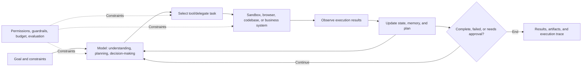

# The State, Implementation Principles, and Trends of AI Agents in 2026

> Research date: 2026-08-10
> Note: "Popular" in this article weighs product influence, developer adoption, ecosystem activity, and open-source community attention together; it does not represent a strict market share ranking. Commercial products generally do not disclose full technical details, so their implementation principles are based on official public materials and observable behavior.

## One-Page Summary

1. **An agent is not a model that is better at chatting, but a system that can continuously act toward a goal.** A practical agent typically consists of a model, instructions, tools, state/memory, execution environment, permissions, and evaluation.
2. **Coding agents are currently the most mature and most competitive direction.** Codex, Claude Code, Cursor, Gemini CLI, Devin, and OpenHands have moved from "code completion" into a complete closed loop of "understand the repository—modify files—run commands—test—commit/deliver."
3. **The key to general-purpose agents is not just model intelligence, but whether there is a controllable "computer."** Manus, Comet, Browser Use, and others rely on browsers or cloud sandboxes to complete web operations, data processing, document generation, and application building.
4. **Enterprise agents are shifting from chatbots to a governed business execution layer.** The competitive focus of Copilot Studio, Agentforce, and Gemini Enterprise Agent Platform is connectors, enterprise data, identity permissions, auditing, process orchestration, and industry templates.
5. **Production systems are returning to "deterministic workflows + local autonomous decision-making."** Fully open-ended agents are costly, high-latency, and hard to reproduce; reliable solutions typically let the model handle understanding, routing, and exception handling, while letting code handle transactions, approvals, and irreversible actions.
6. **Multi-agent systems will grow, but will not become the default answer to every problem.** Only when a task can be clearly decomposed into independent roles, verified in parallel, or requires isolated context does multi-agent generally outperform a single strong model with good tools.
7. **MCP and A2A are forming a two-layer interoperability standard.** MCP connects agents to tools/data, and A2A connects agents to agents; the real moat will gradually shift toward data, permissions, skills, evaluation sets, and business closed loops.
8. **Security and evaluation are the main bottlenecks for agent deployment.** Prompt injection, unauthorized calls, sensitive information leakage, memory pollution, and error accumulation across long chains determine that sandboxes, least privilege, human confirmation, trace tracking, and regression evaluation must become infrastructure.

## 1. What Counts as an Agent

Traditional chat models typically perform a single "input → output" pass; an agent, by contrast, repeatedly observes the environment, selects tools, executes actions, reads results, and revises its plan based on the goal, until a completion condition is met or a stop rule is triggered.



Current mainstream implementations can be summarized into seven layers:

| Layer | Role | Common Implementations |
|---|---|---|
| Model | Understand goals, reason, decide | Reasoning models, multimodal models, large/small model routing |
| Instructions | Define role, boundaries, completion criteria | System prompts, repository rules, skills, policy templates |
| Tools | Read information or change the external world | Function calling, shell, browser, database, enterprise connectors, MCP |
| Orchestration | Determine steps, branches, retries, and delegation | ReAct, Plan-and-Execute, state graphs, Manager–Worker |
| State | Maintain task continuity | Conversation history, workspace files, checkpoints, short-term/long-term memory, RAG |
| Runtime environment | Safely execute real actions | Local machine, containers, cloud VMs, headless browsers, IDE, mobile/desktop applications |
| Governance | Control risk and measure results | Sandbox, least privilege, approval, budget, tracing, evals, audit logs |

Anthropic makes a very practical distinction between "workflows" and "agents": the former has paths predefined by code, while the latter has the model dynamically determine the process and tool usage; it also recommends starting with the simplest, composable options, because agents typically trade higher latency and cost for flexibility. [Source](https://www.anthropic.com/engineering/building-effective-agents)

## 2. Notable Popular Agents Today

### 2.1 Coding Agents: The Most Mature Track

| Product | Positioning and Strengths | Basic Implementation Principles | Best Suited For |
|---|---|---|---|
| **OpenAI Codex** | Coding agent covering terminal, IDE, desktop, cloud, and GitHub; emphasizes understanding codebases, implementing features, fixing issues, testing, and review | A coding-optimized model loops through file search, editing, shell, testing, and browser tools within a controlled workspace; uses Skills/MCP to inject domain processes, and sandbox, approval, and diff review to control side effects | End-to-end engineering tasks, cross-file modifications, test fixes, parallel background tasks |
| **Claude Code** | Terminal-native, with outstanding long-context code understanding, refactoring, and complex problem analysis; active plugin, hook, MCP, and sub-agent ecosystem | The model works in a "search/read → edit → run commands → observe errors → fix" loop; project instructions, permission modes, plugins, and tool descriptions together form the agent harness | Large codebase understanding, complex refactoring, research-oriented engineering tasks, terminal workflows |
| **Cursor Agent** | Agent deeply embedded in the editor, with mature interaction, diff review, checkpoint, and multi-session experiences, plus background agents | Codebase indexing/semantic retrieval provides context; the model calls search, edit, terminal, and MCP tools; the editor handles local change application, rollback, human takeover, and parallel sessions | High-frequency daily development, review-while-writing, team adoption, frontend iteration |
| **Gemini CLI** | Google's open-source terminal agent, with strong reach from its free entry point and large context; supports scripting, extensions, and MCP | The open-source CLI handles sessions, context files, checkpoints, and the tool loop; the model uses the file system, shell, web, and MCP, and can enter CI automation via headless/JSON output | Google/GCP ecosystem, open-source extensible CLI, automation scripts |
| **Devin** | Closer to a "cloud AI software engineer," emphasizing taking on tasks, working in the background, and producing PRs | The officially published architecture splits into a cloud stateless **Brain** and an isolated **Devbox**; each session has a shell, editor, and browser, and the agent executes and tests on an independent machine with human real-time takeover capability | Small verifiable backlog tasks, migrations, test completion, batch parallel delegation |
| **OpenHands** | Popular open-source software development agent/platform; self-hostable, model-swappable, suitable for research and secondary development | The agent operates Bash, files, and browser in a container sandbox through an action–observation event loop; the SDK decouples agents, tools, workspaces, lifecycle, and security analysis | Self-hosting, agent research, private models, teams that need to modify the underlying harness |

Official materials: [Codex](https://developers.openai.com/) · [Claude Code](https://github.com/anthropics/claude-code) · [Cursor Agent](https://docs.cursor.com/chat/overview) · [Gemini CLI](https://github.com/google-gemini/gemini-cli) · [Devin](https://docs.devin.ai/get-started/devin-intro) / [Architecture](https://docs.devin.ai/enterprise/deployment/overview) · [OpenHands](https://github.com/OpenHands/OpenHands) / [Sandbox](https://docs.openhands.dev/openhands/usage/sandboxes/overview)

The reason this track leads is straightforward: software engineering naturally provides machine-readable context, executable tools, and automatic acceptance signals. Code can compile, tests can pass, diffs can be reviewed, and Git can roll back, making it easier for agents to form a closed loop than in the open world.

### 2.2 General-Purpose Execution and Browser Agents

| Product/Project | Core Form | Basic Implementation Principles | Current Boundaries |
|---|---|---|---|
| **Manus** | General-purpose agent with its own cloud computer; can research, analyze data, generate documents, and write and deploy applications | The agent gains a networked sandbox, persistent file system, software installation, and code execution capabilities; long tasks continue through planning, tool calls, file artifacts, and persistent cloud VMs | Broad coverage of open-ended tasks, but result acceptance, account permissions, and high-risk actions still require human oversight |
| **Perplexity Comet** | AI-native browser with sidebar/background assistant, using current tab, history, email, and calendar context | The browser directly provides page text, metadata, sessions, and login-protected UI; the agent combines search, tab context, and browser actions to complete tasks | Prompt injection, erroneous clicks, and sensitive account operations are the main risks |
| **Browser Use** | Popular open-source browser agent framework, providing real browser operation space for any model | Chromium/CDP drives the browser, compressing the DOM/accessibility tree, screenshots, and executable elements into model-understandable observations; the model then selects clicks, input, navigation, or code tools and loops with recovery | Generality is higher than traditional RPA, but stability is usually lower than direct APIs; website changes, CAPTCHAs, and anti-automation measures affect success rates |
| **Computer use models** | Models directly view the screen and operate browser, desktop, or mobile interfaces | Multimodal models read screenshots/UI state and output mouse, keyboard, or structured computer actions; an external harness handles execution, screenshot feedback, and sensitive action confirmation | This is "the last mile when there is no API" and should not be preferred over stable, auditable APIs |

Materials: [Manus introduction](https://manus.im/docs/introduction/welcome) / [Cloud Computer](https://help.manus.im/en/articles/15392111-what-is-the-cloud-computer) · [Comet](https://www.perplexity.ai/grow/comet) · [Browser Use](https://github.com/browser-use/browser-use) · [Gemini Computer Use](https://blog.google/innovation-and-ai/models-and-research/gemini-models/introducing-computer-use-gemini-3-5-flash/)

### 2.3 Enterprise Workflow Agent Platforms

| Platform | Competitive Advantages | Implementation Focus |
|---|---|---|
| **Microsoft Copilot Studio** | Microsoft 365, Power Platform, and a large number of enterprise connectors; low-code building and organizational governance | Combines agents from knowledge sources, Topics/instructions, connectors, Agent Flow, MCP, and Computer Use; generative orchestration handles tool selection, while deterministic processes handle critical business actions; supports sub-agents and triggers |
| **Salesforce Agentforce** | Salesforce CRM data, object model, and business actions naturally form a closed loop | The Atlas Reasoning Engine selects Topics with clear scope and rules based on intent, then calls permitted Actions; the trust layer, permissions, and guardrails constrain data and action boundaries |
| **Gemini Enterprise Agent Platform** | Google Cloud/Workspace data with unified agent registration, runtime, and governance | ADK/Agent Studio handles development, Agent Runtime handles long-running tasks and state, and Registry/Identity/Gateway handles discovery, identity, network egress, and policy control; A2A/MCP connect heterogeneous agents and tools |
| **ServiceNow AI Agents** | ITSM, customer service, HR, and other processes and data are already within the same platform | Agent Studio defines roles and goals, the Orchestrator coordinates multiple specialized agents, and directly invokes ServiceNow workflows and record systems to complete actions |

Materials: [Copilot Studio](https://learn.microsoft.com/en-us/microsoft-copilot-studio/) / [Integration strategy](https://learn.microsoft.com/en-us/microsoft-copilot-studio/guidance/integrations) · [Agentforce Atlas](https://engineering.salesforce.com/inside-the-brain-of-agentforce-revealing-the-atlas-reasoning-engine/) · [Gemini Enterprise Agent Platform](https://cloud.google.com/blog/products/ai-machine-learning/introducing-gemini-enterprise-agent-platform) · [ServiceNow AI Agent Orchestrator](https://www.servicenow.com/uk/company/media/press-room/ai-agents-studio.html)

The moat of enterprise platforms is usually not "smarter models," but that they already know who employees are, what data they can see, what actions they can invoke, how approval works, and how operations are audited and rolled back afterward.

## 3. Popular Agent Development Frameworks

Products are the end-user experience; frameworks are the foundation for building your own agents. The two should not be placed in the same ranking.

| Framework | Core Abstractions | Strengths | Main Trade-offs |
|---|---|---|---|
| **LangGraph** | State graphs, nodes, edges, checkpoints | Explicit control flow, durable execution, pause/resume, human-in-the-loop, and observability are mature | More low-level; developers need to carefully design state and graphs |
| **CrewAI** | Agent, Role, Task, Crew, Flow | Role-based multi-agent is quick to get started, suitable for collaboration flows such as research—writing—review | Too many roles can increase tokens, latency, and error propagation |
| **OpenAI Agents SDK** | Agent, Tool, Handoff, Guardrail, Session, Trace | Lightweight abstractions, tight integration with tool calling, multi-agent handoffs, real-time voice, tracing, and Sandbox Agent | Deep binding to hosted capabilities requires evaluating platform dependency; open model compatibility needs verification against actual functionality |
| **Google ADK** | Agent, Tool, Runner, Session, Memory, Callback, Event | Code-first, relatively decoupled from models and deployment, covering development, evaluation, and deployment, suitable for Google Cloud | The ecosystem is still evolving rapidly; version changes require continuous tracking |
| **Microsoft Agent Framework** | Agent, Session, Middleware, Graph Workflow | Inherits AutoGen's multi-agent approach and Semantic Kernel's enterprise capabilities; supports Python/.NET, checkpoints, OpenTelemetry, and Foundry deployment | A new-generation integrated framework; legacy AutoGen/Semantic Kernel projects require migration decisions |
| **Browser Use** | Browser, Observation, Action, Recovery Loop | Turns web pages into a model-operable environment, suitable for web automation without APIs | UI automation is inherently fragile; security and success rates require additional engineering |

Materials: [LangGraph](https://docs.langchain.com/oss/python/langgraph/overview) · [CrewAI](https://docs.crewai.com/index) · [OpenAI Agents SDK](https://github.com/openai/openai-agents-python) · [Google ADK](https://github.com/google/adk-python) · [Microsoft Agent Framework](https://github.com/microsoft/agent-framework) · [Browser Use](https://github.com/browser-use/browser-use)

### Open-Source Attention Snapshot

GitHub stars can only indicate developer attention; they cannot be equated with active users, enterprise adoption, or product quality, but they help observe ecosystem momentum. As of this research, representative projects are roughly:

| Project | Approximate Star Count | Type |
|---|---:|---|
| OpenClaw | 379k | Self-hosted personal Agent/Gateway |
| Claude Code | 139k | Programming Agent/plugin ecosystem entry point |
| Gemini CLI | 105k | Open-source terminal Agent |
| Browser Use | 96k | Browser Agent framework |
| OpenAI Codex | 86k | Open-source terminal programming Agent |
| OpenHands | 75k | Open-source software development Agent platform |
| CrewAI | 54k | Multi-Agent framework |
| LangGraph | 37k | Stateful orchestration framework |
| OpenAI Agents SDK (Python) | 27k | Agent SDK |
| Microsoft Agent Framework | 11k | Enterprise Agent/workflow framework |

Star data comes from the corresponding GitHub repository pages; the values change continuously and should not be used for precise ranking.

### Wrapping an Internal Agent Platform with OpenClaw: Pros and Cons

OpenClaw's official positioning is a self-hosted personal AI assistant. It uses a long-running **Gateway** to uniformly carry message channels, sessions, Hooks, nodes, and the Agent Runtime, then extends capabilities through tools, Skills, Plugins, MCP, browser, and multi-Agent routing. The [Gateway architecture](https://docs.openclaw.ai/architecture) shows that a single Gateway can connect to channels such as Slack, Teams, Telegram, WhatsApp, and WebChat, with control-plane clients and device nodes connecting via WebSocket.

This happens to cover the most time-consuming set of common capabilities in the early stages of an enterprise internal Agent platform, so some companies choose to add portals, SSO, knowledge bases, and business tools around OpenClaw to quickly form an internal platform. This approach has practical value, but the premise is to treat OpenClaw as an **Agent Harness, channel adapter, and execution unit**, rather than directly as an enterprise-grade identity, permission, and multi-tenant security kernel.

#### Key Advantages

| Advantage | Practical Value |
|---|---|
| **Fast time-to-value** | Basic capabilities such as sessions, memory, multi-channel messaging, scheduled tasks, browser, file, and Shell tools already exist, so teams can validate business value first instead of reinventing the wheel starting from the Agent Loop and chat integration |
| **Strong self-hosting and controllability** | Code, workspaces, and the Gateway can run on the enterprise's own hosts, containers, or Kubernetes environments, and model providers can also be configured according to policy |
| **Rich extension surface** | Tools handle callable actions, Skills encapsulate working methods, and Plugins can add tools, model Providers, channels, Hooks, HTTP routes, and background services; suitable for gradually integrating internal systems |
| **Mature channel entry points** | Employees can initiate tasks directly from Slack, Teams, or WebChat, lowering the barrier to using a standalone Agent portal |
| **Suitable for rapid experimentation** | New scenarios can first be validated by writing a Skill or small Tool Plugin, then decide whether to consolidate them into standalone services and deterministic workflows |
| **High community and ecosystem momentum** | A large number of ready-made Skills, Plugins, and practices can shorten the exploration cycle, and it is also easier to hire developers familiar with its way of working |

The [OpenClaw Tools documentation](https://docs.openclaw.ai/tools) clearly distinguishes the extension surface into Tools, Skills, and Plugins; tools can also be filtered through multiple layers of allow/deny policies at the global, Agent, channel, Provider, and Sandbox levels. This makes it more attractive as an internal Agent prototyping foundation than building from scratch.

#### Key Disadvantages and Risks

| Disadvantage | Impact on Internal Platform |
|---|---|
| **Default trust model does not match enterprise multi-tenancy** | The official documentation explicitly states that one Gateway corresponds to one trusted Operator boundary; it is not a security boundary for mutually untrusted users to share. Session IDs are used for routing, not tenant authorization |
| **Multi-tenancy costs rise quickly** | Different trust domains require separate Gateways, state, credentials, workspaces, and runtime environments; the official Fleet/Cell solution is still marked as experimental, and instance orchestration, upgrades, capacity, and failure recovery must be filled in by the platform team |
| **Gateway is a high-value attack surface** | The Gateway persistently holds channel sessions, workspaces, tool entry points, and routing state, while the Sandbox only isolates some tool executions; the Gateway itself is not inside the Sandbox |
| **Sandbox is not a complete security boundary** | The Sandbox requires explicit configuration by default; `elevated` can bypass the Sandbox. Tool policies are controlled by tool name; if `exec` is allowed, disabling `write/edit` alone cannot prevent Shell from modifying files |
| **Enterprise identity and authorization need to be rebuilt** | The platform also needs SSO/OIDC, RBAC/ABAC, propagation of user identity downstream, on-behalf-of-user authorization, approvals, temporary credentials, and separation of duties; it cannot rely only on Gateway Tokens or shared service accounts |
| **Skills/Plugins introduce supply chain risk** | A Skill is an instruction that enters the model context, while Plugins and their dependencies may execute code; the richer the community ecosystem, the more source allowlists, version pinning, code scanning, signing, and release approvals are needed |
| **Platform-level observability and evaluation still need to be built** | Enterprises need to track success rates, latency, cost, unauthorized-access denials, human approvals, and failure traces by user, Agent, model, tool, and business process; they cannot rely only on chat logs and runtime logs |
| **Deep forking creates upgrade debt** | OpenClaw iterates quickly; if you directly modify the core Gateway, Session, or Tool Runtime, security patches and upstream version merges will become increasingly difficult |
| **A general-purpose Agent is not the same as a reliable business process** | Open-ended model decisions are suitable for exploration and exception handling, but actions such as payments, releases, deletions, and production changes should still be controlled by deterministic services, transactions, and approval systems |

The most critical limitation comes from OpenClaw's own security documentation: [Multi-tenant hosting](https://docs.openclaw.ai/gateway/multi-tenant-hosting) requires separate complete instances for different trust boundaries; [Security](https://docs.openclaw.ai/security) also explicitly states that a shared Gateway is not a hostile multi-tenant security boundary. In other words, "multi-Agent routing" solves message distribution and workspace isolation, but does not equal true multi-tenant authorization.

Furthermore, OpenClaw's [Policy plugin](https://docs.openclaw.ai/cli/policy) is mainly used to check configuration compliance and drift; the official documentation explicitly states that it does not enforce tool calls on every request, nor does it rewrite runtime behavior. Therefore, enterprises cannot treat a single `policy.jsonc` as a complete real-time authorization layer.

#### Recommended Enterprise Wrapping Approach

```text
员工 / Slack / Teams / 内部门户
              │
        SSO + API Gateway
              │
   内部 Agent Control Plane
   ├── Agent 目录、租户与配额
   ├── 模型路由、任务状态与 Evals
   ├── 审批、审计与成本归属
   └── Gateway/Cell 生命周期管理
              │
   每个信任域独立 OpenClaw Cell
   ├── 固定版本的 Gateway
   ├── 审批后的 Skills/Plugins
   └── 独立工作区与短期会话状态
              │
     Container / gVisor / Kata / VM
              │
       Policy + Tool Gateway
   ├── 用户身份与短期凭据交换
   ├── 参数校验、限速和人工确认
   ├── 网络出口、数据脱敏和审计
   └── 企业 API、Git、浏览器、数据库
```

The following principles are recommended when implementing:

1. **One instance per trust domain**: Split Gateways at least by team or security domain; mutually untrusted tenants use separate containers, OS users, or VMs; do not mistake Agent routing for tenant isolation.
2. **OpenClaw serves only as the Harness**: Identity, permissions, secrets, approvals, billing, and auditing go into a separate control plane and Tool Gateway; the Agent can only propose actions, and the external policy layer decides whether to execute them.
3. **Read-only by default and minimal tool set**: First open up search, knowledge bases, and read-only APIs, then open write operations item by item; do not give a general-purpose Agent an unrestricted `exec` and shared production credentials.
4. **Explicitly enable strong isolation**: Choose containers, gVisor, Kata, or VMs based on risk; separate the Gateway from the execution Sandbox, and deny outbound network and host directory mounts by default. See [Sandbox](https://docs.openclaw.ai/gateway/sandboxing) and [the differences between Sandbox, Tool Policy, and Elevated](https://docs.openclaw.ai/gateway/sandbox-vs-tool-policy-vs-elevated).
5. **Extensions first, fork last**: Prefer extending with Skills, Tool Plugins, MCP, and external services; only maintain a small Patch when upstream extension points genuinely cannot meet the need, and pin versions and maintain an upgrade test matrix.
6. **Establish an internal artifact supply chain**: Disable employees from arbitrarily installing community Skills/Plugins; use internal allowlists, pinned versions, code review, dependency scanning, signing, and canary releases. The [Skills documentation](https://docs.openclaw.ai/skills) also requires treating third-party Skills as untrusted code.
7. **Evaluate with real tasks**: Every time OpenClaw, a model, a Skill, or a tool is upgraded, run the same set of golden tasks and compare completion rate, unauthorized-access rate, tokens, latency, cost, and human takeover rate.
8. **High-risk actions do not go through an open-ended Shell**: Encapsulate capabilities such as production releases, refunds, deletions, and payments as narrow interfaces, with server-side Schema, permission, idempotency, transaction, and approval validation.

#### When It Is Worth Choosing

| Scenario | Assessment |
|---|---|
| Internal efficiency assistant for a trusted small team | **Suitable**: can quickly form a Slack/Teams + Skills + internal tools closed loop |
| Auditable tasks such as development, operations, and research | **Suitable but needs isolation**: outputs first go into Diffs, tickets, or drafts, and are executed after human confirmation |
| Validating Agent product requirements and interaction patterns | **Very suitable**: can quickly validate usage frequency, task types, and real ROI |
| Company-wide unified multi-tenant Agent platform | **Can serve as an execution unit, but should not be used directly as the platform kernel** |
| Highly regulated, heavily audited, or handling highly sensitive data | **Requires substantial peripheral engineering**: usually should first evaluate enterprise Agent platforms or build a controlled workflow Runtime |
| High-risk autonomy such as automatic payments, production changes, and data deletion | **Not suitable for direct delegation**: must have deterministic policies, transactions, approvals, and rollback |

Singapore's IMDA [OpenClaw responsible deployment case study](https://www.imda.gov.sg/-/media/imda/files/about/emerging-tech-and-research/artificial-intelligence/openclaw-case-study.pdf) likewise recommends adopting Zero Trust, not using the open-source original directly for mission-critical tasks, and not creating an "omnipotent Agent" with unlimited permissions.

**Overall assessment: OpenClaw is a good accelerator for an internal Agent platform, but it is not a ready-made enterprise security kernel.** The most reasonable approach is to reuse its channels, sessions, tool ecosystem, and Agent runtime capabilities, while keeping multi-tenancy, identity, authorization, secrets, policies, auditing, evaluation, and high availability in the enterprise's own control plane. For trusted teams and low-risk scenarios, this can significantly shorten time-to-launch; for company-wide, highly regulated, and high-risk action scenarios, the cost of filling in peripheral capabilities may gradually approach rebuilding a controlled Agent Runtime.

## 4. Mainstream Implementation Patterns

### 4.1 Tool-Calling Loop: The Minimal Core of an Agent

The most common core is not complex:

```text
state = 初始化(目标、约束、上下文、预算)
while 未完成 and 未超出预算:
    observation = 获取当前环境与上一步结果
    decision = 模型选择：回答 / 调工具 / 修改计划 / 请求审批 / 委派
    result = 在权限边界内执行 decision
    state = 记录结果、错误、制品与剩余任务
return 最终结果 + 可验证制品 + 执行轨迹
```

The truly difficult part is not the loop itself, but how context is selected, whether tool descriptions are accurate, how errors are recovered, whether completion conditions are verifiable, how permissions are restricted, and whether failures are traceable.

### 4.2 ReAct and Plan-and-Execute

- **ReAct**: performs one reasoning step and one action per round based on the latest observations; flexible and easy to recover, suitable for tasks where the environment changes quickly; the downside is a high number of calls and possible detours.
- **Plan-and-Execute**: first decomposes the task, then executes step by step with periodic re-planning; suitable for long tasks; the downside is that the initial plan may be built on incorrect assumptions.
- Real products usually mix the two: first generate a coarse-grained plan, then use ReAct within each step, with local re-planning after failures.

### 4.3 State Graphs and Deterministic Workflows

Decomposing tasks into nodes and writing branches, retries, approvals, and exception paths as explicit graphs yields recoverability, testability, and auditability. LangGraph, CrewAI Flows, Microsoft Agent Framework, and enterprise low-code platforms are all moving toward this pattern.

### 4.4 Manager–Worker Multi-Agent

A Manager is responsible for decomposition, dispatch, and aggregation, while multiple Workers execute in parallel using different tools or contexts. It is suitable for:

- Multiple subtasks are independent of each other, and parallelism can reduce wall-clock time;
- Specialized roles need different tools, permissions, or contexts;
- Independent generation and cross-review are needed;
- A single context is too large and information needs to be isolated.

It is not suitable when: tasks are strongly serial, shared state changes frequently, subtasks cannot be independently accepted, or a single strong model call is already sufficient. In such cases, multi-Agent often only adds coordination cost.

### 4.5 Context Engineering, RAG, Memory, and Skills

An Agent's capabilities increasingly depend on "what context it gets at each step," not just the System Prompt:

- **RAG** provides the external facts needed for the current task;
- **Short-term state** stores plans, tool results, and unfinished items;
- **Long-term memory** stores stable preferences and cross-session knowledge, but must prevent contamination and staleness;
- **Skills** encapsulate domain knowledge, steps, scripts, and resources into on-demand capabilities;
- **Context compression** summarizes long trajectories into executable task state, reducing cost and attention dilution.

### 4.6 Sandboxes, Permissions, and Human Approval

The risk of an executing Agent comes from its ability to change external state. Mature Harnesses typically adopt:

- A separate container/VM per task, restricting files, network, and system calls;
- Tool allowlists, domain allowlists, and least-privilege credentials;
- Separation of read and write privileges, with mandatory confirmation for actions such as sending, purchasing, deleting, and publishing;
- Limits on rounds, tokens, time, concurrency, and cost;
- Saving commands, tool parameters, page observations, Diffs, and approval traces;
- Isolation and detection of indirect Prompt Injection in web pages, emails, documents, and tool return values.

## 5. Major Trends After 2026

### Trend 1: From "Model Products" to "Agent Harness and Runtime"

Model capabilities still matter, but product differentiation increasingly comes from code search, browser, sandbox, Checkpoint, Skills, permissions, evaluation, human takeover, and delivery interfaces. The same model placed in different Harnesses can produce very different actual task completion rates.

### Trend 2: Programming Agents Move from Copilot to "Delegable Engineering Queues"

Interactive IDE Agents will continue to exist, but the faster-growing forms are background tasks, GitHub/CI triggers, batch migrations, automated fixes, and parallel Workers. Engineers' focus will shift from line-by-line code generation to defining tasks, preparing environments, writing acceptance criteria, and reviewing results.

### Trend 3: Protocol-Layer Standardization

[MCP](https://modelcontextprotocol.io/docs/learn/architecture) adopts a Host–Client–Server architecture, allowing servers to expose capabilities as Tools, Resources, and Prompts; [A2A](https://a2a-protocol.org/latest/) handles Agent discovery, task delegation, status updates, and Artifact exchange. In the short term, a large number of adapters will appear; in the long term, this will drive standardization of tool, identity, authorization, and audit interfaces.

### Trend 4: Long Tasks, Persistent Execution, and Asynchronous Delivery

Agents are evolving from a single session into task entities that can be paused, resumed, scheduled, and run in the background. Cloud VMs, persistent file systems, Checkpoints, task Inboxes, and mobile takeover will become standard. But the longer the task, the more severe error accumulation becomes, so intermediate acceptance, budget control, and automatic rollback must be developed in parallel.

### Trend 5: Multi-Agent Moves from Demos to "Bounded, Verifiable Parallelization"

The value of multi-Agent is mainly parallelism, context isolation, permission isolation, and independent review, not simulating a group of characters in a meeting. OpenAI's model guidance also positions multi-Agent as suitable for complex tasks that can be clearly decomposed, and emphasizes concurrency, stopping conditions, and output evidence. [Source](https://developers.openai.com/api/docs/guides/latest-model)

### Trend 6: Agentic and Deterministic Convergence

Production systems will place LLMs where fuzzy judgment is most valuable: understanding intent, classification, extraction, planning, tool selection, and handling exceptions; while leaving amount calculation, permission decisions, approvals, database transactions, and irreversible operations to deterministic code. In the future, "whether a workflow is an Agent" will no longer matter; what matters is the boundary within which autonomy is placed.

### Trend 7: Evaluation Expands from Final Answers to the Entire Trajectory

Judging only whether the final statement is correct is not enough; you also need to evaluate wrong tool selection, repeated calls, privilege escalation attempts, ineffective detours, cost, latency, and recovery capability. Tracing, real task sets, reproducible sandboxes, LLM-as-Judge combined with deterministic assertions, and converting failure trajectories into regression test cases will become the standard closed loop for Agent engineering. The OpenAI Agents SDK already incorporates model calls, tools, Handoff, and Guardrail into Trace; Anthropic also emphasizes that modern Agent Evals require clear tasks, stable environments, and complete testing. [OpenAI](https://openai.github.io/openai-agents-python/tracing/) · [Anthropic](https://www.anthropic.com/engineering/demystifying-evals-for-ai-agents)

### Trend 8: Security Focus Shifts to Zero Trust Agent

Agents read untrusted web pages, emails, code, and documents, while holding real tool permissions, making indirect Prompt Injection a structural risk. The trend is to move the security boundary out of the Prompt: adopting independent policy engines, capability tokens, per-action authorization, data provenance labeling, input/output isolation, confirmation for sensitive actions, network egress control, and continuous red team testing. [Anthropic's protection guidance](https://platform.claude.com/docs/en/test-and-evaluate/strengthen-guardrails/mitigate-jailbreaks) also clearly distinguishes indirect Prompt Injection originating from third-party content.

### Trend 9: Cost Optimization Upgrades from "Using Fewer Tokens" to Model and Tool Routing

Future Agents will select different models based on the step: strong models handle planning and difficult judgment, small models handle classification and formatting, and code runtimes handle filtering, aggregation, and validation; caching, parallel tool calls, context compression, and staged summarization are also used. Given the same result quality, reducing the number of model turns will be more critical than simply compressing the Prompt.

### Trend 10: Vertical Agents and Enterprise Data Closed Loops Outperform General Demos

Vertical scenarios such as customer service, sales, R&D, IT operations, financial reconciliation, and legal review have stable data sources, fixed tools, and clear KPIs, making it easier to establish evaluation and ROI. General-purpose Agents will exist as entry points, but the truly scalable value will most likely come from constrained industry Agents and internal organizational Skills.

## 6. Core Problems Still Unsolved

1. **Reliability declines with chain length**: With 98% correctness per step, the theoretical probability of 30 consecutive steps all being correct is only about 55%. Agents need checkpoints, local validation, and recovery, rather than blindly adding steps.
2. **"Completion" is difficult to define**: Code has tests, but research, design, and business communication often lack automated criteria, so Agents tend to produce results that look complete but are unusable.
3. **Open environments are uncontrollable**: Web page changes, expired logins, CAPTCHAs, network fluctuations, and changes in tool return formats can all interrupt long tasks.
4. **Permission and identity chains are complex**: When a user delegates to an Agent, and the Agent further delegates to sub-Agents, who can do what, on whose behalf, and who bears responsibility still requires unified governance.
5. **Prompt Injection has no silver bullet**: Relying solely on system prompts cannot serve as a security boundary; browser and email Agents especially need least privilege and human confirmation.
6. **Evaluation easily becomes disconnected from real business**: General benchmarks can compare models, but enterprises ultimately need their own golden tasks, real environments, and failure cost weights.
7. **Cost and latency cannot be ignored**: Open-ended planning, multi-Agent discussion, and long contexts rapidly amplify inference costs and response times.

[METR's task-completion time horizon study](https://evals.alignment.org/time-horizons/) shows that the task length frontier Agents can handle continues to grow, but its page also notes that measurements beyond 16 hours are currently not reliable enough. This indicates the capability curve is rising, but "stably taking over long-term work" still cannot be directly extrapolated from short benchmarks.

## 7. Selection Recommendations

### Individual Developers or Small Teams

- For daily coding, first compare **Codex, Claude Code, Cursor, Gemini CLI**, evaluating with your own real repository tasks rather than relying only on public leaderboards.
- If you need a free/open-source entry point and a modifiable CLI, start with **Gemini CLI, OpenHands**; if you need deep self-hosting and research Harness, focus on **OpenHands**.
- For browser automation, look for an API first; only if no API exists, use **Browser Use/Computer Use**, and restrict domains and write operations.

### Building Your Own Agent Product

- For strong process constraints, pause/resume, and auditability: prioritize **LangGraph** or **Microsoft Agent Framework**.
- For rapid role-based multi-Agent prototyping: consider **CrewAI**, but first verify whether a single Agent is sufficient.
- For lightweight tool calling, Handoff, Guardrail, Tracing, or real-time voice: consider **OpenAI Agents SDK**.
- If primarily running in the Google Cloud/Gemini ecosystem: consider **Google ADK**.
- Regardless of which framework you choose, keep domain tools, state models, permission policies, and evaluation sets as portable assets.

### Enterprise Deployment

It is recommended to proceed in the following order:

1. Select high-frequency processes with clear inputs, outputs, and success criteria;
2. Start with read-only Agents, then open up low-risk write operations;
3. Prioritize API/connectors, with GUI Computer Use as a supplement;
4. Run with least-privilege identities, authorizing each high-risk action individually;
5. Establish real-task evaluation sets, end-to-end Trace, and cost and failure alerts;
6. Only after reaching a stable threshold, add persistent memory, background running, and multi-Agent;
7. Retain human approval for deletion, payments, publishing, outbound messages, and production changes.

## 8. Final Judgment

The development direction of Agents is already fairly clear: **models handle understanding and decision-making, tools handle action, sandboxes host execution, state maintains continuity, protocols connect the ecosystem, and evaluation and permissions ensure usability.**

Over the next 12–24 months, what deserves the most attention is not how many more "all-purpose Agents" appear, but the following three things:

- Whether coding Agents can stably scale from single tasks to long-cycle engineering collaboration;
- Whether MCP/A2A, identity, and permissions can form truly interoperable Agent infrastructure;
- Whether enterprises can turn Agent success rates, risks, and costs into observable, regression-testable, auditable engineering metrics.

In the short term, the most realistic product form will still be "humans set goals and boundaries, Agents execute most of the process, and humans accept at key checkpoints." Full autonomy will first land in verifiable, rollback-capable closed scenarios, rather than replacing all knowledge work in open environments in one step.

## References

- [OpenAI Developers: Codex and Agent Capabilities](https://developers.openai.com/)
- [OpenAI Agents SDK](https://github.com/openai/openai-agents-python)
- [OpenAI Model Guidance: Tool Calling and Multi-agent](https://developers.openai.com/api/docs/guides/latest-model)
- [Anthropic: Building Effective Agents](https://www.anthropic.com/engineering/building-effective-agents)
- [Anthropic: Claude Code](https://github.com/anthropics/claude-code)
- [Cursor Agent Documentation](https://docs.cursor.com/chat/overview)
- [Google Gemini CLI](https://github.com/google-gemini/gemini-cli)
- [Cognition Devin Documentation](https://docs.devin.ai/get-started/devin-intro)
- [OpenHands](https://github.com/OpenHands/OpenHands)
- [Manus Documentation](https://manus.im/docs/introduction/welcome)
- [Perplexity Comet](https://www.perplexity.ai/grow/comet)
- [LangGraph Documentation](https://docs.langchain.com/oss/python/langgraph/overview)
- [CrewAI Documentation](https://docs.crewai.com/index)
- [Google ADK](https://github.com/google/adk-python)
- [Microsoft Agent Framework](https://github.com/microsoft/agent-framework)
- [Model Context Protocol Architecture](https://modelcontextprotocol.io/docs/learn/architecture)
- [Agent2Agent Protocol](https://a2a-protocol.org/latest/)
- [METR: Task-Completion Time Horizons](https://evals.alignment.org/time-horizons/)
