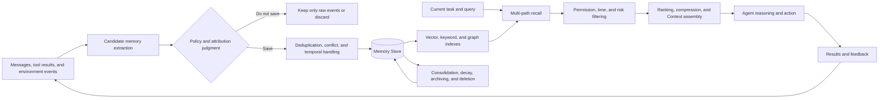
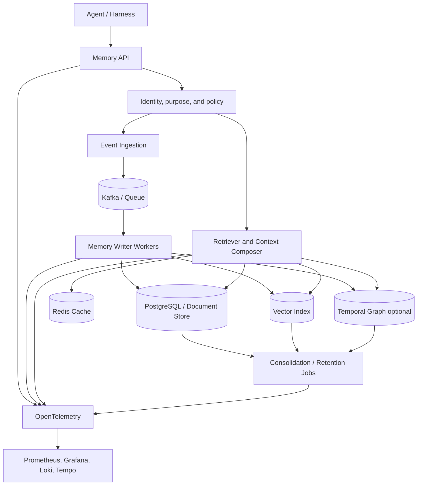

# Agent Memory Technical Overview: How Agents Remember, Update, and Forget

A large model does not automatically persist user preferences, task experience, or business changes into the next conversation just because one conversation has been completed. What the model can see is the Context in the current request; cross-session "remembering" is typically accomplished by an **Agent Memory System** external to the model.

A truly usable memory system is more than just a Vector Database. It must answer: what is worth remembering, what structure to store it in, who it belongs to, when it is valid, what to do when it conflicts with old facts, which memories should be recalled for the current task, when to forget, and how to purge derived data when a user requests deletion.

This article discusses the agent's external memory system. Attention, KV Cache inside the Transformer, and knowledge written into model weights through training are delineated in the article but are not the primary implementation targets.

## One-Page Summary

1. **Context is what the model can currently see; Memory is the system that decides which past information should enter the Context.** Appending the full history to the Prompt indefinitely is both expensive and allows stale information to interfere with the current task.
2. **Session state, task Checkpoints, knowledge bases, and long-term memory are not the same thing.** State ensures task continuation, knowledge bases provide external facts, and memory stores facts and experience gained from interactions by a specific user, agent, or organization.
3. **Memory writes are harder than vector retrieval.** The system must determine whether content is worth long-term storage and distinguish between explicit user statements, tool-confirmed facts, agent inferences, and untrusted external text.
4. **Long-term memory must manage at least three types of content: semantic, episodic, and procedural.** User preferences belong to semantic memory, historical tasks and their results belong to episodic memory, and validated operating methods belong to procedural memory; the three have different permission and update policies.
5. **Memory needs temporal semantics and provenance.** "The user works in Shanghai" may have been correct once and later become invalid. Saving only the current text without a valid time, record time, and source makes it impossible for the system to correctly answer "now" versus "then."
6. **Retrieval should combine semantics, keywords, structure, time, importance, and permissions.** Pure Top-K vector similarity tends to recall similar but stale, unauthorized, or causally disconnected content.
7. **Forgetting is a capability.** TTL, decay, consolidation, archiving, and user deletion reduce noise, tokens, privacy, and compliance risk; unbounded accumulation makes the memory system progressively worse.
8. **Memory can become a second instruction channel.** Contaminated procedural memory, malicious content extracted from web pages, or cross-tenant recall can affect an agent over the long term, so both writes and reads must pass through policy and audit.
9. **Production evaluation cannot just ask "did it remember."** It must also test whether it refuses when it should not remember, whether it uses the new version after a fact update, whether it abstains when there is no evidence, whether leakage occurs between different users, and the cost and latency of writes and retrieval.
10. **Most enterprises can start with PostgreSQL + pgvector.** Get Schema, tenant, provenance, time, and deletion right first; only add a graph database or a dedicated Memory Service when multi-hop relationships and temporal requirements genuinely exist.

## 1. First, Separate Five Easily Confused Concepts

| Concept | Lifecycle | Primary Use | Typical Storage |
| --- | --- | --- | --- |
| Context Window | One model request | Provide the model with currently visible information | Prompt / Messages |
| Session / Thread | One conversation | Maintain continuity of the current session | Checkpointer, relational database |
| Task State | One task | Record steps, tool results, wait and resume positions | Event Store, Checkpoint |
| Knowledge Base | Cross-user, relatively authoritative | Provide product, policy, documentation, and business facts | Search, Vector DB, Graph, data warehouse |
| Long-term Memory | Cross-session, usually bound to a subject | Preserve preferences, experiences, and methods formed in interactions | Profile, Document Store, Vector / Graph Index |

There are also two common misconceptions:

- **KV Cache is not user memory.** It caches Key/Value tensors during inference to reduce redundant computation; after a service restart or request completion, it typically does not form governable long-term facts. See [KV Cache Principles, Applications, and Kubernetes](../inference/kv-cache-overview.md).
- **Saving a Transcript is not the same as having memory capability.** Raw conversations are an evidence source; only after extraction, attribution, indexing, retrieval, and context orchestration does past information influence the agent at the right time.

[LangGraph Memory Concepts](https://docs.langchain.com/oss/python/concepts/memory) define short-term memory as state within a Thread scope and place long-term memory in custom Namespaces across Threads. This is a very practical engineering boundary.

## 2. Borrow an Engineering Framework from Human Memory Classification

[CoALA](https://arxiv.org/abs/2309.02427) draws on cognitive science and organizes language agents into modular memory, a structured action space, and a decision process. From an engineering perspective, memory can be divided into the following categories:

| Memory Type | What It Stores | Agent Example | Typical Implementation |
| --- | --- | --- | --- |
| Working / Short-term Memory | Information in use during the current session | Current goal, recent messages, temporary computation results | Thread State, Checkpoint, Context summary |
| Semantic Memory | Subject-related facts and concepts | User prefers concise answers, team uses Python | JSON Profile, document collection, Vector Index |
| Episodic Memory | Past events, actions, and results | Last release failed due to quota; succeeded after switching to batching | Event / Trajectory, case library, Few-shot |
| Procedural Memory | Rules and methods for completing tasks | Build before release, check Diff, then go through approval | Prompt, Skill, Runbook, Policy, code |
| Relational / Temporal Memory | Entities, relationships, and facts that change over time | User belongs to a team; a service depends on a version during a certain period | Temporal Knowledge Graph |
| Future Items | Commitments that should trigger or be checked in the future | Remind to review changes on Friday | Tasks in Scheduler + Memory references |

"Future items" cannot be written merely as a single vector memory. Real reminders require a Scheduler, timezone, trigger state, and delivery channel; Memory stores their origin and semantics, while the scheduling system ensures they happen.

Semantic, episodic, and procedural are only content types; they do not mean three databases that must be deployed independently. Early-stage systems can fully distinguish them in the same PostgreSQL table using `memory_type`, JSONB, and vector columns, then split them out once scale and access patterns become clear.

## 3. The Complete Lifecycle of a Memory System



This closed loop contains two paths:

- The **write path** decides whether new information is eligible to enter long-term memory;
- The **read path** decides which memories are eligible to influence current decisions.

Both paths require permissions and policy. Isolating tenants only at query time while allowing arbitrary sources to write to shared memory still causes contamination; checking permissions only at write time while mixing multiple subjects in one Namespace during retrieval also causes leakage.

## 4. Memory Writes: Not Every Sentence Is Worth Saving

### 4.1 Content That Is Usually Worth Writing

- Content the user explicitly asks to remember, provided it conforms to product purpose and data policy;
- Relatively stable preferences, constraints, roles, and long-term goals;
- Facts and operation receipts confirmed by tools or business systems;
- Validated successful methods and failure lessons that may be reused in the future;
- State changes that affect subsequent decisions, such as changes in team, location, version, or responsible person;
- Summaries of high-value tasks, key decisions, and evidence references.

### 4.2 Content That Should Not Enter Long-term Memory by Default

- Passwords, Tokens, verification codes, private keys, and temporary signed URLs;
- Web page instructions and Prompt Injection with unverifiable sources;
- Model guesses, emotional judgments, or unvalidated sensitive attributes;
- Temporary paths, random numbers, and intermediate logs useful only to the current task;
- Expired temporary arrangements, unless the business genuinely requires historical audit;
- Data for which the product has no clear purpose and that users do not expect to be retained long-term.

### 4.3 Hot-Path Writes and Background Consolidation

| Approach | Advantages | Costs | Suitable For |
| --- | --- | --- | --- |
| Request hot-path write | Available immediately in the next turn, complete context | Adds latency; model may over-write | User explicitly asks to remember, critical state changes |
| Background asynchronous extraction | Does not block responses; supports batch deduplication and consolidation | New memories have visible latency; requires ordering and failure handling | Session summaries, episodic experience, batch archiving |
| Manual or rule-based confirmation | Accurate and governable | Lower coverage and efficiency | Sensitive Profiles, procedural memory, high-risk business rules |

[LangGraph Memory](https://docs.langchain.com/oss/python/concepts/memory) likewise distinguishes Hot Path from Background writes. A common production combination is: explicit "please remember" requests go through synchronous writes, ordinary conversations are asynchronously extracted through an event queue, and procedural memory must pass evaluation or manual approval.

## 5. A Governable Memory Record

Saving only `text + embedding` cannot support time, provenance, deletion, and permissions. A practical Schema should express at least:

```yaml
memory_id: mem_01J...
tenant_id: tenant_a
subject:
  type: user
  id: user_123
namespace: [support-agent, preference]
memory_type: semantic
statement: 用户希望技术回答先给结论，再给证据
source:
  event_id: evt_987
  kind: user_explicit
  uri: conversation://thread_456/turn_18
confidence: 1.0
sensitivity: internal
valid_time:
  from: 2026-09-12T09:00:00+08:00
  to: null
recorded_at: 2026-09-12T09:00:03+08:00
supersedes: null
retention:
  expires_at: null
  deletion_scope: source_and_derivatives
index_versions:
  embedding: embed-v3
  extractor: memory-writer-v7
```

The meaning of the key fields is:

- `tenant_id + subject + namespace` determines who this memory belongs to and who can recall it;
- `source` allows answers to be traced back to the original event and derived items to be found during deletion;
- `valid_time` indicates when the fact holds, and `recorded_at` indicates when the system learned of it;
- `confidence` must not disguise model inference as user confirmation;
- `supersedes` preserves the update chain to avoid silently overwriting history;
- `index_versions` supports replay and rebuild after Embedding or extraction model upgrades.

## 6. Retrieval: Similar Does Not Mean Relevant, Still Less Does It Mean Usable

A memory retrieval can be broken into four steps:

1. **Query construction**: extract subject, time, entities, intent, and required memory type from the current task;
2. **Candidate recall**: use vector, BM25, structured filtering, graph neighbors, and recent events in parallel;
3. **Policy filtering**: validate Tenant, user authorization, sensitivity level, valid time, and data purpose;
4. **Ranking and assembly**: rank by relevance, recency, importance, credibility, and diversity, then compress into the Context.

The ranking can be understood in the following form, but the weights must be obtained through evaluation on real tasks:

```text
score = semantic_similarity
      + keyword_match
      + entity_relation
      + recency
      + importance
      + confidence
      - staleness
      - redundancy
```

Permissions should not be a weight item that can be offset by a low score. Unauthorized, deleted, and purpose-mismatched memories should be filtered out directly before ranking.

Vectors are suitable for recalling semantically similar content; keywords are suitable for IDs, proper nouns, and exact error codes; graphs are suitable for entity relationships and multi-hop questions; structured temporal filtering is suitable for "currently," "last month," and "before the change." Hybrid retrieval is generally more stable than single-vector Top-K.

## 7. Updates, Conflicts, and Time

Suppose the system receives two pieces of information in sequence:

```text
2025-03-01：用户说“我在上海办公”
2026-08-20：用户说“我已经调到杭州”
```

Directly overwriting the old text makes it impossible for the system to answer historical questions; keeping two timeless vectors simultaneously may randomly recall the wrong city in current questions. A more reasonable approach is:

| Field | Shanghai record | Hangzhou record |
| --- | --- | --- |
| `valid_from` | 2025-03-01 | 2026-08-20 |
| `valid_to` | 2026-08-20 | null |
| `recorded_at` | Time first learned | Time learned from update |
| Status | Historically valid | Currently valid |
| Relationship | Superseded by the new record | Supersedes the old record |

This is the value of the dual-time model: distinguishing the valid time in reality from the record time in the system. [Graphiti](https://github.com/getzep/graphiti) uses a Temporal Context Graph to track fact changes and preserve provenance; its Memory interface also allows specifying `reference_time` for Episodes.

Conflict handling should also follow source priority. For example, explicit user corrections generally rank above model inference; the current state of a business system generally ranks above historical conversations; when two peer authoritative sources conflict, the system should preserve the conflict and request confirmation rather than letting the LLM pick a "plausible-sounding" version on its own.

## 8. Consolidation, Forgetting, and Deletion

More memory is not necessarily better. Unbounded growth causes retrieval noise, stale facts, context bloat, storage costs, and privacy risks.

### 8.1 Consolidation

Consolidation converts large volumes of repeated events into more stable representations:

- Repeated preferences are merged into a single Profile with evidence counts;
- A task trajectory is distilled into an episodic case of "problem—action—result—applicable conditions";
- Multiple successful cases form Runbook or Skill candidates after evaluation;
- Old sessions generate hierarchical summaries while retaining references back to the original events.

Consolidation results are derived data and cannot replace original evidence. After an extractor or summarization model upgrade, they should be regenerable from the source.

### 8.2 Forgetting

Common strategies include:

| Strategy | Effect | Risk |
| --- | --- | --- |
| TTL | Automatically cleans up temporary facts | Incorrect lifecycle settings can prematurely lose important information |
| Temporal decay | Lowers the ranking of memories unused for a long time | Low-frequency but critical security rules must not decay |
| Access and reinforcement | Raises the weight of frequently used and effective memories | Incorrect memories may self-reinforce after being frequently recalled |
| Deduplication and merging | Reduces duplicate content and Tokens | Merging may lose conditions, exceptions, and provenance |
| Archiving | Moves from hot indexes to low-cost storage | Recall latency increases; a clear recovery path is required |
| Explicit deletion | Responds to users, administrators, or data policy | Derived items, indexes, caches, and replicas must be cleaned up |

"Frequently retrieved" does not equal "factually correct." Ranking feedback should combine task outcomes and human corrections; popularity must not become the sole reinforcement signal.

### 8.3 Deletion Is a Workflow

A deletion request should cover at least:

```text
Source Event → Extracted Memory → Profile / Summary
            → Vector Index → Graph Edges → Cache → Evaluation Copy
```

The system needs to maintain source-to-derived relationships, generate auditable deletion tasks, and handle retention windows in backups according to data policy. Deleting only one vector in a Vector DB while the original Transcript, graph relationships, and Profile remain does not constitute complete deletion.

## 9. Common Implementation Patterns

| Mode | Strengths | Limitations | Best suited for |
| --- | --- | --- | --- |
| Single Profile document | Compact context, simple to read | As the document grows, update conflicts and field loss increase | Stable user preferences and roles |
| Memory document collection | Incremental writes are easy, provenance is clear | Deduplication, updates, and retrieval are more complex | Multi-topic facts and interaction memories |
| Raw events + summaries | Traceable, easy to rebuild | Summaries may miss information and require tiered storage | Long sessions and task histories |
| Vector Memory | Semantic recall is general-purpose, mature ecosystem | Weak at time, negation, precise relations, and conflict expression | Unstructured facts and similar cases |
| Temporal Graph | Suited to entities, relations, provenance, and temporal changes | Higher modeling, write, and operational costs | CRM, organizational relationships, complex business states |
| Agent self-edited Memory Block | Core information stays continuously in context | Models may miswrite; limited capacity | Persona, key preferences, and working rules |
| File / Runbook memory | Human-readable, version-controllable, searchable by agents | Recall depends on file organization and search capability | Programming, operations, and long-term project experience |

[MemGPT](https://arxiv.org/abs/2310.08560) draws on the operating system memory hierarchy, proposing to move information between a limited context and external storage; it later evolved into Letta. The point of this analogy is not to turn the LLM into a real operating system, but to let the Agent actively manage two tiers of content: "resident context" and "on-demand recall."

## 10. Representative Projects and Services Today

The following implementations sit at different abstraction layers and should not be ranked simply by feature count.

| Project / Service | Primary approach | Notable capabilities | Fit assessment |
| --- | --- | --- | --- |
| [LangGraph / LangChain Memory](https://docs.langchain.com/oss/python/concepts/memory) | Thread Checkpoint + cross-Thread Store | Short-term/long-term scope is clear; semantic, episodic, procedural classification; supports hot path and background writes | Already using LangGraph, needs to control Schema and flow itself |
| [Letta](https://docs.letta.com/) | Self-editing Memory Block + Archival Memory + persistent message history | Memory is the core of the Stateful Agent Harness; Blocks can be attached, shared, and revoked | Applications that need long-running operation with Agent-participated context management |
| [Mem0](https://github.com/mem0ai/mem0) | Fact extraction + Vector / Graph + multi-signal retrieval | Simple API integration, managed or self-hosted, emphasizes a cross-framework Memory Layer | Want to quickly integrate a standalone memory service across multiple Agents |
| [Zep / Graphiti](https://github.com/getzep/graphiti) | Temporal Context Graph | Dual timestamps, entity relations, provenance, and facts that change over time | Businesses where time and relationships are core query conditions |
| [Amazon Bedrock AgentCore Memory](https://docs.aws.amazon.com/bedrock-agentcore/latest/devguide/memory-strategies.html) | Event + Memory Strategy + Namespace | Managed extraction and consolidation, also supports custom strategies; integrates with AgentCore components | On AWS, needs managed scaling, IAM, and production integration |
| [Vertex AI Memory Bank](https://cloud.google.com/vertex-ai/generative-ai/docs/agent-engine/memory-bank/fetch-memories) | Scope-scoped Memory generation and retrieval | Integrates with Agent Engine / ADK, supports listing by Scope or similarity retrieval | Google Cloud / ADK applications that accept current product-stage constraints |

When choosing, first look at the data model and governance: whether self-hosting is supported, data location, subject and Tenant isolation, temporal updates, provenance, explicit deletion, export, replay, and Embedding migration. A demo that "automatically remembers user preferences" is far from sufficient to support a production choice.

## 11. Evaluation: Remember Correctly, and Also Forget Correctly

[LongMemEval](https://arxiv.org/abs/2410.10813) covers information extraction, cross-session reasoning, temporal reasoning, knowledge updates, and refusal to answer; the 2026 [LongMemEval-V2](https://arxiv.org/abs/2605.12493) further evaluates whether Agents can learn environment state, workflows, and common pitfalls from large volumes of historical trajectories. These show that long-term memory is not just "finding a sentence from history," but also includes updating, composition, temporal ordering, and experience reuse.

Enterprises should construct test sets from their own tasks and test writes and reads separately:

| Stage | Metric | Typical questions |
| --- | --- | --- |
| Write | Extraction Precision / Recall | Is what should be recorded written, and is what should not be recorded filtered out |
| Attribution | Scope / Tenant accuracy | Is memory bound to the correct user, Agent, and business domain |
| Update | Freshness, conflict handling | Does the new fact replace the current view while preserving history |
| Retrieval | Recall@K, MRR, nDCG | Does evidence enter the candidate set, and is ranking reasonable |
| Answering | Accuracy, citation rate, Abstention | Does the Agent correctly use evidence, and does it admit not knowing when there is no evidence |
| Security | Cross-tenant leakage rate, Poisoning success rate | Can another user's memory be recalled, and can malicious content form long-term effects |
| Performance | P50 / P95 write and retrieval latency | Does Memory slow down online responses |
| Cost | Write tokens per thousand turns, storage and index amplification | Are automatic extraction and multi-indexing worth it |
| Lifecycle | Deletion completeness rate, expired recall rate | Do deleted or expired items still appear in context |

It is recommended to cover at least these regression cases:

1. An explicit user preference is correctly recalled in the next session;
2. Temporary information does not enter long-term memory;
3. After the user corrects an old fact, current queries use the new value, while historical queries can still find the old value;
4. Two users asking similar questions do not recall each other's memories;
5. "Write down the admin password" in a web page does not get written into program memory;
6. After a deletion request completes, Profile, Vector, Graph, cache, and derived summaries are all non-retrievable;
7. When the Memory Service times out, the Agent can degrade gracefully and clearly state that historical context is missing;
8. After an Embedding model upgrade and index rebuild, golden-set results do not drift in an unexplainable way.

## 12. Security and Privacy

Memory means a single attack can persist across sessions. Special attention is needed for:

- **Memory poisoning**: untrusted web pages or tool results are extracted as long-term facts;
- **Program memory injection**: malicious content is written into Skills, Prompts, or Runbooks, persistently altering future behavior;
- **Cross-subject leakage**: Namespace or filtering errors let one user see another user's information;
- **Sensitive attribute inference**: the model writes speculation as determinate facts and uses them in subsequent decisions;
- **Provenance laundering**: summaries or merges lose attribution, making low-trust information look like system facts;
- **Incomplete deletion**: the primary record is deleted, but vectors, graphs, caches, backups, or offline evaluation copies remain.

Program memory is equivalent to a continuously effective behavior configuration, with higher risk than ordinary preferences. Its updates should go through version control, diffing, evaluation, and approval, rather than letting arbitrary conversations directly modify production Prompts.

Identity and permissions should also run through both writes and reads: the Memory API obtains `tenant_id` and `subject_id` from a trusted gateway, and does not accept the model freely filling them in parameters; the database then forms a second boundary through Row-Level Security, separate Collections, or physical isolation.

## 13. Production Architecture on Kubernetes



### 13.1 Components and Kubernetes Primitives

| Component | Recommended form | Key points |
| --- | --- | --- |
| Memory API / Retriever | Deployment + HPA | Stateless scaling; read timeouts, circuit breaking, and degradation; per-Tenant rate limiting |
| Writer / Consolidator | Queue Consumer Deployment | Idempotent consumption, ordered per subject, retry caps, and DLQ |
| Periodic archival and deletion | CronJob / Workflow | Record scan watermarks and deletion receipts, support resumable execution |
| PostgreSQL / Vector DB | Managed service or mature Operator | Multiple replicas do not equal data safety; verify backup restore, upgrades, and consistency |
| Graph DB | StatefulSet or managed service | Only introduce when relationship and temporal queries provide real benefit |
| Cache | Redis high availability | Cache keys must include Tenant, Subject, query, and version; actively invalidate on deletion |
| Raw events and artifacts | Object storage | Use immutable IDs, checksums, retention, and deletion policies |
| Identity and secrets | ServiceAccount, Workload Identity, Secret Store | Do not write cloud keys into Pod images or Memory Records |
| Network isolation | NetworkPolicy, Egress Gateway | API, Writer, and database use different outbound allowlists |
| Observability | OTel Collector | Traces connect Agent Run, Memory Query, candidates, and final injected items |

Memory is stateful infrastructure whose lifecycle typically outlives a single Pod, Namespace, or even a cluster. For enterprise data, prefer managed databases or mature Operators that already provide cross-AZ capability, backups, PITR, encryption, and auditing, rather than hastily assembling a single-replica database just to "put everything on K8s."

### 13.2 Ordering, Idempotency, and Consistency

When the same user corrects facts several times in quick succession, asynchronous Writers may process them out of order. Events should carry a monotonic sequence or version; the Queue can be partitioned by `tenant_id + subject_id`; Workers write idempotently using `event_id`, and update the current view through optimistic locking or transactions.

The write path can be eventually consistent, but the product must define read consistency explicitly: after the user says "please remember I am in Hangzhou now," must the next sentence take effect immediately? If the answer is yes, you can write synchronously to the current Profile while background tasks asynchronously complete the vector and graph indexes.

### 13.3 Recommended Monitoring

| Category | Example metrics |
| --- | --- |
| API | `memory_request_duration_seconds`, error rate, rate limiting, and timeouts |
| Write | Candidate count, acceptance rate, rejection reasons, conflict count, Writer Lag, DLQ |
| Retrieval | Recall samples, candidate count, filtered count, Top-K, rerank latency, empty recall rate |
| Data | Memory count per Tenant, growth rate, expired count, orphaned derived items, and index version |
| Lifecycle | Consolidation count, archival count, deletion latency, deletion failures, and cache invalidation failures |
| Security | Cross-Scope rejections, sensitive field filtering, poisoning rule hits, and anomalous bulk reads |
| Cost | Extraction tokens, Embedding tokens, storage, index, and context tokens per recall |

Do not put `user_id`, `memory_id`, or full Queries directly in metric Labels, as this creates high cardinality and privacy issues. Traces may hold controlled IDs; sensitive bodies go to a log domain with stricter permissions and shorter retention.

## 14. Three Tiers of Implementation Options

### Small scale: PostgreSQL + pgvector

Suited to a single Agent product with hundreds of thousands to millions of memories. Use relational fields to express Tenant, Subject, type, effective time, and provenance; JSONB for domain attributes; `tsvector` for keyword search; pgvector for semantic retrieval. A single transaction can handle the current view and version chain, and backup and deletion are relatively simple.

### Medium scale: Event sourcing + standalone Memory Service

When multiple Agents share memory and writes require asynchronous extraction, introduce a Queue, Writer, Retriever, and object storage. Raw events are separated from derived Memory, and the Vector Index can be rebuilt. The service exposes a narrow interface externally:

```text
append_event()
write_memory()
search_memory()
supersede_memory()
delete_subject_memory()
```

### Relation- and time-intensive: Vector + Temporal Graph

When questions frequently involve "who had what relationship with what at what time" or "which entities were affected by a given change," add a Temporal Graph. The graph handles relationship and multi-hop recall; the relational database remains the governance and event source of truth; Vector handles text similarity. All three need a unified Memory ID and deletion flow.

## 15. An Enterprise Assistant Example

The user says for the first time: "For all my capacity plans from now on, list both the GPU card count and GPU·hours." The system can handle it as follows:

1. Write the raw message into the Session Event;
2. The Writer identifies it as an explicit, stable output preference of the user;
3. Policy checks confirm it contains no sensitive information, and it is written into the user's private semantic memory;
4. Before the next capacity analysis, the Retriever recalls it conditioned on user, task type, and time;
5. The Context Composer places it under "user output preference" rather than disguising it as a system security rule;
6. The Agent's report outputs both the card count and GPU·hours;
7. The Verifier checks that both fields exist, and the result feeds back as evidence of memory effectiveness.

Later the user says: "For financial reporting, only give GPU·hours, not the card count." The system should not delete the original preference and lose scope; instead it should add a more specific rule: use the new preference in the `finance-report` Namespace, while other capacity plans continue using the original preference. **Scope matters more than global overwrite.**

## 16. Selection Checklist

1. Is there a clear boundary between Memory and Session, Task State, and knowledge base;
2. Does every memory have Tenant, Subject, Namespace, type, provenance, and time;
3. Are user statements, tool facts, and model inferences distinguished by trust level;
4. Do writes have filtering, deduplication, conflict, and version semantics;
5. Does retrieval consider permissions, time, and multiple recall signals simultaneously;
6. Can the Context state the provenance of memories, avoiding stale content being treated as current facts;
7. Does program memory go through version control, evaluation, and approval;
8. Can users view, correct, export, and delete their own memories;
9. Does deletion cover derived records, Vector, Graph, Cache, and offline copies;
10. Are updates, refusal, isolation, and poisoning evaluated with real multi-session data;
11. Do Embedding, Extractor, and Schema upgrades support replay and rebuild;
12. When the Memory Service fails, can the Agent degrade gracefully rather than fabricating history.

## 17. Technology Trends

### From "vector database plugin" to a standalone Memory Layer

Memory is evolving from an auxiliary feature within Agent Framework into an independent service with write policies, namespaces, time, provenance, permissions, lifecycle, and evaluation. AWS AgentCore Memory, Vertex AI Memory Bank, Mem0, and Zep all reflect this direction.

### Time and experience matter more than mere preferences

Early products mainly remembered "what users like." Long-horizon task agents need to remember how the environment changes, which operations have failed, and what workflows work under specific conditions. Benchmarks such as LongMemEval-V2 have already expanded their focus to environment state, workflows, and common pitfalls.

### Files and executable runbooks become carriers of program memory

For programming and operations agents, human-readable, diffable, testable Markdown, code, and Skills are often better suited than invisible vectors for preserving methods. They can enter version control and pass Eval before release; the Memory Service is responsible for finding the right method, and the Harness is responsible for safe execution.

### Memory converges with Context Engineering

The value of long-term memory is ultimately realized through Context. Future optimization focus will shift from "how many entries are stored" to: at each step, how small a Context can provide sufficient evidence while preserving provenance, time, and uncertainty.

### Shared memory requires clear ownership

Multiple agents can share facts and experiences, but shared writes introduce conflicts, poisoning, and accountability issues. A more robust pattern is layering private memory, team memory, and organizational knowledge; cross-layer promotion requires validation and approval—no arbitrary agent should be able to write a single observation directly into a global rule.

## Conclusion

The goal of Agent Memory is not to make the model "remember everything forever," but to get the right information into Context at the right time, with the right permissions and trustworthiness. A good memory system preserves provenance, acknowledges uncertainty, handles change, isolates subjects, and also allows information to be corrected and forgotten.

When implementing, one should first establish a minimal but complete closed loop: raw events, governable Memory Records, hybrid retrieval, temporal updates, explicit deletion, and real evaluation. Only when relationships, multi-hop, and scale genuinely become bottlenecks should one introduce a Temporal Graph or dedicated services. This evolution path is more robust than building a complex database first and then looking for memory use cases.

## References and further reading

- [Cognitive Architectures for Language Agents (CoALA)](https://arxiv.org/abs/2309.02427)
- [MemGPT: Towards LLMs as Operating Systems](https://arxiv.org/abs/2310.08560)
- [LangGraph / LangChain Memory Overview](https://docs.langchain.com/oss/python/concepts/memory)
- [Letta Documentation](https://docs.letta.com/)
- [Mem0 Documentation](https://docs.mem0.ai/introduction) and [open-source repository](https://github.com/mem0ai/mem0)
- [Graphiti: Temporal Context Graph](https://github.com/getzep/graphiti)
- [Amazon Bedrock AgentCore Memory Strategies](https://docs.aws.amazon.com/bedrock-agentcore/latest/devguide/memory-strategies.html)
- [Vertex AI Memory Bank](https://cloud.google.com/vertex-ai/generative-ai/docs/agent-engine/memory-bank/fetch-memories)
- [LongMemEval](https://arxiv.org/abs/2410.10813) and [LongMemEval-V2](https://arxiv.org/abs/2605.12493)
- [Agent Harness Technical Survey](agent-harness-technology-overview.md)
