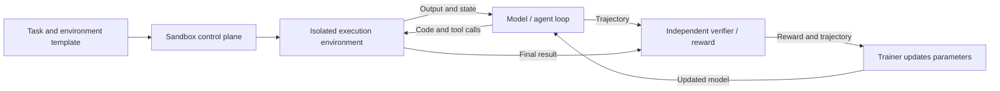

# Sandboxes in LLM Training: From Agent Reinforcement Learning to Kubernetes Environment Engineering

How do we know whether code generated by a model actually runs? How can we tell whether a coding agent fixed a repository issue? Training systems increasingly let models act in executable environments, run commands, observe results and adjust behavior based on feedback. A sandbox supplies a controlled execution space; the task environment and verifier define available actions and determine whether the task is complete.

<strong>A training sandbox is environment infrastructure, not a model-training algorithm that replaces the GPU trainer.</strong> It is particularly useful for code verification, tool use, software-engineering agents and browser-use training. Ordinary text pretraining generally does not require a sandbox for every sample; a sandbox enters the picture when a training workflow needs to execute code, tools or interactive environments.

This survey draws on public material available as of 2026-11-09. Its diagrams and numbers are illustrative; it reports no local training, benchmark or security certification. For background, see [Agent RL: veRL and Miles](agent-rl-verl-miles-overview.md) and [Agent sandbox selection](agent-sandbox-selection.md).

## 1. A code-repair task as an example

Suppose a model must fix a billing function in a Python project. The environment prepares the repository, dependencies and tests. The model reads code, edits files, runs tests and uses failures to guide another attempt. An independent verifier ultimately checks whether the result satisfies the task.

This conceptual flow does not require synchronous execution or prescribe where components run. A rollout is a sampled interaction trajectory and may contain multiple model outputs, tool calls and environment observations. A trainer can update parameters using trajectories and rewards; the same infrastructure can instead generate data or run evaluations without updating weights. Code execution can be a tool in a multi-turn interaction or a final-answer verifier, depending on the configuration. [verl Sandbox Fusion integration](https://verl.readthedocs.io/en/latest/sglang_multiturn/sandbox_fusion.html)

| Layer | Question it answers | Example |
| --- | --- | --- |
| Task and environment | What is the starting state, what actions are allowed, and when does the task end? | Repository and issue, browser page, tool API |
| Sandbox | Where does code run, what can it access, and how are resources limited? | Containers, gVisor, Kata Containers, microVMs |
| Verifier and reward | How is the result judged and scored? | Hidden tests, target-state checks, rules or reward models |
| Agent loop | When does the model call tools, and how does it continue after observing results? | Multi-turn model and tool interaction |
| Training framework | How are samples collected, optimization objectives computed and weights updated? | verl and others |

An environment need not always be an independent VM: a simulator or controlled API can provide state and feedback. Conversely, a container that executes commands does not automatically supply tasks, verification or rewards.

## 2. Three common uses

### 2.1 Verifying generated code

After the model outputs a function, a verifier runs tests in an isolated environment and collects exit codes, standard output, timeouts or exceptions for rule-based scoring. This can be a single-turn task: the sandbox executes and verifies code without maintaining a multi-turn session. verl provides a Sandbox Fusion example; confirm interfaces, versions and deployment against the target release. [verl example](https://verl.readthedocs.io/en/latest/sglang_multiturn/sandbox_fusion.html)

### 2.2 Training software-engineering agents

Given a repository and issue, an agent can search, edit and test over multiple turns. The environment must retain file changes within the same trajectory, and independent tests or other rules evaluate the final outcome. [SWE-Gym](https://github.com/SWE-Gym/SWE-Gym) supplies tasks and environments for software-engineering agents; it occupies a different layer from the underlying isolation runtime.

<strong>Verifiers need protection against reward hacking:</strong> if the agent can edit final tests, read reference answers or change the score directly, a passing result can be misleading. Protect hidden tests and scoring credentials, and where needed run final verification in a separate boundary the agent cannot write to. Also inspect patch quality, resource use and timeouts rather than relying on a single success flag.

### 2.3 Browser and computer use

An environment can provide a browser, web pages, mouse and keyboard or desktop to operate a simulated system. A verifier checks business state, such as completion of a simulated form. Separate read-only pages, reversible test data and real external systems so that training cannot send real messages or execute real transactions. Reset must cover accounts, cookies, caches and server-side data; restarting a browser alone does not guarantee a clean state.

## 3. How data enters training

In agent reinforcement learning (Agent RL), the model produces actions under its current policy, the environment executes them and returns observations, and the sampler records trajectories including tool input/output and tokens. Rewards can come from tests, rules, models or combinations; the trainer uses the selected algorithm to compute advantages and losses and update weights. Not every approach uses the same algorithm, and not every tool call needs an immediate reward. [verl agent-loop and reward extensions](https://verl.readthedocs.io/en/latest/extend_guide.html)

Keep the task and environment version, model and sampling configuration, tool calls, final artifacts, verifier version, reward and failure reason. Separate training from evaluation data; keep hidden tests outside model-accessible directories so leakage is not mistaken for generalization. Report success, incorrect answers, timeouts, environment failures and unexecuted cases separately. Preserve initial attempts when retrying infrastructure failures instead of reporting only eventual successes.

## 4. Combining open-source components

| Project or technology | Primary role | What it can address | What it does not solve alone |
| --- | --- | --- | --- |
| [verl](https://verl.readthedocs.io/en/latest/sglang_multiturn/sandbox_fusion.html) | Reinforcement learning training and agent loops | Integrating sampling, tools and rewards | Does not automatically provide reliable business tasks, verifiers or isolation policies |
| [Sandbox Fusion](https://github.com/bytedance/SandboxFusion) | Code execution and evaluation service | Execute model code and return results for training integration | Not a complete multi-turn agent-training system |
| [SWE-Gym](https://github.com/SWE-Gym/SWE-Gym) | Software-engineering tasks and training environments | Repository-level tasks and verification | Not the underlying isolation runtime |
| [OpenEnv](https://github.com/openenv/OpenEnv) | Post-training environment interface and ecosystem | Define interactive environments, tools and rewards | A common interface does not automatically make tasks or isolation secure |
| [Kubernetes Agent Sandbox](https://agent-sandbox.sigs.k8s.io/docs/) | Kubernetes sandbox resources and lifecycle | Templates, claims, warm pools and runtime integration | The controller is neither an isolation kernel nor a trainer |
| [OpenSandbox](https://github.com/alibaba/OpenSandbox) | General-purpose agent sandbox platform | Sandbox lifecycle, code execution and environment integration | Training throughput, isolation and reward quality still need testing |

These components can be combined and may overlap. Interfaces and compatibility change across releases; do not assume they can be swapped without integration work. Agent Sandbox supports different underlying runtimes, and its quickstart explicitly presents gVisor and Kata as optional stronger isolation configurations: installing the controller does not automatically establish a VM boundary. [Official quickstart](https://agent-sandbox.sigs.k8s.io/docs/use-cases/examples/quickstart/)

## 5. Kubernetes architecture and choices

A design can place trainers and model-serving workloads in GPU pools, while running the environment control plane and many sandboxes mainly on CPU nodes. Allocate GPUs separately when a sandbox must execute GPU or CUDA tasks. Availability depends on runtime, device passthrough and driver compatibility; do not assume every microVM or container isolation mechanism supports it.

| Isolation method | Advantages | What to evaluate |
| --- | --- | --- |
| Standard containers | Mature ecosystem and usually low startup and resource overhead | Share the host kernel; constrain privileges, system calls, network and mounts |
| gVisor | Adds an isolation layer around container system calls | System-call compatibility and network/I/O overhead |
| Kata / microVMs | Virtualized boundary with a separate guest kernel | KVM, startup, images, density and device passthrough |

These are typical characteristics, not an absolute security ranking or guarantee. Test escape risks, versions and configuration, patches, device access and multi-tenant boundaries for the actual solution.

<strong>A warm pool reduces cold-start waiting; it is not free capacity.</strong> Precreated containers or VMs can reduce image pulls and initialization but consume CPU, memory and disk. Before reuse, reset files, processes, credentials, network connections and application data. If clean reset cannot be demonstrated reliably, destroy and recreate the environment. Agent Sandbox offers templates, claims and warm-pool resources; do not treat example startup times as measurements for your own cluster. [Agent Sandbox documentation](https://agent-sandbox.sigs.k8s.io/docs/)

At high concurrency, the control plane can become a bottleneck. Frequent Pod creation, storage mounts, IP allocation, image pulls and status updates pressure the API server, scheduler, etcd, registry and node disks. Limit concurrency per node and tenant, smooth pool replenishment, set timeouts and garbage collection, and protect shared clusters with quotas and rate limits. GPU count alone is not a training-throughput estimate.

## 6. Operational metrics and capacity estimation

Start with end-to-end metrics: effective tasks completed, verified successes, cost per usable trajectory, and latency and failure rates for queueing, creation, execution and verification. Then inspect warm-pool hit rate, environment-creation P50/P95/P99, image pulls, CPU/memory/disk, leaked sandboxes, verifier waits and idle inference GPUs. Group latency by comparable task and environment version, separating cold starts from warm hits.

A rough example: for a target of 120 tasks per minute, with each occupying a sandbox for 30 seconds on average, the idealized average number of active sandboxes is `120 × 30 / 60 = 60`, assuming stable arrivals, representative averages and no other bottleneck. Real capacity must cover bursts, tail latency, retries, warm-pool reserve and node failure; this is not a benchmark. If a task calls tools several times, use its total actual environment occupancy, not the number of tool calls as the task count.

Trace the whole pipeline. If inference GPUs are idle and many tasks wait for environments, inspect warm pools and scheduling. If environments are ready but wait for models, inspect inference throughput and concurrency. If tests are slow, inspect verifiers, disks and dependencies. Validate correlations over the same time window rather than attributing the issue to a single GPU utilization number.

## 7. A practical adoption sequence

1. Use a small set of non-sensitive coding tasks to validate “create environment → model actions → independent verification → cleanup” and retain raw trajectories.
2. Design isolation, secrets, outbound networking, verifier permissions and retention; conduct negative tests to confirm unauthorized behavior is blocked.
3. Measure cold starts, warm pools, concurrency, failure recovery and contamination cleanup; increase task volume gradually while observing Kubernetes control-plane and storage behavior.
4. After integrating training, report model success rates together with infrastructure failure denominators. Compare against a fixed-version evaluation set so throughput improvements do not come at the expense of valid sample quality.

This is a design and selection survey. Component feature lists cannot establish production readiness or training improvement. A later test-cluster evaluation should record versions, actual isolation, task sets, failures and resource consumption. The existing [OpenSandbox practice](opensandbox-kubernetes-practice.md) and [sandbox failure and network-policy practice](sandbox-runtime-failure-network-policy.md) are useful runtime background, but they do not replace a training-loop evaluation.
