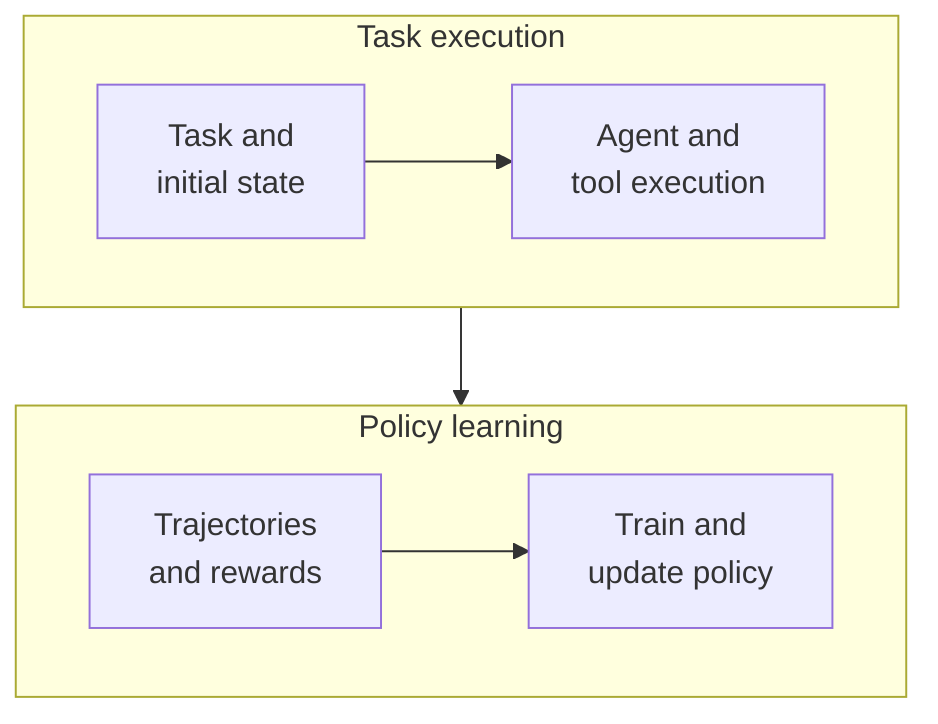
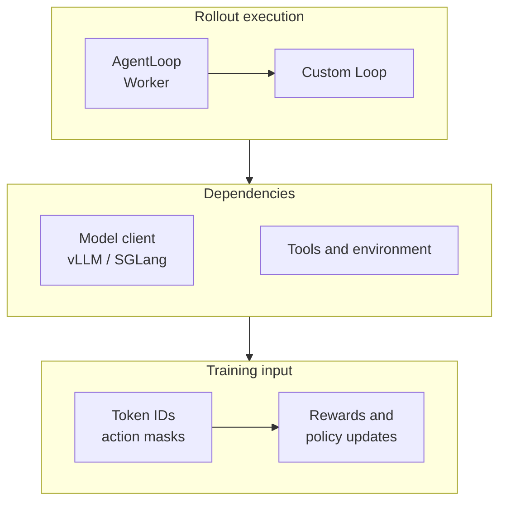
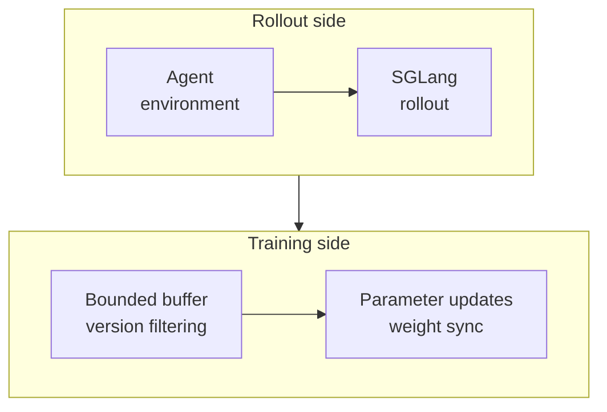

# Agent RL Survey: Tools, Trajectories, Rewards, veRL, and Miles

Why use reinforcement learning when a coding agent can already read files, run commands, and edit programs? Calling a tool is only part of the job. The agent still needs to choose useful actions, correct mistakes from feedback, and finish within a budget. Agent Reinforcement Learning (Agent RL) turns complete task attempts into training experience that improves later decisions.

This article focuses on **post-training language-model-driven agents**: collect multi-turn trajectories, calculate rewards, update trainable model weights, and return the new weights to the agent. veRL provides flexible training dataflows and an Agent Loop interface. RadixArk's Miles brings together SGLang sampling, distributed training, session trajectories, and asynchronous pipelines. Both require the team to build useful tasks, environments, and scoring rules.

Research is current to **October 19, 2026**. Source inspection uses veRL at [`4b26c788`](https://github.com/verl-project/verl/tree/4b26c788d41ce932ce7706c5ee8e249ab52f4c51) and Miles at [`915e89b7`](https://github.com/radixark/miles/tree/915e89b7bef529b3d0572cf7fd6030202ce7751e). The article contains architectural analysis and illustrative examples, rather than local training results. Official examples and support claims must be read within their respective interface boundaries.

## 1. What does Agent RL train?

Think of training a junior engineer who can use a computer. Give them a broken project, let them inspect it, make changes, and run tests, then have an independent verifier check the repair. The training system compares attempts and makes useful actions more likely. The quality of the tests determines whether the engineer learns to solve the problem or exploit the scoring rules.

The **policy** is usually the language model producing reasoning, tool calls, and answers. A **rollout** executes a task with a particular policy version. A **trajectory** records observations, actions, tool feedback, and outcomes. A **reward** scores the outcome or process.

| Method or component | What it primarily changes | Relationship to Agent RL |
| --- | --- | --- |
| Supervised Fine-Tuning, SFT | Model weights, by learning demonstrations | Often teaches tool formats and basic task procedures first |
| Agent RL | Model weights or trainable adapters, optimizing rewards | Learns from task attempts collected with the policy |
| Prompts, skills, memory, and retrieval | Input context and external state | Can improve the agent without automatically updating weights |
| LangGraph and agent harnesses | Control flow, tools, context, and recovery | Execute the policy being trained |
| Evaluation harnesses and verifiers | Task contracts and acceptance checks | Supply training rewards and independent evaluation |

Reinforcement Learning from Human Feedback (RLHF) describes the feedback source. Reinforcement Learning with Verifiable Rewards (RLVR) emphasizes programmatic verification. Proximal Policy Optimization (PPO) and Group Relative Policy Optimization (GRPO) are optimization algorithms. These categories describe different dimensions. GRPO was introduced in [DeepSeekMath](https://arxiv.org/abs/2402.03300) and is not specific to multi-turn agents.



*Illustration: the tool environment supplies feedback, the trainer updates the model, and the agent uses the updated policy for subsequent tasks.*

If an agent only calls a commercial model API that the team cannot train, adding logs or rewards will not directly change that model. The team could train another open policy or a trainable component such as a router, but must identify exactly which component receives updates.

## 2. What does a learnable trajectory contain?

Consider repairing a date-parsing function. The following is an illustration, not actual training output:

| Stage | What happens | Training interpretation |
| --- | --- | --- |
| Initial observation | User request, repository, and permitted tools | Conditioning input for the model |
| First action | Model generates a file-reading tool call | A policy action whose original tokens must be recorded |
| Tool feedback | Source file content is returned | An environment observation, normally excluded from policy action loss |
| Second action | Model generates a patch and invokes tests | Policy actions with arguments and turn boundaries preserved |
| Further feedback | Tests fail and the model continues repairing | Later observations and actions in the same task |
| Terminal outcome | Independent hidden tests verify the result | Outcome reward and an explicit termination reason |

The **action mask / loss mask** is easy to overlook. A long tool response is an observation supplied by the environment. Policy-gradient loss normally applies to tokens generated by the model itself. Otherwise the policy is being held responsible for content returned by an external program. A zero mask does not remove the observation from context: it still conditions subsequent actions.

Training records should also connect task identity, sampling parameters, model and tokenizer versions, sampled action log probabilities, rewards, timeouts, and truncation reasons. Required fields vary by algorithm. A final answer and one total score cannot substitute for every multi-turn training trajectory.

How does a reward become a weight update? In PPO/GRPO-style methods, the trainer estimates relative advantages and uses action probabilities to construct an objective that favors more effective actions while constraining update size. An external test's zero-or-one result need not be differentiable: gradients come from the language model's action probabilities. PPO typically uses a value model to estimate advantages; GRPO compares outcomes within a task's sampled group, reducing reliance on a separate value model. Implementations have several variants.

**Task completion, budget exhaustion, and environment crashes need separate records.** They have different implications for rewards, value estimation, and retries. Infrastructure failures may be excluded from policy updates under a predefined rule, but evaluation must retain their count and end-to-end success rate, rather than reporting only tasks that completed cleanly.

## 3. Which frameworks and tools are available?

The comparison below groups projects by integration approach and engineering focus. It does not rank performance without matched experiments.

| Project | Main role and current interface characteristics | Scenarios worth investigating first |
| --- | --- | --- |
| [veRL](https://github.com/verl-project/verl) | General LLM RL dataflows; Agent Loop for multi-turn execution; composable FSDP, Megatron-LM, vLLM, SGLang, and other backends | Custom algorithms, rewards, and training dataflows requiring substantial control |
| [Miles](https://github.com/radixark/miles) | Developed from a slime fork; emphasizes SGLang rollouts, distributed training, TITO, and asynchronous scheduling | Tool and coding agents, larger models, and coordinated training and inference |
| [slime](https://github.com/THUDM/slime) | RL scaling framework combining Megatron-LM, SGLang, and Ray, with custom rollout interfaces | Training recipes built around existing Megatron and SGLang infrastructure |
| [AReaL](https://github.com/areal-project/AReaL) | Built around asynchronous RL, with workflow and proxy interfaces for agents | Long trajectories, online interaction, and explicit policy-staleness control |
| [SkyRL](https://github.com/NovaSky-AI/SkyRL) | Separates the training library, SkyRL-Agent, and SkyRL-Gym; the repository is also unifying training and inference interfaces | Multi-turn environments, long tasks, and independently developed training and environment layers |
| [OpenRLHF](https://github.com/OpenRLHF/OpenRLHF) | Ray, vLLM, and DeepSpeed stack with multi-turn agent execution and asynchronous training | Extending an existing OpenRLHF deployment to tool tasks |
| [Agent Lightning](https://github.com/microsoft/agent-lightning) | Current v1.0 connects real harnesses through a proxy; trainer uses veRL/vLLM, and agents can run as Kubernetes Jobs | Preserving existing agent control flow while reducing integration changes |
| [ART](https://github.com/OpenPipe/ART) | Agent Reinforcement Trainer for Python applications, organizing GRPO around task rewards; local and managed paths | Application teams testing whether RL can improve a specific business agent |

**Read the version together with the interface.** Agent Lightning released a refactored v1.0 in August 2026, so component names from its early paper do not necessarily describe current code. SkyRL's current README distinguishes its unified library, agent layer, and Gym layer. In every project, backend support still requires checking the target model, precision, parallelism, and tested example combination.

There is also an environment ecosystem: [Harbor](https://www.harborframework.com/docs) organizes container tasks and verification; [OpenEnv](https://github.com/huggingface/OpenEnv) supplies environment interaction interfaces; [Verifiers](https://github.com/PrimeIntellect-ai/verifiers) organizes RL environments and evaluation; and [NeMo Gym](https://github.com/NVIDIA-NeMo/Gym) supplies training environment components. These can be combined with trainers. Sandbox providers form another layer responsible for provisioning, isolating, and cleaning up execution environments.

## 4. Focus one: reading veRL's Agentic RL documentation

### 4.1 The starting page explains how execution enters training

A common starting point is [Agentic RL Training](https://verl.readthedocs.io/en/latest/start/agentic_rl.html). It is marked last updated **July 15, 2025**. Its architectural idea remains useful: separate model generation services from agent clients, advance other tasks while some wait for tools, and return trajectories to the trainer.

veRL builds on the training-system design in [HybridFlow](https://arxiv.org/abs/2409.19256). It addresses data dependencies and resource mapping across model roles, training programs, and generation programs. Agent Loop adds an interactive task layer without requiring the entire RL system to be rewritten around one agent framework.



*Illustration: AgentLoop owns interaction, the inference engine generates tokens, and the trainer consumes aligned trajectories. Process placement and transport depend on the selected version.*

### 4.2 AgentLoopOutput is the key contract

The [Agent Loop documentation](https://verl.readthedocs.io/en/latest/advance/agent_loop.html) defines extension through `AgentLoopBase.run()`. Its important return fields include `prompt_ids`, `response_ids`, and `response_mask`, allowing policy actions and tool observations to be treated separately.

The [pinned current source](https://github.com/verl-project/verl/blob/4b26c788d41ce932ce7706c5ee8e249ab52f4c51/verl/experimental/agent_loop/agent_loop.py) also includes `response_logprobs`, `routed_experts`, `reward_score`, and `num_turns`, and uses a Continuous Token builder for Agent Loop token assembly. The code remains under `experimental/agent_loop`. Integrations should pin a version instead of assuming old examples match the current constructor exactly.

Why preserve original tokens? A generated tool call may be parsed into structured JSON, while reasoning fields can be removed or reordered by clients. Applying a chat template to the final stored messages may then produce a different sequence. Similar-looking text may be adequate for a chat UI; training requires action tokens, sampling probabilities, and loss positions to correspond.

This is the main thread to follow: **first record what the model actually did, then decide how much gradient those actions should receive.**

### 4.3 Distinguish two meanings of asynchronous

| Asynchronous layer | Problem addressed | Does it imply training on older policies? |
| --- | --- | --- |
| Async Agent Loop and concurrent requests | Other agents can request generation while one waits for a tool | Not by itself; the batch can still finish before the policy is updated |
| Overlapping rollout and trainer pipelines | Sampling and parameter updates are interleaved | Requires tracking behavior-policy versions and policy lag |
| Continuing partial trajectories across weight updates | Reduces pauses waiting for long tasks to finish | A trajectory may span versions, complicating data handling and correction |

The starting page's `actor_rollout_ref.rollout.mode=async` describes the service-based rollout mode. That flag alone does not establish fully asynchronous training. veRL has a separate [Fully Async Policy Trainer](https://verl.readthedocs.io/en/latest/advance/fully_async.html), updated **May 25, 2026**, describing separate rollouters, a message queue, a trainer, parameter synchronization, staleness control, and partial rollouts. That page lists Megatron/FSDP with vLLM. A general backend list from another page is not this recipe's support matrix.

[Rollout Correction](https://verl.readthedocs.io/en/latest/algo/rollout_corr.html) addresses distribution differences between training and inference. Kernels, precision, and sampling implementations can introduce differences even at the same weight version. Asynchronous training additionally introduces policy-version differences; both need tracking.

### 4.4 What changes when integrating an existing agent?

A simple tool agent can implement a custom loop and reuse the framework's model client. An existing execution graph such as LangGraph needs its model nodes connected to the training sampler while preserving per-turn tokens and masks. The starting page outlines a LangGraph adapter, but its recipe must be checked against the pinned commit.

Direct integration depends on whether the agent allows replacing its model endpoint, preserves tool history faithfully, and performs context compression, retries, or rollbacks. In particular, identify which model produces compressed context and whether it is a trainable action. Outputs from an auxiliary model must not be silently included in the current policy's action loss.

My assessment: **veRL suits teams that need control over training logic.** Its abstractions organize interactive sampling, while tasks, tools, rewards, and data contracts remain the user's responsibility. Greater flexibility requires the team to inspect every transformation before a sample enters the loss.

## 5. Focus two: the engineering problems Miles brings together

### 5.1 Positioning and training backends

[Miles](https://github.com/radixark/miles), maintained by RadixArk, describes itself as an enterprise-facing post-training framework forked from and co-evolving with slime. Its 2026 public materials cover asynchronous training, low precision, mixture-of-experts models, and agent environments. The [Miles team's PyTorch article](https://pytorch.org/blog/miles-a-pytorch-native-stack-for-large-scale-llm-rl-post-training/) provides an architectural introduction; its performance results are author-reported.

The current [training backend documentation](https://miles.radixark.com/docs/user-guide/training-backend) lists Megatron-LM, PyTorch Fully Sharded Data Parallel 2 (FSDP2), and torchtitan. Megatron is the default and supports recipes requiring tensor, pipeline, and expert parallelism. FSDP2 emphasizes loading Hugging Face implementations directly. torchtitan is constrained by the model implementations it supplies.

**Backend capabilities are not identical.** For example, the current comparison marks Low-Rank Adaptation (LoRA) as supported only for Megatron. Architecture support, checkpoint formats, and parallel combinations must be checked per backend. Changing a single flag does not guarantee feature parity.

### 5.2 Three integration layers determine trajectory ownership

The [environment integration documentation](https://miles.radixark.com/docs/user-guide/environments) defines three nested extension layers:

| Integration layer | What the integration primarily owns | What remains in Miles |
| --- | --- | --- |
| Agent function | Agent-environment interaction loop | Session trajectory recording, reward entry points, grouping, and training |
| Generate function | Interaction and trajectory assembly | Data source, batch orchestration, and training; rewards enter through the relevant contract |
| Rollout function | Data source, execution, trajectories, grouping, and reward orchestration | Training backend, weight updates, and optimizer |

These are not three mandatory services running alongside each other. Replacing an outer layer assumes more responsibility. Harbor, OpenEnv, NeMo Gym, and Verifiers connectors occupy different layers, and the current documentation labels these integrations experimental.

This distinction is useful in practice. If an existing agent mainly needs a different model endpoint, preserve the framework's recording and batching logic. Take over an outer layer only when data organization or sampling control actually differs. Otherwise two systems may independently assemble the same training trajectory after the agent appears to work.

### 5.3 TITO: a trainable session endpoint for an existing harness

The [Token-In-Token-Out (TITO)](https://miles.radixark.com/docs/user-guide/agentic-rollout) session service exposes a chat-compatible endpoint to agents while internally preserving original token IDs, sampled log probabilities, and other metadata for training samples. Clients can continue sending messages while the session service retains the authoritative token record.

This can reduce model-call changes in an existing harness. The official interface combination for a custom agent function includes:

```text
--custom-generate-function-path miles.rollout.generate_hub.agentic_tool_call.generate
--custom-agent-function-path my_agent.run
--use-session-server
--tito-model qwen3
```

*Interface fragment showing the integration point, not a complete launch command with model, resource, reward, and dependency configuration. `qwen3` applies only to a matching model family.*

Three current boundaries matter: session TITO does not yet carry images or video, so visual models require checking the native generate path; `--tito-model` requires a matching family rather than assumed automatic detection; and linear v1 sessions and experimental tree-based v2 sessions handle history replay, branching, and retries differently.

Chat API compatibility therefore does not guarantee lossless integration with every harness's context compression, tool-argument rewriting, and rollback behavior. Test these behaviors explicitly, especially when client-side processing changes a model response before resubmission.

### 5.4 Fully asynchronous pipelines: benefits and costs



*Illustration: separate GPU pools can overlap generation and training; colocated workers still take turns using the device.*

[Miles Fully Async RL](https://miles.radixark.com/docs/user-guide/fully-async) keeps a background producer submitting completed groups while the trainer consumes the buffer and synchronizes weights as configured. Long tasks no longer force all short tasks to wait at the same batch boundary.

| Control | Documented interface | Trade-off to monitor |
| --- | --- | --- |
| In-flight trajectories | `--async-max-concurrent-samples` | Too few underfill inference; too many increase environment and queueing costs |
| Buffer capacity | `--async-data-buffer-capacity-factor` | Oversized buffers can accumulate old-policy samples |
| Maximum weight-version gap | `--max-weight-staleness` | Currently unset by default; strict filtering must not be assumed |
| Weight-update interval | `--update-weights-interval` | Synchronization overhead versus policy freshness |

Benefits depend on matching producer and consumer speeds. A persistently empty buffer means training waits for rollout. A persistently full buffer means generation outpaces training; more GPUs may merely produce more stale samples. Track queue depth, version gaps, and cost per usable training sample together.

Also distinguish **time spent waiting after generation** from **weight updates encountered while the trajectory was being generated**. Dequeue time alone cannot capture the latter. Fully asynchronous operation still has synchronization boundaries for weight transfer and evaluation sharing inference resources.

### 5.5 MoE and low precision: routing alignment after token alignment

A Mixture of Experts (MoE) model selects experts for each token. Training and inference can choose different experts because of numerical differences even with identical weights. [Rollout Routing Replay (R3)](https://miles.radixark.com/docs/advanced/miles-router) records rollout expert choices and replays them during training forward passes to reduce this mismatch.

It requires additional routing metadata and support from the model, training backend, and inference engine. R3 addresses routing consistency. Policy lag, incorrect action masks, and unreliable rewards still need separate treatment.

Low precision also has different roles: FP8 inference weights, low-precision training computation, and Quantization-Aware Training (QAT) are separate stages. A checkpoint that supports FP8 inference is not automatically ready for RL updates with a chosen backend. Verify trainable weights, optimizer state, reference policy, and conversion procedures first.

### 5.6 Kubernetes and fault-recovery boundaries

The current [Ray and Kubernetes Backend documentation](https://miles.radixark.com/docs/advanced/cluster-backend) describes the default Ray path and a Kubernetes path where Miles creates cluster objects itself. The latter depends on the LeaderWorkerSet (LWS) controller and is explicitly under active development. Running Ray on Kubernetes is another deployment option. None of these can be summarized as requiring Kubeflow first.

The [Fault Tolerance page](https://miles.radixark.com/docs/advanced/fault-tolerance) explicitly marks its content outdated while new machinery is being merged. It cannot substantiate a promise that one flag provides lossless recovery from every trainer, sandbox, or coordinator failure. Evaluate inference engines, training ranks, data buffers, coordinators, and environment state separately at a pinned version.

My assessment: **Miles is compelling for integrating existing agents with training and coordinating large-scale training and inference.** TITO, the specific training backend, asynchronous version management, and environment connectors deserve close examination. Recovery and deployment maturity require evidence from the selected commit.

## 6. Choosing between veRL and Miles

| Dimension | veRL | Miles |
| --- | --- | --- |
| Design entry point | Training dataflows, algorithms, and worker abstractions | Rollout/training coordination and extensible recipes |
| Custom agents | AgentLoop, tool interfaces, and recipes | Agent, generate, and rollout extension layers |
| Trajectory consistency | Continuous token assembly, action masks, and rollout probabilities | TITO sessions or the native generate path |
| Common inference combinations | vLLM and SGLang; check each recipe | Primarily SGLang |
| Fully asynchronous training | Separate recipe, distinct from async Agent Loop execution | Dedicated buffers, staleness controls, and weight synchronization |
| Existing harnesses | Evaluate adapters or projects built on veRL | Start with TITO and available connectors |
| Large models and MoE | Backend-specific recipes and correction capabilities | Megatron recipes, R3, and weight synchronization |
| Kubernetes | Orchestrate training and rollout workers for the actual cluster | Ray on Kubernetes is available; native cluster backend remains under development |
| Main engineering investment | Maintaining sample contracts and custom training flows | Validating recipe combinations, session semantics, and async boundaries |

For a team already familiar with veRL, integrating tasks into its existing system is often more economical. For a complex existing agent whose harness behavior should be preserved, compare proxy approaches such as Miles TITO, Agent Lightning, and AReaL. For large MoE models, compare training backends, weight synchronization, and inference/training consistency before making a decision based on the framework name.

These projects are not permanent, isolated camps: they reuse many foundational components and evolve quickly. Pin the complete **task + model + harness + reward + training recipe + version** combination.

## 7. Rewards and evaluation: did the agent actually improve?

A simplified way to understand GRPO is to sample multiple trajectories for the same task and compare their rewards within the group. Suppose four rewards are `[0, 0, 1, 1]`, with mean `0.5`. Rewarded trajectories have positive relative advantage and failed ones have negative relative advantage. This only illustrates the signal's direction; the actual loss includes probability ratios, clipping, normalization, and optional reference-policy constraints.

If every reward is zero or every reward is one, standard group-relative outcome rewards have no difference from which to learn. Inspect task difficulty, baseline capability, and reward distribution rather than assuming more repeated sampling will solve the problem. Relative rewards also do not automatically identify the crucial action. **Credit assignment**, attributing outcomes to actions, remains difficult for long tasks.

For coding, retrieval, and operations agents, separate scoring into three layers:

| Layer | What can be verified | Common bias |
| --- | --- | --- |
| Final task | Hidden tests, artifacts, query correctness, and target state | Agent edits tests or exploits weak success criteria |
| Process constraints | Tool protocols, permitted operations, and resource budget | Format rewards or step penalties overwhelm the main objective |
| Independent generalization | Unseen tasks, changed initial states, and success under a fixed budget | Training leakage and cherry-picked tasks or retries |

LLM-as-a-Judge can help score open-ended quality, but should be calibrated against human and programmatic verification. Verbosity and prompt injection against the judge must not become shortcuts to reward. Rising training rewards need corresponding improvement on independent tasks before they establish better target capability.

A training report should state total attempts, policy failures, environment failures, and strict success rate, along with tokens, tool calls, elapsed time, and GPU hours spent on success. See the [agent evaluation survey](agent-evaluation-overview.md) and [Harbor survey](harbor-agent-evaluation-framework.md) for task-level evaluation.

## 8. Dividing responsibilities on Kubernetes

Agent RL differs from text-only inference: GPUs handle training and generation, CPUs host many tools and sandboxes, and tasks may depend on shared storage and external services. The following engineering recommendations are derived from the interfaces above, rather than capabilities automatically supplied by any one framework.

| Plane | Main responsibilities | First constraints to establish |
| --- | --- | --- |
| Trainer | Backpropagation, optimizer, and checkpoints | GPU/RDMA topology, grouped startup, consistent saving and reconstruction |
| Rollout | Generation, weight reception, and session records | Model versions, concurrency, context budget, and memory |
| Sandboxes and tools | Task execution, files, and test environments | CPU/memory quotas, isolation, networking, cancellation, and timeout cleanup |
| Data and evaluation | Datasets, trajectories, verifiers, and evaluation snapshots | Task/image/verifier versions, deduplication, and durability |
| Coordination and observability | Submission, backpressure, diagnosis, and cost attribution | Run/episode/attempt identity and stage timelines |

Initially, alternate training and generation on the same GPUs to reduce startup cost. Split resource pools when the two sides require different resources or long tails become significant. Disaggregation adds weight-transfer, networking, and coordination costs; it pays off only when it reduces actual idle and waiting time.

Recovery should cover model weights, optimizer, learning-rate scheduler, random state, data cursor, and rollout buffer. For active agents, specify whether environment filesystems and tool side effects can be restored. Replay or resampling must avoid duplicate training and repeated external writes. A model-weight export alone usually does not capture complete training state.

### 8.1 Monitoring needs more than GPU utilization

| Metric | Question it answers |
| --- | --- |
| Fixed-validation success and task cost | Is training producing business value? |
| Reward distribution and fraction of informative groups | Is there a learning signal? |
| KL, entropy, clipping fraction, gradients, and nonfinite values | Is the policy drifting or becoming numerically unstable? |
| Rollout/train throughput and idle ratios | Which side is waiting? |
| Queue depth and policy-version gap | Is asynchronous execution accumulating stale data? |
| Tool P95 latency, errors, and sandbox preparation time | Does the long tail come from the model or the environment? |
| Weight sync and checkpoint save/restore time | How expensive are synchronization and recovery? |

Grafana can visualize these once the application exports them. Miles documents training log fields including `rollout/fully_async/queue_size` and `rollout/fully_async/avg_staleness`. veRL's fully async documentation lists `trainer/idle_ratio` and `rollouter/idle_ratio`. These are not necessarily Prometheus endpoints; export adapters and aggregation must be defined.

Keep Prometheus labels bounded, using dimensions such as model, stage, and task category. Episode IDs, complete prompts, and per-token data belong in trajectory or log storage. Turning all of them into time-series labels can make monitoring itself a bottleneck.

## 9. What should an initial validation establish?

A controlled starting point is a trainable small model that already uses tools, plus a repeatable environment such as fixed-corpus retrieval, verifiable calculation, or a small code repair. Do not estimate training GPU requirements directly from flagship-model inference deployments: gradients, optimizer state, reference models, activations, and rollout caches can all increase memory requirements.

Validate the loop in five steps:

1. **Establish a fixed-budget baseline.** Pin tasks, images, harness, and sampling parameters; retain failure types.
2. **Manually inspect a few complete samples.** Verify original tokens, observations, action masks, sampled probabilities, and termination reasons before training.
3. **Test learning with synchronous or simple configurations.** Inspect rewards and independent validation before combining async execution, low precision, and MoE routing changes.
4. **Introduce async only after identifying the bottleneck.** Compare success, elapsed training time, and usable-sample cost under equal resources and task budgets.
5. **Test export, reload, and recovery.** Run the new checkpoint through the same evaluation harness and connect task records to training state.

Miles' [Retool v2 example](https://github.com/radixark/miles/tree/915e89b7bef529b3d0572cf7fd6030202ce7751e/examples/retool_v2) shows tool definitions, execution, and rewards, including a single-GPU colocated path. Its launcher also contains specific model, download, conversion, and hardware assumptions. A single-GPU example does not establish that its defaults work on every consumer card. The [veRL Agent Loop tutorial directory](https://github.com/verl-project/verl/tree/4b26c788d41ce932ce7706c5ee8e249ab52f4c51/examples/tutorial/agent_loop_get_started) provides another way to trace the sample contract.

For enterprises, repeatable tasks and verifiers are valuable early investments. They remain useful after framework upgrades and help establish whether RL is needed or whether better tools, context, and workflows already solve the problem.

## 10. Suggested reading order

Start with [agent harnesses](agent-harness-technology-overview.md) and task evaluation. Read the requested [veRL Agentic RL page](https://verl.readthedocs.io/en/latest/start/agentic_rl.html), checking its trajectory contract against current source. Then read Miles' [environment layers](https://miles.radixark.com/docs/user-guide/environments), [TITO](https://miles.radixark.com/docs/user-guide/agentic-rollout), and [training backends](https://miles.radixark.com/docs/user-guide/training-backend). Leave fully asynchronous execution, routing replay, and precision optimization until these contracts are clear.

The order answers three questions: **What counts as task success? What makes a sample correct? How can the system run efficiently?** If the first two remain unresolved, more GPUs and more elaborate asynchronous pipelines only amplify errors faster.
