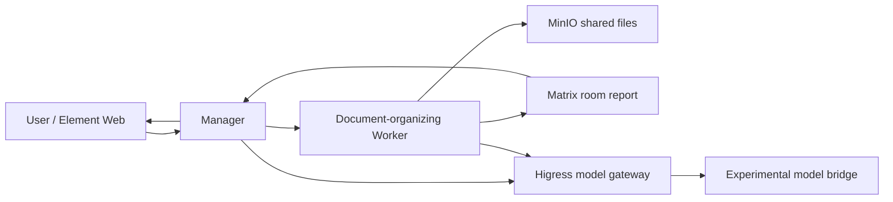

# AgentTeams on Kubernetes: From a Chat Request to Worker Delivery

How do you know that a multi-agent demonstration actually performed work? A Manager saying “done” in chat is not enough: inspect the delegation, the Worker's output, and the file contents independently. This article deploys AgentTeams in a Kubernetes test cluster, follows a document-organizing task, and preserves screenshots from the real interface.

[AgentTeams](https://github.com/agentscope-ai/AgentTeams) is a multi-agent collaboration project from the AgentScope community: a Manager coordinates Workers, and people observe and participate in Matrix rooms. The project supplies a controller, model gateway, messaging, and shared storage; it is a collaboration platform rather than a model itself. Consult the [official Kubernetes guide](https://github.com/agentscope-ai/AgentTeams/blob/main/docs/usage/deployment/kubernetes.md) and the version being deployed for current details.

## Test environment and architecture

This test used AgentTeams **v1.2.6** in a dedicated test namespace. The controller, Manager, Worker, Element Web, Matrix service, Higress gateway, and MinIO object storage ran on Kubernetes. A local port-forward exposed the page to the workstation, which also supplied a model bridge. No production workloads were involved. Internal addresses are obscured in screenshots; the account and task are test data.

This is a logical illustration of the test, not evidence of network isolation or high availability. Manager and Worker are separately running agents; Kubernetes hosts the workloads and control components, Matrix rooms carry collaboration, and MinIO stores task files.

## Architecture: who manages resources and who runs tasks

AgentTeams separates creating and maintaining agents from the runtimes in which agents reason and use tools. The following reflects the v1.2.6 source and this deployment; recheck it after upgrading.

| Layer | Components and responsibility | Boundary in this test |
| --- | --- | --- |
| Control plane | Controller watches Manager, Worker, Team, Human, and related custom resources, reconciling identity, runtime, and state | Resource reconciliation does not ensure correct answers or successful business tasks |
| Execution | Manager receives requests and coordinates; Workers execute in their runtimes | In this test each Worker is a separate Pod; a task does not automatically imply a newly created Pod |
| Collaboration | Element is the client and Tuwunel is the Matrix homeserver; rooms carry human and agent messages | Chat is evidence of the process, not proof that an artifact exists |
| Data | MinIO stores shared task files and agent state; mechanisms such as file-sync exchange them | Verify local and object copies separately; synchronization is not a database transaction or guaranteed exact resumption |
| Model access | Higress provides the model and API gateway; this test used an experimental model bridge | Validate gateway policies, authentication, and bridge availability separately; prompts are not a security boundary |

In the source, [`WorkerReconciler`](https://github.com/agentscope-ai/AgentTeams/blob/v1.2.6/agentteams-controller/internal/controller/worker_controller.go) manages standalone Workers; Team members are reconciled by the Team controller using shared member logic. Reconciliation reads desired configuration and maintains resources and status, but Pods, models, Matrix, and storage have different failure modes. Project workflow status and read-only inspection also depend on the relevant plugin and project data; this chat task is not evidence that a DAG workflow was verified. [Project workflow API](https://github.com/agentscope-ai/AgentTeams/blob/v1.2.6/docs/usage/project-workflow-api.md)

A typical request reaches the Manager through chat, then travels to a Worker through a task specification and message. The Worker calls a model, uses tools, produces files, and reports back. Users and reviewers must still check actual files, execution logs, and edge cases. The workstation bridge after the gateway was an experiment-specific adaptation, not a required AgentTeams component.

## Comparison with the Multica test

We previously deployed [Multica v0.8.0](multica-agent-team-platform.md) in a test cluster. Models, tasks, and execution configurations differed, so this compares architecture and observations rather than matched performance.

| Dimension | AgentTeams | Multica |
| --- | --- | --- |
| Primary entry | Matrix/Element room conversation with a Manager coordinating Workers | Workspace issues, agents, and execution records |
| Runtime | In this test the Controller launched separate Worker Pods from custom resources; runtime and model are configurable | The control plane and separate runtime Pod were distinct; a daemon launched the DSH CLI |
| Collaboration and artifacts | Room messages, task files, and shared object storage; a human supplied a follow-up prompt in this run | Issue assignment, comments, and runs; overlapping tasks were observed, but inter-agent collaboration was not established |
| Investigation | Chat, Worker state/Pod logs, and shared files; project views depend on plugins | Issue activity, run timeline, and tool events; code and tests still need independent review |
| Observed risks | A Worker failed and entered a restart loop; its state-file issue needs investigation | The runtime sandbox was unavailable and execution fell back to wider access; prompts alone cannot isolate either system |
| Starting point | Explore chat-led role delegation and Kubernetes-native Worker management | Track coding agents, execution records, and human review around issues |

Both require review of identities, storage, networking, credentials, and model outputs. A failure in one experiment is not a project-wide reliability ranking. AgentTeams supports more than chat, and Multica supports more than a single agent; validate features against the target version.

## Deployment and checks

1. Install the target Helm Chart version in a test namespace with the controller, gateway, Matrix, MinIO, and frontend. Configure persistent volumes, reachable images, and a model service for the environment; keep credentials in restricted Secrets, not public values files.
2. Check that Pods and volumes are ready and that the Manager can reach the model gateway. This experiment used a separate workstation bridge to access the model: it was an environment-specific adaptation, not a universal official architecture.
3. Access Element through a local port-forward such as `kubectl -n <namespace> port-forward svc/higress-gateway 18088:80`. Sign in with a test account and open the Manager room.
4. Submit the task in the Manager room, then inspect the Worker room, runtime state, and task file. A Running Pod alone does not prove model calls or task delivery succeeded.

See the [official Kubernetes deployment guide](https://github.com/agentscope-ai/AgentTeams/blob/main/docs/usage/deployment/kubernetes.md) for installation options and compatibility. Storage, images, and model connectivity depend on the environment.

## Experiment: ask the Manager to create a document-organizing Worker

In Element, we asked the Manager to create `doc-organizer` and supplied three example notes: the model bridge works, the Matrix room is accessible, and the gateway plugin must be obtained from an image accessible inside the cluster. The Worker was asked to categorize the notes, preserve their original text, and report the result.

*The real light-theme desktop view shows the Manager reporting Worker status, categorized summaries, and file delivery. Some internal identifiers and paths are obscured. The original Chinese screenshot is preserved.*

The Manager created an OpenClaw-based Worker and posted the assignment in its room. One detail matters: **the administrator sent an additional prompt in the Worker room**. The result demonstrates a human-assisted workflow; it does not establish that the first assignment completed without intervention.

*The Worker room shows the Manager's assignment, an additional administrator prompt, and the Worker's completion report. Internal addresses are obscured; the original Chinese screenshot is preserved.*

The Worker reported creating `result.md` with a categorized index, individual summaries, and an overall summary. We read the file in the Worker's task directory and confirmed all three original notes were retained. We then listed the object-storage files read-only and compared the object returned by `mc cat` byte for byte with the Worker's local file; they matched. This verifies that both copies were readable and identical in this test, not long-term storage reliability.

## Further experiments: task splitting, dispatch, and failure observation

We submitted another set of fictional tasks in the same test environment, asking the Manager to reuse the existing Worker, leave cluster configuration alone, and avoid deleting existing files:

| Experiment | Input and acceptance goal | Observed result |
| --- | --- | --- |
| A: metric analysis | 1,000 requests and 25 failures in five minutes; calculate the error rate and state what cannot be inferred | Manager also delegated this to the Worker, despite the request for independent Manager analysis. The expected arithmetic is 2.5%, not a measured Worker result |
| B: classify and deduplicate | Four records, including one duplicate; retain the originals, classify them, and identify the duplicate | The task specification was created and dispatched; no `result.md` was present when checked, so acceptance is incomplete |
| C: missing information | The same records lack timestamps; mark them unknown rather than inventing them | The task specification was created and dispatched; no `result.md` was present when checked, so acceptance is incomplete |

The Manager wrote separate specifications and sent the three tasks to the Worker, whose room displayed a failure to complete the request. The Manager then resent A on its own. At inspection, all three task directories in object storage contained `spec.md` and `meta.json` but no result file; the Worker Pod remained Running. **These were not three successful cases, and a Running Pod does not establish task success.**

*The real light-theme desktop screenshot shows the Manager's assignments and the Worker's failure message. Internal addresses are obscured; the original Chinese screenshot is preserved.*

At about the same time, Worker logs repeatedly showed `Shared-state read and cleanup failed` and `SQLite database file identity changed before existing-only open`. The errors coincided with the failure, but causation was not established. Preserve logs and investigate the SQLite database and WAL/SHM lifecycle, whether shared-directory synchronization replaces open files, and the runtime version and official known issues. Do not delete the database or blindly retry side-effecting tasks before understanding state-storage semantics. Reproduce in an isolated test environment and verify files and task results before and after any fix.

## Complex tasks: service-quality analysis and code verification

The earlier document-organizing Worker later entered `CrashLoopBackOff`, with SQLite integrity-check failures in its startup logs. We preserved its state, created a separate test Worker with `agt create worker`, and had the administrator submit fictional tasks directly in its Matrix room. This path was <strong>not automatically orchestrated by the Manager</strong>.

The first task supplied two five-minute windows: 20 failures in 1,000 requests and 120 failures in 4,000 requests, against a 99% success target. It requested individual and aggregate rates, error budget, a counterfactual, and a distinction between facts and diagnostic hypotheses. The Worker replied in the room; we independently checked the arithmetic:

| Metric | Verified result |
| --- | --- |
| Individual error rates | 20/1,000 = 2%; 120/4,000 = 3% |
| Aggregate error rate | 140/5,000 = 2.8%; a simple average of 2.5% is incorrect |
| Ten-minute budget | At a 99% target for this window, 50 errors are allowed and 90 are in excess; a longer-period SLO cannot be inferred directly |
| Counterfactual | Reducing the second window to 40 errors yields 60/5,000 = 1.2%, still above 1% |

The Worker also separated hypotheses about traffic mix, releases, and measurement definitions, and suggested read-only investigation. It did not access a real cluster. This validates one Worker's multi-step reasoning, not multi-agent collaboration or production diagnostic correctness. Statistical significance and confidence intervals in the screenshot depend on sampling and independence assumptions; aggregate counts alone do not establish causality.

*The independent Worker analyzes fictional service metrics; internal addresses are obscured and the original Chinese model output is preserved.*

A second task asked the Worker to implement a Python log-summary utility and unit tests in a temporary directory, grouping request counts, errors, and average latency by service. The Worker created two files, but the chat reported a temporary model-provider internal error before its final response. We independently ran the existing tests inside the test container: **27 of 28 passed and one failed**, showing that infinite latency was not rejected. We then asked the Worker to fix and rerun the tests; the room again reported a temporary model-service error, and Worker logs showed HTTP 503 from the gateway request. Another independent rerun still had 27 passes and one failure. A 503 alone does not locate the fault. This is not a passing result; the temporary code was only an experiment and was not validated for production.

*Both the coding task and the repair retry encountered model-service errors. Internal addresses are obscured; the test conclusion comes from the independent rerun. The original Chinese screenshot is preserved.*

## Interruption and deployment constraints

The Worker room records that a gateway restart interrupted an earlier session; the Worker reported checking the directory, rebuilding the plan, and finishing. Eventual completion does not establish exact checkpoint resumption, automatic recovery of every side effect, or exactly-once execution.

The model service depended on a workstation bridge, so shutting down the workstation or interrupting the bridge affects inference; the page also depended on a local port-forward. Gateway plugins needed images reachable by the cluster. We also observed the controller resetting the gateway plugin failure policy. Its cause and target-version behavior require further investigation; do not treat the current configuration as a production security boundary.

A production evaluation should cover service identity, secret management, network controls, persistence and backup, Worker resource quotas, external ingress and HTTPS, gateway failure handling, and observability. End-to-end encryption was not enabled in this test room. That does not prove every transport hop lacked encryption, but sensitive data should not be put into this demonstration room. Enforce permissions in the runtime and policy layer rather than relying on prompts alone.

This test covered login, human task submission, Manager-created Worker, room assignment, a follow-up human prompt, file generation, and reporting. **It did not establish concurrency performance, cross-node recovery, production security readiness, or long-term object-storage reliability.** It is a functional exploration, not proof of production readiness.
