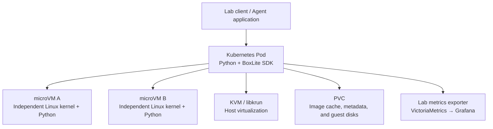

# BoxLite on Kubernetes in Practice: microVM Startup, Code Execution, and Disk Recovery

BoxLite packages micro virtual machine (microVM) creation and use as an SDK. An application can start an independent Linux environment, run Python, exchange files, and terminate the environment. For an agent executing model-generated code, this is an implementation worth testing: the application manages tasks, while BoxLite supplies an execution environment with its own kernel.

This experiment deployed BoxLite 0.10.7 to an existing Kubernetes test cluster on one node with working KVM. Median startup with a cached image was **736.9 ms**, and median execution of a short Python command in an already-running environment was **32.1 ms**. Four concurrent instances, file isolation, execution deadlines, and disk recovery after recreating the hosting Pod were all validated. The experiment also exposed an SDK metric interpretation issue in the recovery scenario.

Addresses, node names, registries, and cluster identifiers have been anonymized. The accompanying [examples and measurements](https://github.com/runzhliu/aik8s/tree/main/examples/boxlite-kubernetes) support reproduction.

## 1. What Kubernetes, BoxLite, and the guest each manage

This deployment uses BoxLite's **embedded Python SDK**. Kubernetes manages a Pod hosting the application. The application calls BoxLite, which starts multiple microVMs through libkrun and KVM. Each microVM runs the user space supplied by an OCI image. OCI stands for Open Container Initiative; the Python image used here retains the familiar container image format. [Project description](https://github.com/boxlite-ai/boxlite/tree/v0.10.7)



One Kubernetes Pod can therefore host multiple Boxes. Each Box does not automatically become an independent Pod, Service, or Kubernetes custom resource. Kubernetes manages node placement, application replicas, and outer resource limits; the SDK manages Box creation, command execution, stopping, and deletion.

This also explains the distinction from [OpenKruise Agents](openkruise-agents-kubernetes-practice.md): that project places warm pools, claims, and lifecycle management in Kubernetes controllers and custom resources. BoxLite's embedded path is closer to a virtual machine runtime library inside an application. They operate at different layers, so startup latency alone cannot rank them.

## 2. Actual deployment environment

| Item | Configuration |
| --- | --- |
| Kubernetes / container runtime | 1.30.4 / containerd 1.7.14, Linux amd64 |
| Host kernel / cgroup | 5.10.134 / cgroup v1 |
| BoxLite | 0.10.7; source commit `e140b56b4c6195292cbcf26de76c406e71ab56f4` |
| Python client | Python 3.12, using the released Linux wheel |
| Guest user space | Python 3.12 slim OCI image, fetched through an internal image cache |
| Each microVM | 1 vCPU, 512 MiB guest memory |
| Maximum test concurrency | 4 microVMs, 90-second CPU tasks |
| Hosting container | Requests 1 CPU / 2 GiB; limits 4 CPU / 8 GiB |
| Storage | 10 GiB ReadWriteOnce local volume mounted at `/data` |
| Access and monitoring | localhost port-forward; VictoriaMetrics collection and Grafana visualization |

The version is pinned to v0.10.7, released on 2026-10-18. Deployment was restricted to one selected node, retaining the existing container runtime and network. No node DaemonSet was installed, and existing KubeVirt configuration was unchanged. Checks before and after the experiment found all five existing virtual machines still Running. [Release record](https://github.com/boxlite-ai/boxlite/releases/tag/v0.10.7)

### 2.1 Devices and privileges

The node already had a usable `/dev/kvm`. The experiment used a privileged container with explicit mounts for `/dev/kvm`, `/dev/fuse`, and `/dev/vhost-vsock`. This compatibility baseline follows the direction of the upstream container deployment example; least-privilege deployment was not validated in this run. [Deployment patterns](https://github.com/boxlite-ai/boxlite/blob/v0.10.7/docs/guides/deployment-patterns.md)

Seeing the KVM device is a prerequisite; successful execution is the actual test. The first guest reported kernel **6.12.87**, whereas the host ran a 5.10 kernel. Two subsequent Boxes also reported different `boot_id` values. Together, these observations show that the tasks entered separate guests rather than running as ordinary processes directly inside the hosting Pod.

### 2.2 There are two separate image pulls

First, kubelet/containerd pulls the application image. Then BoxLite pulls the guest OCI image into its own cache and prepares its disk. A container image cached on the node does not imply that BoxLite's cache is ready.

The first guest image preparation attempt failed. An HTTPS probe to the registry identified an untrusted self-signed certificate in the experiment image. The second attempt configured `ImageRegistry(skip_verify=True)` for that registry only, and startup succeeded. This was an explicit laboratory exception; a production integration should configure a trusted certificate chain instead of making verification bypass the default. The Python SDK needs explicit registry options and does not automatically read the CLI configuration file. [Registry configuration](https://github.com/boxlite-ai/boxlite/blob/v0.10.7/docs/guides/image-registry-configuration.md)

## 3. Start a real microVM from code

With ordinary public image access, the basic call sequence is:

```python
import asyncio
import boxlite

async def main():
    runtime = boxlite.Boxlite(boxlite.Options(home_dir="/data/runtime"))
    try:
        async with boxlite.SimpleBox(
            image="docker.io/library/python:3.12-slim",
            runtime=runtime,
            cpus=1,
            memory_mib=512,
        ) as box:
            result = await box.exec(
                "python", "-c", "print(sum(range(101)))", timeout=20
            )
            print(result.exit_code, result.stdout)
    finally:
        await runtime.shutdown()

asyncio.run(main())
```

The actual result was exit code `0` and output `5050`. The first successful start took **5.466 seconds** from the client's perspective, including guest image preparation and initialization. It is not a pure kernel boot measurement. The SDK's `guest_boot_duration_ms` was `null` in this run; it was neither replaced with zero nor plotted as a boot performance result.

The accompanying example includes a page that reads the real JSON execution records:


This is the **SDK lab page supplied with this article**. Upstream BoxLite does have an official Console under `apps/dashboard`, but that Console depends on control-plane components including an API, authentication, database, and Runner. This experiment validates the embedded SDK path. Mock-mode screenshots were not used as deployment evidence, and the lab page is not presented as the official Console. [Official Console description](https://github.com/boxlite-ai/boxlite/blob/v0.10.7/apps/dashboard/README.md)

## 4. What startup and repeated execution measured

Startup timing begins immediately before `SimpleBox.start()` and ends when it returns, followed by a command that checks the result. The image cache is retained, but each round creates a new Box. The previous Box is stopped and automatically removed.

| Test | Samples | Median | Minimum | Maximum |
| --- | --- | --- | --- | --- |
| `start()` with the guest image already cached | 10 | 736.9 ms | 713.8 ms | 1,427.2 ms |
| Short Python execution inside a running Box | 20 | 32.1 ms | 31.2 ms | 71.8 ms |

The second row repeats `print(sum(range(101)))` in the same running Box, checking both exit code and output every time. It includes command transport and Python process startup, but excludes model inference, substantial dependency imports, and data downloads.

These measurements establish the approximate latency of preparing a small Python execution environment. The sample is too small to characterize production tail latency and cannot directly compare sandbox platforms using different nodes or warm-pool strategies.

The initial test harness also had a call-order error: it read `SimpleBox.id` after stopping the Box, which the current SDK rejects. After saving the ID before stopping, a separate second attempt recorded the complete results. Original failure records were retained. The ten and twenty samples in the table come from the corrected complete tests; incomplete calls from the first attempt were not counted as successes.

## 5. Files, deadlines, and concurrency

### 5.1 File separation and transfer

Boxes A and B were started together. A random marker was written to `/root/isolation.txt` in A. That file did not exist in B, and the two guests had different `boot_id` values. A local file was then copied into A and copied back to the hosting application. Its SHA-256 checksum matched.

This validates separation under the default filesystem configuration used here and the file transfer path. Shared directories, explicit volume mounts, and network policies change resource visibility and require validation in the actual application configuration.

### 5.2 Can the environment still work after a deadline?

A guest Python process intended to sleep for 20 seconds ignored `SIGALRM` and ran with `timeout=2`. The call returned after **2.011 seconds**, with exit code **-15**. A subsequent command in the same Box successfully returned `alive`.

The deadline was therefore checked through the command's exit result rather than by waiting for the Python SDK to raise a timeout exception. The current SDK may return an `ExecResult` with a nonzero exit code on timeout, so callers must inspect the result. [Upstream timeout test](https://github.com/boxlite-ai/boxlite/blob/v0.10.7/sdks/python/tests/test_exec_timeout_sigalrm.py)

### 5.3 Four environments running together

Four Boxes were created concurrently, each with 1 vCPU / 512 MiB. Each guest ran a SHA-256 CPU loop for 90 seconds. The first concurrent execution phase took **90.610 seconds**; all four tasks returned successful exit codes and valid iteration counts. A second run to collect resource curves took **90.354 seconds**, with all four tasks completing again.

The hash loop is not an agent throughput score. Its purpose is to keep four guests busy at the same time, observe the hosting container's resource changes, and check reclamation after completion.

## 6. What exactly survives Pod recreation?

This test set `auto_remove=False` to retain guest disks and placed the complete BoxLite home on a PVC, rather than saving only a workspace directory.

The actual sequence was:

1. Create a named Box, write a random marker to `/root/marker.txt`, and save the Box ID and guest `boot_id`.
2. Stop the Box and confirm completion of the preparation phase.
3. Run `rollout restart` on the hosting Deployment and verify that the Pod UID changes.
4. In the new Pod, start with the same PVC, home, and Box name, using `reuse_existing=True`.
5. Check the Box ID, file contents, and new guest `boot_id`, then stop and remove the verification instance.

The result was **the same Box ID, the same file contents, and a different guest boot ID**, with restart taking **712.3 ms**.

The preserved state is the disk and instance metadata; the guest has rebooted. This process does not keep the previous process, Python variables in memory, or open network connections running. An agent that must resume a business workflow still needs application-level persistence for task state and completed steps.

The PVC used a local volume, so the result covers Pod recreation on the same node. It does not cover node disk loss, relocation to another node, or storage disaster recovery.

## 7. Resource curves and an SDK counting trap


The figure uses data actually collected during the experiment:

| Observation | Result and definition |
| --- | --- |
| Peak hosting-container CPU | 4.005 cores; 30-second rate of cumulative CPU time from the container's own cgroup |
| Peak hosting-container working set | 764,030,976 bytes, approximately 728.6 MiB; usage minus inactive file cache |
| Functional check records | 8 checkpoints passed in the second attempt, including persistence preparation and verification and one concurrency repeat |
| After completion | SDK-derived count returned to 0; no remaining KVM file descriptors were found inside the container |

The resource exporter reads the **current container's cgroup mount root**, not the machine's root cgroup. These curves include the hosting application and its microVM processes. They do not represent one guest's used memory, and subtracting them directly from `512 MiB × 4` would mix different accounting definitions. Configured guest memory, host resident memory, and file cache are different quantities.

There is another important observation: actual concurrency was four, but the SDK count plateaued at three. In v0.10.7, `num_running_boxes` is derived from `created - stopped - failed` counters for the current runtime process instead of a live enumeration of active instances. This process first recovered and then stopped an old Box. Together with the counter implementation, that explains the subsequent count being one short when four new Boxes were created. This is an interpretation supported by this experiment and source code, not a conclusion about every version. [Runtime metrics implementation](https://github.com/boxlite-ai/boxlite/blob/v0.10.7/src/boxlite/src/metrics/runtime_metrics.rs)

The original curve was retained, with its title explicitly identifying it as an SDK-derived count. Four independent command results also verified actual concurrency and exit status. Production capacity planning and billing should not rely on this derived count alone, particularly around recovery and repeated starts.

This run used a custom exporter to bridge SDK and container cgroup data, collected through a new `VMServiceScrape`. It does not imply that the BoxLite Python SDK provides a native Prometheus HTTP endpoint. Existing monitoring collection configuration was preserved.

## 8. Running on cgroup v1 does not prove per-Box host limits

The test node uses cgroup v1. The v0.10.7 jailer resource-control code checks for cgroup v2. When cgroup setup fails, the call path logs a warning and proceeds with startup. The successful microVM runs therefore do not establish that per-Box host CPU, memory, and process-count limits were created. [Cgroup detection](https://github.com/boxlite-ai/boxlite/blob/v0.10.7/src/boxlite/src/jailer/cgroup.rs), [continue-on-failure path](https://github.com/boxlite-ai/boxlite/blob/v0.10.7/src/boxlite/src/jailer/sandbox/bwrap.rs)

Three distinct layers are involved: the guest's 1 vCPU / 512 MiB configuration, the hosting container's 4 CPU / 8 GiB limits, and the per-instance host cgroup BoxLite attempts to create. Configuring the first two does not validate the third.

Further multitenant production evaluation should use cgroup v2 to test per-instance limits and cleanup under malicious process and memory pressure, while reducing the trusted launcher's privileges. A privileged Pod is part of the platform trust boundary; guest virtualization does not automatically remove the risk of launcher misuse.

## 9. Reproduction and access

The accompanying directory includes a Dockerfile, manifest renderer, complete test script, read-only record page, and monitoring configuration. Replace the node, storage class, and image with those for your environment:

```bash
docker build --platform linux/amd64 -t registry.example.com/lab/boxlite:0.10.7 \
  examples/boxlite-kubernetes
docker push registry.example.com/lab/boxlite:0.10.7

python3 examples/boxlite-kubernetes/render.py \
  --test-node worker-lab --storage-class local-lvm \
  --image registry.example.com/lab/boxlite:0.10.7 \
  --output .local/boxlite-lab

kubectl create namespace boxlite-lab --dry-run=client -o yaml | kubectl apply -f -
kubectl apply --dry-run=server -f .local/boxlite-lab/install.json
kubectl apply -f .local/boxlite-lab/install.json
kubectl -n boxlite-lab rollout status deployment/boxlite-lab
kubectl -n boxlite-lab port-forward service/boxlite-lab 18940:9108
```

Open `http://127.0.0.1:18940/` in a browser to view the records. Submit the suite and inspect its status from another terminal:

```bash
curl -X POST http://127.0.0.1:18940/api/suite
curl http://127.0.0.1:18940/api/state
```

`202 Accepted` only acknowledges submission. Wait for `busy=false`, inspect each record, and confirm `persistence_prepare` succeeded before recreating the Pod. Reestablish port-forward and submit `/api/persistence-verify`. For resource curves, install the example scrape resource and dashboard, then submit `/api/resource-run`. The renderer does not change the CNI, host runtime, or existing monitoring release.

The lab page and scrape endpoint share one Service and are intended for controlled tests. They should not be exposed directly as a public multitenant endpoint. A production platform also needs caller authentication, task quotas, lifecycle ownership, and coordinated cleanup after failures.

For an agent application, this run establishes the path from starting an independent execution environment through code execution and disk preservation to reuse after Pod recreation. Further work should focus on per-instance resource governance, task recovery semantics, and monitoring accuracy rather than treating a successful `start()` as acceptance of an entire platform.
