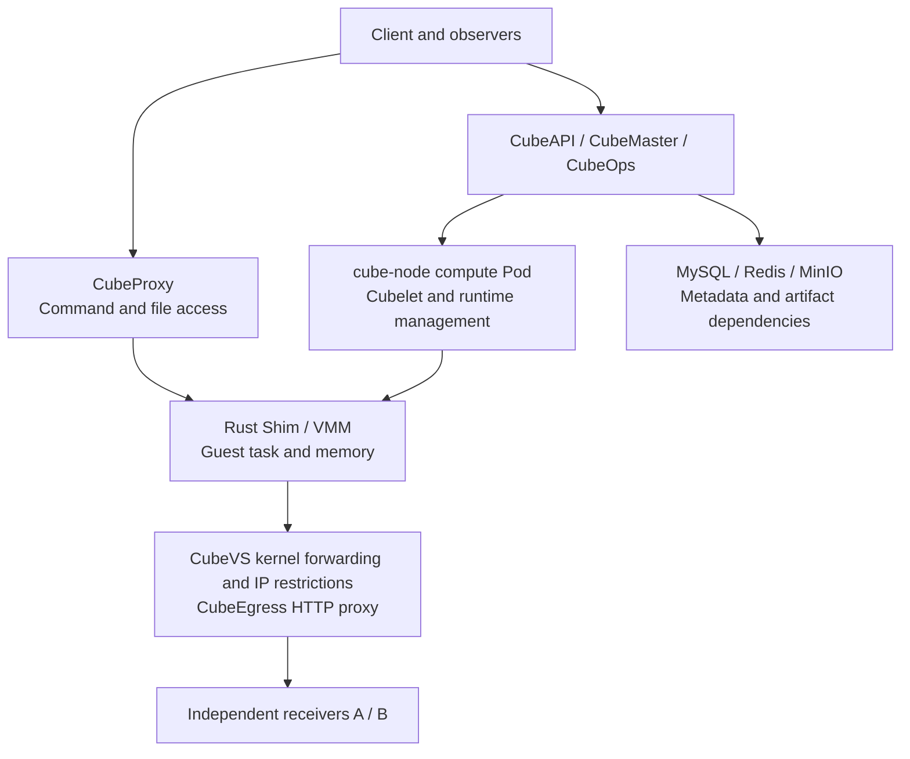

# CubeSandbox failure drills — control-plane outages, VMM termination, and snapshot recovery

Sandbox reliability involves more than creation speed. Does a task continue when the API fails? Does a proxy outage merely make a live task unreachable? Can execution resume after the compute Pod is recreated? Will a recovered task repeat operations it already performed against an external system?

We injected component failures into an initially idle Kubernetes test installation of CubeSandbox. The formal results use a **v0.7.3 Rust Shim verified against the actual executable**. Of 12 planned profiles, 11 reached fault injection; the HTTP path-rule baseline failed, so its fault was not injected. Compute Pod recreation received an additional attempt, with the failure retained.

Three findings matter most. Existing tasks generally continued during control-plane outages. After one virtual-machine runtime was killed, an explicit full-snapshot restore recovered its saved execution state. However, recreating the compute Pod in this installation's Pod-network mode stopped both original tasks, and subsequent recovery encountered port-map conflicts and `NoResource`. Failed compute-Pod recovery should be treated as a blocker before production adoption.

The [scripts, sanitized results, and per-request receiver records](https://github.com/runzhliu/aik8s/tree/main/examples/cubesandbox-fault-drill) are public. This is a component-failure and recovery experiment on one compute node, rather than validation of recovery across nodes, sites, or host power loss.

## 1. Verify which runtime was actually upgraded

Initially, component images were already tagged v0.7.3, but sandboxes created from an older template still used the node's retained v0.7.1 Rust Shim. CubeSandbox supports multiple component versions: templates and snapshots bind versions, so updating the current toolbox does not automatically move historical templates to the new runtime. [Component multi-version mechanism](https://github.com/TencentCloud/CubeSandbox/blob/v0.7.3/docs/guide/component-multiversion.md)

We created a separate template through the official OCI (Open Container Initiative) image-build workflow, retaining the same source image, startup behavior, and envd client service, and repeated the entire suite. We did not edit the historical template's component bindings in place.

| Verification | Historical template | New template used here |
| --- | --- | --- |
| Node component directory | `cube-shim/v0.7.1` | `cube-shim/v0.7.3` |
| Actual process | Rust Shim with embedded VMM | Rust Shim with embedded VMM |
| Executable SHA-256, first 12 characters | `9c5f4736e571` | `b538a14c67d0` |
| Formal matrix | Retained as historical attempts only | `r073a01`, plus Pod attempt `r073a02` |

VMM means Virtual Machine Monitor. Before injection, the script required the process to identify this sandbox, execute from the component-version directory, and hold an `anon_inode:kvm-vm` handle. This installation had no separate `cube-hypervisor` process; selecting a process by an assumed name would have targeted the wrong boundary.

Both binaries returned development placeholders for `--version`. Version attribution therefore combines the component manifest, actual executable path, and file hash. An image tag or CLI version string alone was not treated as runtime proof.

## 2. Identify shared failure boundaries



Arrows represent functional relationships, not a requirement that every packet traverse every component in sequence. In particular, outbound business requests from the guest and client commands through CubeProxy take different paths.

The `cube-node` installation used Pod networking and `hostPID: true`. PID 1 visible inside the container was a host process: killing it would not be a legitimate container-exit simulation. Target selection used the PID, Linux process start time, command hash, container cgroup, and KVM handles. An independent watchdog backed up recovery from Cubelet and Nginx process suspension.

| Test condition | Configuration |
| --- | --- |
| Kubernetes / architecture | 1.30.4 / x86_64, one compute node, KVM backend |
| CubeSandbox control components / Python SDK | v0.7.3 / 0.7.3 |
| Each sandbox | 2 vCPU, 2000 MiB, approximately 1 GiB root filesystem |
| Workload | Python in-memory counter, random identity, state digest, HTTP probes |
| Snapshot-package backend | Local XFS, not a shared cross-node snapshot backend |
| Dependencies | One replica each of MySQL, Redis, and MinIO; persistent volumes retained |
| Independent observation | Two receiver Pods separate from the sandboxes, on the same physical node |
| Observation resolution | Per-request receiver timestamps; 2-second metrics scrape; 8-second rate window |

### Use two targets instead of trusting client errors

A and B ran the same HTTP receiver. An unrestricted control first verified that both were reachable. Restricted cases allowed only A and checked whether B actually received requests. Each guest iteration visited both targets, with a 0.8-second request timeout and a 0.35-second interval between iterations. Connection reuse and environment proxies were disabled.

The baseline lasted at least 10 seconds, followed by at least 14 seconds after the fault action was confirmed. API and command probes also consumed time, so window lengths differed. Receipt counts indicate continued execution; they are not a component-throughput comparison. Network conclusions cover only these fresh IPv4 HTTP connections.

## 3. Control-plane outages separate execution from management

| Component and fault | A receipts during fault | B receipts | Successful API-list / command probes | Execution and recovery |
| --- | ---: | ---: | --- | --- |
| Scale CubeAPI to 0 | 40 | 0 | 0/17; 17/17 | Task continued; new-task execution and cleanup passed after recovery |
| Scale CubeMaster to 0 | 39 | 0 | 0/17; 17/17 | Task continued; new-task execution and cleanup passed after recovery |
| Scale CubeOps to 0 | 41 | 0 | 17/17; 17/17 | Task continued; deletion succeeded after transient failures |
| Scale CubeProxy to 0 | 40 | 0 | 22/22; 0/22 | Business requests continued; client commands were unreachable |
| Cubelet `SIGSTOP` | 42 | 0 | 0/8; 8/8 | Original task continued; management recovered after `SIGCONT` |

Cases ran sequentially, with recovery and acceptance checks before the next fault. The Cubelet case suspended a process; it did not demonstrate automatic recovery from a crash and restart.


*Actual monitoring for `cube-proxy-r073a01`. The allowed receiver continued receiving requests while the command channel fell to 0, then returned to 1. The counter shows only successful command reads; a gap means the counter could not be read, rather than that execution stopped.*

For incident response, “the sandbox is unreachable” needs a more precise diagnosis: did the guest stop, did its outbound path break, or did the access proxy fail? API responses alone can misclassify a live task as dead. Receiver traffic alone can conceal the fact that users can no longer execute commands.

## 4. Kill one VMM: recovery returns to the snapshot point

This case added a witness sandbox that received no fault. The main task held its counter steady, completed a full snapshot, resumed execution, and then had its actual Rust Shim killed.

| Checkpoint | Observed result |
| --- | --- |
| Counter saved in snapshot | 39, `held=true` |
| Last read before termination | 46 |
| Main task A / B receipts during fault | 0 / 0 |
| Witness counter | 2 → 55, same random identity |
| Counter after explicit snapshot creation | 39, `held=true` |
| Identity, PID, digest, and hold flag | Matched the snapshot |
| Recovery trigger | Explicit test-program call; no automatic failover |


*The main task's receive rate fell to 0, commands failed, and successful reads reappeared after explicit recovery. The exact 39 → 46 → 39 sequence comes from raw guest-state records. Metrics sampling is not a millisecond recovery timer.*

The full snapshot preserved guest memory and process state, rather than simply restarting a script that reread a file. However, restoration returned to 39 instead of the last pre-kill value of 46. Progress after the snapshot was not automatically retained.

The independent receiver also recorded **6 previously received allowed requests, sequence numbers 40–45**, replayed after recovery. It was outside the snapshot and did not roll back with the guest. An agent that had submitted an order, sent a message, or written an external database could therefore repeat an already completed side effect.

Task state and business idempotency still need their own design: persist idempotency keys for external writes, reconcile completed steps after restoration, and let the task system decide which operations to retry. Restoring memory does not restore the external world.

## 5. Compute Pod recreation stopped tasks and defeated recovery

This case ran both a subject and a witness, then deleted their `cube-node` Pod. The replacement had a different UID, both original Rust Shim processes were gone, and neither guest command channel worked. The main task had 0 / 0 A / B receipts in the fault window. An additional 35-second wait did not show automatic recovery.

The first explicit snapshot restoration failed with this sanitized error structure:

```text
network runtime EnsureNetwork failed:
ifindex/listen_port 4/49983 already maps to host port 20078,
cannot map to 20000
```

`ifindex` is a Linux network-interface index. The new Pod had a changed network namespace and interface lifecycle, while host-pinned CubeVS port maps retained old entries. A new allocator started at lower ports, and the implementation refused to overwrite a conflicting mapping. [v0.7.3 port-map conflict checks](https://github.com/TencentCloud/CubeSandbox/blob/v0.7.3/CubeNet/cubevs/port.go)

The first attempt's snapshot was subsequently removed by test cleanup. Attempt `r073a02` therefore explicitly retained its failed snapshot. It again failed to recover automatically, and its new-task check hit the same class of mapping conflict. The first failure cannot be dismissed as an isolated event.

### New-task creation recovered; the original task did not

After verifying an empty API inventory and no live CubeSandbox VMMs, we backed up and checked two dedicated maps, then briefly suspended Cubelet writes. Each repair removed 4 orphan entries from each map:

```text
/sys/fs/bpf/local_port_mapping
/sys/fs/bpf/remote_port_mapping
```

This was an idle-installation repair with no active CubeSandbox virtual machines, not a generic online repair procedure. No eBPF programs were detached, `/sys/fs/bpf` was not cleared, and the cluster CNI (Container Network Interface), OVS (Open vSwitch), and unrelated virtual-machine networks were unchanged.

Creation, execution, and deletion worked after cleanup, but restoring the second retained snapshot still returned `NoResource`. Snapshot and replica metadata reported READY, while the replica address still referred to the pre-recreation Pod. This is a lead for investigating placement and replica registration, not a root cause proven by a successful corrective experiment. `NoResource` should not automatically be read as insufficient machine memory.

The result is therefore: **the original task was not recovered; the environment's new-task path was restored**. We did not edit database records, bind an obsolete address, or force reuse of a vanished network namespace to produce a success screenshot.

The retained snapshot's cleanup request also dialed the old Pod address and timed out. Its cleanup remains outstanding pending investigation of replica registration; it does not consume a running virtual machine. This outstanding item is included in the public results.

The same-version official upgrade guide already warns that Big Pod recreation in Pod-network mode interrupts sandbox networking without self-healing and requires draining first. `hostNetwork` changes the network namespace lifecycle, but the supported isolation, drain, and validation process still applies. Switching that setting alone is not evidence of high availability. [Kubernetes upgrades and networking mode](https://github.com/TencentCloud/CubeSandbox/blob/v0.7.3/docs/guide/kubernetes/upgrade.md)

## 6. Dependency recovery requires more than a working list page


*The two experiments ran separately in sequence. API-list and command probes represent those specific operations, not the recovery of every create, delete, or snapshot operation.*

| Dependency and fault | A / B during fault | API / command probes during fault | Additional recovery findings |
| --- | --- | --- | --- |
| Scale MySQL StatefulSet to 0 | 40 / 0 | 17/17; 17/17 | Deletion had 7 DNS-name-not-found errors, then succeeded on attempt 8; retries spanned about 31 seconds |
| Scale Redis StatefulSet to 0 | 42 / 0 | 0/8; 8/8 | Deletion encountered connection failures, bridge timeouts, and finally not-found; inventory was empty and a new task executed successfully |
| Scale MinIO StatefulSet to 0 | 41 / 0 | 17/17; 17/17 | Cached task continued; new-task execution and cleanup passed after recovery |

The MySQL result shows that Pod readiness and a lightweight list probe do not establish that name resolution, connections, and all state changes have recovered. The Redis result illustrates that a timeout does not prove the server performed no action. Repeated create or delete calls need resource-state checks.

The MinIO case covered a cached running task and basic operations after recovery. It did not attempt a cold restoration requiring remote object reads while storage was unavailable. It therefore provides no evidence for object-storage high availability or S3-compatible snapshot disaster recovery. S3 here means the Simple Storage Service-compatible object-storage interface.

## 7. Validate IP restrictions separately from HTTP path rules

Layer-3 IP allowlists and layer-7 HTTP path rules follow different enforcement paths. Suspending the CubeEgress Nginx master and workers produced 39 A receipts and 0 B receipts in the IP-allowlist fault window. Existing kernel IP restrictions continued for this traffic; that does not establish successful HTTP path enforcement during a proxy failure.

The allowed request under HTTP path rules timed out before injection, so the profile is `BLOCKED_BASELINE` and no fault was injected. Investigation found a mismatch between the guest network range and egress listener configuration. Two environment variables were temporarily aligned, but the allowed path still failed with the new runtime. Formal records identify that temporary aligned configuration; original values were restored at the end.

The boundary matters: the IP-rule case was verified, HTTP proxy rules were not shown to work, and universal fail-closed behavior was not established. DNS, IPv6, established long-lived connections, and rule-loading intervals require separate cases.

## 8. Official UI and actual execution evidence


*Actual official Console with Mock mode off. Visible masks redact internal node, template, and environment identifiers. This sandbox was created for final command and creation acceptance and removed after capture. It is not evidence that the original task survived the Pod fault.*


*This is the accompanying custom evidence viewer, not the official Console. It separately presents successful explicit VMM snapshot restoration, failed compute-Pod recovery, and the failed HTTP path baseline. Failed profiles remain failed.*

## 9. Make the drill a repeatable recovery acceptance process

The program records every case as a separate attempt, including code and executable hashes, action times, original errors, and receiver records. Private configuration, full manifests, snapshot identifiers, and access tokens stay in a local ignored directory. Public results are exported through an explicit field allowlist.

```bash
# 配置中使用自己的专用测试安装和两个接收端，先完成目录 README 的预检。
python3 examples/cubesandbox-fault-drill/watchdog.py \
  --config .local/cube-drill/private/settings.json

# 在另一终端逐项执行；不要并发运行故障场景。
python3 examples/cubesandbox-fault-drill/run_drill.py \
  --config .local/cube-drill/private/settings.json \
  --case vmm --attempt a01
```

The comments above preserve the original test commands. Configure a dedicated installation and both receivers, complete the directory README preflight, start the watchdog, then run cases sequentially in another terminal.

A useful recovery acceptance process has four checks:

1. **Processes and interfaces:** component readiness, the actual runtime, survival of original processes, and interface or namespace changes.
2. **Tasks and traffic:** identity and counter continuity, received allowed traffic, and no receipts at the denied target.
3. **State changes:** verify creation, execution, file operations, deletion, and snapshots separately instead of treating a list endpoint as all management functionality.
4. **Business consistency:** measure progress lost since the snapshot, request replay, external idempotency, and reconciliation.

This experiment exercised listing, commands, creation, deletion, snapshots, and state verification. Guest file APIs installed the probes; this is not a complete matrix of filesystem failures and volume recovery.

Production planning should establish compute-node isolation and draining, a stable network lifecycle, and independent metadata and snapshot backups before promising cross-node recovery targets. Local XFS snapshots require the origin node. Shared S3 snapshots additionally depend on completed synchronization, compatible compute nodes, and real read availability, all of which need their own drill. [Cross-node snapshot conditions](https://github.com/TencentCloud/CubeSandbox/blob/v0.7.3/docs/guide/cross-node-snapshot.md)

No host reboot, power loss, cross-node, or cross-availability-zone recovery was performed. Original component replica counts and temporary environment variables were restored, test sandboxes were removed, and all five pre-existing virtual machines retained their UIDs and remained Running / Ready. The new template was retained for future validation.

## References and companion material

- [CubeSandbox v0.7.3 source](https://github.com/TencentCloud/CubeSandbox/tree/v0.7.3)
- [Reproduction code and sanitized JSON / CSV](https://github.com/runzhliu/aik8s/tree/main/examples/cubesandbox-fault-drill)
- [CubeSandbox process-memory snapshot experiment](cubesandbox-process-snapshot-recovery.md)
- [Microsandbox, BoxLite, and OpenSandbox failure experiments](sandbox-runtime-failure-network-policy.md)
