# CubeSandbox failure drills — control-plane outages, VMM termination, and snapshot recovery

Sandbox reliability involves more than creation speed. Does a task continue when the API fails? Does a proxy outage merely make a live task unreachable? Can execution resume after the compute Pod is recreated? Will a recovered task repeat operations it already performed against an external system?

We injected component failures into an initially idle Kubernetes test installation of CubeSandbox. The formal results use a **v0.7.3 Rust Shim verified against the actual executable**. Of 12 planned profiles, 11 reached fault injection; the HTTP path-rule baseline failed, so its fault was not injected. Compute Pod recreation received an additional attempt, with the failure retained.

Three findings matter most. Existing tasks generally continued during control-plane outages. After one virtual-machine runtime was killed, an explicit full-snapshot restore recovered its saved execution state. However, recreating the compute Pod in this installation's Pod-network mode stopped both original tasks, and subsequent recovery encountered port-map conflicts and `NoResource`. This configuration has not passed compute-Pod recovery acceptance and should not be deployed on the assumption of automatic recovery.

The [scripts, sanitized results, and per-request receiver records](https://github.com/runzhliu/aik8s/tree/main/examples/cubesandbox-fault-drill) are public. This is a component-failure and recovery experiment on one compute node, rather than validation of recovery across nodes, sites, or host power loss.

## 1. Verify which runtime was actually upgraded

Initially, component images were already tagged v0.7.3, but sandboxes created from an older template still used the node's retained v0.7.1 Rust Shim. CubeSandbox supports multiple component versions: templates and snapshots bind versions, so updating the current toolbox does not automatically move historical templates to the new runtime. [Component multi-version mechanism](https://github.com/TencentCloud/CubeSandbox/blob/v0.7.3/docs/guide/component-multiversion.md)

We created a separate template through the official OCI (Open Container Initiative) image-build workflow, retaining the same source image, startup behavior, and envd client service, and repeated the entire suite. We did not edit the historical template's component bindings in place.

| Verification | Historical template | New template used here |
| --- | --- | --- |
| Node component directory | `cube-shim/v0.7.1` | `cube-shim/v0.7.3` |
| Actual process | Rust Shim with embedded VMM | Rust Shim with embedded VMM |
| Executable SHA-256, first 12 characters | `9c5f4736e571` | `b538a14c67d0` |
| Formal matrix | Retained as historical attempts only | `r073a01`, plus Pod attempt `r073a02` |

VMM means Virtual Machine Monitor. Before injection, the script required the process to identify this sandbox, execute from the component-version directory, and hold an `anon_inode:kvm-vm` handle. This installation had no separate `cube-hypervisor` process; selecting a process by an assumed name would have targeted the wrong boundary.

Both binaries returned development placeholders for `--version`. Version attribution therefore combines the component manifest, actual executable path, and file hash. An image tag or CLI version string alone was not treated as runtime proof.

## 2. Identify shared failure boundaries

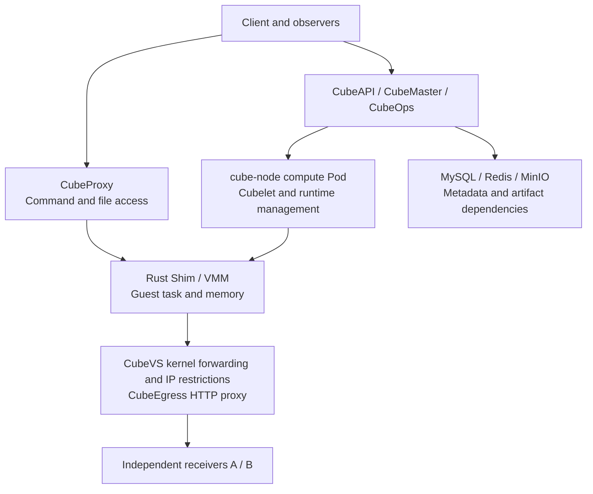

Arrows represent functional relationships, not a requirement that every packet traverse every component in sequence. In particular, outbound business requests from the guest and client commands through CubeProxy take different paths.

The `cube-node` installation used Pod networking and `hostPID: true`. PID 1 visible inside the container was a host process: killing it would not be a legitimate container-exit simulation. Target selection used the PID, Linux process start time, command hash, container cgroup, and KVM handles. An independent watchdog backed up recovery from Cubelet and Nginx process suspension.

| Test condition | Configuration |
| --- | --- |
| Kubernetes / architecture | 1.30.4 / x86_64, one compute node, KVM backend |
| CubeSandbox control components / Python SDK | v0.7.3 / 0.7.3 |
| Each sandbox | 2 vCPU, 2000 MiB, approximately 1 GiB root filesystem |
| Workload | Python in-memory counter, random identity, state digest, HTTP probes |
| Snapshot-package backend | Local XFS, not a shared cross-node snapshot backend |
| Dependencies | One replica each of MySQL, Redis, and MinIO; persistent volumes retained |
| Independent observation | Two receiver Pods separate from the sandboxes, on the same physical node |
| Observation resolution | Per-request receiver timestamps; 2-second metrics scrape; 8-second rate window |

### 2.1 Conditions held constant across cases

Each case ran one already-created probe sandbox, except the VMM and compute-Pod cases, which ran two. During faults, the workload did not continuously create or delete sandboxes, take snapshots, or perform model inference: it advanced an in-memory counter and sent short HTTP requests. Sandboxes were created with a 900-second timeout. These were short interruptions, not expiration-and-reaping tests.

Only the specified component was stopped in each case. CubeAPI, CubeMaster, CubeOps, and CubeProxy each had one replica when targeted; the lifecycle-management components retained their original deployment. Dependency outages preserved the original persistent volumes. The compute host, cluster network plugins, and receivers were outside the injection scope.

Every formal case used the new template and verified v0.7.3 executable, with the temporarily aligned egress CIDR configuration described earlier. Historical v0.7.1 records and configuration-debugging attempts remain separate. Template bindings and configuration changed, so these records cannot establish a performance gain between versions.

### 2.2 Network baselines: IP targets and HTTP paths are different cases

In IP-allowlist cases, A and B were the IPv4 addresses of two receiver Pods, both on port 8080. The sandbox used `allow_internet_access=False`, with only A in `network.allow_out`. Each guest iteration visited A and B, with a 0.8-second request timeout and a 0.35-second interval. Connection reuse and environment proxies were disabled.

The HTTP path-rule case instead visited **port 80 on the same receiver Pod A**: `/probe/allow*` was allowed, other paths on the same host were denied, and `/probe/deny` was the negative target. Here, “allowed / denied” means different paths, not different Pods. HTTPS decryption, domain rules, and TLS (Transport Layer Security) handshakes were not tested.

A separate environment preflight obtained HTTP 200 from both A and B when both were allowed, then checked the A-only restriction. That preflight did not record runtime hashes equivalent to the formal matrix and cannot stand in for an unrestricted control repeated in every v0.7.3 case. The formal runner actually performs a restricted baseline per case: observe for at least 10 seconds and require at least 3 A receipts and 0 B receipts before proceeding. Zero B receipts therefore means no bypass was observed in this traffic, not a security proof covering all bypass paths.

### 2.3 What each probe establishes

| Evidence | Actual check | What it does not establish |
| --- | --- | --- |
| API-list probe | `GET /sandboxes` returns HTTP 200 and parses as a JSON list or object | It does not inspect business error codes or every resource state; a JSON error object with HTTP 200 may count as success, without establishing creation, deletion, persistent writes, or snapshot availability |
| Command probe | Use the existing SDK connection to execute a command that reads a local guest HTTP state endpoint | This is not an external business request, fresh authentication, or creation of a new sandbox |
| Task identity and counter | Random identity, in-memory counter, PID, digest, and successfully read states | A missing counter curve alone does not prove the guest stopped when commands fail |
| Independent receiver records | Receiver timestamps, cases, targets, and sequence numbers | Receivers and tested components still share the physical host; this cannot validate host-power-loss availability |
| New-task and cleanup checks | After component recovery, clean old tasks, create a new task, run `printf recovered`, then request deletion | This does not continuously validate all mutations during the fault and is not a concurrent load test |

API and command probes run concurrently within each sample, followed by a 0.6-second delay between samples. Timeouts reduce sample counts, so the denominators do not represent an identical sampling rate. Recovery polling requires 3 consecutive successes for API, commands, and identity, with a maximum 75-second wait. Counter advancement and receiver traffic need separate inspection; that boolean predicate does not cover all business semantics.

The result field `remaining_sandboxes` is read after old-task cleanup and before the new smoke-test task is created; emptiness is checked separately at the end of the entire run. `MEASURED` means the measurement completed, not that every recovery acceptance passed. Monitoring stage 3 means the test workflow ended and can also occur for failed cases.

### 2.4 Where measurement windows begin

The pre-fault receipt window runs from `baseline` to `fault_issued`. The interval from `fault_issued` to `fault_confirmed` is an action transition and is excluded from fault receipt counts. Only `fault_confirmed` to `restore_issued` is the reported fault window. Witness and snapshot preparation extend the pre-fault window in VMM and Pod cases. The fault window also includes the final probe and witness read, so it can exceed the 14-second observation budget and is not the full business-outage duration.

Guest requests and receiver recording continue through action transitions, but the controller does not continuously sample API and commands there, so transient availability is not established. Monitoring stage 1 starts at `fault_issued` and includes that transition, whereas tabulated fault counts start at `fault_confirmed`; the plotted stage length cannot be used directly as their denominator. Stage 2 only means the program entered recovery steps, not that the task has recovered.

All values below are seconds, derived from adjacent timestamps in the public results and rounded to two decimal places. For process signals, “confirmed” means exact identity verification and a successful signal call. Scaling cases wait until the matching Pod list is empty. Pod recreation waits for a different UID to reach Running. These are different confirmation strengths.

| Profile / attempt | Pre-fault window | Action transition | Fault window |
| --- | ---: | ---: | ---: |
| CubeAPI / `r073a01` | 10.98 | 1.32 | 14.15 |
| CubeMaster / `r073a01` | 10.27 | 1.50 | 14.14 |
| CubeOps / `r073a01` | 10.91 | 2.27 | 14.29 |
| CubeProxy / `r073a01` | 10.51 | 1.71 | 14.53 |
| Cubelet / `r073a01` | 10.45 | 1.22 | 14.84 |
| VMM / `r073a01` | 15.03 | 1.17 | 14.98 |
| MySQL / `r073a01` | 11.04 | 4.80 | 14.10 |
| Redis / `r073a01` | 10.74 | 1.66 | 15.00 |
| MinIO / `r073a01` | 12.24 | 2.91 | 14.37 |
| CubeEgress IP / `r073a01` | 10.32 | 1.18 | 14.09 |
| CubeEgress HTTP / `r073a01` | Baseline only | Not injected | Not injected |
| Compute Pod / `r073a01` | 14.45 | 41.51 | 17.88 |
| Compute Pod / `r073a02` | 15.46 | 44.14 | 17.81 |

Receipt counts help establish task continuity, not component throughput. A 2-second scrape and 8-second rate window delay or smooth curve edges; they are not exact exit timestamps. There is one formal attempt per profile and two for the Pod. These records do not provide repeated-run distributions, long-term availability, or recovery-duration P95 / P99 values.

## 3. Control-plane outages separate execution from management

The following 12 diagrams show **experiment steps**, not packet-level topology or product screenshots. Read left to right: blue marks retained or observed execution, orange marks an injection target or failed step, and grey marks preparation and checks. A dashed orange border marks a planned action that was not executed. Arrows between columns show operation order; each diagram is a separate case. Click a diagram to enlarge it.

| Component and fault | A receipts during fault | B receipts | Successful API transport / guest command probes | Execution and recovery |
| --- | ---: | ---: | --- | --- |
| Scale CubeAPI to 0 | 40 | 0 | 0/17; 17/17 | Task continued; new-task execution and cleanup passed after recovery |
| Scale CubeMaster to 0 | 39 | 0 | 0/17; 17/17 | Task continued; new-task execution and cleanup passed after recovery |
| Scale CubeOps to 0 | 41 | 0 | 17/17; 17/17 | Task continued; deletion succeeded after transient failures |
| Scale CubeProxy to 0 | 40 | 0 | 22/22; 0/22 | Business requests continued; client commands were unreachable |
| Cubelet `SIGSTOP` | 42 | 0 | 0/8; 8/8 | Original task continued; management recovered after `SIGCONT` |

Cases ran sequentially, with recovery and acceptance checks before the next fault. The Cubelet case suspended a process; it did not demonstrate automatic recovery from a crash and restart.

### 3.1 CubeAPI: stop the sole API entry point, retain existing task access

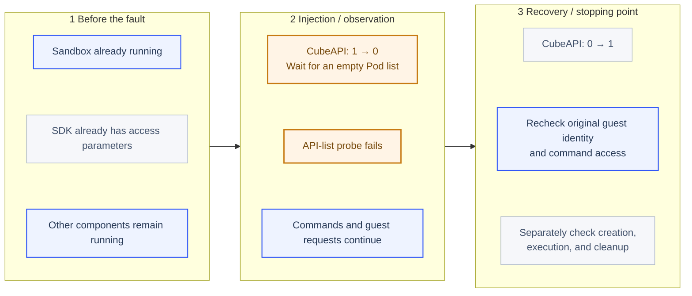

*Only CubeAPI is stopped. The middle column shows observations during the fault; the right column shows later recovery operations. Existing SDK access does not establish new-sandbox creation during the outage.*

| Item | Conditions, method, and boundary |
| --- | --- |
| Preconditions | One sandbox is already probing; the SDK already holds guest-access connection parameters, while CubeProxy, Cubelet, and other control components are healthy |
| Fault method | Scale `deploy/cube-api` from 1 to 0 and wait for all matching Pods to disappear; shutdown may be graceful, rather than a direct `SIGKILL` |
| Observation and recovery | Inspect the existing task for 14.15 seconds, restore 1 replica, poll API, commands, and identity, then run cleanup and new-task checks |
| Supported conclusion | This running task's HTTP loop and existing command access did not require CubeAPI to remain alive |
| Exclusions | New-task requests during the outage, fresh credential issuance, multi-replica failover, and longer control-plane outages were not tested |

### 3.2 CubeMaster: stop management while observing an existing task

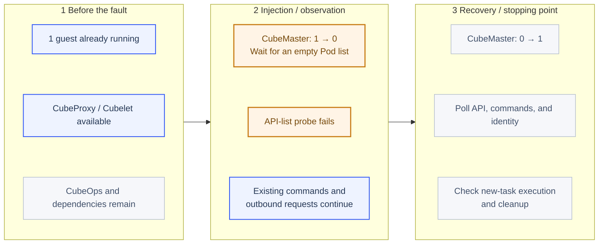

*The management component stops while the existing guest runtime remains. Scheduling and continuous task mutations were not tested during the outage.*

| Item | Conditions, method, and boundary |
| --- | --- |
| Preconditions | One running task; CubeAPI, CubeOps, CubeProxy, Cubelet, and dependencies remain running |
| Fault method | Scale `deploy/cube-master` from 1 to 0 and wait for its Pod list to become empty; other control components are not stopped |
| Observation and recovery | Observe for 14.14 seconds, restore the original replica count, check API listing, guest identity, and commands, then create, execute, and clean up |
| Supported conclusion | In this short window the existing guest and access proxy worked, while the list path was unavailable |
| Exclusions | Scheduling and task mutations during the outage, expiration cleanup, active/standby failover, and uncommitted state at a crash were not tested |

### 3.3 CubeOps: briefly stop operational metadata management

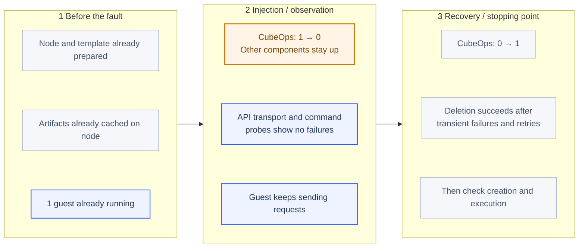

*This covers a prepared node and a warm task. Short-window success excludes new-node joining, missing-version downloads, and cache expiry.*

| Item | Conditions, method, and boundary |
| --- | --- |
| Preconditions | Node, component artifacts, and template are already prepared; one task is running and other control components remain available |
| Fault method | Scale `deploy/cube-ops` from 1 to 0 and confirm all matching Pods have been deleted |
| Observation and recovery | Check the task and both probes for 14.29 seconds; restore 1 replica, retry deletion and inspect inventory, then create and execute a new task |
| Supported conclusion | No failures were observed for the existing task, listing, or command path in this short window |
| Exclusions | Node-registration or artifact-cache expiry, new-node joining, missing-version downloads, and prolonged heartbeat loss were not tested; CubeOps cannot be considered safe to disable indefinitely |

### 3.4 CubeProxy: interrupt command access while observing guest egress

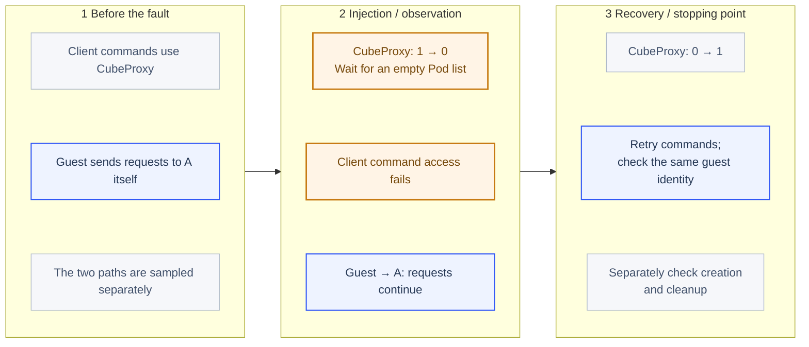

*The fault removes client command access without deliberately cutting guest egress. Failed commands and continuing business requests can coexist.*

| Item | Conditions, method, and boundary |
| --- | --- |
| Preconditions | One running task sends receiver requests independently; client commands take a separately sampled CubeProxy path |
| Fault method | Scale the sole `deploy/cube-proxy` from 1 to 0 and wait for an empty Pod list; do not disconnect the guest network interface |
| Observation and recovery | Observe for 14.53 seconds, restore the proxy, read the same guest identity through SDK commands, then run creation and cleanup checks |
| Supported conclusion | Guest business requests continued while client commands were unreachable; loss of access does not necessarily mean execution stopped |
| Exclusions | Proxy multi-replica failover, established long connections, streaming reconnection, and safe command retries were not tested |

### 3.5 Cubelet: suspend and resume the same process

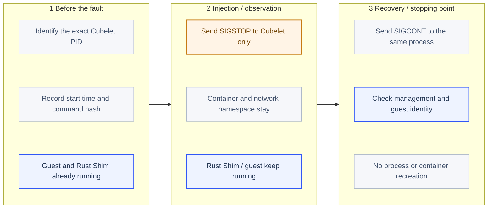

*The original process is suspended and then resumed. The container and namespace are not destroyed; this is not a crash-and-rebuild test.*

| Item | Conditions, method, and boundary |
| --- | --- |
| Preconditions | One running task; find exactly one Cubelet using its container cgroup and exact command, retaining PID, start time, and command hash |
| Fault method | Send `SIGSTOP` to that process while retaining its container, file descriptors, network namespace, and Rust Shim; no container exit or recreation |
| Confirmation and observation | Record identity validation and the successful signal call, then observe for 14.84 seconds; no separate `/proc` stopped-state polling was recorded, so this is not a full process-state trace |
| Recovery | Send `SIGCONT` to the same process identity, then check task, listing, commands, and cleanup; the independent watchdog resumes only the exact suspended process |
| Boundary | Covers brief management-process suspension, not a crash, out-of-memory termination, state reload, container restart, or host reboot |


*Actual monitoring for `cube-proxy-r073a01`. The allowed receiver continued receiving requests while the command channel fell to 0, then returned to 1. The counter shows only successful command reads; a gap means the counter could not be read, rather than that execution stopped.*

For incident response, “the sandbox is unreachable” needs a more precise diagnosis: did the guest stop, did its outbound path break, or did the access proxy fail? API responses alone can misclassify a live task as dead. Receiver traffic alone can conceal the fact that users can no longer execute commands.

## 4. Kill one VMM: recovery returns to the snapshot point

This case added a witness sandbox that received no fault. The main task held its counter steady, completed a full snapshot, resumed execution, and then had its actual Rust Shim killed.

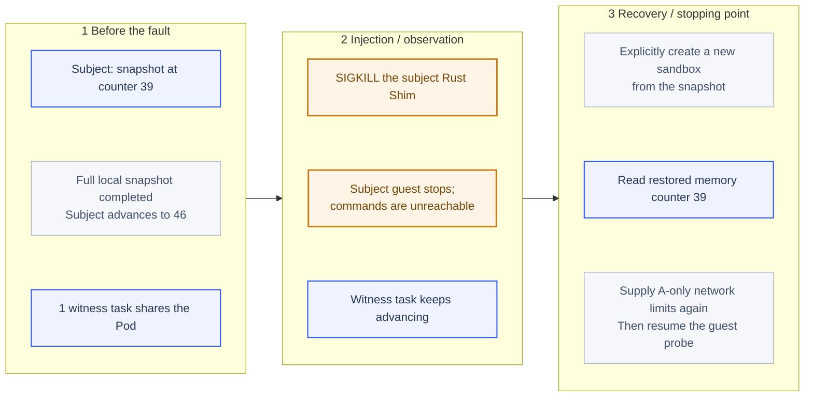

*Recovery creates a new sandbox. Restored guest identity and memory do not mean the original sandbox ID or host process came back.*

| Item | Conditions, method, and boundary |
| --- | --- |
| Preconditions | Subject and witness share one compute Pod; only the subject receives a full local-XFS snapshot, and other components remain healthy |
| Target | One Rust Shim matching the subject sandbox ID, component directory, executable hash, and KVM handles; neither the witness nor Cubelet is terminated |
| Fault and confirmation | Validate PID start time and command hash, call `SIGKILL`, record the return, then cross-check failed commands, stopped receipts, and witness progress; signal return alone is not treated as proof of exit |
| Recovery steps | Request deletion of the old sandbox object, create a new object with `Sandbox.create(template=snapshot_id, ...)`, read its held memory state, compare identity, counter, PID, and digest, then resume the guest probe loop |
| Network conditions | Pass `allow_internet_access=False` and A-only `network.allow_out` again when creating the restored object; this does not prove policies restore from a snapshot without being supplied again |
| Applicability | Requires a readable pre-existing full snapshot, the origin node, local storage, and control plane; not recovery without a snapshot, migration, or reconnection to the original sandbox ID |

The restored guest execution state belongs to a newly created sandbox object. A successful public `task_recovered` value does not mean that the original runtime process or sandbox ID came back automatically. The witness checks whether one VMM failure spreads to another task on the node; it is not in an independent failure domain.

| Checkpoint | Observed result |
| --- | --- |
| Counter saved in snapshot | 39, `held=true` |
| Last read before termination | 46 |
| Main task A / B receipts during fault | 0 / 0 |
| Witness counter | 2 → 55, same random identity |
| Counter after explicit snapshot creation | 39, `held=true` |
| Identity, PID, digest, and hold flag | Matched the snapshot |
| Recovery trigger | Explicit test-program call; no automatic failover |


*The main task's receive rate fell to 0, commands failed, and successful reads reappeared after explicit recovery. The exact 39 → 46 → 39 sequence comes from raw guest-state records. Metrics sampling is not a millisecond recovery timer.*

The full snapshot preserved guest memory and process state, rather than simply restarting a script that reread a file. However, restoration returned to 39 instead of the last pre-kill value of 46. Progress after the snapshot was not automatically retained.

The independent receiver also recorded **6 previously received allowed requests, sequence numbers 40–45**, replayed after recovery. It was outside the snapshot and did not roll back with the guest. An agent that had submitted an order, sent a message, or written an external database could therefore repeat an already completed side effect.

Task state and business idempotency still need their own design: persist idempotency keys for external writes, reconcile completed steps after restoration, and let the task system decide which operations to retry. Restoring memory does not restore the external world.

## 5. Compute Pod recreation stopped tasks and defeated recovery

This case ran both a subject and a witness, then deleted their `cube-node` Pod. The replacement had a different UID, both original Rust Shim processes were gone, and neither guest command channel worked. The main task had 0 / 0 A / B receipts in the fault window. Subsequent automatic-recovery polling did not observe the main task recover.

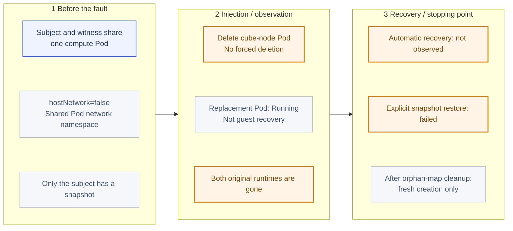

*Replacement startup, original-task recovery, snapshot creation, and fresh-template creation are separate acceptance points. Recovery of the last one does not make the first task recover.*

| Item | Conditions, method, and boundary |
| --- | --- |
| Preconditions | `hostNetwork` is false; two tasks share one compute Pod network namespace; only the subject has a pre-created full local-XFS snapshot |
| Fault method | `kubectl delete pod ... --wait=false`, without forced deletion or a zero grace period; the DaemonSet creates the replacement |
| Timing condition | Wait up to 90 seconds for a different Pod UID to reach Running; this does not require every container to be Ready, node re-registration, or successful sandbox creation |
| Automatic-recovery observation | Poll the subject with a 35-second budget after the fault window, not from Pod deletion; stages up to the manual-recovery marker lasted 35.47 and 39.16 seconds, including the final probe, process verification, and call overhead |
| Manual restore attempt | After no automatic recovery, request cleanup of both old objects, then try creating only from the subject snapshot; the witness is not restored from a snapshot |
| Shared impact check | Verify both original runtime PID identities are no longer alive; this second task measures shared-Pod impact, not survival in an independent failure domain |
| Boundary | Covers this Pod-network installation and these two snapshot-backed attempts; not hostNetwork, in-place upgrades, snapshot-free reconstruction, cross-node recovery, or host failure |

The replacement reached Running after 41.51 seconds in `r073a01` and 44.14 seconds in `r073a02`, counted as action transitions. A working API list afterward did not establish an executable original guest: each fault window had only 4 command probes, all failed. Treat replacement-Pod startup, original-task recovery, snapshot-based creation, and fresh-template creation as four separate acceptance points.

The first explicit snapshot restoration failed with this sanitized error structure:

```text
network runtime EnsureNetwork failed:
ifindex/listen_port 4/49983 already maps to host port 20078,
cannot map to 20000
```

`ifindex` is a Linux network-interface index. The new Pod had a changed network namespace and interface lifecycle, while host-pinned CubeVS port maps retained old entries. A new allocator started at lower ports, and the implementation refused to overwrite a conflicting mapping. [v0.7.3 port-map conflict checks](https://github.com/TencentCloud/CubeSandbox/blob/v0.7.3/CubeNet/cubevs/port.go)

The first attempt's snapshot was subsequently removed by test cleanup. Attempt `r073a02` therefore explicitly retained its failed snapshot. It again failed to recover automatically, and its new-task check hit the same class of mapping conflict. The first failure cannot be dismissed as an isolated event.

### New-task creation recovered; the original task did not

After verifying an empty API inventory and no live CubeSandbox VMMs, we backed up and checked two dedicated maps, then briefly suspended Cubelet writes. Each repair removed 4 orphan entries from each map:

```text
/sys/fs/bpf/local_port_mapping
/sys/fs/bpf/remote_port_mapping
```

This was an idle-installation repair with no active CubeSandbox virtual machines, not a generic online repair procedure. No eBPF programs were detached, `/sys/fs/bpf` was not cleared, and the cluster CNI (Container Network Interface), OVS (Open vSwitch), and unrelated virtual-machine networks were unchanged.

Creation, execution, and deletion worked after cleanup, but restoring the second retained snapshot still returned `NoResource`. Snapshot and replica metadata reported READY, while the replica address still referred to the pre-recreation Pod. This is a lead for investigating placement and replica registration, not a root cause proven by a successful corrective experiment. `NoResource` should not automatically be read as insufficient machine memory.

The result is therefore: **the original task was not recovered; the environment's new-task path was restored**. We did not edit database records, bind an obsolete address, or force reuse of a vanished network namespace to produce a success screenshot.

The retained snapshot's cleanup request also dialed the old Pod address and timed out. Its cleanup remains outstanding pending investigation of replica registration; it does not consume a running virtual machine. This outstanding item is included in the public results.

The same-version official upgrade guide already warns that Big Pod recreation in Pod-network mode interrupts sandbox networking without self-healing and requires draining first. `hostNetwork` changes the network namespace lifecycle, but the supported isolation, drain, and validation process still applies. Switching that setting alone is not evidence of high availability. [Kubernetes upgrades and networking mode](https://github.com/TencentCloud/CubeSandbox/blob/v0.7.3/docs/guide/kubernetes/upgrade.md)

## 6. Dependency recovery requires more than a working list page


*The two experiments ran separately in sequence. API-list and command probes represent those specific operations, not the recovery of every create, delete, or snapshot operation.*

| Dependency and fault | A / B during fault | Successful API transport / guest command probes | Additional recovery findings |
| --- | --- | --- | --- |
| Scale MySQL StatefulSet to 0 | 40 / 0 | 17/17; 17/17 | Deletion had 7 DNS-name-not-found errors, then succeeded on attempt 8; retries spanned about 31 seconds |
| Scale Redis StatefulSet to 0 | 42 / 0 | 0/8; 8/8 | Deletion encountered connection failures, bridge timeouts, and finally not-found; inventory was empty and a new task executed successfully |
| Scale MinIO StatefulSet to 0 | 41 / 0 | 17/17; 17/17 | Cached task continued; new-task execution and cleanup passed after recovery |

### 6.1 MySQL: single-instance service outage with its volume preserved

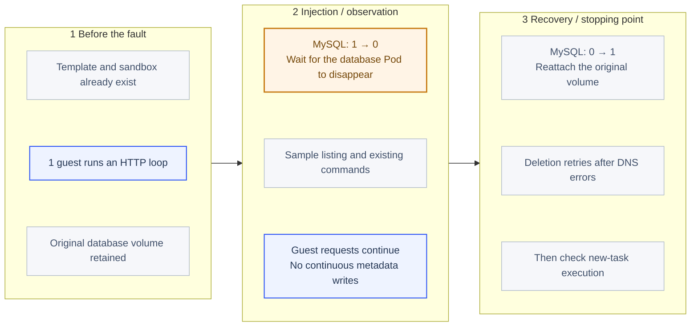

*This is a single-instance service outage with its volume retained. Writes and new-task creation were not continuously stressed while the database was unavailable.*

| Item | Conditions, method, and boundary |
| --- | --- |
| Preconditions | Template and sandbox already exist; one guest is running, the database volume is preserved, and other components remain healthy |
| Fault method | Scale `sts/cube-mysql` from 1 to 0 and wait for the database Pod to disappear; shutdown may be graceful, with no host termination or data-directory corruption |
| Fault-window workload | Observe for 14.10 seconds using only the running task, listing, and commands; do not continuously create tasks, write metadata, or take snapshots while the database is down |
| Recovery and verification | Restore the replica and original volume, continue probes, then delete the old task, inspect inventory, create and execute a new task, and request deletion; retain the 7 DNS failures and successful attempt 8 |
| Boundary | Listing at 17/17 does not make the database unnecessary; crash recovery, transaction loss, replication failover, and database-data restoration were not tested, and DNS errors alone cannot be attributed to the database engine |

### 6.2 Redis: preserve the volume and distinguish timeouts from resource state

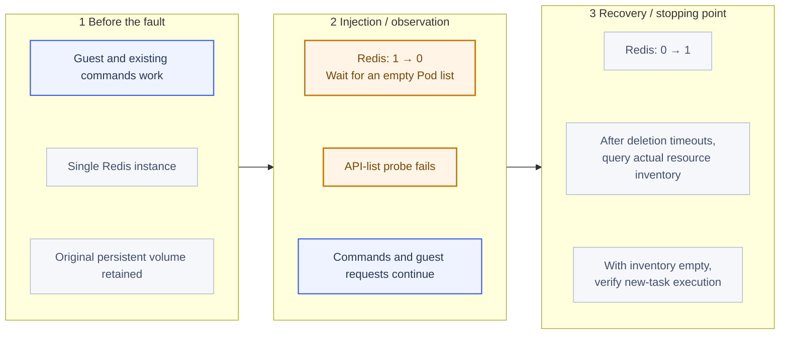

*Recovery checks both call results and actual inventory. A timeout is not proof that no action happened. Replication failover was not tested.*

| Item | Conditions, method, and boundary |
| --- | --- |
| Preconditions | One guest and its existing command connection work; Redis is a single instance whose persistent volume is retained |
| Fault method | Scale `sts/cube-redis` from 1 to 0 and wait for all matching Pods to disappear; this is not packet-loss or disk-latency injection |
| Fault-window workload | Sample the existing task for 15.00 seconds; listing is 0/8, commands are 8/8, and allowed receiver traffic continues |
| Recovery and verification | Restore 1 replica; deletion may time out or eventually return not-found, so cross-check inventory and new-task execution rather than assuming a timeout means no action |
| Boundary | No Redis failover, persistence mechanism, broad cache invalidation, or long-duration TTL (Time to Live) expiry was tested; the management plane cannot be considered independent of Redis |

### 6.3 MinIO: stop object storage and observe cached local execution

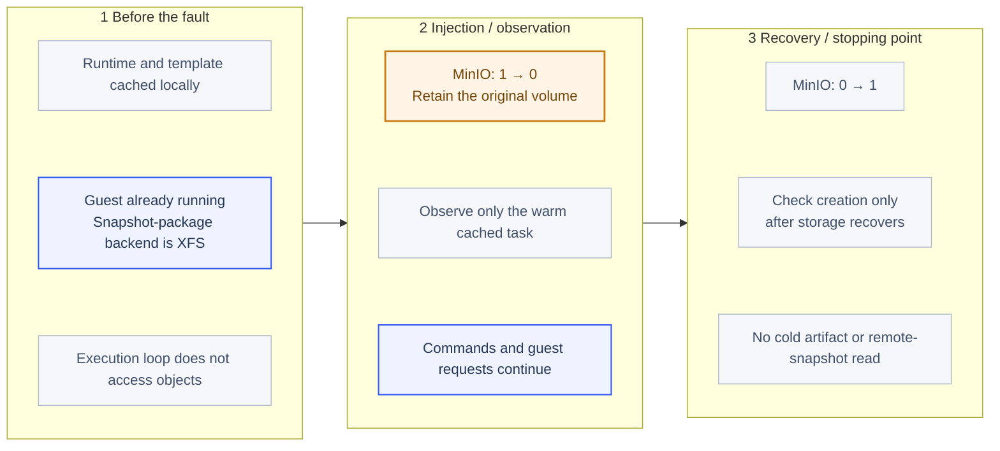

*Continuing execution uses prepared local state. Cold startup and S3 snapshot restoration were not tested during the MinIO outage.*

| Item | Conditions, method, and boundary |
| --- | --- |
| Preconditions | Template and runtime are cached on the node, the guest is running, the snapshot-package backend is XFS, and the execution loop performs no object-storage reads or writes |
| Fault method | Scale `sts/cube-minio` from 1 to 0, wait for its Pod to disappear, and preserve its original persistent volume |
| Fault-window workload | Sample only the running task, listing, and commands for 14.37 seconds; no cache-missing task or remote snapshot read is scheduled |
| Recovery and verification | Restore object storage before local-template creation, command, and cleanup checks; this did not demonstrate cold startup during a MinIO outage |
| Boundary | Demonstrates continuity only for this cached path, not component-warehouse availability, remote snapshots, volume recovery, object-storage availability, or integrity |

The MySQL result shows that Pod readiness and a lightweight list probe do not establish that name resolution, connections, and all state changes have recovered. The Redis result illustrates that a timeout does not prove the server performed no action. Repeated create or delete calls need resource-state checks.

The MinIO case covered a cached running task and basic operations after recovery. It did not attempt a cold restoration requiring remote object reads while storage was unavailable. It therefore provides no evidence for object-storage high availability or S3-compatible snapshot disaster recovery. S3 here means the Simple Storage Service-compatible object-storage interface.

## 7. Validate IP restrictions separately from HTTP path rules

### 7.1 Suspend CubeEgress Nginx and observe the IP-restricted path

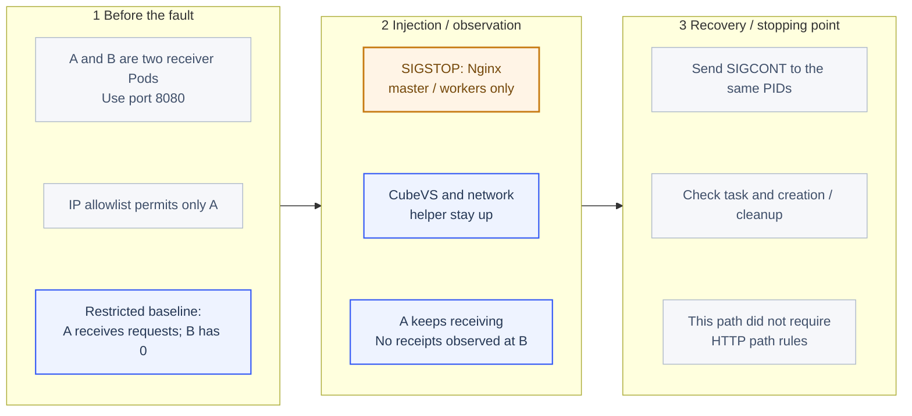

*User-space Nginx is suspended while kernel and network helper remain. This observes the IP-restricted path, not layer-7 proxy-failure safety.*

| Item | Conditions, method, and boundary |
| --- | --- |
| Preconditions | Only A is in the IP allowlist; A and B are different receiver Pods on port 8080; the restricted baseline has A receipts and 0 B receipts |
| Target | Only matching Nginx master / workers in the `cube-egress` container cgroup; Cubelet, Rust Shim, CubeVS, and `cube-egress-net` keep running |
| Fault and confirmation | Validate each process identity and send `SIGSTOP`; subsequent observation follows successful signal calls, without exiting the proxy container or removing kernel rules |
| Observation and recovery | Observe for 14.09 seconds, send `SIGCONT` to the same processes, then check task continuity and creation / cleanup |
| Boundary | HTTP path filtering was not established as a required traffic hop; zero B receipts under existing kernel IP restrictions do not prove layer-7 rules remain effective during Nginx failure |

Layer-3 IP allowlists and layer-7 HTTP path rules follow different enforcement paths. Suspending the CubeEgress Nginx master and workers produced 39 A receipts and 0 B receipts in the IP-allowlist fault window. This establishes continuing allowed traffic and no observed receipts at the denied target under this configuration. Rules were not removed during the fault to make B reachable as a reverse control, so zero receipts alone do not attribute all blocking exclusively to CubeVS or establish HTTP path enforcement during proxy failure.

### 7.2 HTTP path rules: baseline failure, no fault injected

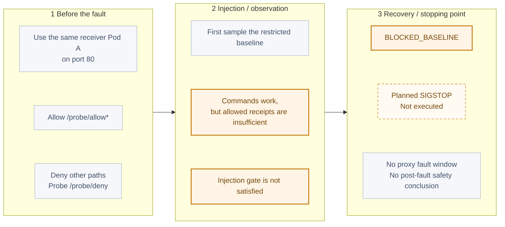

*This diagram stops before injection. SIGSTOP is an unexecuted plan and cannot be combined with the preceding IP-rule case as successful layer-7 validation.*

| Item | Conditions, method, and boundary |
| --- | --- |
| Rules and targets | Allow `/probe/allow*` for A's IPv4 host and deny other paths; visit `/probe/allow` and `/probe/deny` on the same Pod's port 80 |
| Baseline acceptance | Working guest commands are insufficient; require at least 3 allowed-path receipts and no denied-path receipts before suspending the proxy |
| Actual stopping point | Baseline samples and command reads completed, but allowed receipts missed the threshold; the controller stopped as `BLOCKED_BASELINE` without sending `SIGSTOP` |
| Configuration investigation | Temporarily aligning guest CIDR with proxy-listener / transparent-forwarding CIDR still failed; this matches the formal matrix configuration, and original values were restored afterward |
| Boundary | There is no fault window and no result proving safety after proxy interruption; without a successful corrective comparison, a single proven root cause has not been established |

The allowed request under HTTP path rules timed out before injection, so the profile is `BLOCKED_BASELINE` and no fault was injected. Investigation found a mismatch between the guest network range and egress listener configuration. Two environment variables were temporarily aligned, but the allowed path still failed with the new runtime. Formal records identify that temporary aligned configuration; original values were restored at the end.

The boundary matters: the IP-rule case was verified, HTTP proxy rules were not shown to work, and universal fail-closed behavior was not established. DNS, IPv6, established long-lived connections, and rule-loading intervals require separate cases.

## 8. Official UI and actual execution evidence


*Actual official Console with Mock mode off. Visible masks redact internal node, template, and environment identifiers. This sandbox was created for final command and creation acceptance and removed after capture. It is not evidence that the original task survived the Pod fault.*


*This is the accompanying custom evidence viewer, not the official Console. It separately presents successful explicit VMM snapshot restoration, failed compute-Pod recovery, and the failed HTTP path baseline. Failed profiles remain failed.*

## 9. Make the drill a repeatable recovery acceptance process

The program records every case as a separate attempt, including code and executable hashes, action times, original errors, and receiver records. Private configuration, full manifests, snapshot identifiers, and access tokens stay in a local ignored directory. Public results are exported through an explicit field allowlist.

```bash
# 配置中使用自己的专用测试安装和两个接收端，先完成目录 README 的预检。
python3 examples/cubesandbox-fault-drill/watchdog.py \
  --config .local/cube-drill/private/settings.json

# 在另一终端逐项执行；不要并发运行故障场景。
python3 examples/cubesandbox-fault-drill/run_drill.py \
  --config .local/cube-drill/private/settings.json \
  --case vmm --attempt a01
```

The comments above preserve the original test commands. Configure a dedicated installation and both receivers, complete the directory README preflight, start the watchdog, then run cases sequentially in another terminal.

A useful recovery acceptance process has four checks:

1. **Processes and interfaces:** component readiness, the actual runtime, survival of original processes, and interface or namespace changes.
2. **Tasks and traffic:** identity and counter continuity, received allowed traffic, and no receipts at the denied target.
3. **State changes:** verify creation, execution, file operations, deletion, and snapshots separately instead of treating a list endpoint as all management functionality.
4. **Business consistency:** measure progress lost since the snapshot, request replay, external idempotency, and reconciliation.

This experiment exercised listing, commands, creation, deletion, snapshots, and state verification. Guest file APIs installed the probes; this is not a complete matrix of filesystem failures and volume recovery.

Production planning should establish compute-node isolation and draining, a stable network lifecycle, and independent metadata and snapshot backups before promising cross-node recovery targets. Local XFS snapshots require the origin node. Shared S3 snapshots additionally depend on completed synchronization, compatible compute nodes, and real read availability, all of which need their own drill. [Cross-node snapshot conditions](https://github.com/TencentCloud/CubeSandbox/blob/v0.7.3/docs/guide/cross-node-snapshot.md)

No host reboot, power loss, cross-node, or cross-availability-zone recovery was performed. Original component replica counts and temporary environment variables were restored, test sandboxes were removed, and all five pre-existing virtual machines retained their UIDs and remained Running / Ready. The new template was retained for future validation.

## References and companion material

- [CubeSandbox v0.7.3 source](https://github.com/TencentCloud/CubeSandbox/tree/v0.7.3)
- [Reproduction code and sanitized JSON / CSV](https://github.com/runzhliu/aik8s/tree/main/examples/cubesandbox-fault-drill)
- [CubeSandbox process-memory snapshot experiment](cubesandbox-process-snapshot-recovery.md)
- [Microsandbox, BoxLite, and OpenSandbox failure experiments](sandbox-runtime-failure-network-policy.md)
