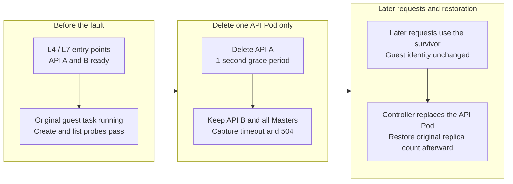
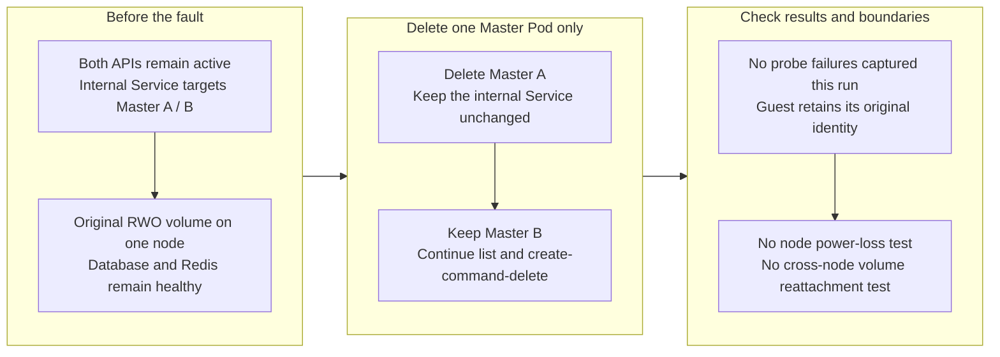
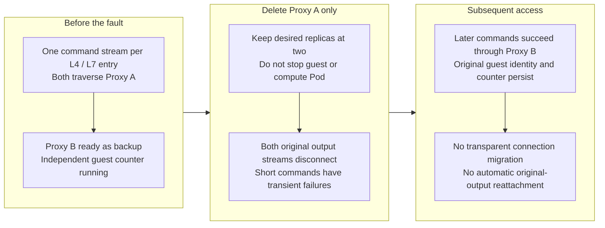

# CubeSandbox multi-replica failover — testing L4 and L7 entry points for API, Master and Proxy

Does running two replicas of API, Master and Proxy behind a load balancer establish sandbox-platform high availability? The previous [single-replica failure experiment](cubesandbox-failure-recovery-practice.md) tested whether tasks continued after components stopped, but could not show whether a surviving replica could handle requests. This follow-up tests multi-replica failover.

On October 22, 2026, in an idle test installation, we temporarily scaled CubeSandbox v0.7.3 API, Master and Proxy to two replicas each, then deleted one Pod at a time. **No request failure was captured in the Master case. API and Proxy had transient failures. Both established Proxy command streams disconnected, while the independent guest counter retained its identity and continued advancing.**

The three cases completed 33 create→command→delete workflows, including 24 started after fault issuance. This shows that small-scale new work could still complete; it does not establish lossless handling of every in-flight operation or a production availability percentage. [Reproduction code, 691 read probes and complete denominators](https://github.com/runzhliu/aik8s/tree/main/examples/cubesandbox-ha-drill)

## 1. What this experiment actually tested

| Condition | Actual configuration |
| --- | --- |
| Kubernetes / CubeSandbox / Python SDK | 1.30.4 / v0.7.3 / 0.7.3 |
| Actual Rust Shim | SHA-256 prefix `b538a14c67d0`, verified against the KVM process before injection |
| API, Master and Proxy | 2 replicas each, all on the same physical node |
| Master storage | Both Pods mount the original RWO volume on that node; cross-node mounting was not tested |
| Fault action | Delete exactly one selected Pod per case, with a 1-second grace period; desired replicas remain 2 |
| Guest workload | Independent Python in-memory counter and random identity; separate commands read its state |
| New requests | API list and guest commands; one serial worker runs create, command and delete |
| Long connections | Two pre-established Connect command-output streams in the Proxy case, one through L4 and one through L7 |
| Unchanged | Host, compute Pod, network plugin, databases, original templates and existing virtual machines |

RWO means ReadWriteOnce: single-node read/write, **not necessarily one Pod per volume**. Both Master Pods run on the same node and can use the original volume there. This does not establish that two different nodes can share it.

The compute Pod's networking mode was unchanged; the host was not restarted and the Helm release was not changed. The experimental LB (Load Balancer) itself has only one replica, so availability of the entire front-end tier was not tested.

### 1.1 Two actual forwarding layers

A separate OpenResty instance provides the experimental entry points, independently of the product CubeProxy. L4 uses Nginx `stream` to forward TCP connections; L7 uses Nginx `http` to parse and forward HTTP. The older lab bridge buffers entire responses, so it is used for management and cleanup, not long-stream measurements.

| Setting | L4 and L7 experimental front ends |
| --- | --- |
| API backend strategy | Round robin over two Pod IPs confirmed during preparation |
| Proxy backend strategy | Primary/backup; pre-fault requests traverse the selected primary |
| Failure handling | Passive removal, `max_fails=1`, `fail_timeout=60s` |
| Connect timeout | 1 second |
| Automatic replay | Disabled in the front LB; the controller does not retry mutations |
| Backend discovery | Read and reload before each case; replacement Pod IPs are not added within a case |
| L7 protocol settings | Preserve Host, forward HTTP/1.1, disable response buffering and gzip |

API list probes open new HTTP connections and require a successful response whose JSON contains the known sandbox ID. Command probes retain the SDK connection pool and read a guest loopback endpoint through envd, checking the original identity and counter. Arbitrary HTTP 200 responses are not sufficient, and list readability is not treated as proof that mutations work.

A real command also completed through the L4 TLS (Transport Layer Security) passthrough entry point. That request used the lab's self-signed certificate with certificate verification disabled. It establishes command execution through that path, not production-domain configuration, certificate-chain trust, L7 TLS termination or mutual TLS.

### 1.2 Distinguishing failure from completed replacement

Each case observes and checks the baseline for about 8 seconds, then issues deletion. After confirming that the old Pod is absent, it continues observing, checks that two replicas are ready, and observes for about another 7 seconds. Raw records retain fault issuance, deletion-call return, old-Pod absence, the readiness observation and measurement completion separately.

The replacement readiness check occurs after an observation interval; **its timestamp is not a precise measurement of replacement-Pod startup time**. Denominators below cover fault issuance through measurement completion, including deletion transition and subsequent recovery. The three windows are 28.26, 27.84 and 28.66 seconds. Different denominators are not a direct performance comparison.

During preparation, an unregistered template port, 18080, produced HTTP 404. A separate new-template preparation attempt failed its port-49999 health probe. Neither reached fault injection. Formal measurements retained the verified template and used existing command port 49983 to read guest-local state. The original template's ports were unchanged, and failed preparation was not overwritten with successful results.

## 2. API: a survivor handles requests, but transient errors remain

*A diagram of fault steps and retained components, not packet capture or a product screen. Master, Proxy and the guest are not stopped when API is deleted.*

After deleting one API Pod, L4 list probes succeeded 48/49, with one `ReadTimeout`; L7 succeeded 50/51, with one HTTP 504. Guest command probes succeeded 38/38 and 39/39 respectively. This case completed 11/11 full lifecycle workflows, including all 8 started after fault issuance.

The interval from the first failed sample's **request start** to the next successful sample's request start was 2.470 seconds for L4 and 1.496 seconds for L7. These are adjacent observations from discrete probes, not precise business-outage durations. Timeout settings, sampling intervals and connection state affect them. One run with few failures cannot establish that L7 always fails over faster than L4.

## 3. Master: same-node replicas continue serving, while storage needs separate validation

*This tests component failure on one node. The shared host and local volume remain common failure points.*

L4 and L7 list probes both succeeded 51/51, and command probes both succeeded 37/37. Full lifecycle workflows completed 11/11, including 8/8 started after fault issuance. No captured failure does not prove availability at every unsampled instant.

The official v0.7.3 Chart explicitly supports multiple Master replicas. Its default `Recreate` strategy avoids conflicts involving the default single-node read/write volume during rolling updates. A fully configured object-storage artifact setup or a filesystem supporting multi-node read/write is needed before further changes to storage and rolling updates. **This experiment did not replace local storage with shared storage or validate cross-node Master failover.** [Official replica and storage configuration](https://github.com/TencentCloud/CubeSandbox/blob/v0.7.3/deploy/kubernetes/chart/values.yaml)

Check the deployed protocol as well. The v0.7.3 CubeAPI client calls CubeMaster over HTTP REST. An internal Service provides basic distribution; a gRPC label in an architecture diagram is insufficient reason to configure a gRPC gateway for that path. [Actual client implementation](https://github.com/TencentCloud/CubeSandbox/blob/v0.7.3/CubeAPI/src/cubemaster/mod.rs)

*A real experiment dashboard. Controller observations were imported into VictoriaMetrics; these are not native CubeSandbox metrics. Success panels show the minimum over 2 seconds and latency shows the maximum over 2 seconds, preventing brief failures from being missed by display sampling. These aggregates do not change the per-request denominators below. Counter points exist only when a command successfully reads state.*

## 4. Proxy: later requests move, but original command streams disconnect

*Primary/backup routing makes the stream's fault target explicit. It is not a production balancing strategy selected by these measurements.*

The streams use envd `process.Process/Start` to run commands that repeatedly read and print the same guest counter. Clients receive `application/connect+json` frames. Despite the RPC-like method path, **this does not validate native gRPC or HTTP/2 stream balancing**.

Each entry point received 20 valid state messages before ending with `ChunkedEncodingError`, about 3.24 seconds after fault issuance. The controller did not automatically reopen either stream. Later successful short commands demonstrate **subsequent request success**, not transparent migration of the original stream or complete replay of its output.

L4 command probes succeeded 36/38 and L7 39/40. List probes both succeeded 55/55, and full lifecycle workflows completed 11/11. The independent counter retained its original random identity; its value advanced from 4 initially to 82, 158 and 235 after the respective cases. This demonstrates continued progress of that counter process. It does not separately establish whether the disconnected output-producing command process remained running.

*The middle-right lines represent the original pre-fault connections. They become 0 and are not automatically reattached. Above, short command probes recover while the bottom-left counter continues increasing: a proxy connection failure is distinct from guest-task termination.*

## 5. Complete denominators and conclusions that remain unsupported

| Deleted target | L4 list | L7 list | L4 command | L7 command | Full lifecycle started after issuance |
| --- | --- | --- | --- | --- | --- |
| One API Pod | 48/49 | 50/51 | 38/38 | 39/39 | 8/8 |
| One Master Pod | 51/51 | 51/51 | 37/37 | 37/37 | 8/8 |
| One Proxy Pod | 55/55 | 55/55 | 36/38 | 39/40 | 8/8 |

Values are successes / attempts. The first four columns cover fault issuance through measurement completion. Each lifecycle baseline also completed 3 workflows, giving 33/33 overall. Including baselines, there are 691 read probes. Public JSON / CSV retain denominators and failure types without retry-based replacement.

This is not an equal-condition L4/L7 performance benchmark. List probes use fresh connections, commands use the SDK pool, API uses round robin, Proxy uses primary/backup, and each entry point sees only one Pod-deletion run. Specific failure behavior can be compared; a general ranking of LBs cannot be derived.

Established streams did span the Proxy fault. However, no lifecycle workflow in these three cases happened to span fault issuance. Therefore, **result consistency when the request entry point disappears halfway through creation, deletion or snapshot execution was not validated**. That needs separately coordinated mutations confirmed to have entered processing, with checks for duplicate resources, unknown outcomes and compensation.

Other unexecuted cases include WebSocket, native gRPC, HTTP/2 multiplexed balancing, front-LB failure, host power loss, cross-node volume mounting, database or Redis elections, and cross-node snapshot recovery. Product configuration supports native gRPC and WebSocket, but these command streams do not substitute for testing them. [Proxy protocol configuration](https://github.com/TencentCloud/CubeSandbox/blob/v0.7.3/CubeProxy/nginx.conf)

## 6. Choosing entry points and replicas for production

| Component | Suggested starting point | Additional requirements |
| --- | --- | --- |
| CubeAPI | L7 entry point, at least 2 replicas on different nodes | Authentication, limits, timeouts and readiness removal; mutation retries follow interface semantics |
| CubeProxy | Prefer L4 passthrough; use L7 when a shared gateway is needed | TLS, Host, command streams, WebSocket / gRPC, draining and client reconnection |
| CubeMaster | Internal Service; address artifact storage before multiple replicas | Shared database and Redis, cross-node-readable artifacts and actual storage failover |
| CubeOps / template service | Multiple replicas according to component support | Object storage or shared filesystem, job coordination and artifact access |
| Lifecycle manager | Retain official replicas and leader election | Election dependencies, resume requests and failover of periodic pause / cleanup work |

These are deployment recommendations based on source and observations, not a production topology already validated in this lab. Both lifecycle-manager replicas can serve resume requests, while the leader performs certain periodic tasks; it should not be treated as an ordinary stateless HTTP service. [Lifecycle-manager implementation notes](https://github.com/TencentCloud/CubeSandbox/blob/v0.7.3/cube-lifecycle-manager/README.md)

Multiple Proxy replicas also have local caches. The official implementation discovers and contacts each management endpoint to invalidate sandbox routes. Replacing that broadcast with one call to an ordinary LB may update only one replica. Business-entry balancing and management broadcast are different requirements. [Cache-invalidation implementation](https://github.com/TencentCloud/CubeSandbox/blob/v0.7.3/CubeMaster/pkg/cubeproxy/admin.go)

For planned upgrades, stop assigning new traffic to a retiring replica and drain existing connections. For abrupt process failure, clients must accept possible connection loss. Reconnection also needs to distinguish command completion, durable output and execution-ID lookup. Blindly reissuing commands can duplicate business side effects.

At completion, API, Master and Proxy returned to their original one replica each. The temporary LB was deleted, no experiment sandboxes remained, fresh create/command/delete validation passed, and all five original virtual machines retained their UIDs and Ready state. The previous compute-Pod experiment's retained snapshot was untouched. Entry-point failover and sandbox-runtime recovery need separate acceptance results.

## References and reproduction

- [CubeSandbox v0.7.3](https://github.com/TencentCloud/CubeSandbox/tree/v0.7.3)
- [Scripts, JSON and 691 read probes for this experiment](https://github.com/runzhliu/aik8s/tree/main/examples/cubesandbox-ha-drill)
- [Previous single-replica, VMM and compute-Pod failure experiments](cubesandbox-failure-recovery-practice.md)
- [API Server L4 and L7 load balancing](../practices/kube-apiserver-load-balancing.md)
