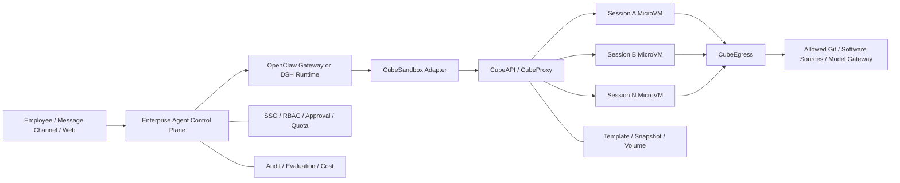
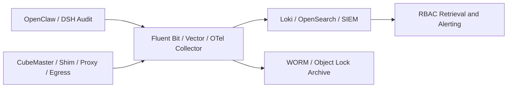

# Enhancing OpenClaw and DSH with CubeSandbox: Enterprise Secure Execution Surface in Practice

OpenClaw and DeepSeek Harness (DSH) are not just chat pages. They can read and write files, run Shell commands, invoke browsers, install dependencies, and persist sessions for long periods. The closer the capabilities get to a real development machine, the less an enterprise can afford to ask only "can it run?"—it must also answer four questions: whether execution is secure, whether the environment is reproducible, whether idle resources can be reclaimed, and whether the user's next turn is smooth enough.

A more appropriate combination is not to stuff all three into one large container, but to split them into two layers:

- **OpenClaw Gateway / DSH Runtime** handles messages, models, sessions, permissions, approvals, and tool orchestration;
- **CubeSandbox** creates per-session MicroVMs and provides Shell, file, PTY, code, network, and lifecycle APIs.

This article first explains why this split makes enterprise Agents safer, faster, and smoother, then uses a CubeSandbox `v0.7.0` cluster already deployed on Kubernetes to run through four real paths: OpenClaw `2026.7.1` and DSH `0.1.1-rc.2` each via Skill, as well as Tool Plugin / Cordis Plugin paths that do not read Skills, to create MicroVMs, execute code, and automatically destroy them. Deployment prerequisites and installation procedures are respectively covered in: [CubeSandbox Kubernetes Deployment Assessment](cubesandbox-kubernetes.md) and [Deployment in Practice](cubesandbox-kubernetes-practice.md).

The following results were obtained from this actual test:

| Verification Item | Result |
| --- | --- |
| MicroVM creation | Successful; 134 ms in this sample |
| Shell / File / Python | Successful |
| Complete blocking of public network egress | Effective |
| Sandbox public entry without access token | HTTP 403 |
| With access token | HTTP 204 |
| Pause | Successful; approximately 2.18 s in this sample |
| Resume | Successful; approximately 2.72 s in this sample |
| Files and Python memory after pause | Both preserved |
| OpenClaw Skill → CubeSandbox | Successful; `openai/gpt-5.6-sol` automatically invoked the Skill, sandbox creation 164 ms |
| DSH Skill → CubeSandbox | Successful; DeepSeek V4 Pro automatically invoked the Skill, sandbox creation 123 ms |
| OpenClaw → Adapter → CubeSandbox | Successful; the model only invoked `cube_exec` / `cube_release`, evidence referenced in `45a28df5` |
| DSH → Adapter → CubeSandbox | Successful; host Shell / FS tools disabled, evidence referenced in `f795f7fc` |
| Adapter auditing | Successful; Agent, live Sandbox, and audit events can be cross-verified via short references |
| Cleanup | Sandbox destroyed, cluster sandbox count restored to 0 |

These timings are functional samples from a single node, a single template, and a single request—not a performance benchmark. Production decisions require continued testing of P50, P95, P99, failure rates, and tail latency under concurrency.

This article strictly distinguishes what has been completed from what remains on the roadmap:

| Scope | Status |
| --- | --- |
| Cube SDK creation, Shell, file, Python, network isolation, traffic token, Pause / Resume, Snapshot, Rollback, Clone, Kill | Actually tested |
| CubeSandbox WebUI digital assistant, running sandbox, and observability pages | Verified with Chrome logged-in state |
| `cube-sandbox` Skill triggered in a real OpenClaw model session | Actually tested; conversation and tool activity screenshots retained |
| `cube-sandbox` Skill triggered in a real DSH model session | Actually tested; conversation and full trace screenshots retained |
| OpenClaw official Tool Plugin → authenticated Cube Adapter | Implemented and actually tested; four `cube_*` tools reuse leases per `sessionKey` |
| DSH Cordis Tool Plugin → authenticated Cube Adapter | Implemented and actually tested; leases reused per DSH Agent ID, host execution plugins can be hard-disabled |
| Adapter policy, quotas, HMAC session references, and JSONL desensitized auditing | Implemented as runnable reference code; currently only `offline-code` is open |
| Creating Digital Assistant / OpenClaw instances and invoking models | Not actually tested; official feature is Preview |
| DSH native transparent `shell/fs/pty` Provider | Not implemented; this article implements model-direct Cordis Tool Plugin, and additionally provides the Provider integration boundary |
| Browser Agent, concurrency stress testing, and cross-node recovery | Not actually tested; listed for the next phase |

## 1. Define the Boundary First: Agent Is the Control Plane, Sandbox Is the Execution Plane

The recommended architecture is as follows:



This boundary matters:

- OpenClaw / DSH retains session facts, user identity, model invocations, and approval records;
- CubeSandbox only receives the workspace, resources, network, and short-lived identity required for the current task;
- If a Sandbox is compromised, the attacker must still cross an independent MicroVM, egress policy, and tool authorization before affecting other sessions or the control plane;
- Sandbox destruction must not delete the OpenClaw state directory or `DSH_HOME`; the two belong to different lifecycles.

If Gateway, plugins, model keys, browser profiles, and untrusted code are all placed in the same long-running container, the isolation value of the MicroVM is significantly weakened.

## 2. What It Specifically Improves for OpenClaw / DSH

### 2.1 More Secure: Upgrading from "Restricted Directories" to "Isolated Execution Worlds"

DSH's built-in `dsh-sandbox` targets process restrictions within the same operating system. The official documentation states that it controls file side effects through mechanisms such as bwrap, Landlock, and Seatbelt; containers, MicroVMs, and remote execution are not backends for this seam, but rather replacements for the entire set of Shell and file capabilities.

When OpenClaw enables Sandbox, the Gateway remains in the host environment, and tool execution can enter Docker, SSH, or OpenShell backends. The official documentation likewise emphasizes that this is not a perfect security boundary; plugins and the Gateway process still belong to the trusted control plane.

What CubeSandbox adds is another layer of execution boundary:

- Each sandbox uses an independent MicroVM kernel;
- Each session has an independent rootfs, processes, network, and lifecycle;
- Egress can be completely disabled, or controlled by CIDR, domain, protocol, Host, Path, and SNI;
- The public entry can require a per-sandbox traffic token;
- The L7 proxy can inject credentials only toward allowed targets; real Tokens need not enter the sandbox environment variables.

But MicroVMs cannot replace tool authorization. Whether the model may invoke `kubectl`, delete repositories, commit code, or access production APIs must still be decided by OpenClaw / DSH and the enterprise Tool Gateway.

### 2.2 Faster: Templates and Snapshots Eliminate Repeated Preparation

What most affects enterprise Agent experience is often not the model's first token, but execution environment preparation: pulling images, installing Node/Python, restoring workspaces, starting browsers, and re-establishing tool connections.

CubeSandbox can move these actions forward:

- Pin Git, Python, Node, browsers, and the enterprise CA into templates;
- Use template aliases to manage environment versions, avoiding each Agent installing its own;
- Pause when idle to release CPU and memory;
- Resume on the next turn, restoring the file system and MicroVM memory;
- Use Snapshot, Rollback, and Clone to support parallel attempts and fast rollback.

The single creation sample for the READY template in this test was 134 ms. Pause and Resume are at the second level; whether they are faster than re-creation depends on template size, snapshot backend, node cache, and concurrency, so real workspaces must be used for testing—this single number cannot be applied directly.

### 2.3 Smoother: One-to-One Mapping Between Session and Sandbox Lifecycle

What users want is "continue later," not an understanding of Pods, containers, and VMs. The adapter layer should hide the underlying state:

```text
第一轮消息
  → 按 session_key 创建沙箱
  → 上传或挂载工作区
  → 执行工具
  → 空闲 5 分钟后自动 Pause

下一轮消息
  → 根据 session_key 找回 sandbox_id
  → 自动 Resume
  → 文件、变量和进程上下文继续存在

会话关闭 / TTL 到期 / 管理员回收
  → Kill
  → 清理快照、网络、临时卷和映射记录
```

The control plane should persist at least the following fields:

| Field | Purpose |
| --- | --- |
| `tenant_id` / `user_id` / `session_key` | Determine tenant and session ownership |
| `sandbox_id` | Connect to or reclaim the MicroVM |
| `traffic_access_token` | Access the protected data plane; stored encrypted |
| `template_alias` / Digest | Guarantee environment reproducibility |
| `network_profile` | Record the actual egress policy |
| `state` / `last_seen_at` | Pause, Resume, Kill, and reclamation |
| `request_id` / `trace_id` | Correlate Agent, API, proxy, and audit logs |

All lifecycle operations must be idempotent. Creation succeeding but the database write failing, recovery timeouts, client disconnects, and duplicate callbacks must not leave unclaimed sandboxes behind.

### 2.4 Better Suited to Enterprise Platforms: Control Plane and Execution Plane Scale Separately

The pressure on OpenClaw / DSH Runtime comes from model streaming, sessions, channels, and plugins; the pressure on CubeSandbox comes from VM creation, CPU, memory, snapshots, and network. After the split, each can be scaled, rate-limited, and upgraded independently:

- Runtime Pools split by business, department, or trust domain;
- Sandbox Node Pools split by ordinary code, browser, data analysis, or GPU templates;
- The enterprise control plane uniformly distributes templates, network, quotas, and TTLs;
- A Runtime no longer needs a local Docker Socket, nor does it need to hand host directories directly to the Agent.

## 3. How OpenClaw and DSH Should Be Integrated

### 3.1 OpenClaw: Three Paths

| Path | Implementation | Advantages | Limitations | Recommendation |
| --- | --- | --- | --- | --- |
| Official CubeSandbox Skill | Agent invokes the Cube SDK per Skill guidance | Fastest to get started; official examples already exist | Not an OpenClaw native backend; ordinary `exec` may still go through other execution surfaces | PoC |
| Enterprise Adapter / Plugin Tool | Register audited `cube_exec`, `cube_read`, `cube_write`, `cube_release` | Parameters and policy are controllable; easy to add tenancy, auditing, and quotas | Requires maintaining a small amount of adapter code; the current reference implementation has no PTY yet | Recommended starting point; actually tested in this article |
| Running the entire OpenClaw inside CubeSandbox | Use Digital Assistant / AgentHub to create assistants from OpenClaw templates | Assistants can be snapshotted, rolled back, and cloned | Currently Preview; Runtime, state, and execution boundaries can easily become mixed again | Demo, personal assistant, and early validation |

The CubeSandbox official repository already provides the `examples/openclaw-integration` Skill, suitable for verifying "whether the Agent can proactively put code into a MicroVM." The enterprise version is better suited to wrapping SDK calls into fixed Plugin Tools: the model only provides commands, files, and policy tiers, and cannot freely concatenate CubeAPI management requests. This article has implemented and run this path through the OpenClaw official `defineToolPlugin` interface; code is available at [`openclaw-plugin`](https://github.com/runzhliu/aik8s/tree/main/examples/cubesandbox-openclaw-dsh-direct/openclaw-plugin).

The built-in Sandbox backends listed in OpenClaw's current public documentation are mainly Docker, SSH, and OpenShell; CubeSandbox cannot be treated as a fourth natively supported backend. If there is no validated backend interface, registering an independent Cube tool and disabling the host `exec` for untrusted sessions is easier to follow upstream upgrades than deeply modifying the Gateway.

### 3.2 DSH: First Hard-Route via Cordis Tool Plugin, Then Evolve to Provider

DSH's composable design is well suited to integrating remote execution surfaces, but the integration point must be correct:

| DSH Capability | CubeSandbox Mapping |
| --- | --- |
| `ctx.shell` | `sandbox.commands.run()` |
| `ctx.fs` | `sandbox.files.read/write/list/...` |
| `ctx.terminals` | `sandbox.pty` |
| Code interpreter | `sandbox.run_code()` |
| Session initialization | `Sandbox.create()` or connect to an existing instance |
| Idle reclamation | `lifecycle.on_timeout=pause/kill` |
| Task cancellation | Terminate command / PTY, Kill Sandbox if necessary |

DSH's approval and `read-only` / `workspace-write` / `danger-full-access` semantics remain in the control plane. The Provider decides which sandbox capability to invoke based on the approved policy; CubeSandbox then enforces resource, network, and MicroVM isolation.

This article first implements a deployable middle layer: a Cordis Plugin registers four Cube tools via `ctx.tools.register`, and uses a Profile Patch to disable `tool-bash`, `tool-pwsh`, `tool-fs`, `tool-fs-search`, and `tool-str-replace-editor`, forcing the model's command and file operations to go only through the Adapter. See the code at [`dsh-plugin`](https://github.com/runzhliu/aik8s/tree/main/examples/cubesandbox-openclaw-dsh-direct/dsh-plugin). It has already shed the Skill and host wrapper scripts, but the tool name is still `cube_*`, not yet a transparent replacement for DSH's original Bash / Editor / Terminal.

Do not implement CubeSandbox merely as `ctx.sandbox`. DSH officially defines this interface as same-world confinement; the eventual remote MicroVM Provider should replace a consistent set of shell, file, and terminal capabilities in the environment. Otherwise, tools in the same round could run half on the local machine and half in the VM, distorting working directory and permission semantics.

## 4. The WebUI already shows the OpenClaw direction

The "Digital Assistant" page of the CubeSandbox `v0.7.0` WebUI already brings OpenClaw assistants, model services, assistant templates, and team sharing into a single entry point. The page also clearly marks itself as Preview, suitable for demos and early validation; it should not be misrepresented as a stable enterprise multi-tenant control plane.


If this path is chosen, SSO, tenants, approvals, model and tool catalogs, budgets, auditing, and release processes still need to be filled in around the periphery. A more robust production form is typically: an enterprise control plane manages multiple controlled OpenClaw / DSH Runtimes, and the Runtimes in turn call the CubeSandbox execution plane.

## 5. Hands-on: the full chain required to validate an Agent session

### 5.1 Prerequisites

The experiment uses:

- Kubernetes `v1.30.x`;
- CubeSandbox `v0.7.0`;
- a READY `sandbox-code` template alias;
- local access to CubeAPI and CubeProxy;
- Python SDK pinned to `cubesandbox==0.7.0`.

Production environments should use trusted DNS, TLS, and API Keys. The `127.0.0.1` below only represents a local experiment entry point established through `kubectl port-forward`:

```bash
kubectl -n cube-system port-forward service/cube-api 13000:3000
kubectl -n cube-system port-forward service/cube-proxy 13080:80
```

Prepare the SDK:

```bash
python3 -m venv .venv
.venv/bin/pip install cubesandbox==0.7.0 requests

export CUBE_API_URL=http://127.0.0.1:13000
export CUBE_PROXY_NODE_IP=127.0.0.1
export CUBE_PROXY_PORT_HTTP=13080
export CUBE_TEMPLATE_ID=<ready-template-alias>
```

`CUBE_PROXY_SCHEME` is not set here: the Python SDK for `cubesandbox==0.7.0` does not read this variable. After upgrading connection parameters, you must also verify against the corresponding version's SDK source code or official documentation; do not infer from variable names in other language SDKs.

The complete script in the repository is [`scripts/cubesandbox_openclaw_dsh_smoke.py`](https://github.com/runzhliu/aik8s/blob/main/scripts/cubesandbox_openclaw_dsh_smoke.py). It does not start OpenClaw or DSH, but directly validates the execution-plane contract that both Adapters must depend on.

### 5.2 Creating a controlled session sandbox

The core creation parameters are as follows:

```python
sandbox = Sandbox.create(
    template=os.environ["CUBE_TEMPLATE_ID"],
    timeout=300,
    lifecycle={"on_timeout": "pause", "auto_resume": True},
    allow_internet_access=False,
    network={"allow_public_traffic": False},
    metadata={
        "runtime": "openclaw-or-dsh",
        "scope": "session",
        "purpose": "integration-smoke",
    },
)
```

These fields correspond to a reasonable enterprise default:

- The session pauses when idle, rather than continuously occupying compute resources;
- Arbitrary public internet access is not allowed;
- External access to sandbox services must carry a traffic token;
- metadata only holds tracking and policy labels, not user privacy data or secrets.

In Chrome, you can see the live running count change to 1. The screenshot keeps only the count area; the sandbox ID, template ID, and node address have all been cropped out:


### 5.3 Executing Shell, file, and Python operations

```python
sandbox.files.write(
    "/tmp/agent-session.json",
    '{"session":"demo","turn":1}',
)

shell = sandbox.commands.run("printf 'shell=ready user=%s' \"$(id -u)\"")
before = sandbox.run_code("counter = 41\ncounter")
```

The command in the test template runs by default as Guest UID 0. Root inside the MicroVM is not the same as host root, but enterprise templates should still prefer non-root users, a minimal software set, and a read-only base layer, to avoid needlessly expanding privileges inside the Guest.

### 5.4 Validating outbound and inbound boundaries

The script attempts to connect to a public internet address from the sandbox, and the attempt fails, confirming that `allow_internet_access=False` is in effect.

It then directly accesses the sandbox data-plane health endpoint:

| Request | Response |
| --- | ---: |
| Without `e2b-traffic-access-token` | 403 |
| With the token returned at creation time | 204 |

This proves that "knowing the sandbox domain or ID" is not sufficient to access protected services. In production, the CubeProxy network ingress must also be restricted, with TLS, API authentication, rate limiting, and auditing added.

### 5.5 Pausing, resuming, and verifying state

```python
sandbox.pause(wait=True)
assert sandbox.get_info().state == "paused"

sandbox.resume()
assert sandbox.get_info().state == "running"

session = sandbox.files.read("/tmp/agent-session.json")
after = sandbox.run_code("counter += 1\ncounter")
```

Results this time:

- The file content is still `session=demo, turn=1` after Resume;
- The Python in-memory variable continues incrementing from 41 to 42;
- Pause takes approximately 2.18 s;
- Resume takes approximately 2.72 s.

The observability page simultaneously shows one running sandbox. After the screenshot, the temporary sandbox was destroyed:


### 5.6 Measured output

The script output, after desensitization, is as follows:

```json
{
  "cleanup": "destroyed",
  "code_after_resume": "42",
  "code_before_pause": "41",
  "create_ms": 134,
  "internet_blocked": true,
  "pause_ms": 2176,
  "paused_state": "paused",
  "public_with_token_status": 204,
  "public_without_token_status": 403,
  "resume_ms": 2721,
  "resumed_state": "running",
  "sandbox_ref": "<ephemeral>",
  "workspace_after_resume": {
    "session": "demo",
    "turn": 1
  },
  "workspace_before_pause": {
    "session": "demo",
    "turn": 1
  }
}
```

`finally` always calls `kill()`. After completing the screenshot, `Sandbox.list()` is called again, and the cluster sandbox count is 0.

## 6. Two real failures: details that determine whether the experience is "smooth"

### 6.1 The CubeProxy admin token on a fresh install may be inconsistent

On the first Pause → Resume execution, recovery failed:

```text
CubeProxy ... status=403 ... admin token mismatch
```

The helper comment in the `v0.7.0` Chart already explains the cause: when `lifecycleManager.adminToken` is empty, a single render on a fresh install may cause the release Secret and the CubeMaster configuration to each generate a random value independently; only the next Helm upgrade reuses the existing Secret via `lookup`.

The experiment environment upgraded with the original values and restarted CubeMaster, which reads configuration mounted via `subPath`:

```bash
helm upgrade cube ./deploy/kubernetes/chart \
  -n cube-system \
  --reuse-values \
  --wait

kubectl -n cube-system rollout restart deployment/cube-master
kubectl -n cube-system rollout status deployment/cube-master
```

A more robust approach for production installation is to generate a random value of at least 16 characters in the release system, securely inject it into `lifecycleManager.adminToken`, and ensure a single source of truth within the same render; do not commit real Tokens to Git.

After the fix, only the digest can be compared without outputting the Token itself:

```bash
# 分别计算 CubeMaster 配置与 CubeProxy 环境变量的 SHA-256。
# 两端摘要必须一致，命令输出不应包含原始 token。
```

Also note: the Secret content being updated does not mean the process using `subPath` has already read the new file. If the Pod Template checksum is not triggered, CubeMaster must be explicitly rolled.

### 6.2 The traffic token must not be lost after `connect()`

After enabling `network.allow_public_traffic=false`, the `v0.7.0` Python SDK returns the traffic token only in the `create()` response. The new object returned by `Sandbox.connect()` does not contain it; if the Adapter only saves `sandbox_id`, file and command calls after recovery will be rejected by CubeProxy with 403.

Therefore, the enterprise Adapter must:

1. Save both `sandbox_id` and `traffic_access_token` at creation time;
2. Encrypt Tokens in the database, keeping only digests in logs and traces;
3. Carry the Token on every data-plane request;
4. Delete the mapping and Token immediately after Kill;
5. Re-validate Connect / Resume behavior after SDK upgrades.

This script completed the test using `resume()`, which retains the original SDK object, so the original traffic token is still in memory. Cross-process recovery cannot rely on this.

## 7. Minimal design for the enterprise Adapter

Do not start by implementing a full IDE, browser, and all E2B APIs. The first version only needs to cover the five most commonly used operations for OpenClaw / DSH:

```text
acquire(session_key, policy_profile) -> opaque_lease, sandbox_ref
exec(opaque_lease, command, cwd, timeout) -> stdout/stderr/exit_code
read/write(opaque_lease, path, data)
pty(opaque_lease, cols, rows) -> stream
release(opaque_lease, action=pause|kill)
```

This time, the minimal design has been written as a runnable reference implementation: [`examples/cubesandbox-openclaw-dsh-direct`](https://github.com/runzhliu/aik8s/tree/main/examples/cubesandbox-openclaw-dsh-direct). The call relationship is not "the Plugin directly holds Cube management permissions," but rather:

```text
OpenClaw Tool Plugin ─┐
                     ├─ Bearer / mTLS ─→ Cube Adapter ─→ Cube Python SDK ─→ MicroVM
DSH Cordis Plugin ───┘                         │
                                              └─ 脱敏 JSONL 审计
```

The Adapter currently implements the following defense lines:

- The model can only request platform-preconfigured `offline-code`; it cannot pass template IDs, CIDRs, public traffic, or lifecycle configuration;
- The session key is only passed between the Runtime and the Adapter; what lands in logs is an HMAC-SHA-256 digest with the key;
- Files are restricted to `/workspace` and `/tmp`, path traversal is rejected, and request, command, file, output, and timeout sizes are limited;
- The Cube API Key, traffic token, and full Sandbox ID remain only in the Adapter; the opaque lease only flows through the control link between the Plugin and the Adapter, and model results only return the 8-character `sandbox_ref`;
- Auditing only records Runtime, action, short reference, request ID, duration, result, and command/path digests; it does not record command bodies, file contents, stdout, stderr, or Tokens;
- The `/audit` demo page is disabled by default; production should send JSONL into an immutable audit pipeline.

This is still a reference implementation, not a ready-made multi-tenant control plane. Leases are currently held in-process, so the example Deployment explicitly runs only 1 replica; before achieving high availability, leases, encrypted traffic tokens, and owner fencing must be placed in a persistent service, or sessions must be stably routed to a single owner. There is currently no PTY, streaming output, cancellation, tenant quotas, approval callbacks, or cross-process recovery, so a single hands-on test cannot be used to claim production readiness.

### 7.1 Policy profiles

Do not let the model freely submit arbitrary CIDRs and host mounts. The platform should maintain a limited set of policy profiles:

| Profile | Network | Workspace | Suitable scenarios |
| --- | --- | --- | --- |
| `offline-code` | Fully offline | Ephemeral volume | Data processing, unknown scripts |
| `repo-build` | Internal Git, software mirrors, and artifact repositories only | Session Volume | Compilation and testing |
| `web-research` | HTTP/HTTPS only, via L7 audit | Ephemeral volume | Browsing and information extraction |
| `model-tool` | Model / Tool Gateway only, proxy-injected credentials | Ephemeral volume | Agent subtasks |
| `approved-release` | Approved release endpoints only | Controlled Volume | Release tasks requiring manual approval |

The model can request a Profile, but the final choice is determined by the policy engine and manual approval.

### 7.2 State and workspace

It is recommended to separate state:

```text
OpenClaw 状态 / DSH_HOME
  → PVC 或受管数据库
  → 保存会话、Profile、配置和审批

Agent Workspace
  → CubeSandbox Snapshot / Volume
  → 保存当前任务的代码和生成物

临时文件、进程和浏览器缓存
  → MicroVM 本地 CoW 层
  → Pause 时保留，Kill 时销毁
```

Do not mount the full host home directory, SSH directory, cloud credential directory, or Docker Socket into the MicroVM. When shared data is truly needed, use read-only Volumes, object storage, or a controlled upload interface.

### 7.3 Credentials

The priority order should be:

1. The Tool Gateway issues short-lived identities based on the user and action;
2. CubeEgress only injects Headers into matching HTTPS Host / SNI;
3. Read-only files or in-memory injection of short-lived Tokens;
4. Environment variables only as a last resort.

Model API Keys, Git Tokens, and cloud credentials should not be written into templates, snapshots, command lines, metadata, or ordinary logs.

## 8. How to actually play with OpenClaw and DSH using CubeSandbox

The following is not a feature list, but actual playbooks from a ten-minute PoC to an enterprise Adapter. Each item gives the operation, prompt, and acceptance criteria.

### 8.1 OpenClaw hands-on: the model automatically calls a Skill and executes inside the MicroVM

The official CubeSandbox repository already provides an OpenClaw Skill. First install it into the target OpenClaw workspace:

```bash
git clone https://github.com/TencentCloud/CubeSandbox.git

mkdir -p <openclaw-workspace>/skills
cp -R CubeSandbox/examples/openclaw-integration/skills/cube-sandbox \
  <openclaw-workspace>/skills/
```

The Skill itself is not a remote execution protocol, nor does it automatically rewrite the OpenClaw / DSH Shell Provider. Its principle is: the Runtime provides `SKILL.md` to the model as operational instructions, the model then calls a host tool to launch a wrapper script; the wrapper script uses the Cube SDK, the SDK accesses CubeAPI based on `CUBE_API_URL`, and accesses the Sandbox data plane via `CUBE_PROXY_NODE_IP` / `CUBE_PROXY_PORT_HTTP`, and finally CubeSandbox schedules the MicroVM to execute the task. Therefore, seeing the model "read the Skill" only proves it chose this set of operational instructions; you must also use live Sandbox instances, SDK results, and cleanup state to prove the task actually entered the MicroVM.

Then configure CubeAPI, CubeProxy, Template, and API Key as environment variables for the OpenClaw process; do not write them into `SKILL.md` or the Agent Prompt. The official example uses E2B-compatible environment variables; new projects can also directly use the `cubesandbox` SDK.

This article also provides a [minimal OpenClaw Skill](https://github.com/runzhliu/aik8s/tree/main/examples/cubesandbox-openclaw-dsh/openclaw-skill/cube-sandbox) that keeps only execution, offline validation, and cleanup logic. It writes user code into the remote MicroVM; the wrapper script itself only receives code and platform-preconfigured policies, and does not allow the model to assemble CubeAPI management requests on its own.

Give OpenClaw a clear task:

```text
请使用 cube-sandbox Skill 完成以下任务，不要在 Gateway 宿主机执行：
1. 创建一个完全断网、120 秒超时的沙箱；
2. 写入 /tmp/input.py，计算 1 到 100 的平方和；
3. 执行脚本并读取输出；
4. 证明沙箱不能访问公网；
5. 无论成功失败都销毁沙箱，只返回脱敏后的执行结果。
```

For acceptance, do not only look at the final number; also check:

- The running count in the CubeSandbox WebUI goes from 0 → 1 → 0;
- The Agent did not create `/tmp/input.py` locally on the OpenClaw Gateway;
- `allow_internet_access=false` indeed blocks the connection;
- The abnormal path still executes Kill.

This path is suitable for a ten-minute PoC. It typically still requires OpenClaw to launch the Python SDK locally via `exec`, so "the Skill is installed" cannot be taken as proof that host execution is disabled. The enterprise version should continue to wrap a Plugin Tool.

This time, it was not just validating the wrapper script; a full OpenClaw Gateway and Control UI were started:

- OpenClaw: `2026.7.1` official container image;
- Model: `openai/gpt-5.6-sol`, signed in via the officially supported ChatGPT / Codex device;
- Skill: loaded from the `openclaw-workspace` source, with status `eligible=true`, `modelVisible=true`;
- Cube SDK: `cubesandbox==0.7.0`;
- Template alias: `agent-code`;
- Network policy: public egress prohibited, public traffic disallowed.

After sending the above task in the Chrome OpenClaw Control UI, the model first reads `SKILL.md`, then invokes the wrapper script. The `Activity: 2 tools` in the page is real tool activity, not a log stitched together after the fact:


Expanding the tool activity reveals two Bash calls: the first reads the Skill, the second runs `cube_agent_task.py`. The user's Python code was not executed locally on the Gateway container:


The actual result of this Agent session is:

```json
{
  "executor": "cubesandbox-microvm",
  "stdout": "338350\n",
  "exit_code": 0,
  "internet_blocked": true,
  "create_ms": 164,
  "cleanup": "destroyed"
}
```

After the task completes, `Sandbox.list()` is invoked again and returns an empty list. This simultaneously proves: OpenClaw genuinely selected the Skill, the code actually entered the MicroVM, the network isolation policy took effect, and the exception-safe cleanup path left no active sandbox behind.

### 8.2 OpenClaw Play Mode Two: One Sandbox per Session, Resume the Next Day

Implement an internal Plugin that exposes the following fixed tools:

```text
cube_acquire(template, network_profile)
cube_exec(command, cwd, timeout)
cube_read(path)
cube_write(path, content)
cube_release(action=pause|kill)
```

The Plugin looks up the lease from the current OpenClaw `sessionKey`; the model does not directly pass `sandbox_id` or the traffic token. Recommended flow:

1. Create a Sandbox the first time a code task is received;
2. Write `sessionKey → sandbox_id + encrypted token` into the lease table;
3. Refresh the TTL on every tool invocation;
4. Automatically Pause after five minutes of idle;
5. Automatically Resume on the next message;
6. Kill when the user closes the session, an administrator reclaims it, or the maximum lifetime expires.

A two-round conversation can verify the "seamless feel":

```text
# 第一轮
在隔离工作区创建一个小型 Python 项目，写两个测试，其中一个先保持失败。
运行测试后暂停环境，记住当前失败原因。

# 等待 Pause 后发送第二轮
继续刚才的会话，修复失败测试并重新执行。不要重新创建项目。
```

Pass criteria: the second round does not re-upload the project and can read the first round's files; the WebUI shows `paused → running`; after an OpenClaw restart, the same session can still be recovered via the lease table.

For untrusted group chats, the host `exec/read/write` can be disabled, keeping only audited Cube tools; whether the main session is allowed higher privileges should be decided by an independent Tool Policy, not by prompt wording alone.

### 8.3 OpenClaw Play Mode Three: Digital Assistant for Snapshots, Cloning, and Rollback

The CubeSandbox WebUI's Digital Assistant route turns the entire OpenClaw Runtime into an assistant template:

1. Configure Provider, Base URL, Model, and managed API Key in "Model Service Settings";
2. Prepare a lightweight or all-in-one OpenClaw assistant template from the template marketplace;
3. Create a personal assistant;
4. Install Skills, configure channels, or modify Agent instructions;
5. Create a Snapshot at a stable point;
6. Rollback if a modification fails;
7. Clone a new assistant from the stable snapshot, then compare the two configurations.

Experiments worth trying include:

- Cloning one base assistant into three roles: "R&D", "Ops", and "Data Analysis";
- Taking a snapshot before a Skill upgrade and rolling back in seconds after a failed verification;
- Cloning two instances that use different models or prompts for A/B evaluation;
- Before converting a personal instance into a team-shared one, checking whether keys, memory, and browser Profiles are incorrectly inherited.

This time, only the page and preparation steps were verified in the real WebUI; no model Key was configured and no OpenClaw instance was created. The official documentation explicitly marks Digital Assistant as Preview, so this part belongs to the next phase of experiments and is not included in this article's "passed" results.

### 8.4 DSH Hands-On: DeepSeek V4 Pro Auto-Loads a Skill and Invokes a Wrapper Tool

DSH can also start with a lightweight integration: give it a Skill that requires invoking a fixed `cube-run` wrapper tool when encountering untrusted Shell, repositories, or attachments. The wrapper tool internally uses the Cube SDK, so DSH only sees stable parameters:

```text
cube-run acquire --profile repo-build --session <opaque-session-key>
cube-run exec -- command...
cube-run put/get ...
cube-run pause
cube-run destroy
```

A prompt suitable for real use:

```text
不要在当前 DSH 宿主环境执行仓库脚本。
请在 repo-build 策略的 CubeSandbox 中完成：
1. 上传仓库；
2. 先查看 package scripts，不执行安装钩子；
3. 运行静态检查和单元测试；
4. 只允许访问企业 Git 与软件镜像；
5. 返回修改 diff、测试结果和 Sandbox 审计引用；
6. 暂停环境，等待我确认是否继续。
```

This step involves minimal changes and is suitable for first verifying network, file semantics, and long command output. Its drawback is that DSH's built-in Shell and file tools versus `cube-run` are two separate surfaces, and the model may pick the wrong one. To make it seamless, the next step should be writing a Provider.

The real verification in this article uses a running DSH `0.1.1-rc.2`, creating a new session in the Chrome WebUI and selecting DeepSeek V4 Pro. The installed [minimal DSH Skill](https://github.com/runzhliu/aik8s/tree/main/examples/cubesandbox-openclaw-dsh/dsh-skill/cube-sandbox) follows the same result contract as the OpenClaw version. The model completes the task in the following order:

1. Automatically invokes `Skill cube-sandbox` based on the prompt;
2. Reads the wrapper script and confirms the parameters and `finally` cleanup;
3. Invokes Bash to run the script;
4. Waits for CubeSandbox to return structured JSON;
5. Summarizes in Chinese the executor, result, network isolation status, creation time, and cleanup result.

The conversation page retains all three types of activity — Skill, Read, Bash — along with the final result:


DSH's trace page can place Input, Model, and Tools on the same timeline. The tool rows show Skill loading, script reading, Bash invocation, and the JSON returned to the model:


The actual result of this DSH Agent session is:

```json
{
  "executor": "cubesandbox-microvm",
  "stdout": "338350\n",
  "exit_code": 0,
  "internet_blocked": true,
  "create_ms": 123,
  "cleanup": "destroyed"
}
```

To avoid judging solely from the final answer, DSH was also asked to run a 60-second hold task. The trace shows the Skill, script reading, Bash tool results, and `sandbox_ref=7fddceaa`; during the hold period, the CubeSandbox WebUI simultaneously showed a running Sandbox with matching prefix and suffix:


This proves that DSH can, without modifying the Runtime core, explicitly route a class of high-risk tasks to CubeSandbox through a Skill. It remains a lightweight integration: to make Bash, editor, and Terminal default to the same remote workspace, the native Provider from the next section still needs to be implemented.

### 8.5 Bypassing Skills: OpenClaw / DSH Directly Invoke a Controlled Adapter

The Skill route proved that the model proactively chooses CubeSandbox, but it usually still requires the host Bash to launch the wrapper script. To prove that "a MicroVM can really be created without a Skill," this time a shared Adapter and two Runtime Plugins were implemented:

- [`adapter`](https://github.com/runzhliu/aik8s/tree/main/examples/cubesandbox-openclaw-dsh-direct/adapter): the only component holding the Cube SDK configuration, full Sandbox ID, and traffic token;
- [`openclaw-plugin`](https://github.com/runzhliu/aik8s/tree/main/examples/cubesandbox-openclaw-dsh-direct/openclaw-plugin): uses the official OpenClaw `defineToolPlugin`;
- [`dsh-plugin`](https://github.com/runzhliu/aik8s/tree/main/examples/cubesandbox-openclaw-dsh-direct/dsh-plugin): uses Cordis `ctx.tools.register`, with a Patch that disables host tools;
- [`deploy/kubernetes.yaml`](https://github.com/runzhliu/aik8s/blob/main/examples/cubesandbox-openclaw-dsh-direct/deploy/kubernetes.yaml): a reference checklist for single-replica, non-root, read-only rootfs, Secret, and NetworkPolicy.

The Adapter exposes an HTTP API to the Runtime and internally calls the `cubesandbox==0.7.0` SDK:

```text
POST /v1/leases/acquire
POST /v1/leases/{opaque-lease}/exec
POST /v1/leases/{opaque-lease}/read
POST /v1/leases/{opaque-lease}/write
POST /v1/leases/{opaque-lease}/release
```

All write requests require a Bearer Token; production should additionally add mTLS, workload identity, rate limiting, and authorization via Service Mesh or Gateway. `acquire` is idempotent per `(runtime, HMAC(session_key))`, so the same session's `exec/read/write` enters the same MicroVM. The Plugin needs an internal lease to call the next step, but the lease, full Sandbox ID, and traffic token never enter the model results.

The minimal way to start the Adapter is as follows; the Token should come from a Secret Manager:

```bash
cd examples/cubesandbox-openclaw-dsh-direct
python3 -m venv .venv
.venv/bin/pip install -r adapter/requirements.txt

export CUBE_API_URL=https://cube-api.example.internal
export CUBE_PROXY_NODE_IP=cube-proxy.example.internal
export CUBE_PROXY_PORT_HTTP=443
export CUBE_TEMPLATE_ID=agent-code
export CUBE_ADAPTER_TOKEN=<from-secret-manager>
export CUBE_ADAPTER_HMAC_KEY=<independent-32-byte-secret>
export CUBE_ADAPTER_AUDIT_LOG=/var/log/cube-adapter/audit.jsonl
.venv/bin/python adapter/cube_adapter.py
```

`CUBE_ADAPTER_HMAC_KEY` should be managed separately from the Bearer Token: the former keeps audit correlation stable, while the latter can be rotated routinely. Neither should appear in plugin configuration, model context, or ordinary logs.

#### OpenClaw Tool Plugin Hands-On Verification

After installation, both the plugin and the tools it registers must be allowed:

```bash
openclaw plugins install ./openclaw-plugin
openclaw plugins enable cube-adapter-tools
openclaw config set tools.alsoAllow \
  '["cube_exec","cube_read","cube_write","cube_release"]' --strict-json
openclaw config validate
```

If an `plugins.allow` or `tools.alsoAllow` already exists, existing trusted entries should be merged rather than overwritten by copying the command. A confusing state appeared during testing: the plugin check showed `loaded`, but without `tools.alsoAllow` the model could not see the four tools at all. The Gateway process only needs `CUBE_ADAPTER_URL` and `CUBE_ADAPTER_TOKEN` configured; no Cube API Key is required.

The prompt to the real model explicitly required "do not read Skills, do not use host exec, only call `cube_exec`, and `cube_release(action=kill)` when done." OpenClaw Activity shows exactly two tool invocations, with the result `openclaw-direct-ok`, exit code 0, and short reference `45a28df5`:


This proves the Tool Plugin route is viable, but OpenClaw's current stable public interface has no "arbitrary fourth native Sandbox Backend." The reference implementation does not masquerade as a Docker / SSH / OpenShell backend; enterprise Profiles should also explicitly deny the host `exec/read/write` to prevent the model from bypassing the Cube tools.

#### DSH Cordis Plugin Hands-On Verification

Install the plugin and apply the reference Patch:

```bash
dsh plugin --profile web add ./dsh-plugin
dsh web --patch ./dsh-plugin/cordis.patch.yml
```

The Patch disables the model-side Bash, PowerShell, FS, FS Search, and string editor, then registers the four Cube tools under the same names. DSH can read the Token from an environment variable or from a read-only Secret file; container deployments are better suited to `tokenFile`. A local `file:` installation copies the plugin into the DSH plugin repository; after modifying the source code, add/update must be re-run — a mere restart will not refresh the installed copy.

The real DeepSeek V4 Pro session was also asked not to read Skills and not to touch host tools. The trace contains only `cube_exec` and `cube_release`, with execution output `DSH_DIRECT_V2=338350`, exit code 0, duration 35127 ms, and short reference `f795f7fc`:


During the 35 seconds that `cube_exec` remained running, the CubeSandbox WebUI simultaneously showed `f795f7…f099`. The WebUI displays the same full ID's prefix and suffix, while the Agent and audit only expose the first 8 characters:


Finally, the Adapter audit page simultaneously shows OpenClaw `45a28df5` and DSH `f795f7fc` acquire, exec, and release entries. Each Tool performs an idempotent acquire first, so the same reference may appear in multiple acquire entries; the page contains no command body, output, Token, raw session key, or full Sandbox ID:


This establishes a verifiable three-point cross-evidence chain: the Agent trace proves what tools the model invoked, the CubeSandbox live page proves the MicroVM actually existed, and the Adapter audit proves that requests, Runtime, results, and durations can be correlated. After the task ends, `Sandbox.list()` is again 0.

This DSH route no longer depends on Skills and can hard-disable common host tools; however, the model still sees `cube_*`, so it is a "direct Tool Plugin," not the transparent Provider described in the next section.

### 8.6 DSH Play Mode Three: Replacing `shell/fs/pty` with a Cube Provider

The Provider version lets the model continue using DSH's original Bash, editor, and Terminal without learning a set of `cube_*` tools:

```text
DSH tool-bash / editor / terminal
             │
             ▼
Cube shell + fs + pty Provider
             │
             ▼
CubeSandbox SDK → per-session MicroVM
```

The recommended implementation order is:

1. One-time `shell.exec`;
2. `fs.read/write/list/stat`;
3. cwd, environment variables, timeout, cancellation, and full stdout/stderr;
4. PTY, resize, stdin, and background tasks;
5. Pause, Resume, reconnection, and Runtime restart recovery;
6. Map DSH approval results to platform-maintained network / workspace Profiles.

The testing focus is not "the command returns 0" but environment consistency: files written by Bash must be immediately readable by the editor; PTY and one-shot Bash must be in the same Sandbox; `workspace-write` must not accidentally write to the DSH host.

### 8.7 Fun on Both Sides: Two Agents Modifying the Same Problem in Parallel

Snapshot and Clone are well suited to OpenClaw sub-agents or DSH multi-plan parallelism:

```text
基线工作区
  → Snapshot
  ├── Clone A：最小修复
  └── Clone B：重构方案

两个 Clone 各自运行测试
  → 比较 diff、测试、耗时和风险
  → 只把胜出方案合并回受控仓库
```

The repository provides a complete script at [`scripts/cubesandbox_agent_parallel_clone_demo.py`](https://github.com/runzhliu/aik8s/blob/main/scripts/cubesandbox_agent_parallel_clone_demo.py). This time, the following was completed on the same baseline:

1. Write `baseline`;
2. Create a Snapshot;
3. Deliberately write `unsafe-change`, then Rollback;
4. Concurrently Clone two sandboxes;
5. Clone A writes `minimal-fix`, Clone B writes `refactor`;
6. Verify that the two Clones do not affect each other, and the baseline remains `baseline`;
7. Destroy all three sandboxes.

Measured sample:

```json
{
  "base_after_clones": "baseline",
  "base_after_rollback": "baseline",
  "cleanup": "destroyed",
  "clone_results": ["minimal-fix", "refactor"],
  "clone_two_ms": 839,
  "isolated": true,
  "rollback_ms": 167,
  "snapshot_ms": 140,
  "snapshot_ref": "<ephemeral>"
}
```

This is only a two-path functional sample, but it already demonstrates a valuable Agent pattern: do not let multiple plans overwrite each other in the same workspace; use Clone to form truly independent execution branches.

### 8.8 Browser Agent and Red-Team Play

A template with Chromium and Playwright/CDP can be built so that each browser task enters an independent MicroVM. Suitable for testing:

- After opening a page containing Prompt Injection, whether the internal metadata address can be accessed;
- Whether CDP and noVNC return 403 without a traffic token;
- Whether downloaded files can only land in the Session Workspace;
- Whether browser Profile, Cookie, and clipboard leak across tenants;
- Whether Chromium, `/dev/shm`, and forwarded ports are reclaimed after the page closes;
- Whether the page is preserved when the browser Pauses while waiting for user confirmation and Resumes in the next round.

OpenClaw's remote SSH/OpenShell backend currently does not provide full sandbox browser capability, so one cannot infer from "Shell can execute remotely" that "the browser can also migrate seamlessly."

### 8.9 Performance and Reliability Play

Finally, upgrade the functional experiments into platform stress testing:

- 1, 10, 50, 100 concurrent Create / Pause / Resume / Kill;
- P50, P95, P99 for different template sizes;
- Concurrently Clone multiple Agents from the same Snapshot;
- Reconnect to the original Sandbox after OpenClaw / DSH Runtime restart;
- Snapshot backend latency and failures;
- CubeProxy caching, node isolation, and network jitter;
- Automatic reclamation of orphaned Sandbox, Volume, Snapshot, and lease;
- Traffic token, network policy, and snapshot compatibility before and after upgrades.

## 9. Enterprise Auditing: Where to Look When the Page Has No History

The "Sandbox" page of the CubeSandbox WebUI states it is a "real-time view of all running micro-VMs." It is not a historical execution list: after `kill()` completes, the instance disappears from both the page and `Sandbox.list()`. Therefore, the page going from 0 → 1 → 0 is suitable for demonstrating real-time lifecycle, but cannot serve as enterprise auditing.

Complete evidence must be stored in layers:

| Layer | Questions it can answer | Original source | What it cannot prove on its own |
| --- | --- | --- | --- |
| OpenClaw / DSH | Who initiated, which model, which Skill / Tool was selected, parameters and approvals, results returned to the user | OpenClaw Activity, DSH Trajectory, Runtime session logs | Whether the MicroVM was actually created, whether the network policy was actually enforced |
| CubeMaster / CubeShim / VMM | Which Sandbox was created, started, paused, resumed, destroyed at what time, and what template and resources were used | Control-plane logs and node `/data/log/CubeShim`, `/data/log/CubeVmm` | Shell command bodies and business identity |
| CubeProxy | Which data-plane APIs (file, process, PTY, etc.) the Sandbox called, and what the status codes and latencies were | Node `/data/log/cube-proxy/access.log` | Request bodies, command bodies, stdout / stderr of `/process.Process/Start` |
| CubeEgress | Which rule allowed or denied HTTP/HTTPS outbound traffic, target, path, status, and latency | Node `/data/log/cube-egress/access.jsonl` | Ordinary L3/L4 traffic that did not enter the L7 proxy; complete command output |
| MySQL instance records | Which instances existed historically, and when they were created and deleted | `t_cube_instance_info`, `t_cube_instance_userdata` | Agent conversations, specific commands, and outputs |

### 9.1 Real Cross-Referenced Evidence from This OpenClaw Task

To cross-verify the Agent's answer against the CubeSandbox page on-site, OpenClaw was again run with a 60-second hold task. OpenClaw returned `sandbox_ref=d9aafb40`, and the same prefix appeared simultaneously in the running Sandbox row of the WebUI:


Using the full Sandbox ID to search node logs again yields a timeline that can be aligned across sources:

| Relative time | Evidence |
| --- | --- |
| T+0 ms | CubeShim `create req start` |
| T+40 ms | Guest agent ready, MicroVM startup complete |
| T+~200 ms | CubeProxy `POST /files`, writes the Agent task file |
| T+~300 / 500 ms | Two `POST /process.Process/Start` events, running the task and the network-disconnect check respectively |
| T+60.6 s | CubeShim receives Kill, followed by `destroy sandbox finish` |

This set of evidence is stronger than looking only at the Agent's final answer: the same ID appears simultaneously in the OpenClaw result, the CubeSandbox real-time list, CubeProxy, and CubeShim. However, it still does not equal complete command auditing, because the CubeProxy access log does not record process-start request bodies or stdout. Commands, parameters, outputs, users, models, and approvals must be additionally written as structured audit events by the Agent Adapter.

### 9.2 Directly Querying Node Logs

First obtain the `cube-node` Pod on the target node where the sandbox runs, then search using the full Sandbox ID. In a multi-node environment, locate the corresponding DaemonSet Pod based on the Node in the instance information; do not default to querying only the first one:

```bash
export SANDBOX_ID=<full-sandbox-id>
export CUBE_NODE_POD=$(kubectl -n cube-system get pod \
  -l app.kubernetes.io/component=cube-node \
  -o jsonpath='{.items[0].metadata.name}')

# MicroVM 创建、启动、Kill 和销毁
kubectl -n cube-system exec "$CUBE_NODE_POD" -c cubelet -- \
  grep "$SANDBOX_ID" /data/log/CubeShim/cube-shim-req.log

# 文件、进程、PTY 等数据面 API；包含路径、状态码、耗时和 Sandbox ID
kubectl -n cube-system exec "$CUBE_NODE_POD" -c cubelet -- \
  grep "$SANDBOX_ID" /data/log/cube-proxy/access.log

# L7 HTTP/HTTPS 出站放行、拒绝、注入和 TLS 事件
kubectl -n cube-system exec "$CUBE_NODE_POD" -c cubelet -- \
  tail -n 50 /data/log/cube-egress/access.jsonl

# 控制面补充证据
kubectl -n cube-system logs deployment/cube-api --since=1h
kubectl -n cube-system logs deployment/cube-master --since=1h
```

The actual cluster may also produce files such as `Cubelet-req.log`, `Cubelet-stat.log`, and `cube-proxy/error.log`. These are better suited for fault diagnosis and should not replace business audit events. Node files can be lost once they rotate, Pods/nodes are cleaned up, or disks are damaged; in production, one cannot wait until an incident occurs to improvise `grep`.

### 9.3 Boundaries of CubeEgress Outbound Auditing

When creating a Sandbox, set `action.audit` for the L7 Rule:

- `none`: no audit record;
- `metadata`: default value, records time, Sandbox IP, destination IP/port, scheme, Host, method, path, status, bytes, latency, TLS, and upstream;
- `full`: `v0.7.0` is still equivalent to `metadata`, and one cannot claim that request or response bodies have been captured based on this.

Only HTTP/HTTPS L7 traffic entering CubeEgress is written to `access.jsonl`. For example, when `allow_internet_access=false` directly intercepts a raw TCP connection at L3/L4, no corresponding L7 record will automatically appear in the file. If the enterprise requires "every outbound attempt to be recorded," eBPF, host firewall, or CNI Flow Log must also be aggregated.

This experiment also uncovered a problem that must be blocked during go-live acceptance: although the `cube-node` Pod ultimately showed Running, the probe of `cube-egress-net` had reported `iptables ... nf_tables ... TRANSPROXY ... incompatible`, the container continuously showed `rule reapply failed`, and the actual `access.jsonl` remained empty. In other words, **Pod Running does not equal L7 audit availability**. Production acceptance should at minimum create a deterministic deny rule of `audit=metadata`, issue a request, and confirm all of the following:

1. The request is rejected with 403;
2. `access.jsonl` adds a JSONL entry for the same request;
3. `cube-egress-net` readiness is normal with no rule-replay errors;
4. The iptables legacy / nftables backend is consistent with existing host rules.

This L3/L4 full network-disconnect verification still succeeded, but it cannot be used to replace the L7 audit acceptance that has not yet passed.

### 9.4 Why the Database Also Returns Nothing After Destruction

CubeMaster's `common.disable_hard_delete` defaults to `false`. The default deletion path hard-deletes `t_cube_instance_info`, so neither the WebUI nor ordinary database queries can see destroyed instances. This experiment environment did not configure that field, and querying by full Sandbox ID after Kill returned 0 rows, consistent with the default behavior.

If instance tombstones need to be retained for auditing or recovery, enable the following in the CubeMaster configuration:

```yaml
common:
  disable_hard_delete: true
```

In `v0.7.0`, this setting changes instance information to soft delete, and its priority is higher than `soft_delete_purge`: `t_cube_instance_info` and `t_cube_instance_userdata` will not be deleted by the tombstone cleaner. Before enabling, assess capacity, indexes, access control, data retention period, and privacy. It only retains instance records; it does not automatically fill in commands, outputs, user, and approval history.

### 9.5 Recommended Enterprise Audit Events

The Adapter should write one append-only structured event before and after each CubeSandbox call, containing at least:

```json
{
  "ts": "2026-08-29T09:47:36.182+08:00",
  "tenant_id": "tenant-opaque",
  "user_id": "user-opaque",
  "session_id": "session-opaque",
  "agent_runtime": "openclaw",
  "model": "model-id",
  "tool": "cube_exec",
  "sandbox_id": "<full-sandbox-id>",
  "trace_id": "<trace-id>",
  "network_profile": "offline-code",
  "approval_id": "<approval-id-or-null>",
  "command_redacted": "python3 /workspace/task.py",
  "command_sha256": "<digest>",
  "exit_code": 0,
  "stdout_sha256": "<digest>",
  "stderr_sha256": "<digest>",
  "latency_ms": 153,
  "result": "success"
}
```

Do not write long-lived Tokens, Cookies, Authorization Headers, complete personal information, or unbounded stdout directly into logs. A more reasonable approach is: a limited-length, desensitized summary enters the retrieval system, complete artifacts are encrypted and written to object storage, and audit events retain only the summary and the object reference.

The recommended aggregation pipeline is as follows:



Also unify NTP and time zones, add `tenant_id + session_id + sandbox_id + trace_id` to logs, restrict audit retrieval permissions, record query behavior, and set independent retention periods for online retrieval and archiving. The CubeProxy local scripts of `v0.7.0` rotate at approximately a 500 MiB threshold and retain only a small number of archives; the `access.jsonl` of CubeEgress cannot be treated as permanent storage either, so log collection must complete before node-local rotation or failure.

## 10. Production Go-Live Checklist

- [ ] OpenClaw / DSH and Sandbox are in different trust boundaries;
- [ ] Untrusted Agent Profiles have host Shell / FS / Editor disabled, and the model tool list indeed contains only controlled remote tools;
- [ ] OpenClaw's `plugins.allow`, `tools.alsoAllow`, and the DSH final composed Profile have been verified after startup;
- [ ] Each tenant or session has an independent Sandbox lease;
- [ ] Adapter Bearer Token comes from Secret Manager, and inter-service communication uses mTLS / workload identity and is rotatable;
- [ ] Persistent lease, encrypted traffic token, owner fencing, and Runtime restart recovery are implemented before multi-replica deployment;
- [ ] CubeAPI, CubeProxy, WebUI, and operations endpoints all have authentication and TLS;
- [ ] Outbound traffic is deny-by-default, allowing only enterprise Git, images, software sources, and Tool / Model Gateway;
- [ ] Traffic token is stored encrypted together with `sandbox_id`;
- [ ] No long-lived model or cloud credentials are injected into Sandboxes;
- [ ] Arbitrary mounting of host directories, Docker Socket, and high-privilege devices is prohibited;
- [ ] Templates are pinned to versions or Digests, and have been scanned, SBOM'd, signed, and regression-tested;
- [ ] Resources, concurrency, TTL, snapshots, and Volumes all have tenant quotas;
- [ ] Pause / Resume, Connect, Kill, and abnormal cleanup are all idempotent operations;
- [ ] Agent, Sandbox, network proxy, and external tool logs can be correlated via Trace ID;
- [ ] CubeEgress JSONL has been verified with real L7 allow / deny requests, not just by checking Pod Running;
- [ ] Desensitization, summarization, encrypted archiving, and retention periods for command bodies and stdout / stderr have been defined;
- [ ] Verified that node logs can be collected before rotation, and both the audit index and WORM archive are queryable;
- [ ] If destroyed instances must be retained, `disable_hard_delete` has been evaluated and enabled;
- [ ] Red-team testing covers Prompt Injection, data exfiltration, internal network probing, and cross-session access;
- [ ] Rollback plans exist for cluster upgrades, token rotation, template upgrades, and snapshot incompatibilities.

## 11. Conclusion

The greatest value of CubeSandbox for OpenClaw / DSH is not "one more deployment method," but rather that the Agent Runtime is no longer directly equivalent to the execution environment.

The most recommended enterprise path is:

1. Keep OpenClaw / DSH in the managed Runtime Pool;
2. First use the Tool Plugin + thin Adapter already tested in this article to route commands and files to CubeSandbox;
3. Manage MicroVMs per session, Pause when idle, Kill when expired;
4. Use deny-by-default networking, traffic tokens, and proxy injection to protect data and credentials;
5. Then fill in PTY, streaming cancellation, persistent leases, and a transparent DSH Provider, and finally evaluate the Preview path of the entire OpenClaw assistant entering CubeSandbox.

This preserves both OpenClaw's channel and Agent ecosystem and DSH's composable Runtime, while placing the most dangerous execution actions into observable, recyclable, snapshot-capable independent MicroVMs. The Adapter and two Plugins described in this article have been published as general reference code, without private cluster, image registry, or account assumptions; they can later be split into independent projects and contributed upstream as examples, but the native OpenClaw backend and transparent DSH Provider still need to first confirm stable extension contracts with their respective communities.

## References

- [CubeSandbox GitHub](https://github.com/TencentCloud/CubeSandbox)
- [CubeSandbox OpenClaw Integration Example](https://github.com/TencentCloud/CubeSandbox/tree/master/examples/openclaw-integration)
- [CubeSandbox Digital Assistant](https://github.com/TencentCloud/CubeSandbox/blob/master/docs/guide/digital-assistant.md)
- [CubeSandbox Python SDK](https://github.com/TencentCloud/CubeSandbox/blob/master/sdk/python/README.md)
- [CubeSandbox Lifecycle](https://docs.cubesandbox.com/zh/guide/lifecycle)
- [CubeSandbox Network Policy](https://docs.cubesandbox.com/zh/guide/network-policy)
- [OpenClaw Sandboxing](https://docs.openclaw.ai/gateway/sandboxing)
- [OpenClaw Building Plugins](https://docs.openclaw.ai/plugins/building-plugins)
- [OpenClaw Tool Plugins](https://docs.openclaw.ai/plugins/tool-plugins)
- [OpenClaw Security](https://docs.openclaw.ai/gateway/security/)
- [DeepSeek Harness Sandbox Contract](https://github.com/deepseek-ai/deepseek-harness/tree/master/packages/sandbox/sandbox)
- [DeepSeek Harness Shell Subsystem](https://github.com/deepseek-ai/deepseek-harness/blob/master/docs/subsystems/shell.md)
- [DeepSeek Harness E2B PoC](https://github.com/deepseek-ai/deepseek-harness/tree/master/packages/e2b)
