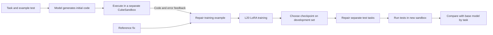
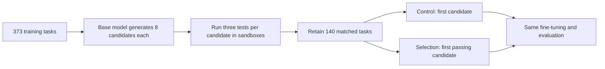

# Sandbox-Assisted Code Repair Training: CubeSandbox and Qwen on One GPU

Can a code model execute its incorrect output, observe an error, and learn to repair it? In this experiment we fine-tune Qwen2.5-0.5B-Instruct on one NVIDIA L20. CubeSandbox provides a separate execution environment for each code sample and records test results and errors.

On 85 separate test tasks whose initial outputs failed the example test, the original model repaired 5 tasks when given execution feedback. The fine-tuned model repaired 20, with one further task unresolved because of an execution error. Paired across the 84 tasks for which both runs produced results, 18 changed from fail to pass and three from pass to fail.

<strong>This experiment observed better code-repair performance after training, but does not establish that CubeSandbox or error feedback alone caused the improvement.</strong> The fine-tuned model also passed 20/85 without specific error feedback; a supplementary control trained without error details passed 16/85, with two unresolved. Here the sandbox supplies independent execution, filesystem-state separation, cleanup and batch management; it is not the training algorithm.

This is a small exploratory experiment. Environment addresses, account and node details are redacted. Tasks come from [MBPP](https://github.com/google-research/google-research/tree/master/mbpp); the model may have seen public tasks during pretraining. The results are not a claim about general programming ability or security certification. For background see the [LLM training sandbox survey](agent-rl-training-sandboxes.md).

## 1. Why we changed the experiment

The previous run used 373 reference solutions for supervised fine-tuning and did not outperform the base model. More fundamentally, trustworthy reference code can be read without a sandbox: that run mainly checked existing answers and did not show a distinctive contribution to the training workflow.

In the revised experiment the model first writes code and an isolated environment runs an example test. The failing code, execution output and reference fix form a training example; evaluation then executes the repaired output. The sandbox matters where the model <strong>actually needs to run code, observe failure and repeatedly reset the environment</strong>.



Training and sandbox execution ran in separate environments, with batches manually transferred through a workstation. The diagram describes data flow, not an implemented automated queue, direct cross-cluster connectivity or online reinforcement learning. Training uses supervised fine-tuning (SFT), not reinforcement learning.

## 2. What the sandbox contributes

| Stage | What we did | Benefit and boundary |
| --- | --- | --- |
| Execute model code | Create a separate sandbox for each candidate, run its example test, and record stdout, errors and exit status | Avoid running the code directly in the trainer process. Ordinary processes can execute code too, but require isolation and cleanup to be provided separately |
| Reset state | Start a new instance per task and destroy it after execution | Reduces interference from leftover files; this does not establish protection against every escape |
| Feedback examples | Pair actual failing code and error output with the training-set reference fix | Builds a code-repair task; an ablation is still needed to determine whether the model uses the error feedback |
| Evaluation | Run outputs from different models for the same task in new sandboxes | Provides a consistent testing process; test quality, timeouts and infrastructure errors still need separate handling |

In a separate check, sandbox A wrote a temporary file. Sandbox B could not see it, while A could still read it; both instances were then destroyed. This establishes separate file state in this configuration, not comprehensive security isolation.


Figure 1: A running instance in the real CubeSandbox console. It was created separately to illustrate the environment, not captured while all training samples ran concurrently; node details are masked.

The creation request set `allow_internet_access=False`. However, the positive control with access allowed also failed to connect, so <strong>egress enforcement was not verified</strong>. Tests and candidate code ran in the same guest; we did not establish that hidden tests resist access by adversarial code. Production use with untrusted code needs independent validation of networking, privileges, resources and verifier boundaries.

## 3. Building training examples from real execution failures

We first asked Qwen2.5-0.5B-Instruct to generate code for 563 tasks. Each prompt contained the task description and its first example test. Sandbox execution captured the initial code and actual errors. Training candidates came from the MBPP training range; their reference solutions had already passed the corresponding tests.

| Split | Original tasks | Failed example and entered repair | Other outcomes |
| --- | ---: | ---: | --- |
| Training | 373 | 259 | 112 passed; 2 had unresolved execution errors on retry and were excluded |
| Development | 90 | 71 | 19 passed the example test |
| Final test | 100 | 85 | 15 passed the example test |

The final 100 tasks are disjoint by ID from training and development, and were not among the 200 test tasks inspected in the previous run. The 15 passes mean only that the <strong>first example test passed</strong>; we did not establish that those outputs passed the full suite. Training targets came from the public dataset's reference solutions, not from the sandbox. We used one initial output per task; results are not guaranteed to hold for more samples or different seeds.

For example, one separate test task asks for characters in the second string to be removed from the first. The model actually generated:

```python
def remove_dirty_chars(str1, str2):
    set1 = set(str1)
    set2 = set(str2)
    common_chars = set1.intersection(set2)
    return ''.join(common_chars)
```

Running the supplied example assertion in the sandbox actually returned `AssertionError`. Given the same code and error feedback, the fine-tuned model generated:

```python
def remove_dirty_chars(string1, string2):
    result = [char for char in string1 if char not in string2]
    return ''.join(result)
```

This output passed all three dataset tests for the task. It is a real repair example, not evidence that every edge case was covered or that the error text alone caused the fix.

## 4. Single-GPU training and SwanLab records

| Item | Setting |
| --- | --- |
| Model | Qwen2.5-0.5B-Instruct |
| GPU | 1 NVIDIA L20 |
| Training data | 259 samples with failing initial code, real execution feedback and reference fixes |
| Method | BF16 LoRA, rank 16, alpha 32; attention and MLP projections |
| Optimization | AdamW, learning rate 0.00005, batch size 1, three epochs, 777 steps |
| Trainable parameters | 8,798,208 |
| Memory metric | About 3.40 GiB peak allocated by PyTorch, not total GPU memory use |


Figure 2: Model, sample counts, training configuration and loss in the actual SwanLab run card; account and host details are cropped out. `test_cases=85` is the number of tasks whose initial code failed the example test and entered repair evaluation.

Mean loss across the three epochs was 0.7874, 0.5064 and 0.3094. The script reports a recent loss window every 10 steps and an epoch mean at the end of each epoch. The curves document training; <strong>falling loss alone does not establish better repair performance</strong>.


Figure 3: Actual SwanLab training curves. Left, middle and right show step-reported loss, epoch and mean loss per epoch; the horizontal axis is optimizer steps.

On the 71 development tasks, the base model with feedback passed four. Epoch 1, 2 and 3 checkpoints passed 12, 15 and 14 respectively; two tasks for epoch 1 and one for epoch 3 had execution errors that remained unresolved after retry. Even if every unknown had passed, epoch 2 would still be best or tied for best; we select the earlier epoch 2 for the final test. After reloading the saved LoRA, raw generated text exactly matched the in-training outputs for all 71 development inputs.

## 5. Six-way comparison on 85 separate tasks

For each task the base model first generated initial code that failed its first example test. All six groups used the same task, initial code, example, decoding parameters and tests. “With feedback” additionally supplied actual sandbox output; “without feedback” said execution results were unavailable. A fresh sandbox ran the three dataset tests on each repair: the first appeared in the prompt, while the other two were not shown to the model.

| Model | Error feedback during repair | Passed | Tests failed | Execution unresolved |
| --- | --- | ---: | ---: | ---: |
| Base model | With | 5 | 80 | 0 |
| Base model | Without | 7 | 77 | 1 |
| Epoch 2 LoRA | With | 20 | 64 | 1 |
| Epoch 2 LoRA | Without | 20 | 65 | 0 |
| Epoch 3 LoRA trained without error details | With | 15 | 69 | 1 |
| Epoch 3 LoRA trained without error details | Without | 16 | 67 | 2 |

We also ran all tests for the dataset reference solutions of these 85 tasks in new sandboxes; all 85 passed. This rules out reference solutions failing their tests here, but does not guarantee adequate test coverage. Unresolved cases in all groups returned `RemoteProtocolError` near the command timeout and remained unresolved after one retry. We did not distinguish code timeout from a communication issue, so these cannot be directly counted as model failures or successes. When comparing the base and fine-tuned models with feedback on the 84 tasks completed by both, 18 changed from fail to pass, three from pass to fail, two passed both, and 61 failed both. Pass counts on this paired set rose from 5/84 to 20/84; the other task remains unresolved.

<strong>The feedback ablation did not provide positive evidence:</strong> the fine-tuned model passed 20 tasks both with and without feedback. Among the 84 completed by both, feedback improved five tasks and regressed four relative to no feedback. We therefore cannot say the model learned to use the error text, or attribute the training improvement to the sandbox. We then added a control trained without error details: it used the same 259 sandbox-selected failing programs, reference fixes, model and training parameters, replacing error details with an unavailable message. Its development set selected epoch 3 (16/71), and reloading reproduced all 71 development outputs; on the final set it passed 16 without feedback and 15 with feedback. The selected checkpoints had 777 and 518 optimizer steps respectively, and each group was trained once; these exploratory results are insufficient to determine whether error details during training helped. The model may instead have learned the repair task's output format and general patterns; that is a hypothesis requiring further testing.

[Download the redacted per-task results](../../assets/data/cubesandbox-sft-practice/repair-results.json). We ran one seed for each training configuration on simple public coding problems, and training and test tasks may be semantically similar. Treat this as exploration, not a production benefit or a guarantee across models. The previous negative result from ordinary 373-sample code SFT has not been overwritten. The runs used different models, training objectives and evaluation tasks, so their scores are not directly comparable.

### Additional check: what happens without a repair prompt?

To understand the boundaries for a potential release, we also selected 100 MBPP tasks whose IDs were separate from the earlier experiments. The model received only the task and first example and generated code directly; no buggy code or error message was supplied. The base model passed 18 tasks and the repair LoRA passed 21; one base-model execution remained unresolved after a retry. Among the 99 tasks resolved for both, eight changed from fail to pass and five from pass to fail. The example was already in the input; the other two tests were not shown to the model. Code still ran inside the guest, and the outcome depends on these limited tests.

This small difference does not establish a general coding improvement or rule out regressions on other tasks. A release should present the adapter as an experimental code-repair LoRA for a particular prompt format and disclose the data source, evaluation and failure cases; the weights are not being released before further verification.

## 6. Using sandbox execution to select training answers

The repair experiment above did not establish that error feedback itself produced the improvement. To examine execution verification more directly, we added a matched comparison: the base model generated eight candidate programs per training task, each candidate ran against that task's three tests in a separate sandbox, and passing answers supplied SFT targets. This is <strong>execution-based selection for supervised fine-tuning</strong>, not online reinforcement learning; ordinary containers or other secure execution environments could also perform such checks.



We generated 2,984 candidates for 373 training tasks. An initial three per task were expanded to eight after the training-pool yield appeared low; this decision preceded inspection of development and final scores. We excluded 100 tasks whose first candidate failed syntax or static screening, 127 with no passing candidate, and six with an unresolved execution, leaving 140 tasks. Both groups used the same tasks, model, random seed, LoRA configuration, three epochs and 420 optimization steps:

| Group | Training target for the same task |
| --- | --- |
| Unfiltered control | First executable candidate, regardless of test result |
| Sandbox-verified selection | First candidate in generation order that passes all tests |

For 74 of the 140 tasks the first candidate failed and the selected target came from a later passing candidate; targets were identical for the remaining 66. The shared task set was itself selected using execution outcomes, so this tests <strong>answer selection</strong>, not the complete end-to-end cost of a pipeline without sandboxes.


Figure 4: An actual light-theme screenshot of the selection run. Left to right: step loss, epoch and mean loss per epoch; the account and other experiment list were cropped out. This records training and does not by itself establish model quality.

On 90 development tasks, the control checkpoints passed 17, 16 and 21; one result for epoch 3 was unresolved. The selection checkpoints passed 27, 28 and 30. Epoch 3 was chosen for both before examining final-test outputs. Development tasks had been used in previous exploration, so they are used for checkpoint selection rather than claimed as a fresh blind test. On another 100 held-out task IDs, each group generated once with the same prompt and greedy decoding; new sandboxes then ran the same tests:

| Model | Tasks passed | Failed or could not execute | Unresolved |
| --- | ---: | ---: | ---: |
| Base | 28 | 72 | 0 |
| Unfiltered control LoRA | 30 | 70 | 0 |
| Sandbox-verified selection LoRA | 36 | 64 | 0 |

One task asked for subject-and-score tuples to be sorted, and the example called the function `subject_marks`. The control generated:

```python
def custom_sort_tuples(tuples_list):
    return sorted(tuples_list, key=lambda x: (x[1], x[0]))
```

The selected model generated:

```python
def subject_marks(subject_marks):
    return sorted(subject_marks, key=lambda x: (x[1], x[0]))
```

Both use the same sorting approach, but the first does not define the function name invoked by the test and failed; the second passed all three tests for this task. Some of the difference may therefore come from <strong>following the required function interface</strong>; the result does not establish that all gains come from learning more complex algorithms.

Against the control, 10 tasks changed from fail to pass and four regressed; against the base, 12 improved and four regressed. Only the first example was in the prompt; the other two were not shown to the model. All three tests come from public MBPP, so pretraining contamination and limited coverage remain possible. With one seed per group, the two-sided exact McNemar test on the 14 disagreements is approximately 0.18; the six-task gap is not evidence of a reliably reproduced general gain. Execution outcomes informed selection, but this <strong>does not attribute the improvement to CubeSandbox's particular isolation implementation</strong>.

After observing the first result, we ran an additional seed 43 using the same training and final-test tasks. Development selection chose epoch 1 for the control and epoch 3 for the selection model; they passed 29/100 and 36/100 respectively. To examine the effect of different step counts, we also compared epoch 3 for both (420 steps each): the control passed 25/100 and the selected model 36/100, with 12 improvements and one regression. This fixed-step comparison was added after development results were visible, and both seeds reuse the same test set; neither replaces an independent evaluation on a different dataset.

The selected LoRA was copied to a separate directory, its base-model reference changed to the public model name, and then reloaded. In the same environment and with the same generation settings, raw outputs matched the saved training-time results for all 90 development prompts. This establishes that the adapter could be reloaded here, not that other environments and versions will reproduce every character.

[Download redacted per-task results](../../assets/data/cubesandbox-sft-practice/selection-results.json). Before releasing a model, evaluate additional code datasets and random seeds, strengthen verifier isolation, and document base-model and dataset licenses, input format and failure cases.

## 7. Does the result transfer to another dataset?

To check whether the MBPP improvement transfers, we also compared the base model and the first seed-42 selected LoRA on all 164 [HumanEval](https://github.com/openai/human-eval) tasks. The model received the function signature, description and documentation examples and generated a complete function using the same experiment's chat prompt. We applied the same static screening, then ran dataset tests in sandboxes. Generation used greedy decoding with up to 192 new tokens. The prompting and code processing differ from the official harness, so <strong>these are not official pass@1 scores comparable directly to public leaderboards</strong>.

| Model | Passed | Failed or could not execute | Unresolved |
| --- | ---: | ---: | ---: |
| Base model | 45 | 119 | 0 |
| Selected LoRA | 38 | 125 | 1 |

Among the 163 tasks resolved for both, 13 improved and 20 regressed; one LoRA execution returned a communication error near timeout twice and remains unresolved. This check did not show an improvement on HumanEval, nor does it establish a universal regression. HumanEval is public and may also have appeared in pretraining; static screening blocked some outputs, and the tests do not exhaust possible behavior. [Download per-task results](../../assets/data/cubesandbox-sft-practice/humaneval-results.json).

**This counterexample matters for release:** the adapter improved in this MBPP configuration, but cannot be advertised as a general coding improvement. It should be labeled experimental and the contrary result disclosed.

## 8. When this approach is worthwhile

It fits workflows where generated code, test commands or file changes must be executed to assess them: code-repair training, tool-use trajectory generation, filtering candidate answers by tests, and evaluation that repeatedly restores the same starting state. Trusted code can run in ordinary processes or containers; a decision to use CubeSandbox or another sandbox should consider isolation requirements, lifecycle management, resource limits, cleanup and operational cost, not a claim that model training requires sandboxes.

Of the 563 initial-code checks, 561 returned test outcomes and two executions remained unresolved. For records with outcomes, the median time from instance creation to command return was approximately 0.41 seconds and P90 approximately 0.51 seconds; <strong>destruction time is excluded</strong>. This is a small batch in this environment with at most three concurrent workers, not a general performance benchmark; no ordinary-process or container cost comparison was measured.

Production training would still need reliable cross-environment batch queues and data versioning, an independently protected verifier, validated resource and network isolation, timeout and retry policies, deduplication, multiple random seeds and cross-dataset evaluation. A follow-up should also control for the same training data and fixed optimizer steps with and without real execution feedback, and compare isolation mechanisms, to assess the separate contributions of feedback and sandboxing.

References: [MBPP dataset](https://github.com/google-research/google-research/tree/master/mbpp) · [CubeSandbox](https://github.com/tencentcloud/CubeSandbox) · [Qwen2.5-0.5B-Instruct](https://huggingface.co/Qwen/Qwen2.5-0.5B-Instruct) · [SwanLab](https://github.com/SwanHubX/SwanLab) · [CodeRL](https://proceedings.neurips.cc/paper_files/paper/2022/hash/8636419dea1aa9fbd25fc4248e702da4-Abstract-Conference.html)
