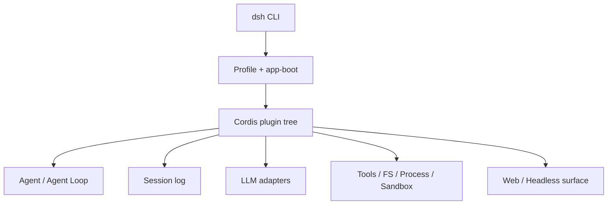
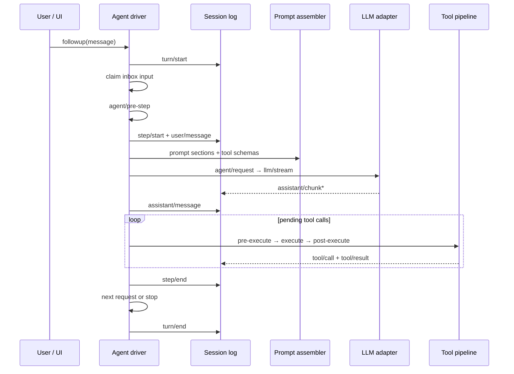

# DeepSeek Harness GitHub Repository Deep Dive: Plugin Architecture, Agent Loop, and Persistence

DeepSeek Harness (command-line name `dsh`) is not DeepSeek model weights, nor is it an inference service like vLLM. It is an open-source **Agent Runtime / Harness**: it assembles models, system prompts, sessions, tools, permissions, workspaces, subagents, a Web UI, and Headless entry points into a runnable whole.

This article only answers "how this GitHub repository is designed and how it runs." Engineering content such as Docker, Docker Compose, Helm, StatefulSet, read-only root filesystems, and EROFS fixes has been split into a companion article: [DeepSeek Harness Docker, Compose, and Helm Deployment in Practice](deepseek-harness-runtime-containerization.md).

This article is based on the upstream `master` source baseline `47f943859bef60e4160492346772ded9b24f765a`, re-verified on 2026-08-13. DeepSeek Harness is still in developer preview; interfaces and configuration may undergo breaking changes in the future.

## 1. Conclusions First

- The core abstraction of DeepSeek Harness is not a chat page, but a plugin tree driven by Cordis; models, tools, sessions, and the Agent Loop can all be replaced via configuration;
- Profiles, Bundles, and multi-layer patches separate "distribution default capabilities," "user configuration," and "temporary overrides," so extensions usually do not require forking upstream;
- The Agent Loop clearly distinguishes turns, steps, real-time control events, and persistent session events; runtime state and replayable facts are not mixed into the same event domain;
- Session logs are not UI chat history, but the source of truth for model context; "what the model sees is already recorded" is the precondition for recovery, forking, compaction, and auditing;
- Filesystem, process, Shell, PTY, Sandbox, LLM, and Subagent are all organized as capability seams, suitable for replacement with remote execution environments or enterprise implementations;
- The Web UI is only one Surface of the Runtime. It is currently not an enterprise Agent platform with authentication, multi-tenancy, and horizontal scaling;
- This repository is best placed under the "RAG, Agent, and Edge" topic, further classified as **Agent Runtime, Tool Execution, and Session State**, rather than "model inference."

## 2. Its Position in the AI Infrastructure Stack

The first step in understanding Harness is to separate it from upstream and downstream components:

| Layer | Typical Responsibility | Relationship to DeepSeek Harness |
| --- | --- | --- |
| Model weights | Parameters and base capabilities | Harness does not provide model weights |
| Inference engine | Batching, KV Cache, model parallelism | vLLM, SGLang, etc. can serve as downstream model services |
| AI Gateway | Routing, rate limiting, quotas, auditing | Can sit between Harness and the model API |
| Agent Runtime | Turns, tools, permissions, sessions, and execution | Harness's core position |
| Agent Sandbox | Isolated execution environment for untrusted code | Harness provides the seam, but the Runtime itself is not a strongly isolated sandbox |
| Surface | Web, CLI, IDE, or SDK interaction | Web and Headless are different entry points to the same Runtime |

A single request can be simplified as:

```text
User / Web / SDK
        │
        ▼
DeepSeek Harness
  Agent Loop ─ Session log
      │       ├─ Tools / Permissions
      │       ├─ Filesystem / Shell / PTY
      │       └─ Subagent / Sandbox
      ▼
LLM adapter → AI Gateway / Model API
```

It solves "how to make a model do things continuously, safely, and recoverably," not "how to produce the next token faster."

## 3. Monorepo Reading Map

The repository is a TypeScript monorepo. On first reading, you do not need to expand every `packages/` one by one; you can first grasp the following main trunk:

| Path | Purpose | Reading Value |
| --- | --- | --- |
| `apps/cli` | `dsh` command entry point, built-in configuration, and command reference | Understand how users start the Runtime |
| `apps/web` | Browser application | Understand the Web Surface, not the core loop |
| `packages/boot/app-boot` | Profile parsing, Bundle layering, and startup | Understand how the plugin tree is assembled |
| `packages/bundle/base` | Base capabilities such as models, tools, persistence, sandbox, and settings | Understand what the default distribution includes |
| `packages/bundle/web-app` | Web Host and browser application composition | Understand the `web` Profile |
| `packages/bundle/headless` | One-shot, serverless run entry point | Understand the Headless Surface |
| `packages/core/agent` | Agent interfaces, active agent registry, and events | Understand the control plane of running Agents |
| `packages/core/agent-loop` | Default Agent driver | Understand the turn/step main loop |
| `packages/core/session` | Append-only session event log | Understand persistent facts and recovery semantics |
| `packages/core/system-prompt` | Prompt fragment and tool schema assembly | Understand how model requests are formed |
| `packages/core/tools` | Tool registration and execution pipeline | Understand permissions, interception, and execution |
| `packages/llm` | Model vocabulary and adapters | Understand model provider integration points |
| `packages/fs`, `packages/subprocess`, `packages/shell`, `packages/terminal` | Workspace and process execution backends | Understand how Agents act on real environments |
| `packages/sandbox`, `native/landlock-run` | Constraints before process startup and Linux native helpers | Understand execution boundaries and their platform assumptions |
| `packages/compaction` | Context compaction and tool result trimming | Understand how long sessions control context pressure |
| `packages/client` | Web client modules and UI capabilities | Understand that the frontend is also composable modules |

It is recommended to read the official architecture documentation first, then trace the source code along `app-boot → bundle/base → core/agent-loop → core/session → core/tools`. Starting directly from Web components makes it easy to misread an Agent Runtime as a chat application.

## 4. Cordis: Why "Everything Is a Plugin" Is Not a Slogan

DeepSeek Harness is built on Cordis. Plugins contribute three kinds of things to the shared `ctx`:

1. Services, such as `ctx.sessions`, `ctx.tools`, and `ctx.llm`;
2. Typed events, such as `agent/request` and `tools/pre-execute`;
3. Reversible side effects, such as registering a tool or adapter, which are automatically undone when the plugin is unloaded.



This yields two direct consequences.

First, there is no "privileged kernel" that requires repeated patching. The default Agent Loop, model adapters, tool registry, and even the session implementation all live on the plugin tree.

Second, plugin lifecycle is part of the architecture. Registered behaviors must be undoable when a plugin is unloaded; otherwise, configuration hot-reload would leave duplicate listeners, stale services, or untraceable global state. This is also why Cordis deserves more attention than an ordinary dependency injection container.

## 5. Profiles, Bundles, and Patches: How the Runtime Is Assembled

A running `dsh` is not a fixed set of hardcoded modules inside a binary, but a configuration tree assembled at startup through layering.

### 5.1 Profile

A Profile is a named assembly stored in the Harness home directory, recording the Bundles to load, out-of-tree plugins installed by the Profile itself, and user patches. The official distribution provides two templates:

- `web`: base Runtime plus Web application and Host Server;
- `headless`: one-shot runner that does not start a Web Server.

### 5.2 Bundle

A Bundle is a distribution unit for Cordis configuration items and mounted code:

- `dsh-base` provides model adapters, tools, persistence, sandbox and approval, settings, credentials, and telemetry;
- `dsh-web-app` adds the browser application;
- `dsh-headless` adds the serverless one-shot execution entry point.

### 5.3 Ordered Overrides

Configuration is applied in the following order:

1. Each Bundle listed in the Profile;
2. The Profile's own `cordis.patch.yml`;
3. Harness home-level patches;
4. The `--patch` overlay passed on the command line.

Later layers can replace the configuration of earlier entries based on stable `id`, or insert new entries. The final configuration tree can be inspected directly:

```bash
dsh --profile web --dump-config
```

The engineering significance of this mechanism is that enterprises can package their own model adapters, tool policies, remote filesystems, or Web configuration as standalone Bundles/patches, rather than maintaining a fork that is difficult to keep up with upstream upgrades.

## 6. Capability Seams: Interfaces, Providers, and Consumers Must Be Viewed Together

Upstream calls replaceable capabilities seams. A complete seam includes:

- **Service Definition**: defines the interface;
- **Service Provider**: implements the capability;
- **Consumer**: consumes the capability, usually a tool exposed to the model.

| Seam | Capability Defined | Possible Replacement Directions |
| --- | --- | --- |
| Session | Event append, read, fork, and broadcast | Local storage, remote persistence, enterprise audit |
| LLM | Model adapter registration and streaming output | DeepSeek, OpenAI-compatible APIs, internal Gateway |
| Tools | Scoped registration and execution policy | Custom tools, approval, audit, policy engine |
| Filesystem | Directories, files, and policies | Local Workspace, remote Sandbox filesystem |
| Subprocess/Shell/Terminal | Processes, Bash, PTY, and long-lived terminals | Local execution, containers, remote execution environments |
| Sandbox | Wrapping argv and imposing restrictions before process startup | Landlock, gVisor/Kata sidecar, or external sandbox |
| Subagent | Create, continue, list, and interrupt subagents | Local subagents, cross-product delegation |

Filesystem and process providers must live in the same execution world. Replacing only the remote filesystem while still launching Bash locally yields two environments that cannot see each other. Harness's seam design allows files, processes, Shell, PTY, and LSP to be migrated as a group to a remote Sandbox without forking the Agent Loop.

## 7. Three Event Domains: Persistent Facts, Real-Time Control, and Capability Policies

The repository divides events into three domains; choosing the wrong domain usually causes recovery or extension problems.

| Event Domain | What It Stores | Applicable Scenarios |
| --- | --- | --- |
| Session events | Persistent facts appended to the log | Reload, replay, fork, transcript |
| `agent/*` events | Active Agent inbox, status, requests, and continuation | Observing or intercepting in-progress work |
| Capability events | Policy points such as `fs/*`, `tools/*`, `telemetry/*` | Extending a capability without importing the Agent Loop |

`turn/start`, `step/start`, `user/message`, `assistant/*`, `tool/*`, and end events are replayable facts; `agent/request`, `agent/pre-step`, and status events serve real-time coordination. If the UI or SDK needs a recoverable transcript, it should consume `session/event` rather than treating `agent/*` as history.

Some key events use waterfall semantics: listeners must call `next()` to hand control to the next layer. This allows extensions to inspect, rewrite, or reject model requests and tool executions while preserving an explicit delegation chain.

## 8. Agent Loop: How Turns and Steps Advance

Harness distinguishes turns from steps:

- A **step** is one model request, plus the tool calls triggered by that response;
- A **turn** can contain zero or more steps, until tools no longer request further calls and no new next-step input exists.



A few easily overlooked details:

1. Input first enters a unified inbox, then is claimed by the driver; steering and injected context also pass through the same `agent/pre-step`;
2. `agent/pre-step` can rewrite or reject messages about to enter the model; even if the first claim is rejected, the persistent turn still closes and records the attempt;
3. Model streaming chunks first enter session events, and ultimately form the `assistant/message`;
4. Tool execution is not a simple serial `for` loop; it must handle execution modes, barriers, concurrency pools, result ordering, and cancellation;
5. Before natural stop there is also an `agent/turn-stopping` checkpoint, where extensions can decide whether there is still work to do.

This design separates "model requests," "tool side effects," "real-time control," and "persistent history." The cost is a more complex event model, but in return you get an interceptable, recoverable, and replaceable runtime.

## 9. Session Event Sourcing: Why the Log Is the Runtime's Source of Truth

`core/session` maintains an append-only `SessionEvent` log. The Agent does not treat a single mutable messages array as its only state; instead, it projects the history needed for the next model request from the event stream via `deriveMessages()`.

The most important invariant in the upstream architecture is: **what the model sees is already recorded**.

Any information that enters the model context must be reconstructable from the session log. If an extension adds new model-visible input, it must add the corresponding Session Event and define how to render it back into model messages from the log. Otherwise, three kinds of problems arise:

- The page sees content, but after a restart the model cannot see it;
- The current turn used some implicit context, but a fork or transcript cannot explain it;
- Compaction, telemetry, and recovery derive contradictory results from different state sources.

Based on the same event stream, the system can derive:

- Real-time transcripts for the Web UI and SDK;
- Session recovery after interruption;
- Creating forks at specified event boundaries;
- Token usage and telemetry;
- Context compaction and tool result trimming;
- Streaming replay that preserves the original `assistant/chunk`.

This also explains why session data in the Harness home cannot be treated as an ordinary cache. Deleting it is not just clearing page history; it is deleting the Agent's recoverable facts.

## 10. How Long Contexts Are Handled: Compaction Is Also Part of Event Semantics

A long session cannot indefinitely feed the full log directly to the model. `packages/compaction` provides compaction and tool result trimming capabilities, and handles context pressure in the `agent/pre-step` phase before the request.

The key is not simply truncating the oldest messages, but maintaining the relationship between "original events" and the "current surface replacement generation." Only when trimming or summarization actually advances the replacement generation does the system open a new retry round; otherwise, the original request error still holds.

This shows that compaction is not message folding at the UI layer, but a runtime feature in which the Agent Loop, session events, and model context projection all participate.

## 11. Tool Execution and Security Boundaries

After the model selects a tool, the call passes through an ordered pipeline:

```text
tool/call
  → tools/pre-execute
  → tools/execute
  → tools/post-execute
  → tool/result
```

Here you can hook in parameter validation, approval, permission policies, auditing, and result transformation. The execution backend then acts on the real environment through the Filesystem, Subprocess, Shell, Terminal, or Sandbox seams.

But three concepts must be distinguished:

- Tool approval decides whether this call is allowed;
- The Sandbox seam decides with what constraints and backend the process starts;
- Containers, gVisor, Kata, or VMs decide what the process can still reach after breaking through application-layer limits.

Harness provides extension points for building security policies, but that does not mean the default Web process already has strong multi-tenant isolation. In particular, when the Agent can access the mounted workspace, launch a Shell, and use configured credentials, the Web entry point is essentially close to a remote code execution control plane.

## 12. Web and Headless: The Surface Should Not Define the Runtime in Reverse

`web` and `headless` are not two separate Agent kernels, but two Profile combinations:

- The Web Surface lets a browser connect to the Host Runtime and display sessions, tools, settings, and the workspace;
- The Headless Surface suits scripts, CI, or one-off tasks and does not require starting a server;
- Future IDEs, SDKs, or other clients can also be built around the same `ctx.agents` and `session/event`.

Therefore, when evaluating the repository, you should not only ask whether the Web UI is polished, but also check:

1. Whether the Surface renders from persistent events;
2. Whether the Agent keeps running after the client disconnects;
3. Whether connections, permissions, and credentials have clear boundaries;
4. Whether the Headless scenario can reuse the same Runtime capabilities.

The current Web Server has no built-in TLS, authentication, or Origin policy, and is suitable for trusted local single-user use. For how to safely put it into containers and Kubernetes, see the [Containerized Deployment Guide](deepseek-harness-runtime-containerization.md).

## 13. Which Seams Are Best for Secondary Development

| Goal | Recommended extension point |
| --- | --- |
| Add a model provider | Register an adapter in `ctx.llm` |
| Add model-callable capabilities | Register tools and schemas in `ctx.tools` |
| Configure different capabilities per session | Agent presets and isolated realms |
| Add approval and auditing for tools | `tools/pre-execute` / `tools/post-execute` |
| Use a remote workspace | Replace both the Filesystem and process execution providers |
| Restrict launched processes | `ctx.sandbox` backend |
| Add model-visible context | `agent.inject()`, and ensure it can ultimately be rebuilt from the log |
| Add persistent session state | Extend `SessionEventMap` and implement replay projection |
| Add Web/IDE clients | Drive `ctx.agents`, consume `session/event` |
| Delegate subtasks across products | Implement a Subagent provider |

For enterprise scenarios, the priority is usually not modifying the Agent Loop, but implementing the following boundaries: an enterprise model Gateway, a credential service, a remote Sandbox, a Tool Gateway, an audit event export, and an identity-bearing client entry point. Harness has reserved seams for these capabilities; whether they are production-ready depends on the maturity of the specific provider.

## 14. Project Maturity and Community Boundaries

This repository already has clear architecture documentation, event diagrams, capability diagrams, test directories, and bilingual documentation, and the source organization is clearly oriented toward long-term extension; but "architecturally complete" does not equal "production commitments are complete."

As of this article's baseline:

- The project is still a developer preview, with the version number at the `0.1.0-rc` stage;
- Upstream warns that breaking changes may occur in the future;
- The Web Server lacks production-grade authentication and transport security;
- Local persistence and single-user workflows cannot directly imply multi-replica or multi-tenant semantics;
- The upstream contribution guide does not currently accept external Pull Requests, but encourages ecosystem projects, tutorials, and feedback.

Therefore, a reasonable adoption strategy is: first use it as a single-user Agent Runtime and extension research baseline, validating models, tools, persistence, and recovery in an isolated environment; then fill in identity, auditing, Sandbox, and data governance according to the enterprise threat model, rather than directly exposing the Web port to the team.

## 15. Which Topic Should This Analysis Belong To

This site places it under **RAG, Agent, and Edge**, and suggests organizing follow-up content with the following tags:

- `Agent Runtime`: Agent Loop, turn/step, inbox, and lifecycle;
- `Tool Execution`: tool registration, permissions, approval, Shell, and Sandbox;
- `Agent Memory / State`: event sourcing, recovery, fork, and compaction;
- `Agent Platform Engineering`: Profile, Bundle, seams, and enterprise extensions;
- `Cloud Native Agent`: Docker, Compose, Kubernetes, and isolation; see also the deployment guide.

If only one topic name is chosen, the most accurate is: **AI Agent Runtime Architecture and Cloud-Native Engineering**.

## 16. Recommended Reading Order

1. `README.zh.md`: confirm the project's positioning and how it runs;
2. `docs/architecture.zh.md`: first build an overall model of the plugin tree, event domains, and seams;
3. `docs/cordis-primer.zh.md`: understand services, events, lifecycle, and reversible side effects;
4. `docs/agent-lifecycle.zh.md`: follow the main loop along the turn/step sequence diagram;
5. `docs/tool-execution-pipeline.zh.md`: understand execution order, concurrency, and policy points;
6. `docs/persistence-catalog.zh.md`: verify the location and owner of each type of persistent state;
7. Then move on to `packages/core`, `packages/bundle`, and the specific capability providers.

If the goal is direct deployment, you can jump to [DeepSeek Harness Docker, Compose, and Helm Deployment in Practice](deepseek-harness-runtime-containerization.md). The companion implementation is at [runzhliu/deepseek-harness-docker](https://github.com/runzhliu/deepseek-harness-docker).

## References

- [DeepSeek Harness Official Repository](https://github.com/deepseek-ai/deepseek-harness)
- [Chinese README](https://github.com/deepseek-ai/deepseek-harness/blob/master/README.zh.md)
- [Architecture Documentation](https://github.com/deepseek-ai/deepseek-harness/blob/master/docs/architecture.zh.md)
- [Cordis Getting Started](https://github.com/deepseek-ai/deepseek-harness/blob/master/docs/cordis-primer.zh.md)
- [Agent Lifecycle](https://github.com/deepseek-ai/deepseek-harness/blob/master/docs/agent-lifecycle.zh.md)
- [Capability Seams](https://github.com/deepseek-ai/deepseek-harness/blob/master/docs/capability-seams.zh.md)
- [Tool Execution Pipeline](https://github.com/deepseek-ai/deepseek-harness/blob/master/docs/tool-execution-pipeline.zh.md)
- [Persistence Directory](https://github.com/deepseek-ai/deepseek-harness/blob/master/docs/persistence-catalog.zh.md)
- [Upstream Contribution Guide](https://github.com/deepseek-ai/deepseek-harness/blob/master/CONTRIBUTING.zh.md)
- [DeepSeek Harness Containerized Deployment](deepseek-harness-runtime-containerization.md)
