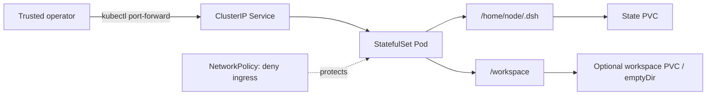

# DeepSeek Harness Docker, Compose, and Helm Deployment in Practice

This article focuses on a clear goal: turning DeepSeek Harness, which is still in developer preview, into a container project that is buildable, reproducible, persistent, and has a security baseline.

If you want to first understand why it uses Cordis, how Agent turns/steps run, why sessions use event sourcing, and how capabilities such as Filesystem, Shell, and Sandbox are replaced, please first read the standalone source code analysis: [DeepSeek Harness GitHub Repository Deep Dive](deepseek-harness-repository-analysis.md). If you care more about all-in-one Chromium, the DSH Browser Plugin, Tailscale ingress, and StatefulSet, PVC, NetworkPolicy, and Cilium probe conflicts in a real test cluster, continue reading [From Docker to Kubernetes: DeepSeek Harness, Built-in Chromium, and DSH Plugin in Practice](../practices/deepseek-harness-kubernetes.md).

If the goal is to keep the DSH Runtime and sink Shell, files, and PTY down to a separate MicroVM, with real-world testing of networking, pause/resume, rollback, and multi-plan parallel cloning, see [Enhancing OpenClaw and DSH with CubeSandbox: Enterprise Secure Execution Surface in Practice](cubesandbox-openclaw-dsh-enterprise-practice.md).

The accompanying implementation has been organized into the standalone open-source project [runzhliu/deepseek-harness-docker](https://github.com/runzhliu/deepseek-harness-docker), with images published on [Docker Hub: runzhliu/deepseek-harness](https://hub.docker.com/r/runzhliu/deepseek-harness). The project includes:

- A multi-stage, non-root Dockerfile;
- Local security defaults in `compose.yaml`;
- A Helm Chart based on StatefulSet;
- Native Kubernetes YAML rendering capability;
- Chinese and English READMEs, runtime screenshots, and verification scripts.

This article is based on `@deepseek-ai/dsh@0.1.0-rc.6` reviewed on 2026-08-13. Upstream may still introduce breaking changes; versions, configuration, and security assumptions should be re-validated before production adoption.

## 1. Deployment Conclusions First

- Image tags should follow the upstream DSH runtime version, so use `runzhliu/deepseek-harness:0.1.0-rc.6`;
- The Web Server inside the container must listen on `0.0.0.0`, but the host port may only be published to `127.0.0.1`;
- `$DSH_HOME` and `/workspace` are two data boundaries with different lifecycles and should be mounted separately;
- `HOME=/workspace` is the key to fixing the Web directory selector's EROFS error when creating `/home/node/test` on a read-only root filesystem;
- Native dependencies such as `node-pty` require a multi-stage build that verifies both `linux/amd64` and `linux/arm64`;
- Kubernetes defaults to a single-replica StatefulSet; it should not pretend to scale horizontally without shared state and concurrency contracts;
- The current Web Surface has no TLS, authentication, or Origin policy; the default access method should be host loopback or `kubectl port-forward`;
- The Docker/Pod security context cannot replace Harness tool approval and the Agent Sandbox; both layers must exist simultaneously.

## 2. Why the Image Tag Is `0.1.0-rc.6`

`0.1.0-rc.6` is not a community version arbitrarily defined for `deepseek-harness-docker`, but the official npm runtime version locked at build time:

```text
Docker image tag                         npm package
runzhliu/deepseek-harness:0.1.0-rc.6  →  @deepseek-ai/dsh@0.1.0-rc.6
```

This has three benefits:

1. Seeing the image tag tells you which DSH is running inside;
2. When upstream upgrades, multiple images can coexist, and rollback does not depend on a drifting `latest`;
3. Issue reports, SBOMs, and build logs can all be tied to the same runtime version.

At the time, the source package version in the upstream GitHub `master` was not fully synchronized with the latest npm release cadence, so the source code analysis should record the commit, while the container image should record the actually installed npm version. These are not in conflict; they are traceability identifiers for different artifacts.

`latest` can serve as a floating alias for user convenience, but the defaults in documentation, Compose, and Helm should be pinned to `0.1.0-rc.6` as much as possible. When upgrading to rc.7 or a stable release in the future, rebuild, complete the verification matrix, and then publish the corresponding new tag.

## 3. The Boundaries Containerization Actually Needs to Address

Directly running the following command only proves that the npm package can start on the current host:

```bash
npx @deepseek-ai/dsh@0.1.0-rc.6 web
```

A publishable container solution must also clarify:

| Issue | Container project's answer |
| --- | --- |
| Node version | Fixed Node.js 24 baseline |
| npm package version | Build argument pinned to `0.1.0-rc.6` |
| Native modules | Compiled in Builder; Runtime keeps only runtime artifacts |
| Process management | `tini` as PID 1 |
| Runtime identity | UID/GID 1000, non-root |
| Harness state | `/home/node/.dsh` persisted independently |
| User workspace | `/workspace` mounted separately |
| Temporary files | `/tmp` uses tmpfs or a temporary volume |
| Root filesystem | Read-only by default |
| Web exposure | Non-loopback inside the container; external access only through trusted ingress |
| Kubernetes controller | Single-replica StatefulSet |
| Credentials | Injected as runtime Secrets, not written into the image or values |

## 4. State Model: `DSH_HOME` and `/workspace` Must Be Separated

The Harness home resolution order is `$DSH_HOME`, followed by `~/.dsh`. In the container, set it explicitly:

```text
DSH_HOME=/home/node/.dsh
HOME=/workspace
```

The recommended data layout is:

```text
/home/node/.dsh/
├── profiles/       # Profile、Bundle 元数据和用户 patch
├── settings.yaml   # 模型与运行设置
├── credentials*    # 凭据或其引用
├── sessions/       # 会话事件日志
└── storages/       # Workspace 等领域状态

/workspace/         # 用户代码和 Agent 实际操作目录
```

`/home/node/.dsh` is not an ordinary cache. Session logs are the source of truth for model context and recovery semantics, and Profile and settings also determine how the Runtime is assembled. Therefore it should use a named volume or PVC.

`/workspace` is user data: on a local machine you can use a bind mount, on Kubernetes you can use a separate PVC, or you can use `emptyDir` when task-end deletion is genuinely acceptable. Do not merge the two into a single anonymous volume; otherwise backup, migration, and least-privilege configuration become difficult.

## 5. Root Cause and Correct Fix for the EROFS Error

When a user creates an `test` folder in the Web directory selector, the following error appears:

```text
cannot create /home/node/test:
EROFS: read-only file system, mkdir '/home/node/test'
```

The root cause is not a failed Docker volume, but a path error resulting from the combination of two configurations:

1. For security, the container root filesystem is set to read-only;
2. The Web directory selector calls Node.js `os.homedir()` and uses the returned `/home/node` as its starting directory;
3. The actually writable user workspace is mounted at `/workspace`.

The correct fix is to point the process home to the mounted workspace:

```dockerfile
ENV HOME=/workspace \
    DSH_HOME=/home/node/.dsh
```

After the fix, the write boundary is:

```text
Web directory picker home
          │ os.homedir()
          ▼
      /workspace  ── writable mount

Harness internal state
          ▼
  /home/node/.dsh ── persistent volume
```

Do not mask the problem with the following approaches:

- Disabling the read-only root filesystem;
- Switching to the root user;
- Making the entire `/home/node` a broadly writable directory;
- Adding `--privileged` to the container.

Verifying the fix cannot rely only on the container status being healthy; you must enter the Web directory selector, actually create a folder, and check that it lands in the mounted `/workspace`.

## 6. Eight Key Design Decisions in the Dockerfile

### 6.1 Pin the DSH Release Version

Install an explicit version via `ARG DSH_VERSION=0.1.0-rc.6` and run `dsh --version` in the build stage. Do not let the build implicitly follow npm `latest`.

### 6.2 Use Node.js 24

The upstream `engines` requires Node.js `^22.19.0 || >=24.0.0`. Node.js 24 is a clear and easy-to-maintain image baseline, avoiding dependence on the host Node version.

### 6.3 Build Native Modules in a Multi-Stage Build

The Agent's Shell and terminal capabilities depend on native modules such as `node-pty`. Some CPU architectures have no matching prebuilt artifacts, and npm falls back to `node-gyp`.

The Builder stage should include Python, compilers, and make; the Runtime stage copies only the final npm installation result and necessary dynamic libraries. This satisfies both:

- `linux/amd64` and `linux/arm64` builds;
- The runtime image does not permanently retain the full compilation toolchain;
- PTY is not "package installed successfully but spawn fails at runtime."

### 6.4 Preserve the Necessary Node Arguments for the DSH Main Process

The Web Profile mounts a configuration watcher, and the current version's HMR service requires Node's `--expose-internals`. The argument should only be passed to the DSH main process and should not be written into a global `NODE_OPTIONS` that could be inherited by Bash, LSP, or other tool subprocesses.

### 6.5 Use `tini` to Manage PID 1

The Agent creates Shell, PTY, language services, and other child processes. `tini` is responsible for forwarding termination signals and reaping orphaned processes, giving `docker stop` and the Kubernetes termination flow consistent semantics.

### 6.6 Non-Root and Read-Only Root Filesystem

The runtime uses UID/GID 1000 and allows writes only to `/workspace`, `$DSH_HOME`, and `/tmp`; it also drops all Linux capabilities, enables `no-new-privileges`, and uses the default seccomp profile.

### 6.7 Keep the Basic Tools the Agent Actually Needs

A slim image cannot mean removing the Agent's ability to work. Git, OpenSSH Client, Python, ripgrep, and `procps` are a reasonable baseline; Java, Go, Rust, or project-specific dependencies should be added through derived images.

### 6.8 Disable Telemetry by Default

The community image sets `DSH_TELEMETRY_DISABLED=1` so that users explicitly choose whether to enable it after understanding the data boundary.

## 7. Web Listening: `0.0.0.0` Inside the Container Is Not Public Exposure

The upstream `web` Profile listens on `127.0.0.1:3080` by default. This is a safe default for running directly on the host, but the Docker bridge cannot forward host ports to a loopback listener inside the container.

The container changes the Web Server through a Cordis patch to:

```yaml
- id: webserver
  name: '@deepseek-ai/dsh-host-webserver'
  config:
    host: '0.0.0.0'
    port: !!js ctx.webStartup.port ?? 3080
```

This only solves container network reachability. The upstream Web Server currently has no TLS, authentication, or Origin policy, and the Agent behind it can access files, start Shells, and execute code, so the ingress must still be restricted to:

```text
Browser
  │ http://127.0.0.1:3080
  ▼
Host loopback publication
  │ Docker port forwarding
  ▼
Container 0.0.0.0:3080
  ▼
DeepSeek Harness + code-execution tools
```

The Docker command should explicitly write out the host address:

```bash
docker run --rm \
  --name deepseek-harness \
  -p 127.0.0.1:3080:3080 \
  -v deepseek-harness-home:/home/node/.dsh \
  -v "$PWD:/workspace" \
  runzhliu/deepseek-harness:0.1.0-rc.6
```

`-p 3080:3080` often listens on all host interfaces and should not be used as the default example in this article.

## 8. Docker Compose: Encoding Security Defaults into Configuration

The value of Compose is not shortening a single `docker run` command, but fixing the runtime contract:

- `127.0.0.1:3080:3080`, avoiding accidental LAN exposure;
- `dsh-home` named volume persists Harness state;
- The user-selected directory is bind-mounted to `/workspace`;
- `read_only: true`, with `/tmp` using tmpfs;
- `cap_drop: [ALL]` and `no-new-privileges:true`;
- Limiting the process count to reduce fork bomb risk;
- In-container HTTP health check;
- Explicit restart policy.

Typical usage is:

```bash
git clone https://github.com/runzhliu/deepseek-harness-docker.git
cd deepseek-harness-docker
docker compose up -d
docker compose ps
docker compose logs -f
```

Then visit `http://127.0.0.1:3080`. After configuring model credentials for the first time, you should also complete a real model request, file read/write, and PTY command, rather than treating HTTP 200 as the entire acceptance.

Persistence testing should include at least:

1. Create a Profile or session;
2. Create folders and files in `/workspace`;
3. Force-recreate the container;
4. Confirm the Harness state is still present;
5. Confirm the workspace content comes from the expected bind mount.

## 9. Kubernetes: Why StatefulSet Instead of Deployment

The current Web Surface is a stateful, single-user Runtime. Profile, credentials, sessions, and Workspace state are all written to the local data directory, and upstream gives no contract for multiple replicas concurrently reading and writing the same state.

Therefore the default controller is a single-replica StatefulSet:



The meaning of StatefulSet here is not for scaling, but:

- Provide stable Pod identity;
- Use `volumeClaimTemplates` to manage the Harness state PVC;
- Define explicit PVC retention behavior;
- Ensure rolling upgrades and failed rebuilds still mount the same state.

A Deployment can only become a reasonable choice if you use an external shared session backend, explicitly support concurrency, and migrate the workspace to a coordinated remote execution environment. Changing `replicas` from 1 to 3 will not automatically give you high availability; it will only make three Runtimes compete over state and task ownership.

## 10. Helm Chart Security and State Baseline

The Chart should include by default:

- `replicas: 1`;
- StatefulSet with `/home/node/.dsh` PVC;
- Optional `workspace.existingClaim`;
- PVC retention policy set to `Retain`;
- `automountServiceAccountToken: false`;
- UID/GID 1000, `RuntimeDefault` seccomp, read-only root filesystem, and drop ALL;
- `/tmp` of `emptyDir`;
- NetworkPolicy that denies inbound traffic to Pods by default;
- No Ingress, NodePort, or LoadBalancer created;
- Model provider credentials injected via `existingSecret`.

Installation example:

```bash
helm upgrade --install deepseek-harness \
  ./charts/deepseek-harness \
  --namespace deepseek-harness \
  --create-namespace
```

Default access method:

```bash
kubectl -n deepseek-harness \
  port-forward service/deepseek-harness 3080:3080
```

Then still access only through `http://127.0.0.1:3080`.

If the enterprise truly needs a shared entry point, you should first add a verified OAuth2/OIDC authentication proxy, TLS, fine-grained authorization, auditing, outbound network controls, and an independent Sandbox before evaluating Ingress; you cannot simply put a domain name and certificate in front of it.

## 11. Secrets, Network, and Workspace Permissions

Model API Keys should not appear in the following locations:

- `ARG` or `ENV` in the Dockerfile;
- Plaintext default values in Compose files;
- Helm `values.yaml`;
- Git repositories;
- Build logs and image layers.

On a local machine you may use `.env` or Docker Secrets, but you must avoid committing them; on Kubernetes use a user-pre-created `existingSecret`. If the platform already has External Secrets, Vault, or a cloud vendor Secret Manager, the controller should project credentials into the Pod rather than copying them into the Chart.

NetworkPolicy denying inbound traffic by default is only the first step. The Agent may send workspace data externally through model requests, Git, curl, package managers, or tools. When handling untrusted repositories, you should also consider denying outbound traffic by default, allowing only the model Gateway, code sources, and necessary software repositories.

The workspace should also adhere to minimal mounting: do not mount the host home directory, SSH directory, cloud credential directory, or Docker Socket wholesale into the Agent container. In particular, `/var/run/docker.sock` is usually equivalent to handing host control to the container.

## 12. Container Isolation Is Not an Agent Sandbox

| Layer | Primary Protection Target | What It Cannot Solve Alone |
| --- | --- | --- |
| Docker/Kubernetes | Host directories, capabilities, resources, and Pod network | Agent misoperations inside an already-mounted workspace |
| Harness approval and Sandbox seam | Tool calls, file policies, and process startup | Container escape, kernel vulnerabilities, and strong tenant isolation |
| gVisor/Kata/VM | Stronger kernel or VM boundary | Credential abuse, business privilege escalation, and data exfiltration |
| Tool Gateway | External API identity, authorization, and auditing | Local code execution and host isolation |

Whether Landlock, user namespaces, and native helpers work depends on the target Linux kernel and container runtime. Do not add `--privileged`, mount the Docker Socket, or grant broad capabilities just to make a single command succeed.

For untrusted code, multi-user, or networked automated execution scenarios, place the Harness inside an independent Agent Sandbox, gVisor, Kata, or VM boundary, combined with ephemeral workspaces and default-deny outbound networking.

## 13. Pre-Release Verification Matrix

| Verification Item | Minimum Passing Condition |
| --- | --- |
| Version | `dsh --version` equals the pinned version corresponding to the image tag |
| Architecture | Both `linux/amd64` and `linux/arm64` can build |
| Native modules | PTY can actually spawn, not just npm install successfully |
| User | Main process is non-root, workspace file UID/GID match expectations |
| Web | Health check returns 200, host only listens on `127.0.0.1` |
| EROFS | Web directory picker can create folders on `/workspace` |
| State | Profile and sessions still exist after forcing container or Pod rebuild |
| Signals | `docker stop` and Pod termination exit within the grace period |
| Permissions | Root filesystem read-only, drop ALL, no privilege escalation, no SA Token |
| Compose | Configuration rendering, health checks, rebuild, and volume recovery pass |
| Helm | `helm lint --strict` and multiple sets of `helm template` values pass |
| Tools | Real files, Shell, PTY, and model requests succeed |
| Security | No default public entry point, Secrets do not enter Git or image layers |

HTTP 200 only proves the Web Server started; it does not prove credentials are correct, PTY is usable, sessions are recoverable, or the Sandbox is effective. Image release evidence must cover these mutually independent boundaries.

## 14. From Local Trial to Production Evaluation

It is recommended to proceed through the following stages:

1. **Local Compose**: host loopback port, trusted code, single user;
2. **Kubernetes single replica**: StatefulSet, PVC, Secret, NetworkPolicy, and port-forward;
3. **Isolated execution**: remote Sandbox or gVisor/Kata/VM, tighten outbound networking;
4. **Enterprise entry point**: OIDC, TLS, authorization, auditing, and Tool Gateway;
5. **High availability evaluation**: wait for or implement shared state, task ownership, and concurrency consistency before considering multiple replicas.

The companion project turns the first two stages into a reviewable open-source baseline, rather than claiming the current preview is already naturally suitable for public exposure, multi-tenancy, and horizontal scaling.

## 15. Project and Future Directions

- GitHub: [runzhliu/deepseek-harness-docker](https://github.com/runzhliu/deepseek-harness-docker)
- Docker Hub: [runzhliu/deepseek-harness](https://hub.docker.com/r/runzhliu/deepseek-harness)
- Source analysis: [DeepSeek Harness GitHub Repository Deep Dive](deepseek-harness-repository-analysis.md)

Future additions may include:

1. SBOM, signing, and provenance for multi-architecture OCI images;
2. Automatic upstream version detection, pinned by Pull Request with upgrade verification executed;
3. gVisor/Kata RuntimeClass examples;
4. Controlled shared deployment of OAuth2/OIDC proxy and Tool Gateway;
5. Backup, disaster recovery, and multi-replica experiments once the upstream state backend matures.

## References

- [DeepSeek Harness official repository](https://github.com/deepseek-ai/deepseek-harness)
- [DeepSeek Harness architecture documentation](https://github.com/deepseek-ai/deepseek-harness/blob/master/docs/architecture.zh.md)
- [Web Server subsystem](https://github.com/deepseek-ai/deepseek-harness/blob/master/docs/subsystems/web-server.md)
- [Persistent directories](https://github.com/deepseek-ai/deepseek-harness/blob/master/docs/persistence-catalog.zh.md)
- [Upstream contribution guide](https://github.com/deepseek-ai/deepseek-harness/blob/master/CONTRIBUTING.zh.md)
- [`@deepseek-ai/dsh` npm distribution](https://www.npmjs.com/package/@deepseek-ai/dsh)
- [deepseek-harness-docker companion project](https://github.com/runzhliu/deepseek-harness-docker)
- [DeepSeek Harness GitHub Repository Deep Dive](deepseek-harness-repository-analysis.md)
