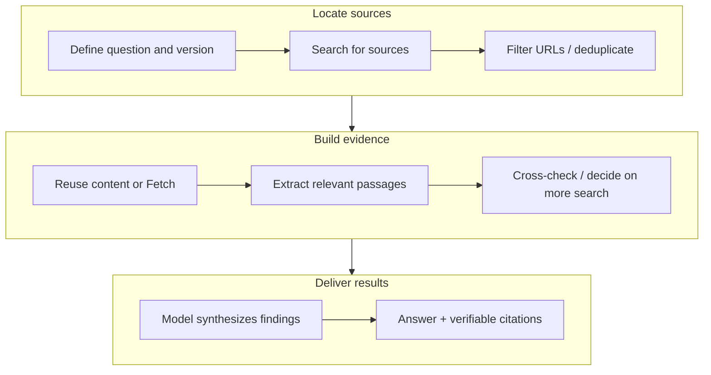

# DeepSeek Search/Fetch: CNY 5 per 1,000 Calls—Still a Price Disruptor?

DeepSeek exposes two independent APIs: Search finds pages, while Fetch retrieves their content. Its Chinese documentation lists each at **CNY 5 per 1,000 successful requests**; the English page lists each at **USD 0.75 per 1,000 successful requests**. These are official prices in different currencies, not a live exchange-rate conversion. [DeepSeek Chinese pricing](https://api-docs.deepseek.com/zh-cn/quick_start/pricing/), [English guide](https://api-docs.deepseek.com/guides/search/)

**For the search-tool fee alone, DeepSeek's quote is 92.5% below OpenAI and Claude's USD 10 per 1,000 searches. That does not make every web capability cheapest.** Some Alibaba Model Studio search strategies in Beijing cost CNY 3 or 4 per 1,000 calls, and Claude adds no tool fee for web fetching. More fundamentally, a search request and a completed agent task have different cost boundaries.

Prices were checked on **2026-10-19**. This is an analysis of official pricing and architecture, not a paid-API performance experiment. It does not rank search quality, latency, or final-answer quality.

## 1. Why Agents Need Search and Fetch

A research agent resembles an engineer writing a technical report: find relevant material, open the originals, compare versions and dates, and then write a conclusion. Relying on search snippets alone is like making a selection recommendation from headlines; it can miss pricing conditions, deprecations, and supported versions.

| Capability | Problem it solves | Typical input and output |
| --- | --- | --- |
| Search | Find candidate sources when their locations are unknown | Query → URLs, titles, summaries, and other results |
| Fetch | Read content at a known URL | URL → page content a model can read |
| Browser operation | Interact with pages, authentication, or application interfaces | Clicks, typing, navigation, screenshots; support depends on implementation |
| RAG, Retrieval-Augmented Generation | Retrieve evidence from controlled knowledge stores or external material, then generate an answer | Document retrieval → context → evidence-based answer |

Search and Fetch can supply material to RAG, but do not replace document permissions, version management, or retrieval evaluation. Fetch is not a complete browser and should not be assumed capable of operating an authenticated console.



This shows one evidence-processing cycle. Missing information may trigger another search round. Further searches, page retrieval, and content reading can all add cost, so one user question is not necessarily one tool request.

For example, to determine whether a Kubernetes release supports a feature, an agent can locate official documentation, read release notes and code changes, and distinguish default behavior, required configuration, experimental status, and distribution differences. Search supplies candidates, source documents supply evidence, and the model synthesizes the conclusion. None replaces the others.

## 2. What DeepSeek Charges For

| Item | Official rule |
| --- | --- |
| Search | CNY 5 per 1,000 successful requests; search results must be non-empty |
| Fetch | CNY 5 per 1,000 successful requests; page content must be returned |
| HTTP status | HTTP 200 must also produce a result; status alone is insufficient |
| Empty results, failures, timeouts | No Search / Fetch request fee for that attempt |
| Result count | `count` does not change the price of one search request |

“Not billed by tokens” describes these two tool endpoints. **When returned content enters a model's context, model reading and generation still follow that model's billing rules.** The number of search results also differs from the number of pages the agent eventually opens. [DeepSeek billing rules](https://api-docs.deepseek.com/zh-cn/guides/search/#计费)

Another distinction matters: DeepSeek says server-side Search / Fetch calls made when using the **DeepSeek API** through DeepSeek Harness, Claude Code, or Codex have temporarily been uncharged, with billing scheduled for **2026-11-01 00:00 Beijing time**. That date had not arrived when this article was checked. This concerns those clients accessing DeepSeek's service, not a universal new fee on all Claude Code or Codex subscriptions. [Official effective-date notice](https://api-docs.deepseek.com/zh-cn/quick_start/pricing/)

A client name does not determine who bills you. Inspect the actual model/tool backend, account, and server-side search behavior. One visible model request can contain more than a single model-token charge behind the scenes.

## 3. Where It Is Cheaper Than Other Providers

### 3.1 USD Prices: Compare the Search Tool First

The table retains each provider's billing unit; it does not treat them as equally capable complete answers. These are public standard rates before free allowances, subscriptions, enterprise agreements, or additional model fees.

| Service | Tool fee per 1,000 billing units | Unit and main conditions |
| --- | --- | --- |
| DeepSeek Search | $0.75 | Successful search requests; independent JSON API. [Guide](https://api-docs.deepseek.com/guides/search/) |
| Brave Search | $5 | Search requests; independent search API. [Pricing](https://brave.com/search/api/) |
| Tavily Basic Search | $8 | Pay-as-you-go at $0.008 / credit; one basic search uses 1 credit. [Rules](https://docs.tavily.com/documentation/api-credits) |
| Tavily Advanced Search | $16 | Same pay-as-you-go rate; one advanced search uses 2 credits. [Rules](https://docs.tavily.com/documentation/api-credits) |
| OpenAI `web_search` | $10 | Standard non-preview search-tool calls; search-content tokens cost extra. Not a rate for every legacy tool. [Pricing](https://developers.openai.com/api/docs/pricing) |
| Claude Web Search | $10 | Each search; content entering context incurs token charges. [Pricing](https://platform.claude.com/docs/en/about-claude/pricing#web-search-tool) |
| Google Search grounding for Gemini 3 and newer | $14 | After free allowance, per executed search query; one prompt can trigger multiple queries. [Rules](https://ai.google.dev/gemini-api/docs/google-search/#pricing) |

Small applications should also consider free allowances: Google currently provides 5,000 monthly searches shared across Gemini 3 and newer models; Tavily provides 1,000 credits per month; Brave Search provides $5 in monthly credits. Free tool allowances do not make model usage free, and project, account, and product terms still apply. [Google](https://ai.google.dev/gemini-api/docs/google-search/#pricing), [Tavily](https://docs.tavily.com/documentation/api-credits), [Brave](https://brave.com/search/api/)

DeepSeek's $0.75 is 7.5% of $10: a **92.5% lower quote for this line item**. This supports calling it inexpensive relative to those two overseas search rates. It does not establish 92.5% lower total agent cost, nor equal recall, Chinese coverage, freshness, or latency.

OpenAI's standard `web_search`, historical `web_search_preview`, and model-specific search-content billing differ. One low number cannot describe every endpoint; some mini models have fixed search-content token blocks. [OpenAI tool billing](https://developers.openai.com/api/docs/pricing)

### 3.2 CNY Prices: DeepSeek Is Not the Only Low-Cost Option

| Service and scope | Tool fee per 1,000 calls | Boundary |
| --- | --- | --- |
| DeepSeek Search | CNY 5 | Independent search endpoint; successful requests billed |
| Model Studio `turbo`, Beijing | CNY 3 | Built-in model web-search strategy |
| Model Studio `max`, Beijing | CNY 4 | Built-in model web-search strategy |
| Model Studio `agent`, Beijing | CNY 4 | Multi-round search; model fees extra |

Model Studio's figures come from its [built-in web-search billing documentation](https://help.aliyun.com/zh/model-studio/web-search/). They do not apply to every region or its separate MCP search service. Built-in model tools and independent JSON search APIs differ in model coupling, returned material, and integration.

Thus “DeepSeek offers a low-priced search endpoint” is supported. “It also has the lowest domestic search price” is not supported by this table. Substitutability depends on whether the workflow needs direct retrieval control or wants a model service to orchestrate search.

### 3.3 Fetch: Cheap Search Does Not Make Retrieval Cheapest

| Service | Additional fetch-tool fee | Other costs and conditions |
| --- | --- | --- |
| DeepSeek Fetch | CNY 5 per 1,000 successful requests; English quote $0.75 | Model charges apply when content is supplied to the model. [Guide](https://api-docs.deepseek.com/guides/search/) |
| Claude Web Fetch | No additional tool fee | Content entering context is billed as tokens. [Guide](https://platform.claude.com/docs/en/about-claude/pricing#web-fetch-tool) |
| Model Studio `agent_max` page retrieval | Currently described as a limited-time free offer | Search and model fees remain; a promotion is not a permanent rate. [Guide](https://help.aliyun.com/zh/model-studio/web-search/) |

This is why a price per thousand searches cannot rank every web-enabled task. One task is search-heavy; another already knows its URLs and spends more on retrieval, long-document reading, or repeated reasoning.

## 4. If Search Returns Content, Is Fetch Still Necessary?

Not always. DeepSeek Search supports `need_content: true`, requesting page content in its results. Content may be missing; setting the flag does not establish successful retrieval. Check whether existing material supports the conclusion, then Fetch only missing, insufficient, or critical pages that need confirmation. [Search API fields](https://api-docs.deepseek.com/api/search)

A known official URL can go directly to Fetch, avoiding unnecessary search. Conversely, a content-bearing Fetch response does not establish relevance: a login page, a changed landing page, or unrelated text still requires validation. Extracted content is not a guarantee of factual correctness. [Fetch API](https://api-docs.deepseek.com/api/fetch)

For a technical review with 8 candidate URLs, retrieving all 8 indiscriminately is unnecessary. Filter by source, date, version, and duplication, inspect existing content, and retrieve originals that affect the conclusion. This reduces both tool calls and repeated model reading.

## 5. What Do Ten Thousand Agent Tasks Cost?

A simple model for DeepSeek's CNY tool prices is:

```text
Tool cost (CNY) = successful Search requests × 0.005
                + successful Fetch requests  × 0.005

Total task cost = tool cost + model token cost + execution / storage cost

Cost per verified task = total cost / number of tasks passing verification
```

A successful request differs from a verified task: search can return pages successfully while the agent still answers incorrectly. Repeated successful calls after retries cannot be removed from billing counts just because they concern the same business question.

The following are **budget assumptions, not measured consumption**. Each task has a fixed number of successful calls, excluding model, browser, and other execution costs.

| Hypothetical task | Search / task | Fetch / task | Tool fee / task | Tool fee for 10,000 tasks |
| --- | --- | --- | --- | --- |
| Simple fact check | 1 | 2 | CNY 0.015 | CNY 150 |
| Documentation and coding assistance | 3 | 5 | CNY 0.040 | CNY 400 |
| Multi-source research | 5 | 20 | CNY 0.125 | CNY 1,250 |

Adjust the calculator below to explore a budget. It computes locally in the browser without calling DeepSeek. Other costs and the task-verification pass rate are reader-provided assumptions.

<style>.aik8s-search-budget{height:740px}@media(max-width:1000px){.aik8s-search-budget{height:1100px}}</style>
<iframe class="aik8s-search-budget" src="../../assets/rag-agent/deepseek-search-fetch/budget.html" title="DeepSeek Search/Fetch budget calculator" width="100%" height="740" loading="lazy" style="border:0;border-radius:12px;"></iframe>

[Open the calculator separately](../../assets/rag-agent/deepseek-search-fetch/budget.html)

When long search content enters context, model-input costs can deserve more attention than tool fees. Caching also has two layers: application caching can avoid external calls; model Prompt Cache reduces repeated model-reading costs, not fees for Search / Fetch requests already executed.

A fuller estimate uses current CNY pricing for `deepseek-flash`: suppose one task accumulates 100,000 uncached input tokens and 10,000 output tokens. Model cost is **CNY 0.14 off-peak** or **CNY 0.28 at peak**. Adding 2 Search and 6 Fetch calls costs **CNY 0.04**, producing totals of **CNY 0.18 and CNY 0.32**, before execution costs. These are calculations from assumed usage; actual charges depend on model version, time band, and billing. A model's off-peak discount cannot simply be applied to Search / Fetch. [Peak/off-peak model prices](https://api-docs.deepseek.com/zh-cn/quick_start/pricing/)

## 6. Integrating Search into an Agent

Two approaches are common. In provider-hosted tools, the model service performs search and returns tool activity. In a self-managed Harness, independent Search / Fetch APIs are wrapped as functions or Model Context Protocol (MCP) tools, and results are passed to the model. The latter separates retrieval-provider choice from model choice, while leaving timeout handling, authorization, caching, and budgets to the platform. [Agent Harness responsibilities](agent-harness-technology-overview.md)

These minimal examples call the independent endpoints. They do not implement a complete Agent Loop, and were not executed with real credentials for this article.

```bash
curl -fsS https://api.deepseek.com/v1/tools/search \
  -H "Authorization: Bearer ${DEEPSEEK_API_KEY}" \
  -H "Content-Type: application/json" \
  -d '{"query":"Kubernetes Service official documentation","count":5,"need_content":true}'

curl -fsS https://api.deepseek.com/v1/tools/fetch \
  -H "Authorization: Bearer ${DEEPSEEK_API_KEY}" \
  -H "Content-Type: application/json" \
  -d '{"url":"https://kubernetes.io/docs/concepts/services-networking/service/"}'
```

For a self-hosted platform, a Tool Gateway can enforce user/task budgets, reuse retrieval caches, record the actual provider and requests, and restrict destinations. Web pages are external evidence; text telling an agent to execute commands does not grant authorization.

DeepSeek currently documents separate account-level **5 QPS** limits for Search and Fetch. Another API key does not expand the same account's allowance; Fetch also has per-domain limits. QPS means Queries Per Second. Concurrency should follow account/tool limits, not merely the model's concurrent-session capacity. [Rate limits](https://api-docs.deepseek.com/guides/search/#rate-limits)

Set per-task search and page limits, content-token budgets, and a total deadline. Retry temporary failures within bounds and stop known permanent errors. Failure to find an answer must not become an unlimited cycle of query rewriting and spending.

## 7. How to Tell Whether a Low Price Produces Savings

Compare completion rate, time, and cost on the same tasks with the same acceptance criteria, rather than the most prominent unit price.

- **Evidence quality:** do sources support the conclusion, do citations match originals, and are dates and versions correct?
- **Effective call volume:** how many searches and fetches were needed, including duplicates, useless content, and retries?
- **Context cost:** how many tokens were read, were whole pages repeatedly carried forward, and did caching reduce repeated work?
- **End-to-end outcome:** verification pass rate, P50 / P95 duration, and total cost per verified task.

P50 is the median; P95 is the 95th percentile. One fast response does not establish tail latency across tasks, and a non-empty search result does not establish factual correctness.

On Kubernetes, tool calls can be separate Trace Spans recording task ID, provider, tool type, duration, result count, billable-success status, and estimated spend. Filter sensitive query/URL data, and reconcile against actual provider bills. A generic framework counter is not automatically every provider's billing meter.

## 8. Is “Price Disruptor” a Fair Description?

DeepSeek's independent search API sits in a low public price range, with a clear advantage over the OpenAI and Claude search-tool rates listed here. That is attractive to retrieval-heavy agent platforms that want control over models and workflows.

However, some domestic built-in search quotes are lower, and other providers offer fetching without extra tool charges. Coverage, availability, rate limits, model-reading cost, and task completion also differ. **DeepSeek is a low-cost web-tool option worth evaluating; pricing alone does not establish the cheapest solution for every agent workload.**

Start with a small set of representative tasks, record search, retrieval, reading, and verification, and then decide whether to switch providers. A lower tool rate reaches the business bill only when additional searches, content tokens, and rework do not offset the saving.

## References

- [DeepSeek Chinese Search / Fetch rules and effective date](https://api-docs.deepseek.com/zh-cn/guides/search/)
- [DeepSeek English USD Search / Fetch prices](https://api-docs.deepseek.com/guides/search/)
- [OpenAI API tool pricing](https://developers.openai.com/api/docs/pricing)
- [OpenAI Web Search actions and citations](https://developers.openai.com/api/docs/guides/tools-web-search)
- [Claude Web Search / Web Fetch billing](https://platform.claude.com/docs/en/about-claude/pricing)
- [Google Search grounding billing units](https://ai.google.dev/gemini-api/docs/google-search/)
- [Model Studio web-search strategies and pricing](https://help.aliyun.com/zh/model-studio/web-search/)
- [Brave Search API prices](https://brave.com/search/api/)
- [Tavily credits and search-depth billing](https://docs.tavily.com/documentation/api-credits)
