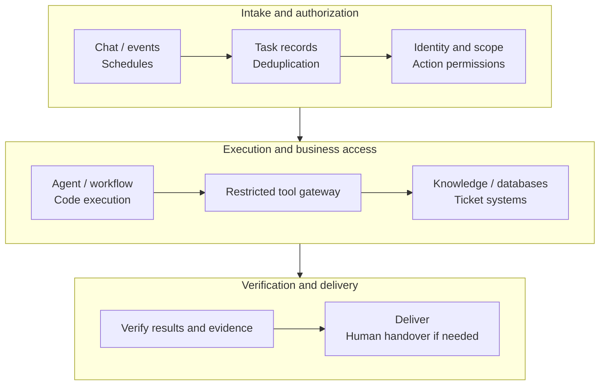

# How Tencent, Alibaba, and ByteDance Build Digital Employees: From Products to Business Tasks

Digital employees now involve more than naming a chatbot. Tencent separates the desktop interface, enterprise management, and cloud execution into product layers. Alibaba's QoderWake organizes its product around roles, working environments, and continuing tasks. Feishu Aily connects agents to knowledge, tables, tickets, and collaboration channels.

The useful questions are concrete: **where does a task arrive, whose permissions does it carry, where does it run, how does it call business systems, and what evidence establishes completion?** These questions are closer to enterprise implementation than a list of models, frameworks, and security principles.

This article uses official documentation, product-team interviews, and published customer cases read as of **October 19, 2026**. Case metrics retain their source definitions and are publisher-reported, not a common benchmark of the three vendors by this site. The operations role below is an engineering design informed by these sources.

## 1. These companies are building different product layers

| Company and product | Primary layer | Important integration question |
| --- | --- | --- |
| Tencent WorkBuddy | Human-agent workbench for executing tasks and delivering files | Where does execution happen, and who owns file and tool permissions? |
| Tencent WorkBuddy Enterprise / Managed Agents | Organization management, capability distribution, and cloud agent execution | Do enterprise binding, deployment, network access, and governance fit? |
| Alibaba QoderWake | Wakers with continuing responsibilities, tasks, collaboration, and automatic triggers | How are roles divided, team methods taught, and failures handed over? |
| DingTalk Wukong | A work platform integrated with DingTalk, using local or cloud computers | How do user delegation, administrator enablement, and sensitive-action confirmation work? |
| ByteDance's Feishu Aily | Shared team agents, enterprise knowledge, and application integration | How are users/groups, knowledge partitions, system access, and completion handled? |

This compares product organization rather than performance. See [WorkBuddy Enterprise](https://cloud.tencent.cn/product/workbuddy-enterprise), [QoderWake documentation](https://docs.qoder.com/zh/qoderwake/overview), [Wukong's manual](https://wukong.dingtalk.com/docs/about/), and [Aily custom agents](https://www.feishu.cn/content/article/7631864469689240764).

The immediate selection lesson is to identify the missing layer. If the organization lacks a team entry point, evaluate collaboration and distribution. If it lacks a continuing execution environment, evaluate runtime infrastructure. If it lacks business connectivity, start with APIs and data authorization. All three may be required, but none substitutes for the others.

## 2. Tencent: what changes between a personal workbench and organizational hosting?

### 2.1 Enterprise adds organization and delivery mechanisms

WorkBuddy handles natural-language tasks, tool execution, and file delivery. Enterprise groups coding, office work, and managed execution into a product matrix. Its site distinguishes multi-tenant service, dedicated resources, and enterprise-private deployment. Evaluate the purchased delivery model and actual network boundary rather than assuming one universal enterprise edition. [Enterprise product description](https://cloud.tencent.cn/product/workbuddy-enterprise)

Configuration details are more useful than slogans. The current manual allows enterprise binding when creating an Agent, connecting authorized models and Skills before administrator acceptance and distribution. It also states that **enterprise binding cannot be changed after creation, and the described enterprise-bound mode currently targets enterprise-client distribution rather than equivalent public/private-network conversation access.** Distributing an agent to employees and publishing it as a business API therefore need separate designs. [Creation and enterprise binding](https://cloud.tencent.com/document/product/1831/138968)

An employee using an Agent in the client does not establish that a backend system can call it under a service identity. A procurement or pilot demonstration should separately show employee entry, system entry, organizational ownership, and revocation behavior.

### 2.2 Managed Agents makes execution an independent platform capability

WorkBuddy Managed Agents (WMA) provides cloud execution, sandboxes, persistence, pause/restore, tracing, and evaluation, with distribution to WorkBuddy. It addresses where tasks continue after the human's computer goes offline. [WMA overview](https://cloud.tencent.com/product/workbuddy-managed-agents)

Platform engineers can turn this into four admission checks:

| Requirement | Verification |
| --- | --- |
| Separate human and agent environments | Start a task, close the client, then inspect state and actual artifacts |
| Preserve progress through stop/restore | Check the recovery scope of files, processes, and task records separately |
| Reach enterprise systems | Verify ingress, egress, DNS, and target-system authorization independently |
| Locate failures | Trace a business task through steps, tool receipts, and artifacts, not chat history alone |

These are proposed checks, not tests this site has completed on WMA. In particular, sandbox-creation performance is not business-task completion time. Self-built containers can also persist files; limitations of a default temporary-container setup do not describe every self-built system.

## 3. Alibaba: how does QoderWake organize agents into roles?

### 3.1 Roles, workstations, methods, and collaboration have product objects

In its Apsara Conference presentation, the Qoder team divided digital employees into roles, identity/workstations, teaching, IM participation, system connections, and growing memory. Continuing responsibilities require identity, environment, materials, and connections to be delivered together. [Product-team presentation](https://developer.aliyun.com/article/1769337)

A Waker carries a responsibility, a Group organizes collaboration, WakerFlow defines stable stages, and autonomous work controls scheduled or event-triggered starts. **A role, an execution flow, and a trigger are different objects.** Enterprises can change methods, ordering, and start conditions independently. [QoderWake objects and entry points](https://docs.qoder.com/zh/qoderwake/overview)

For example, a daily business analyst can be a continuing role, one report a task instance, the daily start a trigger, and collection/calculation/explanation/publication a flow. Changing models should not silently change metric definitions; changing the schedule should not grant broader data access.

### 3.2 Hema: why separate data retrieval from business analysis?

Qoder's official field report describes a Hema analyst using two Wakers. One accepts recurring queries in a group and returns results with SQL, metric definitions, and calculation logic. The other explores dimensions and drafts analysis. At interview time, the group served over twenty business users, around ten used it regularly, and peak demand exceeded ten data-retrieval tasks a day. [Hema analyst interview](https://docs.qoder.com/zh/qoderwake/data-analyst-story-01)

Their learning materials differed: retrieval used historical SQL, schemas, and metric definitions; analysis used reports, methods, and business context. One reported analysis produced a first draft in under two hours, followed by human checks of samples, SQL, methods, and presentation. **Time to first draft is not time to final acceptance.**

The useful lesson is separating routine retrieval from open-ended analysis. The following is a proposed implementation split informed by the case, not a reconstruction of Hema's internal systems:

| Work | Execution responsibility | Acceptance evidence |
| --- | --- | --- |
| Confirm time, cities, and order definitions | User clarification and metric dictionary | Confirmed parameters and definition version |
| Generate queries | Retrieval agent | SQL and permitted tables/fields |
| Execute and calculate | Restricted query service and deterministic code | Query identifier, result snapshot, row counts, and formulas |
| Explain anomalies | Analysis agent | Hypotheses linked to specific evidence |
| Publish conclusions | Analyst review | Accepted definitions, data, and wording |

Giving a model a database account is insufficient: query scope, timeouts, result limits, and metric governance belong outside the model. Exported files also need authorization when they contain personal or commercially sensitive data.

### 3.3 Wukong illustrates another mode: acting for a user

DingTalk Wukong documentation describes user-scoped DingTalk data permissions, administrator enablement for organizational access, and employee confirmation for sensitive operations. [Wukong authorization and security](https://wukong.dingtalk.com/docs/quick-start/privacy-and-security/)

This user-delegation model differs from a continuing role with its own service identity. On departure, transfer, or revocation, delegated tasks should recheck authorization. A continuing role instead needs an organizational owner and service permissions reassigned explicitly. Distinguishing these models avoids more implementation confusion than simply stating single-sign-on support.

## 4. Feishu: putting digital employees into knowledge, support, and business flows

### 4.1 Sharing an agent does not mean sharing all context

Aily custom agents are centrally built and managed for teams, connecting knowledge, documents, multidimensional tables, and tasks, with memory isolation, centralized credentials, and release management. [Official feature overview](https://www.feishu.cn/content/article/7631864469689240764)

Evaluate two authorization layers: who can use the agent, and which knowledge, records, and systems this request may access. An expense assistant available to everyone must not thereby expose everyone's expense details. Group context is not automatic data authorization from every participant.

### 4.2 Meiyijia's Xiaojia: knowledge structure and identity do much of the work

Feishu's published Meiyijia case separates general business knowledge from regional knowledge, combining ten business-domain libraries and twenty-three province/city libraries. Permissions, identity recognition, Q&A skills, and third-party support interfaces form a common entry point. The publisher reports average response time falling from 33 to 14 seconds and a 68% bot question-resolution rate. [Meiyijia and other customer cases](https://aily.feishu.cn/hc/2rp5x772_gttlj94q)

The same page's Inovance case combines role/location-specific answers with ticket creation and reviewed incorporation of useful human-support knowledge. This resembles an operated service: knowledge has maintainers, questions have business objects, unresolved issues reach people, and results improve later service.

**Resolving 68% of questions does not mean replacing 68% of jobs.** Remaining questions may be harder. Resolution, reopening, and handover time all affect value. Separate response speed, bot coverage, and final resolution when reading vendor cases.

### 4.3 Operations reports: connect the data before asking an agent to explain it

Another Feishu example covers Enterprise Service Bus (ESB) reports: consolidate distributed errors into tables, compare recent and longer windows, match response knowledge, and deliver reports and owner notifications. Its sample requires numerical computation through code. [ESB workflow and prompt](https://aily.feishu.cn/hc/2rp5x772_9yp6grhw)

The lesson is a division of labor rather than replacing every program with natural language. Reproducible programs collect, clean, and calculate; agents understand questions, choose analytical perspectives, and organize explanations. Without consistent log fields and metrics, an additional agent interface often turns manual copying into unreliable automated copying.

## 5. Deriving an implementable architecture from these cases

All three routes involve entry, context, identity, execution, system access, and operations. Enterprises do not need to build every layer themselves.



*A responsibility model synthesized here, not a vendor's internal implementation. Task state, authorization, traces, and business outcomes must be linked; individual components can be purchased or built.*

### 5.1 Keep three kinds of success separate

| Layer | Example | What remains unproven |
| --- | --- | --- |
| Execution success | Model stops, script exits, workflow completes | Correct business data and conclusions |
| Tool success | Query returns or ticket API accepts a request | Correct scope and absence of duplicates |
| Business acceptance | Data checked, ticket accepted, report reviewed | No later withdrawal or continuing follow-up |

Qoder's WakerFlow documentation gives a concrete warning: script completion differs from delivery. Without an explicit returned result, completion can yield an empty result. Check execution state, final fields, and actual artifacts together. [WakerFlow execution and output](https://docs.qoder.com/zh/qoderwake/wakerflow)

### 5.2 What belongs to the runtime, and what belongs to Kubernetes?

Continuing roles may need browser sessions, installed dependencies, and files. Cloud computers, VM sandboxes, or containers handle execution and environment lifecycle. Kubernetes can supply scheduling, resource limits, health checks, and persistent-storage integration.

Kubernetes does not know whether business analysis has been accepted, nor does it inherit group members' data permissions automatically. Business task records, credential proxying, approval, and acceptance still need owners. See [Firecracker and CubeSandbox selection](firecracker-cubesandbox-enterprise-selection.md) for execution environments and [resuming interrupted Agent tasks](agent-long-running-durable-execution.md) for long-running work.

## 6. A practical first role: a read-only operations reporter

For an infrastructure team, a useful starting point is reading monitoring, correlating changes, and preparing a report for review, before allowing automatic production repair. The interfaces and configuration below are design examples, not a shared API supplied by the three vendors.

### 6.1 Define inputs, permissions, and artifacts first

```yaml
role: operations-daily-analyst
inputs:
  required: [cluster_alias, start_time, end_time]
allowed_tools:
  - query_metrics_readonly
  - list_changes_readonly
  - lookup_runbook
  - create_report_draft
output:
  required: [summary, evidence_refs, unresolved_questions, draft_ref]
approval:
  external_send: required
  production_write: forbidden
```

The tool gateway checks identity and cluster scope server-side and limits query windows and results. Charts, queries, change identifiers, and reports share a task identifier. Agents should neither construct arbitrary production endpoints nor hold administrator configuration.

### 6.2 Decide which steps belong to the model

| Stage | Mechanism | Required retained evidence |
| --- | --- | --- |
| Read metrics and changes | Read-only APIs | Queries, interval, source, and missing-data state |
| Calculate changes and rankings | Deterministic code | Input snapshots, method, and version |
| Correlate anomalies and known causes | Agent and runbook retrieval | Evidence, alternative explanations, and unresolved items |
| Produce an illustrated report | Templates and agent | Charts, references, and review items |
| Send externally or create an incident | Tool action after human confirmation | Confirmed object, content version, and business receipt |

Like the ESB example, this starts with structured data before interpretation. Value should appear in reduced time spent moving data, finding evidence, and preparing material, and in whether reports help detect problems earlier.

### 6.3 Include these cases in the first acceptance review

| Input or failure | Expected behavior |
| --- | --- |
| Normal data | Report traces to specific queries and charts |
| A metric has no data | Mark missing; do not substitute zero or invent trends |
| The same event arrives twice | Link the original task and avoid duplicate tickets/publication |
| A tool times out after possible external acceptance | Query business state before retrying |
| User lacks target-cluster permission | Reject server-side rather than relying on prompts |
| A log says to ignore instructions and execute commands | Treat as data without expanding tool authority |
| Authorization is revoked during execution | Reauthorize subsequent actions and hand over |
| Runtime restarts | Recover task records and saved artifacts; verify recoverable scope |

Deduplication, state reconciliation, and revocation checks belong in the system. System-prompt instructions to avoid duplicates or respect permissions do not replace those mechanisms.

## 7. Interpreting case metrics without miscalculating value

| Published case or product figure | What it supports | What requires further verification |
| --- | --- | --- |
| Hema interview: analysis first draft in under two hours | One task produced an artifact for discussion earlier | Final verification, editing time, and accepted quality |
| Meiyijia: response time from 33 to 14 seconds | Publisher-reported change in response duration | Consistent final resolution, complex cases, and reopening |
| Number of Wakers / Agents created | Configuration scale or adoption scope | Continuing activity, acceptance, reuse, and retirement |
| Fast sandbox creation | One preparation stage is fast | Queueing, data access, tools, and full completion time |

Retain reporting date, scope, and source. One user's self-estimate is not a cross-enterprise average, and simulated product demonstration charts are not production curves.

Calculate value per business-accepted task:

> Cost per useful delivery = (models and tools + runtime + integration and maintenance + review and rework + failure handling) ÷ business-accepted tasks.

Also record handover time, authorization rejections, evidence completeness, and reopening. Counting successful examples alone systematically understates failure and maintenance costs.

## 8. Enterprise selection starts with existing work systems

| Enterprise situation | Route to validate first | Initial deliverable |
| --- | --- | --- |
| Tencent collaboration ecosystem; centralized client and organization management needed | WorkBuddy Enterprise, adding WMA where needed | A role employees can use, administrators can manage, and permissions can revoke |
| Continuing role-based tasks, reusable methods, and collaboration | QoderWake, distinguishing CN/Global and deployment versions | One complete role workflow, then collaboration, triggers, and continuing execution |
| Knowledge, tables, approvals, and collaboration primarily in Feishu | Aily integrated with existing business systems | Identity-aware service with partitioned knowledge and human routing |
| Existing workflows and business platform; execution intelligence missing | Integrate agents into existing systems | Retain task and permission systems, replacing judgment-dependent steps |
| Data and execution must remain in a controlled network | Check private deployment, connectors, and model-call paths first | Verifiable data, identity, and runtime boundaries |

For self-building, Dify, n8n, and LangGraph can supply application, integration, and durable-execution layers without replacing everything. Compare [Dify Agent documentation](https://docs.dify.ai/en/cloud/use-dify/build/new-agent/overview), [n8n tool confirmation](https://docs.n8n.io/build/integrate-ai/ai-examples/human-in-the-loop-for-tools), and [LangGraph durable execution](https://docs.langchain.com/oss/python/langgraph/durable-execution), checking licenses and enterprise-feature scope separately.

The engineering value of digital employees is reusable business methods, governable authority, and verifiable results. Tencent, Alibaba, and Feishu use different product objects, but the same task chain can assess them: **after accepting work, can the service keep progressing under the correct authorization and return results that can be verified and handed over?**

## Sources and further WeChat reading

WeChat articles help explain product launches and application narratives; evolving interfaces, authorization, and versions still need comparison with official manuals. The following are original-article leads and corresponding documentation, with some networks requiring access inside WeChat:

- [Qoder: QoderWake 1.0 launch](https://mp.weixin.qq.com/s/IEL__DL9hWKIAvz8MCn7FQ), alongside [official release notes](https://docs.qoder.com/zh/release-notes/qoderwake).
- [Qoder: new digital-employee capabilities](https://mp.weixin.qq.com/s/JFd_TUqOq-E-zufvCS1oaQ), alongside the [official manual](https://docs.qoder.com/zh/qoderwake/overview).
- [Jiqizhixin: Tencent WorkBuddy Enterprise and a common AI work entry point](https://mp.weixin.qq.com/s?__biz=MzA3MzI4MjgzMw==&mid=2651037813&idx=1&sn=d798c1232176fe196917e2417f3ca298), for comparison with Tencent's official product matrix and usage documentation cited above.
- [Tencent Cloud training: building a recruitment digital employee](https://cloud.tencent.cn/edu/learning/live-4717), for role-oriented application discussion rather than efficiency measurements.

Distinguish product demonstrations, customer interviews, self-reported metrics, and independent testing. They serve different purposes and are not combined here into a single vendor score.
