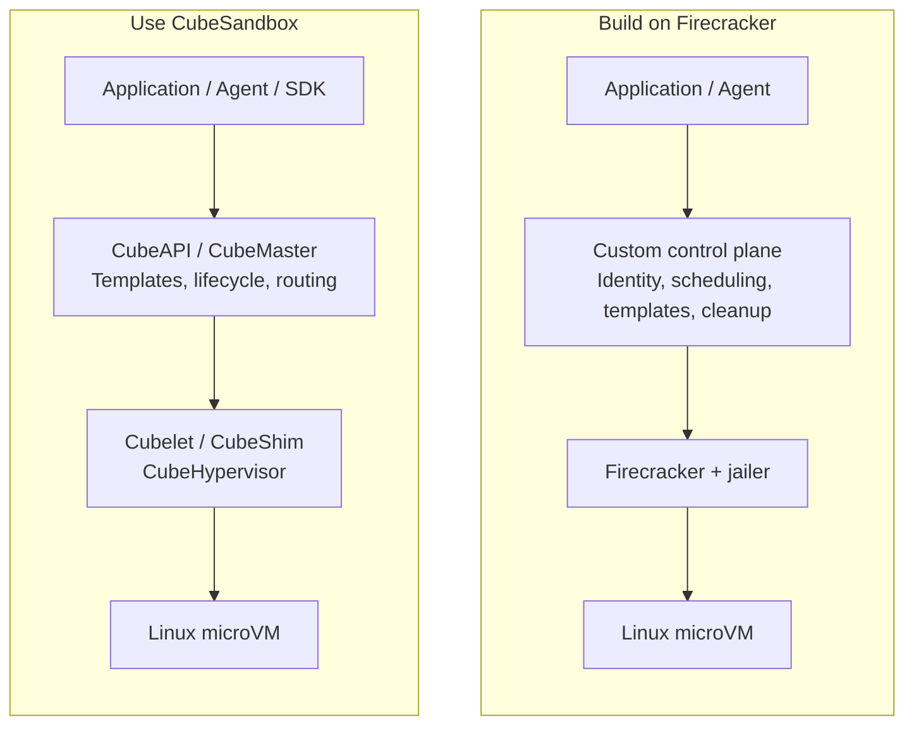
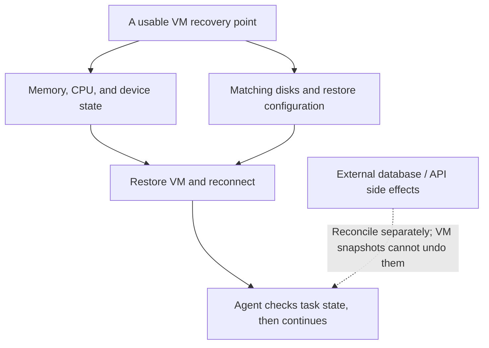

# Firecracker and CubeSandbox: how should an enterprise choose an Agent sandbox?

Once an enterprise connects Agents to code execution, browsers, and internal systems, a practical question follows: where should model-generated code run? Environments should be quick to create and retain useful dependencies, without giving an untrusted script direct access to the host or production credentials.

Firecracker and CubeSandbox both involve lightweight virtual machines, but they address different layers. **Firecracker is a Virtual Machine Monitor (VMM). CubeSandbox is a sandbox platform built around Agent execution environments, using its own CubeHypervisor underneath; it is not a service wrapper around Firecracker.** The meaningful enterprise comparison concerns which responsibilities the project handles and which remain with the platform team.

This article reviews the documentation and source available on October 18, 2026, for Firecracker v1.17.0 and CubeSandbox v0.7.3. Published experiments identify their own versions and measurement boundaries. Numbers from different environments are not presented as a speed ranking. [Firecracker release](https://github.com/firecracker-microvm/firecracker/releases/tag/v1.17.0), [CubeSandbox release](https://github.com/TencentCloud/CubeSandbox/releases/tag/v0.7.3)

## 1. Decide which layer of capability you need

If the goal is to quickly provide APIs for creating sandboxes, executing commands, reading and writing files, and pausing and restoring environments, CubeSandbox is closer to that requirement. If the organization already has mature tenancy, scheduling, image distribution, and task control, but needs a controllable virtualization foundation, Firecracker deserves consideration.

If the actual requirement is to add VM isolation to existing Kubernetes Pods, start by evaluating Kata Containers and RuntimeClass. If it requires full virtual machines, complex hardware, or established device passthrough, also evaluate VM management systems such as KubeVirt. Their resource models and user interfaces differ; using microVMs does not make them the same kind of product.

*Responsibility diagram focused on native KVM. Both paths still need enterprise identity integration, security policy, and operations. The diagram's custom control plane represents a system to build, not a Firecracker component.*

Firecracker uses Linux's Kernel-based Virtual Machine (KVM) to run guests and exposes APIs for CPU, memory, block devices, and network devices. The integrator must arrange host TAP interfaces, disk files, guest kernels, and application access. [Firecracker design](https://github.com/firecracker-microvm/firecracker/blob/v1.17.0/docs/design.md)

CubeSandbox composes the underlying capabilities into a platform: CubeAPI exposes external interfaces, CubeMaster handles scheduling and lifecycle, and Cubelet, CubeShim, and CubeHypervisor perform VM operations on nodes. Storage, networking, ingress proxying, and a management interface are also included. CubeHypervisor builds on Cloud Hypervisor implementation foundations; changing a runtime name does not make it a Firecracker backend. [Architecture](https://github.com/TencentCloud/CubeSandbox/blob/v0.7.3/docs/architecture/overview.md), [Hypervisor source description](https://github.com/TencentCloud/CubeSandbox/blob/v0.7.3/hypervisor/README.md)

## 2. Compare capabilities and responsibilities together

| Dimension | Firecracker | CubeSandbox | Enterprise responsibilities |
| --- | --- | --- | --- |
| Delivery interface | VMM process and machine-control API | Sandbox API, SDK, templates, lifecycle, and management UI | Business interfaces, service levels, and ownership |
| Isolation boundary | Independent guest kernel per microVM | Independent guest kernel per VM sandbox | Host hardening, patching, and tenant separation |
| Environment preparation | Integrator supplies guest kernels, disks, and initialization | Template building, pre-initialization, and restore paths | Template supply chain, dependency updates, and distribution capacity |
| Commands and files | Requires a guest service, vsock, or another integration | Higher-level interfaces for Agents | Authorization, path permissions, output limits, and audit |
| Scheduling and cleanup | External platform responsibility | CubeMaster and node components manage sandboxes | Tenant quotas, queueing, fairness, and orphan verification |
| Snapshots | Primitives to save and load VM state | Platform resources and restore interfaces | Durability, authorization, consistency, and business recovery policy |
| Networking | Virtual devices and rate-limiting primitives; external integration | CubeVS, CubeProxy, CubeEgress, and related components | Internal boundaries, protocol coverage, and network compatibility |
| Kubernetes integration | Custom integration or runtime stacks such as Kata | Helm deployment path, currently marked Preview | Node admission, accounting, eviction, and upgrade validation |
| Identity governance | No complete tenant platform | Interface authentication and callbacks | Enterprise single sign-on, roles, and resource ownership |
| Operations | Most control-plane and platform work beyond the VMM is custom | Platform services, data dependencies, and node runtime | Backup and restore, version matrix, alerting, and on-call support |

This distinction also shapes staffing. Firecracker generally needs sustained ownership of guest images, VMM integration, and platform control. CubeSandbox reduces the amount of platform code to write, but operators must understand its control plane, node components, and state storage. **Less code does not remove production responsibility.**

CubeSandbox's E2B-compatible interfaces should still be checked against the actual SDK version, command streams, file operations, error codes, and connection behavior. An interface compatibility statement does not replace application acceptance testing.

## 3. Security: an independent kernel is the first boundary

### 3.1 VMM isolation and platform authorization are separate

An independent guest kernel reduces the attack surface associated with sharing the host kernel. The host, VMM, and privileged node components remain trusted. VM isolation does not stop a host administrator from reading sandbox data, or a script with valid credentials from calling an allowed internal API.

Firecracker's production guidance includes jailer, syscall filtering, resource limits, and host hardening. Jailer establishes a restricted execution environment; using Rust does not remove that requirement. Host kernels, guest kernels, and CPU microcode also require maintenance. Firecracker does not itself filter guest egress traffic, so the host or surrounding platform must enforce network restrictions. [Production host setup](https://github.com/firecracker-microvm/firecracker/blob/v1.17.0/docs/prod-host-setup.md)

CubeSandbox adds platform components and therefore a broader authorization chain to review: who may create sandboxes, access another user's files, select templates and egress policies, or restore snapshots? Untrusted code inside a sandbox must not be able to change its own network policy or tenant identity.

### 3.2 Keeping credentials outside the guest still requires operation limits

CubeEgress can inject request-header credentials at the egress proxy and apply domain, path, and method policies with auditing. HTTPS inspection involves a Transport Layer Security (TLS) proxy and a trusted CA, so templates need the corresponding trust chain. [Security proxy guide](https://github.com/TencentCloud/CubeSandbox/blob/v0.7.3/docs/guide/security-proxy.md)

For example, an Agent may be allowed to create tickets while the proxy supplies credentials. This reduces the risk of directly reading the raw secret. However, if ticket deletion is also permitted, the Agent can still delete tickets. Enterprises must control which operations are allowed, as well as who can see the key.

Check the protocols, ports, and bypass paths the proxy covers. Direct IP access, IPv6, non-HTTP protocols, redirects, cloud metadata addresses, and internal databases belong in the boundary review. Clients using certificate pinning or mutual TLS need an explicit integration approach; disabling certificate verification is not a solution.

## 4. Kubernetes: installability is only the starting point

### 4.1 The scheduling units differ

Firecracker does not depend on Kubernetes. Integration through Kata can retain the Pod and RuntimeClass resource model, but the kernel, storage backend, and runtime versions must be validated together. This site's [Kata + Firecracker experiment](firecracker-kubernetes-lab/kata-firecracker-runtimeclass.md) documents those integration conditions.

CubeSandbox also supports deployment without Kubernetes. With Helm, Kubernetes schedules platform components and node workloads, while CubeSandbox schedules the inner microVMs. **A sandbox does not automatically correspond to an ordinary Pod.** Looking only at the outer Pod's requests can omit guest memory, VMM overhead, file caches, and snapshot writes.

Capacity planning must answer two questions: how much to reserve for node components, and how much sandbox capacity the inner scheduler may promise. Two schedulers must not independently allocate the same free memory. Container metrics for a business process alone also do not describe the full VM cost.

### 4.2 Read the v0.7.3 deployment conditions carefully

CubeSandbox v0.7.3's Kubernetes documentation remains marked Preview and lists known issues around eviction under resource pressure and compute-node upgrades. Host networking is currently the default. In Pod-network mode, recreating the compute Pod affects existing sandbox networking. Keeping the network namespace with the default host-network mode does not make every upgrade transparent to applications. [Kubernetes deployment guide](https://github.com/TencentCloud/CubeSandbox/blob/v0.7.3/docs/guide/kubernetes/index.md)

Node deployment also involves privileged permissions, the host process namespace, host directories, and network and storage initialization. Uninstalling the Chart does not revert every host change. Kernel, filesystem, and node configuration need separate recovery procedures. An enterprise should start with a dedicated node pool and verify interaction with its Container Network Interface (CNI), security admission, and eviction policies before expanding. [Chart architecture and node responsibilities](https://github.com/TencentCloud/CubeSandbox/blob/v0.7.3/docs/guide/kubernetes/architecture.md)

The project also offers a PVM deployment path, whose host kernel, modules, and guest compatibility requirements need a separate review. It should not be read as a way to deploy without suitable virtualization conditions or operating-system changes. This comparison primarily covers native KVM. [PVM deployment guide](https://github.com/TencentCloud/CubeSandbox/blob/v0.7.3/docs/guide/pvm-deploy.md)

## 5. Where should startup measurement begin and end?

For an application, a successful create response and the first useful tool command are different events.

| Stage | Main influences | What a VM-only measurement can miss |
| --- | --- | --- |
| Authentication and queueing | Identity services, limits, concurrency, and node capacity | Waiting during peak demand |
| Template preparation | Image distribution, rootfs, initialized state, and local cache | First use of a template on a new node |
| VM boot or restore | VMM, guest, CPU, and snapshot layout | Page faults and storage reads after restore |
| Guest service readiness | Command service, browser, interpreter, and connections | A running guest whose application is not ready |
| First useful task | Dependency loading, networking, and real input | The tail latency the user experiences |

Pre-initializing an environment and restoring its template snapshot suits frequent creation of similar environments. Some cost moves into template production and storage. Compare templates already on a node, first-time template acquisition, and queueing under insufficient capacity separately, then report end-to-end P50, P95, and failure rates.

Firecracker snapshot loading uses on-demand mappings, so a quick API response does not mean the application's working set is resident. CubeSandbox's Copy-on-Write (CoW) storage reduces initial copying, but continuing writes still create private data. Account for resident memory, shared pages, dirty pages, physical disk usage, and node caches together. A template's logical size is not each instance's physical cost, and the VMM process alone does not represent the whole platform. [Firecracker snapshot mechanism](https://github.com/firecracker-microvm/firecracker/blob/v1.17.0/docs/snapshotting/snapshot-support.md)

## 6. Restoring a snapshot does not rewind the whole business

### 6.1 Recovery needs a matching set of state

Firecracker provides VM state capture and restore, while disk-file management, consistency coordination, snapshot distribution, and access control belong to the integrator. CubeSandbox exposes these operations as platform snapshot resources, but enterprises must still verify that every required recovery object exists.

*Recovery boundaries. Operations committed to external systems need business idempotency or compensation; a VM snapshot restores only the state it covers.*

Consider a snapshot at task step 50, followed by a payment submitted to an external system and a failure at step 55. Restoring step 50 does not undo the payment record. Submitting it again can duplicate the side effect. Keep a durable external operation record and idempotency key, reconcile after recovery, and then decide whether to continue or compensate.

A VM snapshot likewise does not automatically save Agent conversations, workflow progress, or approval state outside that VM. Long-running tasks need links between persisted Agent state, sandbox recovery points, and external operation records. [Resuming interrupted Agent tasks](agent-long-running-durable-execution.md)

### 6.2 Local recovery, cross-node recovery, and automatic takeover are different

CubeSandbox's default local XFS storage is not cross-node persistence. In v0.7.3, cross-node snapshots require a configured S3/CubeS3lvol path, which is not enabled by default. Enabling it also requires reviewing memory and storage costs. [Cross-node snapshot guide](https://github.com/TencentCloud/CubeSandbox/blob/v0.7.3/docs/guide/cross-node-snapshot.md)

Even if another machine can restore a snapshot, automatic takeover after node failure is not established. It also requires durable recovery points, failure detection, duplicate-execution prevention, compatible target capacity, and re-established network and application connections. If a source node fails before its latest snapshot is persisted, subsequent in-memory progress may still be lost.

Define the Recovery Point Objective (RPO), or acceptable progress loss, and Recovery Time Objective (RTO), or acceptable interruption. Cross-node compatibility also involves CPU features, kernels, templates, and runtime versions. Snapshots contain business data and potentially credentials, so treat them as sensitive data. After cloning, check identity, randomness, and connection semantics so multiple instances do not accidentally reuse one external identity.

## 7. What do the published experiments establish?

This site has separately tested Firecracker and CubeSandbox, with different subjects and boundaries. Those records help establish capability boundaries; they are not a controlled performance ranking.

| Published experiment | Observation | Supported conclusion | What it does not establish |
| --- | --- | --- | --- |
| Firecracker v1.16.1 native snapshot | One load API call took 16.86 ms; ICMP readiness after restore took 26.15 ms | VM restore primitives can be fast; API and network readiness are separate timing boundaries | Enterprise end-to-end P95, or a direct comparison with CubeSandbox create latency |
| Kata 4.1.0 + Firecracker | One batch of 10 Pods, 10/10 Ready, P50 6 s and observed P95 8 s | Kubernetes, runtime, storage, and guest readiness add time to the path | One batch does not establish sustained tail latency or large-scale capacity |
| CubeSandbox v0.7.3 + SDK 0.7.3 | Three rounds in each of two environments; 6/6 restored memory counter, identity, guest PID, and digest, including after original sandbox deletion | Snapshots restored process execution state and allowed it to continue | External-volume rollback, node failure, or automatic failover |

Evidence is available in the [sanitized Firecracker test report](firecracker-kubernetes-lab/test-report.md) and [CubeSandbox process-memory snapshot tests](cubesandbox-process-snapshot-recovery.md). This article does not add a direct benchmark with identical hardware, templates, and workloads.

The useful lesson is to verify both whether recovery is fast enough and whether it restores the state the application needs. A successful API response cannot answer the second question.

## 8. Which route fits which enterprise scenario?

| Enterprise scenario | Starting point | Reason and admission conditions |
| --- | --- | --- |
| Quickly deliver sandbox APIs for code, browsers, or development environments | CubeSandbox | Templates, execution, lifecycle, and routing are composed already; verify identity, networking, upgrades, and node permissions |
| Existing multi-tenant execution platform needs deep low-level customization | Firecracker | Control guests, devices, and machine protocols; the team owns scheduling, templates, and governance development |
| Existing Pods need VM isolation while retaining Kubernetes usage | CRI runtime routes such as Kata | Validate RuntimeClass, storage, kernels, and operational compatibility before building a separate sandbox API |
| Persistent development environments need pause, restore, and cloning | CubeSandbox is a candidate | Separate root disks, external volumes, Agent sessions, and external side effects; verify backup and upgrades |
| Cluster prohibits node privilege, host networking, or kernel changes | Review infrastructure boundaries first | A Helm Chart does not imply compliance; dedicated compute nodes or a separate service boundary may be necessary |
| CUDA, complex devices, or full VM capabilities are required | Validate device virtualization separately | CPU sandbox results cannot establish GPU support; choose a better-fitting VM platform where necessary |

Avoid two GPU misconceptions. Firecracker has PCI support, so saying it has no PCI is outdated; that does not establish a production GPU passthrough solution in the current release. CubeSandbox GPU sandboxes likewise need verification against released capabilities, rather than treating a roadmap as acceptance evidence. [Firecracker PCI tracking](https://github.com/firecracker-microvm/firecracker/issues/5133), [CubeSandbox roadmap](https://github.com/TencentCloud/CubeSandbox/blob/v0.7.3/docs/guide/roadmap.md)

## 9. What evidence should enterprise admission require?

Rather than assigning an unsupported composite score, connect each important requirement to an inspectable result.

| Admission question | Evidence to request |
| --- | --- |
| Can tenants access someone else's sandbox or snapshot? | Ownership checks for creation, queries, execution, proxy access, and restore, with traceable enterprise identity and role mapping |
| What happens on insufficient capacity, timeout, or cancellation? | Defined queueing and failure semantics, retries without duplicate creation, and cleanup of late results |
| Does a snapshot retain the state actually needed? | Separate checks for memory, disk markers, external-volume scope, and business progress, followed by a useful task after restore |
| Do node maintenance and upgrades interrupt applications? | Observed drain, pause, recreation, and restore behavior, plus runtime and template compatibility matrices |
| What happens when state services or object storage fail? | Defined database, Redis, and storage failure behavior, backup restoration results, and acceptable data loss |
| Can network restrictions be bypassed? | Checks covering DNS, direct IPs, IPv6, redirects, non-HTTP protocols, and sensitive internal addresses |
| Does deletion actually free resources? | Reconciliation of VM processes, TAP interfaces, addresses, disks, snapshots, and leases, with orphan detection |
| Can a slow create or failed restore be traced? | Request identifiers across API, scheduling, node, VMM, and storage, with stage durations and failure causes |

Organize monitoring around that path. Beyond CPU and memory, track queueing time, template hits, first-useful-command latency, restore success, dirty-page and disk growth, proxy rejections, orphan resources, and actual tenant consumption. Service Level Objectives (SLOs) should describe success and latency the application can perceive.

Procurement and maintenance conditions also need explicit ownership. Review the project's and dependencies' open-source licenses, retain a component inventory, and establish provenance checks and vulnerability remediation for templates and images. Assign responsibility for tracking upstream security updates, checking whether old snapshots restore under new runtimes, and rolling back failed upgrades. The platform team's ability to do this often determines long-term viability more than the presence of any single feature.

For cost, use Total Cost of Ownership (TCO):

> Cost per useful task = (compute and reserve capacity + template/snapshot storage + proxies and control plane + engineering, upgrades, and on-call effort) ÷ successfully completed business tasks.

“Useful” requires business acceptance. A created sandbox with a failed task, leaked resources after deletion, or a duplicate business operation after restore should not count as a cheap successful request.

Choosing Firecracker trades platform-building responsibility for low-level control. Choosing CubeSandbox reuses composed platform capabilities while accepting and validating its node integration and operating boundaries. Teams building their first Agent execution platform can usually estimate value more easily by proving the business workflow with a complete platform first. Direct VMM control is more likely to pay off for teams that already operate a mature platform and need deep customization.

## References

- [Firecracker v1.17.0 design and production documentation](https://github.com/firecracker-microvm/firecracker/tree/v1.17.0/docs)
- [CubeSandbox v0.7.3 documentation and implementation](https://github.com/TencentCloud/CubeSandbox/tree/v0.7.3)
- [Agent sandbox selection](agent-sandbox-selection.md)
- [Firecracker Kubernetes lab overview](firecracker-kubernetes-lab/index.md)
- [CubeSandbox Kubernetes deployment assessment](cubesandbox-kubernetes.md)
