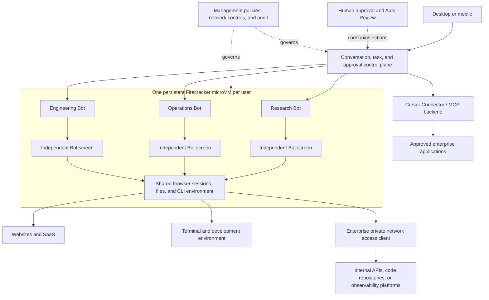
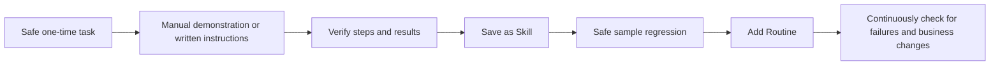
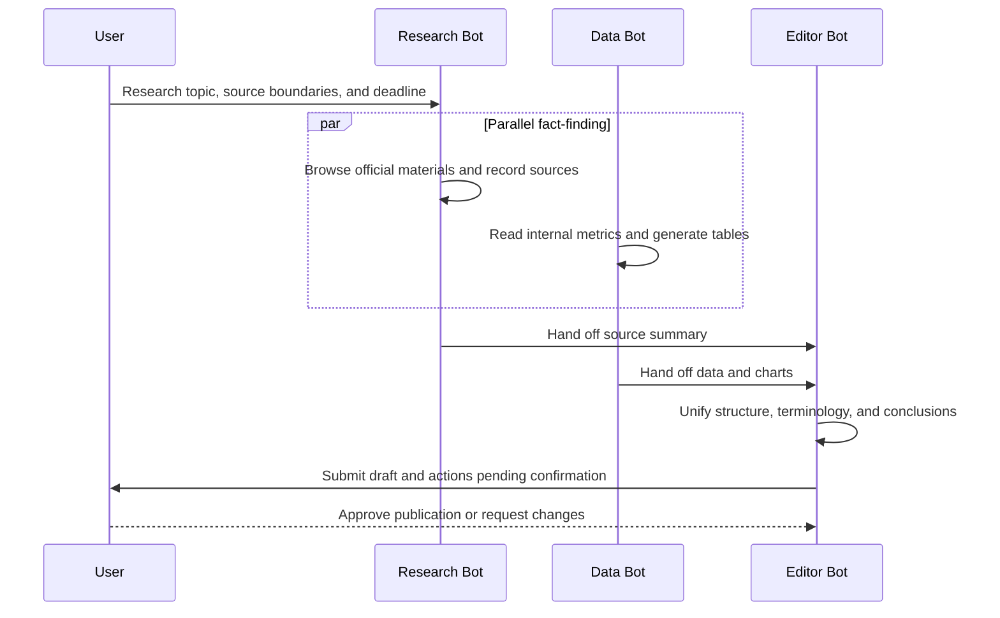
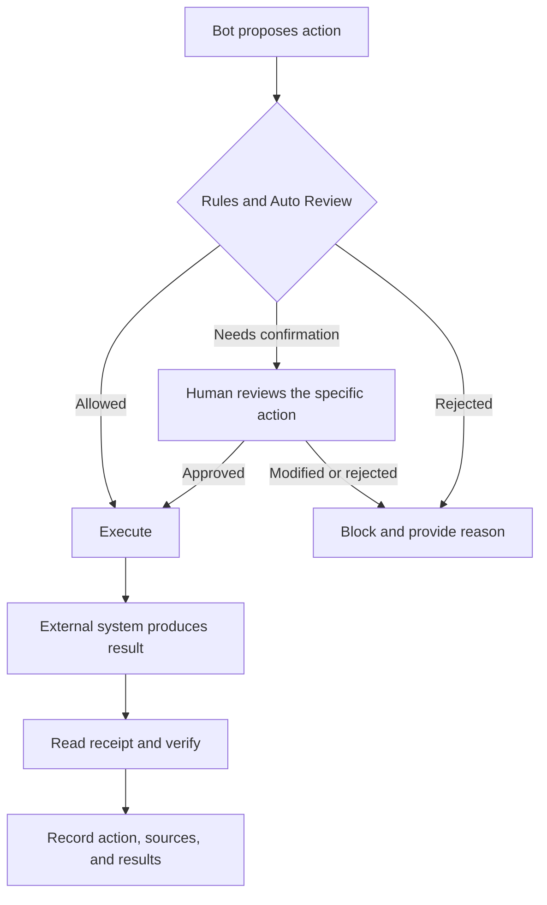
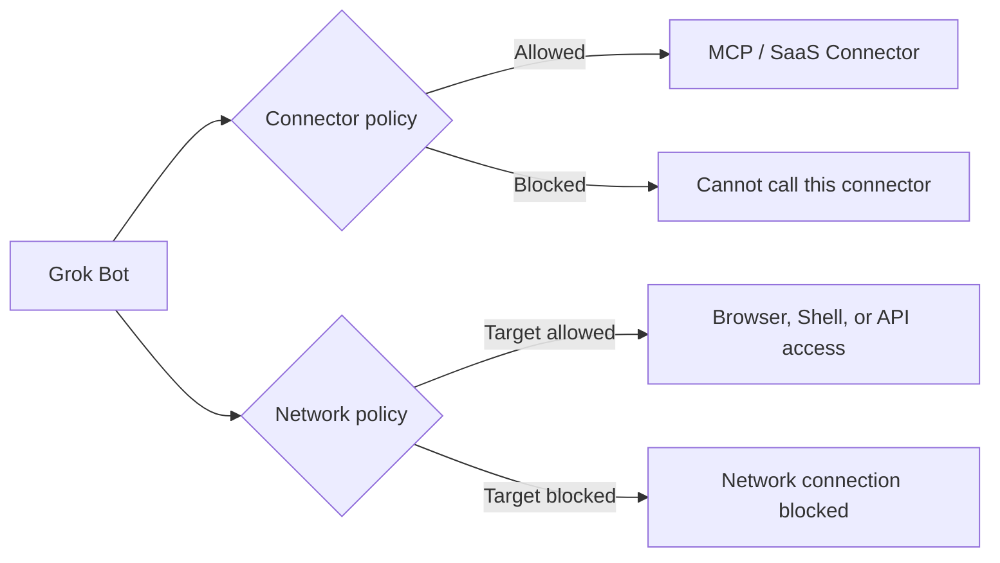
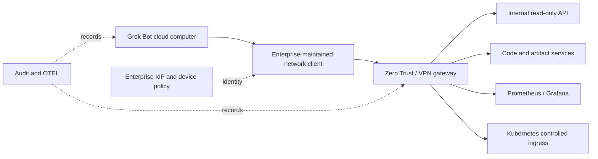
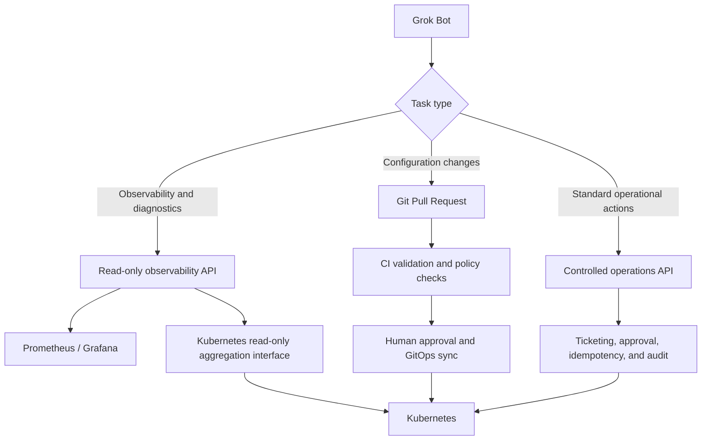

# Grok Bot Technical Overview: Persistent Cloud Computers, Multi-Agent Collaboration, and Enterprise Governance

In August 2026, xAI released Grok Bot. It is not merely an "auto-execute" button placed next to the Grok chat interface, but a managed agent with a name, job role, memory, and a persistent working environment: users assign tasks via messages, and the Bot continues working in a cloud browser, file system, and terminal, returning to request approval when confirmation is needed.

If an ordinary chat assistant is like a phone consultation, Grok Bot is more like a remote colleague with a permanent workstation and a company computer. The computer is not destroyed after each conversation round; browser logins, files, and command-line environments can be persistently retained. At the same time, a permanent workstation means accounts, networking, approvals, auditing, and data cleanup must all be governed as enterprise systems.

Based on official materials available as of September 14, 2026, this article discusses Grok Bot's product boundaries, implementation structure, suitable tasks, and production integration approaches. The product is still evolving rapidly; plans and management capabilities should be confirmed against the current official pages.

## One-Page Summary

1. **Grok Bot is a hosted Computer-use Agent, not a downloadable Grok model to deploy.** Work actually runs on persistent computers in Cursor's cloud; the local desktop and mobile apps are primarily responsible for chat, reviewing progress, and approvals.
2. **"Persistence" is its most obvious difference from ordinary chat assistants.** Bots can retain job context, history summaries, and preferences; cloud computers can retain files, browser sessions, and command-line environments. Tasks can continue after the user closes their laptop.
3. **The isolation boundary is between users, not between a single user's Bots.** The official architecture provides each user with an independent Firecracker microVM; all Bots created by the same user share that computer, including its logins, files, and CLI credentials.
4. **Skills and Routines turn a one-time successful operation into reusable automation.** A Skill describes how to do something; a Routine describes when to do it. The safe path is to first complete a low-risk task, then stabilize the steps, solidify them into a Skill, and finally add scheduled or event triggers.
5. **Multi-Bot collaboration is more like role division in a shared office.** Bots can process tasks in parallel, exchange information in group chats, and hand off work, but they share compute resources and credentials. Adding more Bots does not mean gaining more security domains.
6. **Approval is a control plane, not a rollback mechanism.** "Stop" or rejecting subsequent actions does not automatically roll back already-sent emails, modified files, or external system state. Irreversible actions still require idempotency, approval, and compensation from the business system.
7. **Auto Review has value, but it cannot replace least privilege and network isolation.** It does not cover all side effects; connector policies and browser network access are also two separate boundaries. Disabling a plugin does not mean the Bot cannot open the corresponding website.
8. **The key capabilities provided by the Enterprise plan center on networking and auditing.** Network Controls, Team Setup, Action Recording, organization-level toggles, audit logs, and OpenTelemetry export are not all included in the self-service Teams plan.
9. **Grok Bot can participate in Kubernetes operations, but it should not directly hold cluster admin credentials.** A safer path is read-only APIs, GitOps Pull Requests, controlled operations gateways, and short-lived identities, with changes placed in a separate approval chain.
10. **The core reason to choose it is to quickly obtain a complete "cloud computer + Agent + everyday applications" experience.** If the enterprise must run on its own cluster, needs custom images, strict data residency, or full control over the execution runtime, it should evaluate building its own Agent Harness and Sandbox.

## 1. First, Distinguish Four Similarly Named Products

"Grok Bot" is easily confused with Grok, `@grok` on X, and the xAI API. They share the brand and some model capabilities, but their delivery forms are completely different.

| Name | Primary Entry Point | Is State Persistent | Can It Operate Computers and Applications | Who Is Responsible for the Execution Environment | Typical Use Cases |
| --- | --- | --- | --- | --- | --- |
| Grok Chat Assistant | grok.com, mobile apps | Primarily session- and product-memory-based | Primarily chat, search, file, image, and voice capabilities | xAI product | Q&A, research, content generation |
| `@grok` on X | X posts and replies | Tied to social context | Does not provide a user-dedicated persistent computer | X / xAI | Explaining posts, answering public questions |
| xAI API Models | HTTP API / SDK | Requests are typically stateless | Requires developers to integrate tools, state, and sandboxes themselves | Caller | Building custom applications and Agents |
| Grok Bot | Desktop, mobile | Bot and memory persist long-term; cloud computer is persistent | Browser, file system, terminal, connectors | Cursor cloud hosting | Cross-application, multi-step, scheduled, and collaborative tasks |

xAI has published partial system prompts for the Grok chat assistant and `@grok` on X, but this does not mean the Grok Bot product is open source. The official [`grok-prompts`](https://github.com/xai-org/grok-prompts) repository is suitable for studying the behavioral boundaries of the chat product; it cannot be used to reproduce Grok Bot's cloud computer, approvals, connectors, and organization management capabilities locally.

Grok Bot's official launch page describes it as "always-on agents." A more precise engineering description is: **a Computer-use Agent product driven by a hosted Agent Harness, with a persistent execution environment and a human-in-the-loop approval interface.** [Introducing Grok Bot](https://x.ai/news/introducing-grok-bot)

## 2. Grok Bot's Logical Architecture

The official documentation does not disclose the complete server-side implementation, but it reveals enough architecture to determine security boundaries: the desktop and mobile apps are thin clients; each user has an independent Firecracker microVM in Cursor's cloud; Bots use Shell, browser, and graphical interfaces within it, and can also call MCP tools through Cursor's connector policies.



This structure has three distinct layers of state:

| State Layer | What Is Stored | Sharing Scope | Primary Risks |
| --- | --- | --- | --- |
| Bot state | Name, job role, conversations, summaries, preferences, and learned context | Single Bot | Stale memory, incorrect learned behavior, role drift |
| Cloud computer state | Files, browser cookies, logged-in sessions, CLI credentials | All Bots of the same user | Lateral reads, credential mixing, residual temporary files |
| Enterprise connector state | OAuth authorizations and MCP tool access | Constrained by member and team policies | Overly broad authorization scope, tool side effects, third-party risk |

Official documentation states that OAuth tokens are stored in Cursor's connector backend; Bots do not directly obtain tokens when calling tools. Cookies formed by manual browser logins, downloaded files, and CLI credentials placed in the terminal are stored in the user's shared cloud computer and require different cleanup and isolation strategies. [Team and enterprise architecture](https://docs.x.ai/grok-bot/teams-and-enterprises)

## 3. Why the Persistent Cloud Computer Matters

Traditional browser agents often place each task in a fresh environment: the security boundary is clear, but users must repeatedly log in, upload files, and explain context. Grok Bot chose a different path, letting the environment persist with the user, thereby reducing repetitive preparation.

### 3.1 Capabilities It Enables

- Browser logins and application sessions can be reused across tasks;
- Files can be generated by one Bot and then processed by another Bot;
- Installed command-line tools and working directories do not need to be rebuilt each time;
- Background Turns and Routines can continue running after the user closes their local device;
- Each Bot has its own screen and can reason in parallel, use connectors, and process files;
- A single screen of a single Bot executes only one Computer-use task at a time.

### 3.2 It Changes the Threat Model

Multiple Bots of the same user are separated in roles and sessions, but not isolated in computer and credentials. A file downloaded locally by a "daily report Bot" is technically accessible to another "engineering Bot" in the same environment. Giving Bots different names does not create a security boundary.

Therefore, enterprises should manage it as **a single long-lived employee computer**:

- One Cursor user corresponds to one credential domain; workloads requiring strict isolation use different users;
- Only log into the browser with low-privilege accounts needed to complete tasks, and log out promptly when finished;
- Temporarily exported customer data, reports, and key files must have a cleanup cycle;
- Do not place production operations, financial payments, and market research of different security levels in the same user environment;
- Continue checking the shared computer after deleting a Bot, because deleting a Bot does not mean shared files and login sessions are also cleared.

[Grok Bot overview](https://docs.x.ai/grok-bot/overview) explicitly states: strict isolation is enforced between users, while all Bots of the same user share one computer. This detail deserves more security review attention than "each Bot has its own screen."

## 4. How Bots, Skills, and Routines Form Automation

Grok Bot decomposes automation into three easy-to-understand objects:

| Object | Question It Answers | Suitable Content to Store | Unsuitable Content to Store |
| --- | --- | --- | --- |
| Bot | Who does it | Stable responsibilities, tool scope, work style, approval boundaries | One-time task requirements |
| Skill | How to do it | Inputs, steps, validation, delivery format, exception handling | Schedule times and one-time context |
| Routine | When to do it | Time or event triggers, run frequency, Skills to invoke | Large blocks of operational detail |

For example, a "weekly service stability check" can be decomposed as follows:

```text
Bot：平台稳定性助手
岗位：读取观测平台和 Kubernetes 只读接口，整理风险，不修改生产环境。

Skill：生成服务稳定性周报
输入：服务清单、SLO、变更记录、Prometheus/Grafana 链接
步骤：检查错误率、延迟、容量、告警和近期变更
验证：每个判断必须附查询时间、来源链接和原始指标
输出：Markdown 周报和待确认事项
审批：发送群消息、创建工单或修改配置前必须确认

Routine：每周一 09:00 执行上述 Skill，完成后把草稿交给负责人审阅
```

The official product also supports teaching processes through demonstration: the user takes the Bot through a multi-step operation once, then saves the stable path as a Skill. Demonstration accelerates the starting pace but cannot replace validation. Web page structures, field semantics, and permissions may change; the correct order should be:



[Skills and routines](https://docs.x.ai/grok-bot/skills-routines-and-automations) recommends that Skills explicitly define trigger conditions, inputs and permissions, steps, validation, outputs, and approval points. This is close to the structure of a production Runbook: being able to repeat execution is only the starting point; knowing how to confirm success and when to stop is what makes automation reliable.

## 5. What Problem Does Multi-Bot Collaboration Solve

Grok Bot supports multiple Bots working in parallel, sending messages to each other, sharing context in group chats, and handing off tasks. A group chat can hold 2 to 6 Bots, suitable for decomposing complex tasks into clear roles:



The benefit of this orchestration comes from **separating roles, sources, and acceptance criteria**, not from having more Bots. Overly long handoff chains cause repeated reads, amplify errors, and consume more quota; the shared computer can also create conflicts over browser focus, file names, and account state.

Situations suitable for decomposition include:

- Different subtasks can run in parallel, and each has an independent deliverable;
- Different roles need different context and long-term memory;
- One Bot needs to review another Bot's evidence and formatting;
- There is a clear final owner responsible for consolidation.

If a short task involves only one application, handing it directly to a single Bot is usually clearer. The official collaboration documentation also cautions that excessive handoffs can cause duplication and noise. [Message and collaborate](https://docs.x.ai/grok-bot/chat-and-collaboration)

## 6. The Real Boundaries of Approvals and Auto Review

Grok Bot can request approval before sending messages, publishing content, making payments, deleting, modifying permissions, performing production operations, or accepting legal terms. Users can choose to allow or reject an action for that instance, or save long-term rules within a certain scope; if an allow rule conflicts with a mandatory approval rule, Require Approval takes precedence.

A complete action chain more closely resembles the following structure:



Four limitations need particular understanding:

1. **What is approved is a specific action.** It is not unlimited authorization for all subsequent similar actions.
2. **Approval does not undo prior side effects.** If the user sends "Stop now" mid-way, already-sent emails or completed external modifications still exist.
3. **Auto Review does not cover every type of side effect.** The official documentation explicitly notes that memory writes and most settings changes do not all go through the same review.
4. **The user-side toggle remains a boundary.** The official Security FAQ states that organizations currently cannot lock Auto Review so that members cannot disable it, so it cannot be treated as the sole mandatory control.

Production systems should still implement, on the target system side:

- Different identities for read-only and write operations;
- Structured APIs for write operations, with explicit resources, versions, and idempotency keys;
- Production changes going through Pull Requests, tickets, or release platform approvals;
- Financial and legal actions requiring secondary confirmation from the business system;
- Reading receipts after each execution and storing auditable resource IDs.

References: [Approvals, security, and privacy](https://docs.x.ai/grok-bot/approvals-security-and-privacy), [Security FAQ](https://docs.x.ai/grok-bot/security-faq).

## 7. Connector Policies Are Not Network Policies

Grok Bot can use MCP connectors allowed by Cursor, and it can also access websites directly in the browser. These two access paths are independent of each other:



Therefore, after an administrator disables a Slack, GitHub, or database plugin, the Bot may still access the corresponding website through the browser, as long as the network policy and website login permit it. To close all paths to a target service, you need to handle the connector, browser identity, and network egress together.

The official key plan boundaries are currently as follows:

| Management capability | Teams | Enterprise | Production significance |
| --- | --- | --- | --- |
| Team Rules | Yes | Yes | Injects team rules into all Bots |
| Cloud Agent delegation toggle | Yes | Yes | Controls whether to delegate to an independent coding Agent |
| Public template sharing | Yes | Yes | Controls whether Bot templates can be shared publicly |
| Connector policy | Yes | Yes | Allows or blocks connectors; MCP allowlist is an Enterprise capability |
| Network Controls | No | Yes | Restricts domains, IPs, and ports accessible from cloud computers |
| Team Setup | No | Yes | Installs enterprise tools or network clients on cloud computer startup |
| Action Recording | No | Yes | Records Bot actions, off by default |
| Audit logs / OpenTelemetry Export | No | Yes | Outputs administration, security, and action evidence |
| SCIM | No | Yes | Automatically provisions and deprovisions member identities |

Self-service Teams has no network policy, so target access defaults to allow-all; Network Controls is an Enterprise capability. When evaluating for enterprise use, you cannot simply confirm "the Teams plan was purchased" — you must also check item by item whether the required controls are actually included. [Grok Bot for teams and enterprises](https://docs.x.ai/grok-bot/teams-and-enterprises)

In addition, the official offering provides shared static egress addresses across multiple customers, and does not provide a dedicated egress IP per customer. If intranet allowlists, security domains, or audit policies depend on a dedicated source address, this needs to be resolved at the integration design stage, not patched after go-live.

## 8. How to connect enterprise private networks

Grok Bot's cloud computers run in the Cursor cloud and do not support deployment into the enterprise's own Kubernetes, private cloud, or on-premises data center, nor do they support bringing your own VM images. Enterprise Team Setup can install customer-maintained Linux network clients on each cloud computer; the official documentation lists Tailscale and Cloudflare Tunnel, and also allows other VPN, Zero Trust, or Mesh clients.



The Team Setup script runs with elevated privileges on the cloud computer and can execute at startup and refresh periodically. The enterprise is responsible for the network client and connection state; Cursor is responsible for running the installation and checking the script. The script itself should not embed long-lived secrets; secrets should be obtained through enterprise identity and Secret delivery mechanisms. [Connect to private networks](https://docs.x.ai/grok-bot/private-networks)

Before introducing private networks, you should answer:

- Which APIs, domains, IPs, and ports does the Bot need to access;
- Whether the access identity belongs to an employee, a service account, or a temporary task identity;
- When an account is disabled, how the browser session, VPN session, and service tokens are revoked together;
- Whether downloading data to a persistent cloud computer is allowed;
- Which logs enter the SIEM, and whether users, Bots, actions, targets, and results can be correlated;
- Whether data residency requirements are met. The official FAQ states that cloud computers currently run in the United States; if a written residency commitment is required, you should confirm with your account team.

## 9. Recommended approach for integrating with Kubernetes

Grok Bot is suitable for reading monitoring data, triaging events, generating change recommendations, and initiating GitOps workflows. It should not become a general-purpose jump host carrying an `cluster-admin` kubeconfig.

### 9.1 Recommended access paths



These three paths handle different risks:

| Task | Recommended interface | Bot permissions | How changes take effect |
| --- | --- | --- | --- |
| Query Pods, Events, and workload status | Read-only aggregation API or restricted Kubernetes API | `get/list/watch`, does not read Secrets | No changes produced |
| Query SLO, latency, and resource utilization | Read-only Prometheus/Grafana API | Restricted to specific data sources and organizations | No changes produced |
| Modify Deployments, HPAs, or policies | Git repository | Create branches and PRs | CI, review, GitOps Controller |
| Restart standard services, scale up/down | Narrow API of the operations platform | Can only invoke allowed actions | Executed by the platform after ticket approval |
| Emergency production operations | Human Runbook | Bot provides evidence and recommendations | On-call personnel execute and re-verify |

If direct Kubernetes API access is required, you can start with a minimal read-only Role and avoid reading Secrets, executing remote commands, and accessing node proxies:

```yaml
apiVersion: rbac.authorization.k8s.io/v1
kind: ClusterRole
metadata:
  name: agent-observer
rules:
  - apiGroups: [""]
    resources: ["pods", "events", "nodes", "namespaces"]
    verbs: ["get", "list", "watch"]
  - apiGroups: ["apps"]
    resources: ["deployments", "statefulsets", "daemonsets", "replicasets"]
    verbs: ["get", "list", "watch"]
  - apiGroups: ["batch"]
    resources: ["jobs", "cronjobs"]
    verbs: ["get", "list", "watch"]
```

This Role is only an example of the permission ceiling. Actual integration should also add restrictions on clusters, Namespaces, Labels, and query time ranges, and use short-lived identities or an identity proxy to avoid writing long-lived ServiceAccount Tokens to a shared cloud computer.

### 9.2 A task template that can be handed directly to the Bot

The official recommendation is that a task should contain at least Outcome, Sources, Constraints, Deliverable, and Review point. A Kubernetes stability task can be written like this:

```text
目标：分析 payment 服务过去 6 小时错误率上升的原因，给出按证据排序的判断。

来源：
1. 只读 Grafana 与 Prometheus；
2. production/payment Namespace 的 Pod、Event、Deployment 和 HPA；
3. 最近 24 小时的 Git 变更记录。

约束：
- 不修改集群、告警、Dashboard 或代码；
- 不读取 Secret，不进入容器执行命令；
- 每个结论写明时间范围、PromQL 或资源名称；
- 数据不足时标记“无法确认”，不要补全原因。

交付：
- 一页 Markdown 报告；
- 时间线、影响范围、三个最可能原因及反证；
- 建议的验证步骤；
- 如需改动，生成 Git Diff 草案，不创建 PR。

复核点：
完成报告后停止，等待我确认；创建工单、PR、发送消息或修改任何外部系统前再次审批。
```

This kind of task places the Bot in the "evidence collection and recommendation" position, letting Kubernetes, GitOps, and release platforms continue to bear the authorization and execution responsibilities.

## 10. How to choose among other Agent routes

Grok Bot's advantage is not that it lets developers freely combine every Runtime component, but that it combines computer operation, messaging entry points, persistent state, collaboration, and approvals into a product that can be used directly.

| Route | Time to launch | Programmability | Execution environment control | Suitable tasks | Main costs |
| --- | --- | --- | --- | --- | --- |
| Grok Bot | Fast | Medium | Low, runs in the Cursor cloud | Everyday cross-application work, browser workflows, personal and team automation | Managed boundaries, plan capabilities, shared computer governance |
| Ordinary chat assistant | Fastest | Low to medium | Low | Research, Q&A, content drafting | Difficult to continuously operate real systems |
| API + Agent Framework | Medium | High | Determined by the developer | In-product Agents, structured business processes | Requires self-developed state, tools, permissions, and evaluation |
| RPA / workflow platform | Medium | Medium | Medium to high | UI flows with stable steps and clear rules | Fragile to page changes, weak adaptability to open-ended tasks |
| Self-built Harness + Sandbox | Slow | Highest | Highest | Strong isolation, private deployment, custom Runtime, large-scale multi-tenancy | Highest build and long-term operations cost |

Before choosing Grok Bot, you can use four questions for a quick assessment:

1. Does the work mainly happen in browsers, terminals, and existing SaaS?
2. Is it acceptable for the execution environment to reside in the Cursor cloud, with network and audit controls obtained per plan?
3. Does the security model accept that multiple Bots for the same user share logins, files, and CLI credentials?
4. Can the business keep high-risk actions in existing approval, GitOps, and transaction systems?

If the first three answers are "yes," and the enterprise wants knowledge workers to use persistent Agents quickly, Grok Bot is very attractive. If there are hard requirements to run in your own Kubernetes, use custom base images, dedicated egress, region-specific data residency, or independent machine identities, a self-built approach is a better match.

## 11. Phased approach for enterprise rollout

### Phase one: Read-only pilot

- Select research, reporting, data organization, and knowledge retrieval tasks;
- Use low-sensitivity data and least-privilege accounts;
- Prohibit outbound sending, publishing, payments, deletions, and production changes;
- Save inputs, tool traces, outputs, and human revisions;
- Evaluate completion rate, human time saved, error types, and approval burden.

### Phase two: Drafts and handoffs

- Allow generating emails, PRs, tickets, and configuration diffs, but do not submit directly;
- Consolidate validated Skills, adding sources and completion conditions to each step;
- Separate research, execution, and review Bots, and limit the number of group chat handoffs;
- Periodically clean up files, sessions, and unused tools in shared cloud computers.

### Phase three: Limited writes

- Only expose idempotent, traceable, compensatable business APIs;
- Implement approvals and resource-level permissions in target systems;
- Set maximum runtime, frequency, cost, and failure notifications for Routines;
- Monitor identity anomalies, network egress, connector calls, and approval outcomes.

### Phase four: Governance at scale

- Integrate SSO, SCIM, network policies, action recording, and SIEM;
- Plan cloud computers by user and credential domain, avoiding role names being mistaken for isolation;
- Establish Skill versioning, owners, test cases, and retirement mechanisms;
- Track task success rate, rollback rate, privilege-escalation prevention rate, human takeover rate, and per-task cost;
- Include model, Harness, and external system upgrades in regression testing.

## 12. Issues easily overlooked during evaluation

| Issue | Why it matters | Verification method |
| --- | --- | --- |
| Whether Bot memory references the latest sources | Memory can be stale; it is not a fact database | Modify source data and repeat the task; check whether it re-reads |
| What remains after deleting a Bot | Shared files and logins may continue to exist | Delete a test Bot; check computer, cookies, downloads, and CLI sessions |
| Whether web access is still possible after disabling a plugin | Connectors and networks are independent channels | Disable a test connector, then verify web and Shell paths |
| Whether multiple Bots running in parallel interfere with each other | Same user shares computer and credentials | Run concurrent tasks on different accounts, files, and downloads |
| Whether the full action chain stops after an approval is rejected | Prior actions may already have side effects | Use a sandbox system to simulate multi-step writes and rejections |
| What happens when a Routine encounters page changes | UI automation may silently drift | Change fields on a test page; observe stopping, alerts, and evidence |
| Whether all sessions are invalidated when a user leaves | IdP, browser, and network session lifecycles differ | Run a full offboarding drill and check for residual access |
| Whether the basis for a production recommendation can be reconstructed | Without inputs, tool results, and versions, auditing is impossible | Rebuild the task timeline and sources from logs |

Do not just run a "can it complete the task once" demo. The main risks of persistent Agents often appear after the second run, long-running background execution, permission changes, concurrent Bots, and employee departures.

## 13. What product direction Grok Bot represents

Grok Bot advances the Agent from a "chat window opened when needed" to a "long-lived work role": it has a name, a job function, memory, and a computer; it can observe processes, accumulate Skills, run on Routines, and hand off to other Bots. This form lowers the barrier for ordinary users to build automation and brings problems previously handled by platform engineering teams to every knowledge worker.

The three product design points most worth learning from:

- **Let users describe automation in terms of job roles and deliverables, rather than drawing workflows first;**
- **Let a single successful task gradually upgrade into a Skill and Routine, rather than directly scheduling unknown processes on a timer;**
- **Put approvals back into the conversation, so humans can judge in the context of specific actions.**

The three points most worth careful evaluation:

- **All Bots for the same user share one persistent computer;**
- **Connectors, web networks, browser logins, and private network clients form multiple access paths;**
- **Organizational governance capabilities are tied to the plan, and Auto Review, logs, and network policies each have coverage boundaries.**

Grok Bot is suitable as an intelligent work layer above existing business systems. Permissions, transactions, releases, and production changes should still have final control held by the target systems. Only then can you get both the efficiency of persistent Agents and the determinism and auditability of the enterprise infrastructure.

## References

- [Introducing Grok Bot](https://x.ai/news/introducing-grok-bot)
- [Grok Bot overview](https://docs.x.ai/grok-bot/overview)
- [Get started with Grok Bot](https://docs.x.ai/grok-bot/get-started)
- [Create and manage Bots](https://docs.x.ai/grok-bot/bots)
- [Message and collaborate](https://docs.x.ai/grok-bot/chat-and-collaboration)
- [Use the computer and apps](https://docs.x.ai/grok-bot/computer-and-apps)
- [Skills and routines](https://docs.x.ai/grok-bot/skills-routines-and-automations)
- [Approvals, security, and privacy](https://docs.x.ai/grok-bot/approvals-security-and-privacy)
- [Grok Bot for teams and enterprises](https://docs.x.ai/grok-bot/teams-and-enterprises)
- [Grok Bot security](https://docs.x.ai/grok-bot/security)
- [Grok Bot security FAQ](https://docs.x.ai/grok-bot/security-faq)
- [Connect to private networks](https://docs.x.ai/grok-bot/private-networks)
- [Grok Bot and X](https://x.ai/news/grok-bot-and-x)
- [xAI grok-prompts](https://github.com/xai-org/grok-prompts)
