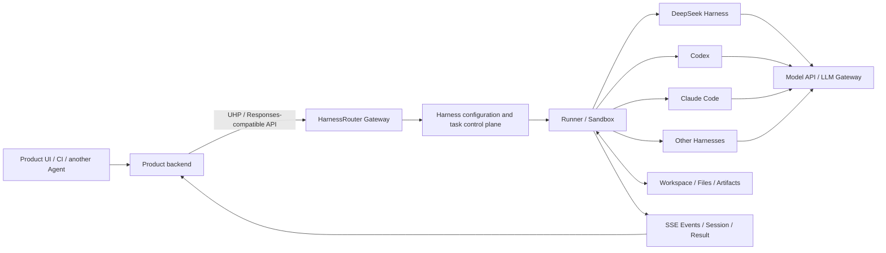

# HarnessRouter Overview: From Model Routing to Agent Harness Infrastructure

> This article discusses [HarnessRouter](https://harnessrouter.ai/) and its Unified Harness Protocol (UHP), not Harness.io's CI/CD product, nor the same-named local account-switching CLI.

## Abstract

HarnessRouter is a unified execution interface for **Agent Harnesses**. It attempts to let product backends run complete Agent Runtimes such as Codex, Claude Code, DeepSeek Harness, Gemini CLI, Hermes, OpenCode, Pi, and Qwen Code through the same API, without having to handle each CLI's processes, sessions, streaming events, files, cancellation, failure recovery, and sandbox separately.

It is not an ordinary LLM API relay:

- An LLM Gateway handles a single model call, i.e., "messages in, tokens out";
- HarnessRouter handles a task that may last minutes or longer, i.e., "task in, events/files/artifacts out";
- Model routing happens below the Agent; Harness routing happens at the Agent Runtime layer;
- The two can be stacked; they are not replacements for each other.

As of 2026-09-13, HarnessRouter offers a managed Cloud and an Apache-2.0 Community Edition. The official website lists 41 Harnesses reviewed from documentation, of which 10 are marked as runnable; the DeepSeek Harness run ID is `dsh`. Its unified protocol UHP is currently at version `2026-09-12`, still explicitly marked as a Draft Standard.

My assessment: **this direction has value, and the product is already usable in trial form, but the protocol, ecosystem, and product are all very new.** If you only need to change the model endpoint for a local DSH, there is no need to add this layer; if you need to use multiple Coding Agents as product backends, run isolated tasks in batch, or systematically compare "Harness × Model" combinations, it genuinely solves the problem.

## 1. First, Distinguish Several Similar Names

| Name | Routing Target | Primary Use |
| --- | --- | --- |
| [HarnessRouter](https://harnessrouter.ai/) | Complete Agent Harness and task lifecycle | Connect multiple Coding Agents behind the same product API |
| [Unified Harness Protocol](https://unifiedharnessprotocol.org/) | Protocol between Client, Server, and Harness | Standardize Harness discovery, tasks, events, sessions, files, cancellation, and errors |
| [Agent Router](https://theagentrouter.ai/docs/) | Model and MCP traffic | Authentication, protocol conversion, quotas, load balancing, and failover; formerly Envoy AI Gateway |
| [LLM API relay](../inference/llm-api-relay-gateway-overview.md) | Model requests | Unify OpenAI/Anthropic model APIs, keys, billing, and routing |
| [joshuaboats/harness-router](https://github.com/joshuaboys/harness-router) | Local CLI accounts/Profiles | Rust command-line tool `hr` for switching Claude Code, Codex, and other accounts; no proxy, server, or task API |
| DSH Model Router plugin | Models/sub-agents within DSH | Switch models within the same DeepSeek Harness by role, difficulty, or failure state |

The last category is especially easy to confuse. DSH's Model Router plugin decides "which model to use for this turn" or "which model a sub-agent uses"; HarnessRouter decides "which complete Harness executes this task for the product" and unifies its surrounding lifecycle.

## 2. Why a Harness Layer Is Needed

A model itself only generates tokens. An Agent that can actually modify code, analyze files, or deliver artifacts typically also needs:

- A loop of planning, calling tools, observing results, and continuing reasoning;
- System prompts, context trimming, compaction, and persistent sessions;
- Shell, Git, filesystem, browser, MCP, and Skills;
- Permission confirmation, network and file boundaries, timeouts, and budgets;
- Workspaces, sandboxes, process management, and interruption recovery;
- Streaming process events, final text, files, and previewable artifacts.

The combination of these capabilities is what constitutes a Harness. Even when Codex, Claude Code, and DeepSeek Harness call the same model, they differ in prompt construction, tool definitions, Agent Loop, context management, and failure handling, so results, speed, and token consumption can all differ.

If a product needs to support `N` Harnesses, and each Harness requires separate adaptation of `M` lifecycle capabilities, the engineering effort approaches `N × M`. HarnessRouter's core claim is to converge this set of adaptations into a stable product interface.

## 3. Overall Architecture



A task roughly goes through the following process:

1. The product backend selects a configured Harness and submits the task along with the files allowed for access.
2. The Gateway creates a Response/Session, validating identity, scope, idempotency keys, and parameters.
3. The Runner prepares the workspace and execution environment, then starts the target Harness.
4. The Harness itself runs the Agent Loop, calls models, reads and writes files, and executes tools.
5. HarnessRouter converts each Harness's native output into unified SSE events.
6. When the task completes, the product receives status, text, files, Artifacts, and a resumable Session ID.
7. Subsequent requests continue the same session via `previous_response_id`, or explicitly cancel still-running tasks.

The most critical boundary here is: HarnessRouter does **not** reimplement each Harness's Agent Loop; instead, it drives the real Harness through Adapters and then normalizes the differences.

## 4. UHP: The Moat It Really Wants to Build

[Unified Harness Protocol](https://unifiedharnessprotocol.org/) is the open HTTP protocol proposed by HarnessRouter. It defines three roles:

- **Client**: the product backend, CLI, CI, or another Agent that needs work done;
- **Server**: an implementation that receives tasks, drives Harnesses, and returns unified events;
- **Harness**: a complete Runtime with its own Agent Loop, tools, and session state.

UHP currently covers:

| Scope | Problem Solved |
| --- | --- |
| Discovery and Version | Which UHP version, capabilities, and Harnesses the service supports |
| Harness Configuration | Default models, system prompts, tool restrictions, Skills, MCP, step and time budgets |
| Tasks | How to submit a job and receive a standard Response |
| Streaming | How to express text, tool calls, files, and terminal states via SSE |
| Sessions | How to continue conversations, inspect history, and cancel running work |
| Files and Artifacts | How to upload input files, list and download Agent deliverables |
| Errors and Idempotency | Machine-readable errors, retry semantics, and avoiding duplicate task starts |
| Security | Identity scopes, non-enumerable objects, credentials, and file boundaries |
| Schema and Conformance | OpenAPI 3.1, JSON Schema, and runnable conformance tests |

UHP's task interface deliberately is compatible with a subset of the OpenAI Responses API, then expresses Harness semantics through additional objects such as `metadata.harness_id`, Session, and File. This makes it easier to reuse existing Responses SDKs, SSE Parsers, and UI components.

But "open protocol" needs two qualifiers:

1. It is indeed released under Apache-2.0, including the specification, schemas, reference implementation, and Conformance Suite, and does not force connection to HarnessRouter Cloud.
2. It is currently still a Draft Standard led and maintained by HarnessRouter in its own repository; governance is maintainer-led; whether the ecosystem will produce multiple truly independent and interoperable implementations still needs time to verify.

So, UHP can currently be evaluated as a well-designed open contract, but it cannot yet be assumed to be a mature industry standard like HTTP, OCI, or the Kubernetes API.

## 5. Does "Router" Actually Auto-Route Today

The name easily suggests it automatically analyzes tasks and picks the best among Codex, Claude Code, and DSH. At least from the current public API, the core path remains:

- First create or select a Configured Harness;
- The request specifies it via `metadata.harness_id`;
- `model` is likewise specified by configuration or request;
- The product can maintain its own `feature_key → harness_id` mapping on its server side;
- Compare different combinations via Trace and its own evaluations, then update the mapping or implement policy-based routing.

In other words, HarnessRouter already provides a "routable unified data plane" and the control plane needed for comparison, but **automatic decision policies are still primarily defined by the upper-layer product**. This is not a flaw; on the contrary, it avoids a black-box router switching Harnesses on its own without understanding business acceptance criteria. It just means that when selecting, "unified selection interface" should not be misread as "out-of-the-box intelligent routing algorithm."

## 6. Current Supported Scope

As of this article's date, the official Catalog marks the following 10 Harnesses as Available:

| Harness | ID | Brief Positioning |
| --- | --- | --- |
| Claude Code | `claude-code` | Anthropic Coding Agent |
| Cline | `cline` | IDE-type open-source Coding Agent |
| Codex | `codex` | OpenAI Coding Agent |
| DeepSeek Harness | `dsh` | DeepSeek extensible Agent Harness, currently still Developer Preview |
| Gemini CLI | `gemini` | Google open-source terminal Agent |
| Hermes Agent | `hermes` | General-purpose Agent with memory, tools, browser, and sub-agents |
| Oh My Pi | `omp` | Multi-model terminal Coding Agent |
| OpenCode | `opencode` | Open-source, multi-vendor Coding Agent |
| Pi | `pi` | Smaller, controllable terminal Coding Agent |
| Qwen Code | `qwen` | Qwen Coding Agent |

"Reviewed" in the Catalog only means the official team has compiled capability profiles based on public materials; it does not mean the Harness can already run through HarnessRouter. Even when marked Available, functional equivalence cannot be assumed: MCP, Skill, browser, GUI, approval, sub-agent, and Artifact support are still constrained by each Harness itself.

## 7. Cloud vs. Community Edition

| Dimension | HarnessRouter Cloud | Community Edition |
| --- | --- | --- |
| Deployment | Officially hosted | Self-hosted single Docker deployment |
| Core components | Managed Gateway, Runner, control plane | Console, Gateway, Runner combined in one container |
| Execution isolation | Officially described as serverless, isolated sandbox | Each Session gets a workspace and OS user, not one container per Session |
| Provider Key | Platform keys or BYOK available | Provide your own keys |
| State and files | Managed Workspace | `/data` volume stores database, Secrets, Sessions, files, and workspaces |
| Operations | Platform handles scaling, upgrades, and recovery | User handles backups, upgrades, TLS, resources, and failure handling |
| Protocol | UHP | Same UHP API Surface |
| License | Commercial terms of service | Core Community Edition is Apache-2.0; each Harness CLI remains subject to its own license |

The official quick start for Community Edition only needs one Docker container, but this does not mean it is naturally suitable for multi-tenant production:

- The official requirement is not to grant the container additional `--user`, because the entry program and Runner need to manage each Session's user as root inside the container;
- Root inside the container is not the same as a privileged container on the host, but it is not naturally compatible with strict non-root Pod Security Policies;
- UID 0 inside a container under Rootless Podman maps to a regular host user and can theoretically still work, but user creation, UID mapping, `chown`, file volumes, and sandbox capabilities must be tested in practice;
- Default account passwords must be changed immediately; external service also requires TLS, network boundaries, backups, and monitoring;
- Community Edition's "per-user and workspace" separation should not be marketed as Cloud's "per-task independent Sandbox."

## 8. How It Combines with an LLM Gateway

It is recommended to draw the two layers as follows:

```text
你的产品 / CI / 自动化平台
            │
            ▼
HarnessRouter / UHP
  Harness 选择、任务、会话、事件、文件、取消、Artifact
            │
            ▼
Codex / Claude Code / DeepSeek Harness / ...
  Agent Loop、上下文、工具、Skill、MCP、权限
            │
            ▼
LiteLLM / New API / Agent Router / 企业模型网关（可选）
  模型协议、Key、配额、供应商路由、熔断、成本治理
            │
            ▼
云模型 API 或自建 vLLM / SGLang
```

| Comparison Item | LLM Gateway | HarnessRouter |
| --- | --- | --- |
| Minimum work unit | One Completion/Response | One complete Agent Task |
| Has Agent Loop | No | Does not rewrite, but is responsible for launching and driving the external Harness |
| State | Mostly request-level, may attach logs | Session, Response, events, workspace, and files |
| Output | Token, Tool Call, Usage | Process events, text, files, Artifacts, terminal state |
| Main routing dimensions | Model, provider, region, instance | Harness, Harness configuration, model |
| Failure handling | Timeout, 429, 5xx, fallback before first token | Task cancellation, failure terminal state, Session continuation, Artifact recovery |
| Typical users | Model platform teams | Application teams embedding Agent capabilities into products |

If the requirement is simply to have DSH use an internal model such as `enterprise-qwen-review`, you should configure DSH directly or place an LLM Gateway underneath. Introducing HarnessRouter solely for this purpose adds an extra Session, workspace, and execution control plane without delivering the value actually needed.

## 9. Practical Significance for DeepSeek Harness

HarnessRouter already provides DeepSeek Harness as an `dsh` Adapter, running a fixed version. The value it delivers falls into three categories:

1. **Productization entry point**: Instead of exposing the DSH WebUI directly to end users, your own product backend submits tasks and receives events and files.
2. **Horizontal comparison**: Using identical inputs and acceptors, compare `DSH × 模型 A`, `Codex × 模型 A`, and `DSH × 模型 B`.
3. **Migration flexibility**: Upper-layer business logic is not directly bound to any single Harness's CLI output and session format.

It does not automatically solve DSH's own problems:

- Insufficient context window, summarization failures, or inadequate model capability are still determined jointly by DSH, the model, and task decomposition;
- DSH-specific capabilities such as the Cordis plugin, WebUI, and browser desktop may not map completely to UHP;
- DSH is still in Developer Preview; when upstream interfaces change rapidly, the HarnessRouter Adapter requires continuous follow-up;
- If a human needs to approve every tool call in real time in the DSH WebUI, you must first verify whether that interaction can be correctly expressed through the remote task API.

Therefore, it is better suited for **headless, acceptable, file-or-structured-result-deliverable** tasks, not as a transparent remote proxy for the DSH desktop experience.

## 10. How to Read Costs and Official Benchmarks

### 10.1 Cloud Current Billing Structure

As of 2026-09-13, the official page lists monthly plans of Free, Developer $20, Production $200, Scale $1,000, and Enterprise custom. Plan fees can be applied against that month's Usage; there are also three primary metering dimensions:

- **Model Usage**: billed at Catalog list prices when using platform Keys; billed directly by the model provider under BYOK;
- **Agent Work**: active time of Agent-executed steps and tools; time waiting for models, users, or queues is not counted;
- **Agent Memory (Beta)**: GB-hour of work history, Trajectory, and Artifacts;
- Top-up currently carries a 5.5% processing fee; BYOK model usage exceeding $25,000 per month incurs an additional 5% Routing Fee;
- Trace is still Beta; retention policy and pricing vary by Plan.

These are time-sensitive details; re-check the [official pricing page](https://harnessrouter.ai/pricing) before procurement, and do not write these figures into a long-term budget model.

### 10.2 The 475x Cost Difference Is Not a Universal Conclusion

In a Care Prep test published by HarnessRouter, single-task costs across 8 Harness × Model configurations ranged from 0.47 to 223 credits, a difference of roughly 475x; end-to-end time ranged from 1 minute 25 seconds to 4 minutes 36 seconds. This figure is striking, but note:

- This is a vendor benchmark published by HarnessRouter itself, not an independent third-party evaluation;
- There is only one controlled synthetic data task, with 5 runs retained per configuration;
- The 475x difference comes primarily from model tier price differences, not from the Harness itself;
- With the same model fixed, the cost difference attributable to the Harness in this test was 1.5–2.1x;
- The cheapest, fastest, and best-quality configurations are not necessarily the same one.

The genuinely useful conclusion is not that "a particular Harness is always best," but that a Harness's Agent Loop significantly affects total cost and latency, and you should run paired evaluations using your own tasks and your own success criteria.

## 11. Advantages

- **Reduces integration duplication**: unified launch, events, Session, cancellation, files, and error models.
- **Preserves Harness choice**: product interfaces are not directly bound to a specific CLI's private output format.
- **More reasonable evaluation unit**: compares complete Harness × Model combinations rather than model leaderboards alone.
- **Suitable for asynchronous product experiences**: long tasks can stream progress and return files and Artifacts.
- **Self-hosted path available**: Community Edition, UHP, Schema, and Conformance Suite are all public.
- **API consistency from local to Cloud**: you can validate in a self-hosted environment first, then decide whether to go managed.

## 12. Limitations and Risks

### 12.1 Abstraction Cannot Fully Flatten Harness Differences

Some Harnesses support native Plan, approval, browser, sub-Agent, or complex Skills; others do not. A unified protocol can only express common semantics and explicit Capabilities; it cannot guarantee behavioral equivalence when the same task switches Harnesses. The more you depend on a particular Harness's exclusive capabilities, the lower the migration benefit.

### 12.2 State Portability Does Not Equal State Interchangeability

UHP can unify Session creation, continuation, and querying, but Codex's internal context cannot be directly transplanted into Claude Code or DSH native sessions. In practice, the more reliable approach is to restart on a new Harness with a business summary, input files, and acceptance criteria, rather than promising lossless hot migration across Harnesses.

### 12.3 Security Surface Is Much Larger Than a Model Proxy

HarnessRunner sees not only Prompts but also source code, uploaded files, workspaces, Shell, Git, MCP, external networks, generated artifacts, and Provider Keys. The impact of a single privilege escalation could be executing commands or exfiltrating files, not just leaking one conversation.

### 12.4 Both Cloud and Self-Hosted Have Responsibility Boundaries

- Cloud: review DPA, Subprocessors, processing regions, data retention, deletion, and incident response;
- Self-hosted: reduces third-party data plane, but users bear OS, container, TLS, Secret, backup, upgrade, and Harness supply chain risks;
- Harness CLIs are installed on first launch and are subject to their respective licenses and update mechanisms;
- The official Security Policy also explicitly requires treating instances as "systems capable of executing code with the granted credentials."

### 12.5 Protocol and Ecosystem Are Still Early

UHP updates quickly; a `2026-09-12` version was released the day before this article was written. Open Schema and Conformance Tests are a good foundation, but version evolution, compatibility windows, the number of third-party implementations, long-term governance, and Adapter maintenance quality still need observation.

## 13. What Must Be Verified Before Launch

### Functional

- Whether the Harnesses, models, Skills, MCPs, and tools actually needed are all supported;
- Whether SSE continuously flushes, and whether reconnection after disconnection re-executes tasks;
- Whether `Idempotency-Key` truly prevents duplicate launches and duplicate billing;
- Whether Session Continue, Cancel, timeout, and process residue behave as expected;
- Whether text, binary files, Chinese paths, large files, and Artifact downloads are reliable;
- Whether Tool Approval and human intervention can be correctly expressed in the product UI.

### Isolation and Security

- Whether different tenants cannot enumerate or download each other's Sessions/Files;
- Whether UID, directory permissions, temporary files, and processes are isolated between workspaces;
- Which environment variables, Provider Keys, Git Credentials, and SSH Keys the Agent can access;
- Which outbound networks are denied by default, and whether MCP Servers are individually authorized;
- Whether high-risk Shell, deletion, publishing, and external write operations have approval or policy gates;
- Whether retention, export, and deletion of logs, Traces, Prompts, files, and Artifacts meet requirements;
- Whether Community Edition backup/restore includes the database, Secrets, workspaces, and encryption keys.

### Evaluation and Cost

- Use real task samples, not just `hello world`;
- Fix inputs, Skills, permissions, network, and acceptors; vary only Harness/Model;
- Record at minimum: success rate, number of manual corrections, wall-clock time, active work time, model tokens, total cost, tool failures, and recovery success rate;
- Repeat non-deterministic tasks multiple times and report distributions rather than a single best result;
- Count "task completion" and "artifact correctness" separately.

## 14. Recommendations for the Current DSH Project

### Cases Where Integration Is Not Needed for Now

- Primarily personal interaction through the DSH WebUI;
- Only one workspace, one Harness, and a small number of models;
- Current pain points are model context, browser plugins, or container deployment;
- No product backend of your own that needs to call the Agent Task API.

In such cases, continuing to maintain the DSH container in this repository, and adding LiteLLM/New API at the model layer as needed, is the simpler architecture.

### Cases Worth a POC

- Planning to provide Agent capabilities in `aik8s.run` or another product rather than exposing the DSH WebUI directly;
- Want to compare DSH, Codex, Claude Code, Gemini CLI, and Qwen Code using the same tasks;
- Need to run large numbers of isolated, cancellable, traceable Headless Tasks concurrently;
- Deliverables are code changes, documents, tables, or other automatically acceptable Artifacts;
- Want the option to replace Harnesses in the future without rewriting the entire backend.

Suggested approach: run a limited POC first:

1. Prepare 10–20 real, desensitized tasks with defined acceptors.
2. Choose 2 Harnesses and 2 models, forming 4 configuration groups.
3. Repeat each group at least 3–5 times, recording full success rate, p50/p95 latency, and total cost.
4. Deliberately inject failures such as model 429s, Runner restarts, SSE disconnections, task cancellations, and large files.
5. First validate the API and data boundaries on Community Edition, then compare Cloud's operational benefits.
6. Only put it into the production path when the multi-Harness benefit outweighs the added control-plane complexity.

## 15. Conclusion

HarnessRouter addresses a real new infrastructure layer: when complete Agents such as Codex, Claude Code, and DeepSeek Harness are embedded into products, teams no longer need to unify just the model API, but also tasks, sessions, tools, workspaces, streaming events, files, cancellation, and failure semantics.

The most fitting analogy is not "another OpenRouter," but a **unified API and execution control plane for the Agent Harness layer**. UHP attempts to extract this interface from a single commercial product.

The appropriate attitude at this stage is:

- Acknowledge the problem it solves;
- Use Community Edition and UHP for small-scale validation;
- Stay clear-eyed about the Router's degree of automation and the isolation differences between Cloud and CE;
- Validate Harness × Model with real tasks rather than adopting vendor leaderboards;
- Do not add a layer gratuitously for a single DSH local deployment.

## References

- [HarnessRouter Official Website](https://harnessrouter.ai/)
- [HarnessRouter Community Edition](https://github.com/HarnessRouter/harnessrouter)
- [HarnessRouter Harness Catalog](https://harnessrouter.ai/harnesses)
- [DeepSeek Harness on HarnessRouter](https://harnessrouter.ai/harnesses/deepseek-harness)
- [HarnessRouter Integration Docs](https://harnessrouter.ai/docs)
- [HarnessRouter Cloud Pricing](https://harnessrouter.ai/pricing)
- [HarnessRouter Benchmark 01](https://harnessrouter.ai/benchmarks)
- [Unified Harness Protocol](https://unifiedharnessprotocol.org/)
- [UHP Governance](https://github.com/HarnessRouter/harnessrouter/blob/main/protocol/GOVERNANCE.md)
- [HarnessRouter Security Policy](https://github.com/HarnessRouter/harnessrouter/blob/main/SECURITY.md)
- [DeepSeek Harness Official Repository](https://github.com/deepseek-ai/deepseek-harness)
- [Same-named local CLI: joshuaboys/harness-router](https://github.com/joshuaboys/harness-router)
- [Overview of LLM API Relayers and LLM Gateway](../inference/llm-api-relay-gateway-overview.md)
