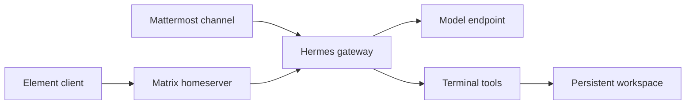

# Hermes Agent on Kubernetes: Mattermost and Matrix in Practice

When an Agent can run commands and produce files, a chat application becomes more than a place to ask questions: a team can assign work in a channel, observe tool calls, and get a report back. We deployed [Hermes Agent](https://github.com/NousResearch/hermes-agent) on a Kubernetes test cluster and connected Mattermost and Matrix/Element, completing several real-model checks.

Both chat entry points connect to **the same Hermes instance and workspace**; they are not isolated Agents. The experiments use synthetic data and dedicated private test rooms. Cluster names, internal addresses, credentials, and personal information are omitted. The screenshots are real desktop UI captures, cropped to remove browser chrome and unrelated areas.

## 1. Hermes and two messaging models

Hermes Agent is an open-source Agent runtime from Nous Research that offers model integration, tools, sessions, memory, and messaging gateways. It can run tasks in a terminal or exchange messages through chat platforms. Mattermost is a team chat application; Matrix is a messaging protocol, and Element is one of its clients. [Hermes repository](https://github.com/NousResearch/hermes-agent) · [Mattermost integration](https://hermes-agent.nousresearch.com/docs/user-guide/messaging/mattermost) · [Matrix integration](https://hermes-agent.nousresearch.com/docs/user-guide/messaging/matrix)



| Item | Test environment |
| --- | --- |
| Hermes | Official `v0.23.1` image, single replica |
| Kubernetes | Test cluster v1.30.4; dedicated namespace |
| Storage | One 5 GiB persistent volume for configuration, sessions, and test artifacts |
| Model | DeepSeek-V4.1-Flash service reached through a dedicated bridge with a Chat Completions-compatible API |
| Messaging | Existing Mattermost, Matrix homeserver, and Element Web; a dedicated test bot and private channel/room for each |
| Execution | Terminal tools run inside the Hermes container; no host Docker socket or Kubernetes ServiceAccount token is mounted |
| Access | Local port forwarding and login authentication; no public ingress |

The bridge requires the office computer to remain online; its address and credentials are omitted, and it is not presented as a production model gateway. Running inside a container does not mean each task gets a separate sandbox; multi-tenant isolation was not tested.

## 2. Deployment and integration

1. Create a dedicated namespace, persistent volume, and credential Secrets. Following the [official container guide](https://hermes-agent.nousresearch.com/docs/user-guide/docker), mount the data directory at `/opt/data` and deploy the gateway and official Web UI. Retain the image's default entry point for initialization to avoid changing container file ownership.
2. Select the `custom` model provider in Hermes configuration and set the OpenAI-compatible endpoint and model name; supply credentials through environment variables or Secrets. Verify normal responses and tool calls against the model separately, then verify the end-to-end Hermes path. [Custom model configuration](https://hermes-agent.nousresearch.com/docs/integrations/providers)
3. Create a test bot and private channel in Mattermost and add the bot. Configure `MATTERMOST_URL`, `MATTERMOST_TOKEN`, `MATTERMOST_ALLOWED_USERS`, and the channel allowlist. Channel messages trigger the bot with `@`; use a dedicated Bot Token rather than another Agent's identity.
4. Create a test identity and private room on the Matrix homeserver and invite Hermes. Configure `MATRIX_HOMESERVER`, `MATRIX_ACCESS_TOKEN`, `MATRIX_USER_ID`, `MATRIX_ALLOWED_USERS`, and `MATRIX_ALLOWED_ROOMS`. This room does not require `@` on every message, and end-to-end encryption was not enabled.
5. After restarting the gateway, submit test tasks from both clients and check bot replies and actual artifacts in the container. Create rooms, accounts, and tokens for your own environment; do not copy these test credentials or real endpoints into public configuration.

For example, adapt the following model configuration fragment with your own endpoint, model name, and credential variable:

```yaml
model:
  provider: custom
  default: your-model-name
  base_url: http://model-service:8000/v1
  key_env: HERMES_MODEL_API_KEY
  api_mode: chat_completions
```

For local verification, the following example forwards an existing service; adjust the service name and ports to match your deployment:

```bash
kubectl -n hermes-lab port-forward svc/hermes 19919:9119 19920:9120 --address 127.0.0.1
```

Limit the Mattermost token to the test bot and channel, and restrict both users and rooms for Matrix. Store the actual credentials in separate Secrets and inject them as Pod environment variables. After a Pod restart, re-establish interrupted port forwards and verify that the gateway has actually reconnected instead of checking only that the Pod is Running.

## 3. Experiment 1: conversation through both platforms

We submitted the same arithmetic question, 17 multiplied by 19, in both private rooms. Each returned `323`. This verifies each message's route through its receiving adapter, Hermes, the model, and the response path; it is not a model-capability or messaging-throughput benchmark. When first connected, both bots displayed a notice about an unset default notification channel, followed by the actual answer. The notice alone is not counted as success.

## 4. Experiment 2: terminal tools from chat

We asked each entry point to write and read back a separate test file. Mattermost returned `mattermost-confirmed` and Matrix returned `matrix-confirmed`; we then independently read both files inside the Hermes container and confirmed the contents. The screenshots show the bot reporting terminal execution and the results.


*Figure 1: In the private Mattermost channel, the user triggers Hermes with @. The screen shows file read/write and the later statistics report.*


*Figure 2: Element shows requests, terminal calls, and results in the Matrix room. Paths in the screenshot refer to this container's synthetic test workspace.*

## 5. Experiment 3: generating a data analysis report

In each room, we asked Hermes to use Python to process the synthetic data `A:5 B:3 C:2`, calculate the total and percentages, write a Chinese Markdown report, and read it back. Both performed tool calls and replied with total `10` and shares of `50.0%`, `30.0%`, and `20.0%`. We independently read the two reports inside the container and confirmed the results.

| Check | Mattermost | Matrix + Element |
| --- | --- | --- |
| Arithmetic question | Returned `323` | Returned `323` |
| Terminal file write | Actual file content matched the reply | Actual file content matched the reply |
| Statistics and report | Report persisted; percentages correct | Report persisted; percentages correct |
| Two-turn context in the same room | Correctly answered `BLUE-ORBIT` on the second turn | Correctly answered `BLUE-ORBIT` on the second turn |
| Chat interaction | Private channel, triggered by @ | Private room, @ not required in this test |

For the context check, each room was separately asked to remember the project code `BLUE-ORBIT`, then asked for it in a follow-up. Both answered correctly. This verifies one continuous conversation in each room, not cross-platform context sharing or resumption after restart.

These are a small number of individual functional checks. They do not establish reliability, concurrent performance, long-task recovery, or the general accuracy of generated reports. All report data is synthetic, not cluster metrics.

## 6. Choosing between the two

For a team already using Mattermost, assigning work with @ in an existing private channel can fit naturally into its workflow. To use Matrix's open protocol and different clients, evaluate Matrix + Element. The first emphasizes the application and team channels; the second separates the homeserver from the client. Both require practical checks of permissions, session behavior, and response delivery rather than a UI-only comparison.

This test covered two entry points for one Hermes instance. It did not validate collaboration among multiple bots, workspace isolation between tenants, Matrix federation, or end-to-end encryption. Context, shared memory, and concurrent behavior across chat channels also need separate testing against the specific version.

## 7. Security and follow-up experiments

A bot that can invoke terminal tools gives authorized users more than a chat interface. Use dedicated identities, limit users and rooms, avoid sensitive host mounts, and constrain network and external actions as appropriate. A container with an ordinary PVC does not provide strong isolation for untrusted code. Production evaluation needs independent execution sandboxes, auditing, credential isolation, and approvals.

Next steps include testing longer room context, message retries and deduplication, collaboration between distinct Agent identities, and recovery after model or messaging interruptions. None of these are covered by this pass.
