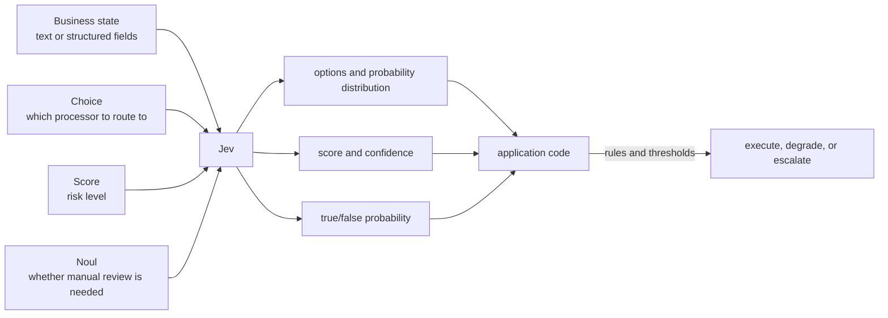
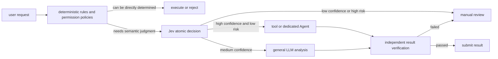
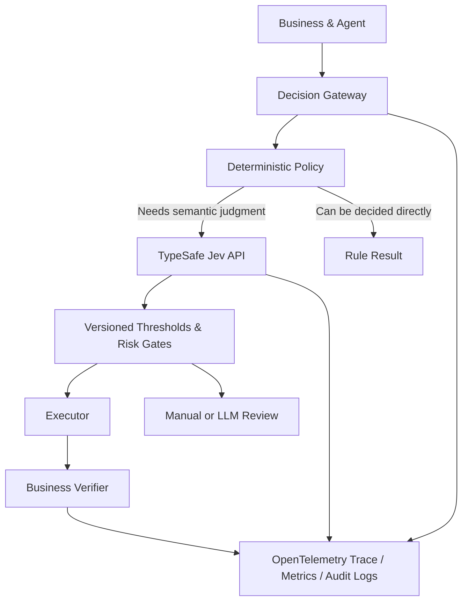

# Jev Technical Review: A System One Decision Model That Doesn't Generate Text

On September 15, 2026, TypeSafe AI released Jev and called it the first **System One Model**. It doesn't write articles, generate code, or chat with users. Applications provide a piece of state and a set of typed questions, and Jev only returns options, scores, true/false probabilities, and confidence levels, letting programs branch directly on that basis.

This positioning explains why it suddenly attracted attention: many online systems call large language models (LLMs) not to generate content, but simply to answer "which Agent should this go to," "how risky is this operation," or "does the result need human review." General LLMs first generate tokens, then constrain the text into JSON; Jev makes **decision-making** a native interface.

This is also a product that was just released and hasn't undergone long-term independent verification. As of September 21, 2026, Jev remains a closed-source hosted API; the weights, parameter count, model architecture, training data, and the Reinforcement Learning for Calibrated Decisions (RLCD) paper have not been made public. This article therefore separates publicly confirmed facts, vendor evaluations, and community observations.

Subsequent versions, independent evaluations, and application progress are continuously recorded in [Jev Weekly Review](jev-weekly-review.md), with time and comparison baselines preserved on a weekly basis.

## One-Page Conclusion

1. **Jev is more like a "probabilistic decision engine with general language understanding" than a small chat model.** It is best suited for routing, classification, scoring, validation, and risk triage; it is not responsible for explanation, creative work, or multi-step reasoning.
2. **Type safety solves the output space, not factual correctness.** Jev won't return options outside the defined set, and it won't output corrupted JSON; it can still select the wrong option with very high probability.
3. **Whether probabilities are trustworthy must be validated with your own data.** You can't just see `confidence=0.9` and interpret it as "nine out of ten times correct." Calibration needs to be checked using Brier Score, negative log-likelihood, reliability diagrams, and bucketed accuracy.
4. **The most appropriate production position is between rule systems and generative LLMs.** Deterministic rules handle computable conditions first, Jev handles narrow and clear semantic judgments, and low-confidence or high-risk requests are escalated to humans or stronger models.
5. **It is not a self-hosted model.** TypeSafe has published Python/JavaScript SDKs, an Agent Skill, and an adapter that simulates the same interface with an ordinary LLM, but this does not equal making Jev's weights public.
6. **Chinese-language usability still needs separate evaluation.** The official documentation states that English is the primary training language; CJK text such as Chinese, Japanese, and Korean is supported, but performance is not equivalent to English.

## 1. What Jev Actually Provides

The [TypeSafe official documentation](https://docs.typesafe.ai/introduction) calls the input `state` and constrains outputs to three types of questions:

| Primitive | Suitable questions | Primary return values | Example |
| --- | --- | --- | --- |
| `Choice` | Select one option from a predefined set | Selected item, per-item probabilities, confidence | Should this ticket be routed to billing, technical support, or sales |
| `Score` | Score according to an ordered rubric | Weighted score, per-level probabilities, confidence | Is the user's dissatisfaction level low, medium, or high |
| `Noul` | Judge the likelihood that a proposition is true | A 0-to-1 `noul` value | Does this content contain an urgent request |

`Noul` is the name TypeSafe uses; you can think of it as a "yes/no" judgment with probabilities. It directly gives the probability of "yes," so there is no separate `confidence` field. `Choice` and `Score` return full probability distributions and compute a confidence level from how concentrated the distribution is.

A single request can carry multiple questions. The official documentation states that these questions are evaluated independently and in parallel against the same state. Therefore, one request can simultaneously judge intent, risk, and whether manual review is needed, without requiring later questions to depend on the natural language output of earlier ones.



As of this review, the [official model page](https://docs.typesafe.ai/models) lists the stable version as `jev-1.13.0`, with `jev-latest` pointing to that version. Public specifications:

| Item | Jev 1.13 public specifications |
| --- | --- |
| API | `POST https://api.typesafe.ai/v1/systemone` |
| Input | Plain text; can be organized as strings, JSON objects, or text arrays |
| Context | 64K tokens per request; `state` plus the longest question must not exceed 32K |
| Pricing | $0.042 per million input tokens; output is free |
| Published limits | 250,000 tokens/s, 1,200 requests/min; the official documentation states these are dynamically adjusted |
| Model version | `jev-1.13.0`; production is advised to pin a version rather than rely on a floating alias long-term |
| Multimodal | Does not accept images, audio, or video; they must first be converted to text or structured fields |
| Deployment form | TypeSafe hosted API; no public weights or self-hosted image |

Pricing, limits, and aliases may change. Production systems should record the actual model version from API responses and include billing information in periodic reviews.

## 2. What a Single Call Looks Like

The HTTP interface in the [official Quick Start](https://docs.typesafe.ai/introduction/quickstart) is very straightforward. Below, it's adapted into a risk gate before an Agent executes:

```bash
curl -X POST https://api.typesafe.ai/v1/systemone \
  -H "Authorization: Bearer $TYPESAFE_API_KEY" \
  -H "Content-Type: application/json" \
  -d @- <<'EOF'
{
  "model": "jev-1.13.0",
  "state": {
    "user_request": "把生产命名空间中所有失败的 Job 清理掉",
    "planned_tool": "kubectl delete job --field-selector status.successful=0",
    "environment": "production"
  },
  "questions": {
    "action_type": {
      "type": "choice",
      "instructions": "判断计划动作的类别",
      "criteria": {
        "read_only": "不会改变外部状态",
        "reversible_write": "会改变状态但可可靠恢复",
        "destructive": "删除、覆盖或造成难以恢复的状态变化"
      }
    },
    "needs_human": {
      "type": "noul",
      "instructions": "该动作是否应在执行前由人类明确批准？"
    }
  }
}
EOF
```

The real security boundary is still held by code. For example, deleting production resources is a hard rule and cannot bypass approval just because the model gives a low-risk score:

```python
if deterministic_policy.requires_approval(action):
    return request_human_approval(action)

decision = jev.evaluate(state, questions)

if decision.needs_human >= calibrated_threshold:
    return request_human_approval(action)
return execute_with_policy(action)
```

This structure has two key points: the model does not directly hold side-effect tools; and thresholds are not copied from examples but derived from the enterprise's own validation set and risk budget.

## 3. How It Relates to Existing Solutions

Jev is most easily misunderstood as "a classifier wrapped in a new name" or "a new model that completely replaces LLMs." Both statements are too absolute.

| Solution | Strengths | Main limitations | Where it fits |
| --- | --- | --- | --- |
| Deterministic rules | Fast, cheap, auditable, stable results | Difficult to handle fuzzy semantics; rule count grows | Amounts, dates, permissions, quotas, strong compliance conditions |
| Traditional supervised classifiers | Low latency, self-hostable, low cost on fixed tasks | Each domain needs labeling, training, and maintenance; retraining needed when tasks change | High-traffic classification tasks with long-term stable labels |
| Embedding + nearest neighbor/linear models | Simple to deploy, easy to explain similarity | Limited capability for complex context and combinatorial conditions | Semantic routing, deduplication, coarse filtering |
| General LLM + JSON Schema | Can explain, generate, do multi-step reasoning; mature ecosystem | Higher latency and cost; still needs format handling, retries, and non-comparable probabilities | Complex analysis, planning, generation, and a small number of high-value judgments |
| Jev | Zero-shot natural language judgment, fixed output space, probability distributions, low latency | Closed-source API, cannot generate, weak at math and multi-step reasoning, little independent evidence | High-frequency routing, scoring, validation, confidence-based triage |

If task labels are stable, samples are abundant, and call volume is very high, a well-trained small classifier may be cheaper and more controllable. Jev's value lies in reducing the friction of "training a new model every time a new judgment appears": business people can first define options and rubrics in natural language, then use production data to decide whether it's worth distilling into a dedicated model.

## 4. Why the Agent Community Is Paying Attention First

Agent loops are full of short judgments: which tool to call next, whether the result is complete, whether a failure can be retried, whether an expensive model is needed, whether a permission boundary has been crossed. If all these judgments are delegated to the main model, it lengthens per-turn latency and consumes a large number of output tokens.



Recent discussions focus mainly on the following directions:

- **Agent, tool, and model routing.** Selecting sub-agents, tools, or models at different price points based on task semantics and complexity is the easiest use case to integrate and the easiest to quantify benefits.
- **A second pair of eyes before execution.** Before tool invocation, judge whether the intent matches, whether parameters are suspicious, and whether approval is needed. It's suitable for adding a signal, not for replacing existing authentication and policy engines.
- **Generated result validation.** Let the LLM generate first, then have Jev judge completeness, risk, and whether rework is needed against multiple atomic rubrics.
- **Real-time interaction.** Games, browsers, robots, and home automation need high-frequency short decisions; the community is interested in low latency. But Jev only accepts text; vision and sensor data still need other models to encode first.
- **Is it just a zero-shot classifier.** The technical community recognizes the product value of "arbitrary natural language rubric + unified interface," while questioning whether System One constitutes a new model category and whether public information is sufficient to verify architectural and training innovations.
- **The boundary of "can't hallucinate."** A fixed output space does eliminate format drift and undefined options, but it does not eliminate misclassification. This wording is currently the most controversial part.
- **Whether probability calibration can be reproduced.** Confidence is the core of the product, but there is currently no large-scale third-party retest covering different languages, domains, distribution drift, and adversarial inputs.
- **Closed-source API and data boundaries.** Open-source SDK does not equal open model. Privacy, data residency, vendor failures, and version drift all need additional design.

### What's Being Discussed on WeChat Public Accounts Recently

When searching the public index of WeChat public accounts with "Jev TypeSafe" on September 21, 2026, the search page returned approximately 808 results. This number includes reposts, approximate titles, and aggregated content, and cannot be understood as 808 independent studies. The homepage sample already reveals three narrative patterns:

| Discussion pattern | Homepage sample | Judgments worth keeping |
| --- | --- | --- |
| Product introduction | "Jev and TypeSafe AI System One Models Research Report" "In-depth interpretation of Jev" | Helps readers understand "doesn't generate, only decides," but performance numbers mostly come from vendor materials |
| Speed and cost spread | "Why 200x faster and 400x cheaper" "The value of the Jev model" | Shows that Agent developers are indeed looking for a cheap decision layer; multiples cannot be reused without specifying task, model, and billing baselines |
| Skepticism and hands-on testing | "Can multi-party verification be trusted" "Jev model hands-on test" | Starting to focus on accuracy, Chinese-language performance, boundary inputs, and whether it's just a classifier — these are questions closer to real deployment |

The most easily overlooked point in WeChat public account spread is **coverage**: when a system only auto-passes high-confidence samples, accuracy usually rises, but the manual review ratio also rises. Production selection cannot just write "95% accuracy"; it must also answer what proportion of traffic this accuracy covers, who handles the remaining traffic, and what the cost of a wrong action is.

[A third-party Chinese small-sample comparison](https://www.jxxy.net/ai/articles/yibie-2101553680889598094/) tested Jev and the open-source Laya on 40 customer service messages, reporting Jev at 31/40 with an average end-to-end latency of 588 ms, and Laya at 23/40 with 7.6 ms, and attempted to use cascading to preserve accuracy while reducing cloud calls. This result is suitable for designing your own experiments but is insufficient to constitute a general ranking: the sample is only 40 items, and category definitions, annotation consistency, hardware, and warm-up conditions can significantly affect results.

[LangChain's Jev-as-a-Judge experiment](https://www.langchain.com/blog/jev-agent-evals-langsmith) offers another way to deploy: each of five fixed Agent trajectories was judged 100 times. In this very narrow binary evaluation, all 500 of Jev's judgments matched human labels, averaging 0.44 seconds and $0.00035 per call, and the variance of continuous scores was also lower than several generative models. The author also explicitly states that the experiment is very early-stage. Five fixed cases are suitable for verifying repeatability but insufficient to prove cross-task accuracy; production evaluation should still expand the sample and error types.

[Vercel's post-launch statistics](https://vercel.com/blog/ai-gateway-jev-model-launch) show that Jev reached nearly 13% of paid teams within 24 hours of being integrated into AI Gateway; [its public leaderboard](https://vercel.com/ai-gateway/leaderboards/models) on September 20 showed Jev's request share and team reach rate rising rapidly. This shows that developers are experimenting heavily, but first-week request counts cannot prove long-term retention, accuracy, or production value. A large number of low-cost short requests will also naturally inflate request share, so it cannot be directly compared with generative models' token share.

## 5. To What Extent Does "Can't Hallucinate" Actually Hold

Suppose the options are only `billing`, `technical`, and `sales`; Jev won't return `legal`, and it won't insert explanatory paragraphs that break the JSON. This guarantee is useful because code no longer needs to handle Markdown fences, missing fields, enum spelling variations, or extraneous natural language.

But the following output is still completely legal:

```json
{
  "choice": "sales",
  "probabilities": {
    "billing": 0.02,
    "technical": 0.03,
    "sales": 0.95
  },
  "confidence": 0.91
}
```

If the original request is clearly a payment failure, this is a **high-confidence misclassification**. It didn't hallucinate at the schema level, but it still made the wrong decision. Production design needs to examine three layers of guarantees separately:

| Layer | Can Jev guarantee it structurally | What still needs verification |
| --- | --- | --- |
| Output types and enum values are legal | Yes | API contract test |
| Probability distribution satisfies interface constraints | Can be validated by the interface | Numeric ranges, sums to 1, missing fields |
| Semantic judgment is correct | No | Labeled sets, error analysis, drift monitoring |
| Confidence matches true accuracy | Cannot be assumed in advance | Calibration curves, Brier Score, ECE |
| Business actions are safe | No | Permissions, policies, approvals, idempotency, and rollback |

## 6. Capability Jaggedness Acknowledged by the Vendor

[Jev 1.13 Jaggedness](https://docs.typesafe.ai/model-jaggedness/jev-1.13) lists limitations that are more important than the launch copy:

| Weak point | Engineering handling |
| --- | --- |
| Takes things literally; struggles to fill in implied intent | Write boundary conditions into `instructions` and `criteria` |
| Counting and exact math are unreliable | Use ordinary code for computation; only delegate semantic judgment to the model |
| Date ordering and time intervals are unreliable | Extract fields first, then compare with a time library |
| Multi-level indirect relationships and double negatives degrade | Reduce jumps; split into atomic questions |
| Large amounts of irrelevant context reduce accuracy | Retrieve and filter first; only send relevant fields |
| Adversarial content and prompt injection | Precisely constrain questions, run red-team tests; the model does not directly hold permissions |
| Instructions and scoring criteria contradict each other | Check the Question Schema before release |
| Multiple probabilities don't automatically satisfy business identities | Ask each decision in only one way; enforce structural constraints in code |
| Cannot generate text | Call a generative model when text is needed |

This list also defines the appropriate division of responsibility: **meaning in language goes to the model; what can be deterministically computed stays in code.**

## 7. Confidence Cannot Be Used Directly as an Automation Switch

A well-calibrated model should satisfy: among all samples where the claimed confidence is approximately 0.8, roughly 80% should be correct over the long run. This is a statistical property, not a factual guarantee for any single request.

Before going live, at minimum you should compute:

- Per-class Precision, Recall, F1, and the confusion matrix;
- Brier Score and Negative Log-Likelihood (NLL);
- Expected Calibration Error (ECE) and reliability diagrams;
- Coverage, accuracy, manual review effort, and business loss at different confidence thresholds;
- Stratified results for Chinese, English, short text, long text, and different business domains;
- Out-of-Distribution (OOD), irrelevant context, negation, contradiction, and Prompt Injection samples;
- P50, P95, P99 latency, 429 ratio, timeout rate, and cost per effective decision.

A practical gating table might look like:

| Condition | System Action |
| --- | --- |
| Hard rule hits high risk | Directly require approval; do not call the model to override the rule |
| Jev high confidence, and that bucket meets the target accuracy in the validation set | Automatically execute low-risk actions |
| Jev medium confidence | Supplement information, call a stronger LLM, or route to spot-checking |
| Jev low confidence | Manual review or safe degradation |
| API timeout, 429, version change | Bounded retry, then fall back to the backup path; do not allow by default |

Thresholds must be set separately according to action cost. A recommendation article's routing can tolerate more error; deleting data, transferring money, and publishing externally cannot use the same threshold.

## 8. Recommended Production Integration Approach

### 8.1 Put Jev in a Decision Service Rather Than Scattering It Across Business Code

You can build an independent Decision Gateway that uniformly handles model version pinning, prompt template versioning, timeouts, rate limiting, caching, auditing, thresholds, and degradation:



It is recommended to record the following fields: Question template version, pinned model ID, input hash and desensitized summary, full probability distribution, threshold version, final action, manual override, ground-truth outcome label, latency, error code, and cost. Do not write sensitive raw text directly into ordinary application logs.

### 8.2 How to Run in Kubernetes

Jev itself is an external API; what is typically deployed on the Kubernetes side is the Decision Gateway:

- Store API Keys in a Secret or external Secret Manager, and restrict them to a dedicated ServiceAccount;
- Use NetworkPolicy or an Egress Gateway to allow access only to approved TypeSafe/Vercel endpoints;
- Use PodDisruptionBudget, multiple replicas, and topology spreading to guarantee gateway availability;
- Apply exponential backoff with jitter for 429, 5xx, and network timeouts, but set a strict retry cap;
- Use a Circuit Breaker to prevent upstream failures from exhausting the business thread pool;
- Design fail-closed paths for high-risk actions; low-risk recommendation-type requests may fail-open or fall back to rules;
- Use OpenTelemetry to trace business requests, Jev calls, manual review, and final execution results end to end;
- Treat model versions, template versions, and thresholds as deployment artifacts; run Shadow and Canary before upgrading.

Do not treat probability responses directly as Kubernetes admission results. Admission control should still be primarily based on interpretable, deterministic policy; Jev can provide risk signals or route ambiguous samples to review.

## 9. A Reproducible PoC Evaluation

Whether Jev is worth adopting should not be decided by a few demos. It is recommended to prepare three baselines: existing rules, a representative general-purpose LLM structured output, and a pinned Jev version; add a dedicated classifier if historical labels are available.

### Dataset

1. Sample from real traffic and desensitize; split by time into training/tuning and final test sets;
2. Retain normal samples, boundary samples, minority classes, Chinese expressions, typos, and long contexts;
3. Build independent OOD, contradiction, Prompt Injection, and missing-information sets;
4. High-risk labels should be reviewed by at least two domain experts; record disagreements rather than forcing pseudo-precise ground truth.

### Run Matrix

| Dimension | Minimum to Include |
| --- | --- |
| Method | Rules, general-purpose LLM, Jev, optional dedicated classifier |
| Language | Chinese, English, mixed text |
| Context | Short, typical, long, and with irrelevant information mixed in |
| Version | Pin `jev-1.13.0`; test `jev-latest` only to detect version drift |
| Concurrency | 1, target normal load, target peak load |
| Failure | 429, timeout, 5xx, returned version change, network disconnect |

### A Decision Gateway Demo That Can Run Directly

The [`examples/jev-decision-gateway`](https://github.com/runzhliu/aik8s/tree/main/examples/jev-decision-gateway) in the repository provides a minimal implementation. It uses 20 synthetic Chinese and English customer service tickets, simultaneously determining the handling team and whether the issue is urgent, while retaining the full probability for each option. The executor then chooses automatic routing or manual review based on thresholds.

The same evaluation interface currently supports four backends: keyword rules, the official TypeSafe `jev-1.13.0`, `pngwn/system-one-qwen3.5-4b-scorer`, and the Apache-2.0 Laya. The official backend must read the API Key from environment variables; results from community models will not be labeled as Jev.

Public model test results from September 21, 2026:

| Path | Completed Samples | Routing Accuracy | Urgency Accuracy | Routing Brier | Routing ECE | Model-side P50 / P95 |
| --- | ---: | ---: | ---: | ---: | ---: | ---: |
| Keyword rules | 20 / 20 | 95% | 100% | 0.110 | 0.100 | < 0.1 ms |
| Laya public CPU Space | 20 / 20 | 60% | 90% | 0.521 | 0.222 | 227 / 438 ms |
| Qwen3.5-4B Scorer Space | 2 / 20 | Not counted | Not counted | Not counted | Not counted | Smoke test only |
| Official Jev 1.13.0 | Not executed | — | — | — | — | Awaiting independent API credentials |

Laya's public internet end-to-end P50 is 3.82 seconds and P95 is 6.50 seconds, significantly higher than the 227/438 ms in the model response payload. The two are not contradictory: the former includes free Space queueing, container scheduling, and network; the latter is the model computation time reported by the application. Production testing must retain both measurement perspectives.

Laya's routing results also demonstrate the cost of confidence gating: with a maximum option probability of 0.5 as the auto-processing threshold, only 20% of samples are covered, and all four of those are correct; raising the threshold to 0.7 leaves only 10% coverage. With so few samples, 100% cannot be extrapolated as true accuracy, but it clearly shows that "raising the threshold" sends a large number of requests to manual review or a fallback model.

The Qwen3.5-4B Scorer completed two real requests before the anonymous Hugging Face ZeroGPU quota was exhausted. One routed a duplicate charge to `billing` with a maximum probability of 0.819; the other, a refund request, had a maximum probability of 0.945. These two results only prove the call chain works. The script retains failed samples and the original denominator; it does not compute official scores from two successful results.

The rule baseline's high score also cannot be taken as a model win/loss: the synthetic samples deliberately retain clear keywords, mainly to validate the data and metrics pipeline. The next step should be to switch to desensitized real tickets, hide explicit keywords, add multi-intent, unknown categories, typos, refusal-to-answer, and cross-language expressions, then put the official Jev, Laya, and existing business rules on the same frozen test set.

### Release Gate

Do not compare only average accuracy. Each business scenario should specify: the minimum Recall for critical minority classes, acceptable false-execution rate, low-confidence manual review ratio, P95/P99 latency, failure behavior, and cost per thousand correct decisions. Once the bar is met, run Shadow first (recording recommendations only, without driving actions); then Canary to low-risk traffic; only then expand the scope of automation.

## 10. Are There Jev Models on Hugging Face?

As of September 21, 2026, there are no Jev weights officially released by TypeSafe AI on Hugging Face. Search results already show multiple models, Spaces, and datasets tagged with `jev` or `system-one`, but these are community reproductions, interface adapters, or applications that call the official API. They cannot be described as "open-source Jev."

| Project | Actual Content | What to Watch Out For |
| --- | --- | --- |
| [`pngwn/system-one-qwen3.5-4b-scorer`](https://huggingface.co/pngwn/system-one-qwen3.5-4b-scorer) | Qwen3.5-4B-Base, LoRA, scalar scoring head, and temperature calibration; scores each candidate option | Jev-style community model, licensed CC BY-NC 4.0, not TypeSafe weights |
| [`convaiinnovations/laya`](https://huggingface.co/convaiinnovations/laya) | 421M-parameter non-autoregressive decision model supporting Choice, Score, and Noul; weights under Apache-2.0 | Model card provides RLCD, calibration, and multilingual version information; very recently released, model card results still need independent replication |
| [`jasonkneen/open-jev`](https://huggingface.co/spaces/jasonkneen/open-jev) | Demonstrates state-prefix reuse, parallel scoring of candidate branches, and comparison with Qwen Instruct generating JSON | Space uses the community Scorer above; suitable for studying inference paths, does not represent a reproduction of Jev's training method |
| [`C-Tianyu/NanoJev`](https://huggingface.co/C-Tianyu/NanoJev) | Action-decision experiments based on Qwen3-0.6B | Training targets are concentrated on narrow tasks like maze, Snake, and ViZDoom; cannot be extrapolated as general decision capability |
| [`cua-ai/cua-s1-forms`](https://huggingface.co/cua-ai/cua-s1-forms) | Single-choice option scorer for GUI form operations | Scenario-specific model; interface similar to Jev, but task coverage differs |
| [`Drenel/plek-1`](https://huggingface.co/Drenel/plek-1) | Claims to implement Jev-style non-autoregressive option scoring | Contains custom code; requires code audit and independent replication of the model card's performance and calibration claims before deployment |

These projects prove that "scoring states, questions, and candidate options" does not depend on any single vendor's API, and they provide a starting point for self-hosted experiments. They currently cannot answer whether the official Jev's parameter scale, RLCD training method, and performance results are reproducible. When selecting, keep three categories separate: the official Jev hosted API, TypeSafe's LLM Adapter, and community Jev-style weights.

## 11. Evidence Most Needed at This Point

Jev's product form is highly suggestive, but the following questions still lack sufficient public material to answer:

- What exactly are RLCD's objective function, training pipeline, and calibration method;
- Parameter count, model architecture, hardware, and a comparable test environment for end-to-end latency;
- The complete dataset, sampling method, and third-party replication of the official Workflow Evals;
- Whether confidence remains stable across domains, languages, class imbalance, and distribution shift;
- Whether 70–500 ms, 40–200× speedup, and hundreds-of-times cost advantage can be reproduced under a fair baseline;
- Availability targets, regions, data residency, and enterprise disaster-recovery options for the hosted service;
- The impact of version upgrades on probability distributions and existing thresholds.

The official GitHub currently publishes the [SDK, Agent Skill, and System One Adapter](https://github.com/typesafe-ai). The Adapter uses a traditional LLM to simulate the same client interface, suitable for validating the programming model or serving as a fallback path, but it is not an open-source implementation of Jev. Seeing "replaceable Client" does not justify inferring that Jev weights have been released.

## 12. How to Decide Whether to Use It

Tasks suitable for piloting Jev first typically share these characteristics: input is text or a text-serializable state, the output set is finite, the judgment frequency is high, the latency of waiting for generated text is unacceptable, and errors can be controlled by thresholds, review, and an independent Verifier.

The following tasks should continue to be handled by code or other models: exact computation, date comparison, database constraints, and permission checks go to code; writing, code generation, explanation, and planning go to generative LLMs; images, audio, and video require multimodal model processing first; actions that could directly cause significant loss require deterministic policy and human approval.

What is genuinely worth paying attention to with Jev is not that it gives a classifier a new name, but that it separates out the "decision layer" that has long been handled incidentally by general-purpose LLMs in AI applications: fixed output space, probability-first, application-code composition, and generative models only handle the parts that need generation. Even if you ultimately do not choose Jev, this layered approach can make agent systems faster, cheaper, and easier to test.

## References

- [TypeSafe AI: Introducing System One Models & Jev](https://typesafe.ai/blog/introducing-system-one-models-and-jev)
- [TypeSafe AI: Introduction](https://docs.typesafe.ai/introduction)
- [TypeSafe AI: Quick Start](https://docs.typesafe.ai/introduction/quickstart)
- [TypeSafe AI: API Reference](https://docs.typesafe.ai/api)
- [TypeSafe AI: Models](https://docs.typesafe.ai/models)
- [TypeSafe AI: Confidence](https://docs.typesafe.ai/confidence)
- [TypeSafe AI: Patterns](https://docs.typesafe.ai/patterns)
- [TypeSafe AI: Jev 1.13 Jaggedness](https://docs.typesafe.ai/model-jaggedness/jev-1.13)
- [TypeSafe AI GitHub Organization](https://github.com/typesafe-ai)
- [Vercel: Jev is the fastest-adopted model in AI Gateway history](https://vercel.com/blog/ai-gateway-jev-model-launch)
- [Vercel AI Gateway Model Leaderboard](https://vercel.com/ai-gateway/leaderboards/models)
- [Hacker News: Introducing System One Models and Jev](https://news.ycombinator.com/item?id=49717558)
- [Hugging Face: System One Qwen3.5 4B Scorer](https://huggingface.co/pngwn/system-one-qwen3.5-4b-scorer)
- [Hugging Face: Laya System One Decision Model](https://huggingface.co/convaiinnovations/laya)
- [Hugging Face Space: Open Jev](https://huggingface.co/spaces/jasonkneen/open-jev)
- [Hugging Face: NanoJev](https://huggingface.co/C-Tianyu/NanoJev)
- [LangChain: Jev-as-a-Judge for Agent Evals](https://www.langchain.com/blog/jev-agent-evals-langsmith)
- [Sogou WeChat Public Index: Jev TypeSafe](https://weixin.sogou.com/weixin?type=2&query=Jev%20TypeSafe)
- [Guo et al.: On Calibration of Modern Neural Networks](https://arxiv.org/abs/1706.04599)
- [Silva Filho et al.: Classifier Calibration Survey](https://arxiv.org/abs/2112.10327)
