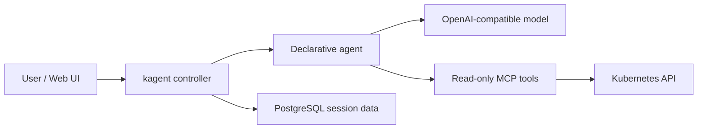

# kagent on Kubernetes: diagnosing a Pending Pod with read-only tools

An operations agent needs more than a generic explanation of Pending Pods: it needs to read real events and say where its evidence came from. We deployed the open-source [kagent](https://github.com/kagent-dev/kagent) in a Kubernetes test cluster, connected an existing model service and a read-only Kubernetes tool, and created an unschedulable Pod to see whether the agent could identify the cause.

**Result: the agent invoked `k8s_describe_resource` through MCP and identified a mismatched node selector from the scheduling events; it suggested remedies without making changes.** The experiment used kagent 0.10.4 and Kubernetes 1.30.4. Model, network, and cluster identifiers have been anonymized; this success does not imply official upstream compatibility certification for that Kubernetes version.

## 1. What is kagent?

kagent manages agents, model configurations, and tools as Kubernetes custom resources. Its controller coordinates agent execution; agents call large language models and Model Context Protocol (MCP) tools; the Web UI provides conversations and configuration. The model may be an external OpenAI-compatible service, so the control plane itself does not require a GPU. [Official introduction](https://kagent.dev/docs/kagent/0.x/introduction/what-is-kagent/)



Unlike a simple rule scanner, a model can select tools, read their outputs, and assemble a conclusion. Whether it can make changes depends on the tools and actual Kubernetes permissions; prompts alone cannot guarantee safety.

## 2. Environment and scope

| Item | Configuration |
| --- | --- |
| Kubernetes | 1.30.4, isolated test namespace |
| kagent / tool server | 0.10.4 / 0.3.0 |
| Agent runtime | Go, calling an OpenAI-compatible model endpoint |
| Database | Bundled PostgreSQL, one instance, local persistent volume, for demonstration only |
| UI access | Local `kubectl port-forward`, no public endpoint |
| Tool permissions | Test namespace only; read Pods and other resources and logs; no Secret reads or Pod deletion |

The [0.x installation guide](https://kagent.dev/docs/kagent/0.x/introduction/installation/) provides Helm installation. We found no explicit 0.10.4 compatibility commitment for 1.30.4. The [1.x preview installation guide](https://kagent.dev/docs/kagent/1.x/setup/installation/) requires Kubernetes 1.37 or later and introduces Agent Substrate. Do not apply this 0.x result to 1.x or assume an in-place upgrade is supported.

The test environment could not directly reach the model gateway, so this demonstration used a dedicated office-machine bridge. The agent, bridge, and gateway jointly handled each request; the bridge depends on the office machine remaining online and is not presented as a production architecture. No model key is included in this article.

## 3. Restrict scope before installation

We first installed a separate CRD Helm release, then the controller, UI, and demonstration database. Built-in agents were disabled and the controller's watch scope restricted to the demonstration namespace. After confirming the core components worked, we enabled a read-only tool server. The following shows the important settings without the internal registry or credentials:

```yaml
rbac:
  namespaces: [kagent-lab]
kmcp:
  enabled: false
substrate:
  enabled: false
kagent-tools:
  enabled: true
  rbac:
    namespaces: [kagent-lab]
    readOnly: true
    allowSecrets: false
  tools:
    enabledTools: [k8s]
    args: ["--read-only"]
```

Render the chart before enabling it: the tool server's default configuration generates a ClusterRole and ClusterRoleBinding with wildcard privileges. This experiment explicitly used a namespace Role and read-only rules. The tool's `--read-only` setting and Kubernetes RBAC are separate controls; review readable data as well, because Pod logs can contain sensitive information.

```bash
kubectl -n kagent-lab auth can-i list pods --as system:serviceaccount:kagent-lab:kagent-tools
kubectl -n kagent-lab auth can-i get secrets --as system:serviceaccount:kagent-lab:kagent-tools
kubectl -n kagent-lab auth can-i delete pods --as system:serviceaccount:kagent-lab:kagent-tools
```

The observed results were `yes`, `no`, and `no`, respectively. These checks establish those specific permissions for the test identity; they are not a comprehensive permission or isolation audit.

## 4. Images and model access

The first installation failed to pull GHCR images from cluster nodes; events reported reset connections. We mirrored fixed versions of the controller, UI, Go agent runtime, and tool-server images to a registry accessible to the cluster. PostgreSQL also used an accessible copy. We then updated this experiment's Helm release image settings. The Pods subsequently pulled successfully, and the controller, UI, database, and tool server became Ready.


*Actual screenshot: the kagent console lists the test agent; the model identifier is redacted.*

The agent's `ModelConfig` points to an OpenAI-compatible endpoint, with its API key referenced from a Secret. Verify ordinary responses, streaming, and tool calling with real requests; a health check alone does not prove model availability. [Official model configuration](https://kagent.dev/docs/kagent/0.x/supported-providers/byo-openai/)

We first asked a general question about typical reasons for a Pending Pod. The agent suggested resource, scheduling-constraint, and storage checks while stating that it had not queried the cluster. This validated the conversation path, but not actual diagnosis.

## 5. Create a real Pending Pod

The test Pod uses a nonexistent node label as a hard selector, so it cannot be scheduled and does not need to pull its image:

```yaml
apiVersion: v1
kind: Pod
metadata:
  name: kagent-pending-demo
  namespace: kagent-lab
spec:
  nodeSelector:
    example.invalid/kagent-demo: nonexistent
  containers:
    - name: demo
      image: registry.k8s.io/pause:3.10
```

We independently checked `kubectl describe pod`: the Pod was `Pending`, `PodScheduled=False`, and events showed that the node selector could not be satisfied. We then asked the agent to inspect only this test Pod.

Execution logs recorded the invocation and completion of `k8s_describe_resource`. The answer identified the mismatched `nodeSelector` and explained that preemption cannot fix a label constraint. It suggested checking the selector or recreating the test Pod; **it did not execute any change**. The agent also discussed other possible conditions, but humans should check its claims about exclusions such as resource shortages against complete scheduling events rather than treating them as established facts.


*Actual screenshot: the tool arguments target the specified Pod in the test namespace, and the call is marked Completed. The Chinese response below gives the model's diagnosis based on the returned data. Its claim that resource shortages are excluded requires human verification.*

An earlier request failed when the agent Pod had not passed its readiness probe and the controller could not reach the Service. The same agent later became ready and completed the call. We did not establish the underlying network or probe cause, so we report the observation without attributing it to a particular CNI or kube-proxy implementation.

## 6. Before production

This experiment validated one read-only diagnosis path. It did not test large-scale concurrency, multi-tenant isolation, database disaster recovery, tool-execution approvals, or high availability. The default demonstration UI is not suitable for direct shared exposure.

For enterprise use, first establish authentication, namespace and data permissions, model-request data boundaries, auditing, and cost controls. Put tools that can change infrastructure behind an explicit approval process. Design backups and availability for the database, persistent storage, and model gateway separately. Finally, have a person review generated commands and conclusions: **agent output is a lead; actual Kubernetes state and events are the evidence.**
