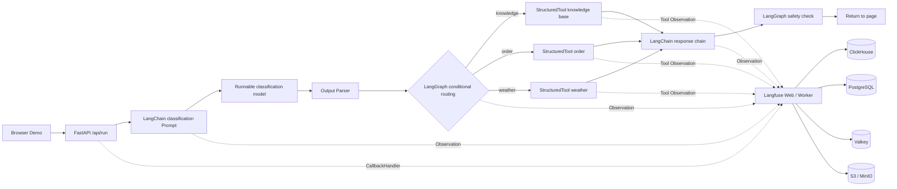

# LangChain, LangGraph, and Langfuse in Kubernetes: From Components and Orchestration to Tracing

LangChain, LangGraph, and Langfuse often appear together, but they do not solve the same problem. Reading only the definitions makes it easy to remember them as "three Agent tools that start with Lang." Once you actually run a request end to end, the boundaries become much clearer:

- **LangChain provides the building blocks for composing applications**: model interfaces, Prompts, Tools, Retrievers, Output Parsers, and Runnables;
- **LangGraph organizes these building blocks into a controllable state graph**: State, Nodes, Edges, branching, loops, and persistence;
- **Langfuse records what actually happened**: Traces, Observations, inputs and outputs, latency, errors, versions, and subsequent scoring.

This article implements and deploys a complete demo. A user question first passes through a LangChain classification chain, then LangGraph selects a knowledge base, order, or weather tool, followed by a LangChain response chain and a safety check; the entire path is written to a Trace via the Langfuse Callback. The page can also proactively trigger slow tools and tool failures, using the same interface to compare success, latency, and error scenarios side by side.


Fully reproducible code is available at [`examples/langchain-langgraph-langfuse-demo`](https://github.com/runzhliu/aik8s/tree/main/examples/langchain-langgraph-langfuse-demo). The example uses deterministic Runnables to simulate model responses and does not depend on external APIs, so what is verified is the component, orchestration, and observability pipeline, not the answer quality of any model.

## 1. Understanding the three with a real-life analogy first

Think of an Agent request as a hospital outpatient visit:

- LangChain is like the registration form, examination equipment, prescription templates, and department interfaces. It wraps "what can be done" into unified components;
- LangGraph is like the triage process. It decides which department the patient goes to first, when a follow-up is needed, and when to end;
- Langfuse is like the electronic medical record and quality control system. It records who handled each step, how long it took, what the inputs and outputs were, and where anomalies occurred.

With only LangChain, you can chain steps sequentially into a Chain, or create an Agent directly; once the flow involves complex branching, loops, pause-and-resume, and human approval, an explicit state graph is usually easier to review. With only LangGraph, you still need to integrate the model and tools yourself, and LangChain happens to provide those components. Both can run applications, but neither automatically provides cross-request retrieval, waterfall charts, error aggregation, and evaluation data the way Langfuse does.

[The official LangChain overview](https://docs.langchain.com/oss/python/langchain/overview) positions it as an Agent Framework for composable models, tools, Prompts, and middleware; [the official LangGraph overview](https://docs.langchain.com/oss/python/langgraph/overview) emphasizes low-level orchestration, durable execution, and stateful Agents. LangGraph can work without LangChain, but the combination of the two is the most common.

| Dimension | LangChain | LangGraph | Langfuse |
| --- | --- | --- | --- |
| Core responsibility | Components such as models, Prompts, Tools, and Retrievers, plus invocation interfaces | Stateful control flow and execution runtime | LLM application observability, evaluation, and Prompt management |
| Main abstractions | Runnable, Prompt, Tool, Model, Parser | State, Node, Edge, Checkpoint | Trace, Observation, Session, Score |
| Executes application logic | Yes | Yes | No; receives and analyzes telemetry data |
| Decides the next step | Simple Chains or Agents can | Explicit graphs, conditional edges, loops, and commands | Does not decide business paths |
| Used for business recovery | Not responsible | Checkpointer can save Graph State | Traces are for analysis, not business state |
| Questions it is suited to answer | "How do I call models and tools?" | "Which node executes next?" | "Where was this run slow, where was it wrong?" |

## 2. The complete pipeline of this demo



A normal call ultimately produces 15 Observations. The Langfuse call tree on the left shows Graph nodes, LangChain sub-chains, Prompts, Runnables, and StructuredTools at the same time; the right side retains the inputs and outputs of the selected node.


[The Langfuse data model](https://langfuse.com/docs/observability/data-model) organizes a single request as a Trace, records steps such as models, tools, and retrieval as nestable Observations, and can aggregate multi-turn interactions with Sessions. This hierarchy maps naturally to Graph → Node → Chain → Prompt/Model/Tool.

## 3. LangChain: how the component layer is implemented

The classifier is not an `if` hidden inside a function. It still uses LangChain's Prompt, Runnable model interface, and Parser, so swapping in a real model does not require changing the Graph:

```python
classification_prompt = ChatPromptTemplate.from_messages([
    ("system", "把用户问题分类为 knowledge、order 或 weather，只输出分类名。"),
    ("human", "{question}"),
])

classifier_chain = (
    classification_prompt
    | RunnableLambda(rule_based_classifier)
    | StrOutputParser()
).with_config(run_name="langchain-classifier-chain")
```

The three business capabilities use `StructuredTool`, making tool names, descriptions, and parameter schemas explicit contracts:

```python
knowledge_tool = StructuredTool.from_function(
    knowledge_search,
    name="knowledge_search",
)
```

The value here is not just writing less adapter code. LangChain Callbacks can recognize the nesting relationship among Chains, Prompts, Parsers, and Tools, so what Langfuse receives is no longer a flat log line.

## 4. LangGraph: why an explicit state graph is needed

The demo's shared State holds the question, scenario, classification, tool context, final answer, and page events. After the classification node completes, a Conditional Edge selects one tool node based on `category`:

```python
builder = StateGraph(AgentState)
builder.add_node("classify", classify)
builder.add_node("knowledge_tool", knowledge_node)
builder.add_node("order_tool", order_node)
builder.add_node("weather_tool", weather_node)
builder.add_node("compose", compose)
builder.add_node("safety", safety_check)

builder.add_edge(START, "classify")
builder.add_conditional_edges(
    "classify",
    route_after_classification,
    {
        "knowledge": "knowledge_tool",
        "order": "order_tool",
        "weather": "weather_tool",
    },
)
```

In the [official Graph API](https://docs.langchain.com/oss/python/langgraph/graph-api), State is a shared data snapshot, Nodes perform computation and return updates, and Edges determine the next node. The benefit of this model is that routing, termination conditions, and error boundaries can be tested and drawn; when human approval, retry nodes, or a Checkpointer are added later, you do not have to cram the control flow back into an increasingly long Agent loop.

The current example does not enable a Checkpointer, because each request completes within a single HTTP lifecycle. Long-running tasks, multi-turn conversations, or human approval require configuring a persistent Checkpointer for the Graph and using a stable `thread_id`. LangGraph Checkpoints save recoverable business state; Langfuse Traces save observational evidence. The two cannot replace each other.

## 5. Langfuse: how a single request becomes diagnosable evidence

The application first creates a root Observation, then passes `CallbackHandler` to `graph.invoke()`:

```python
langfuse = get_client()
callback = CallbackHandler()

with langfuse.start_as_current_observation(
    name="agent-demo-request",
    as_type="agent",
    input={"question": question, "scenario": scenario},
) as root_span:
    result = graph.invoke(
        initial_state,
        config={
            "callbacks": [callback],
            "run_name": "langchain-langgraph-observability-demo",
            "tags": [scenario, "three-layer-stack"],
        },
    )
    root_span.update(output={"answer": result["answer"]})
```

This is the Langfuse Python SDK v3 style. [The Langfuse LangChain integration documentation](https://langfuse.com/integrations/frameworks/langchain) explains how `CallbackHandler`, the root Observation, `user_id`, `session_id`, and tags are passed. Short-lived scripts should also call `flush()` before exiting; long-running web services should also flush the queue during graceful shutdown.

The following questions can be answered directly from this Trace:

- Whether the classification chain executed, and which business route was ultimately taken;
- What parameters the tool call received and what result it returned;
- Whether the slow request was mostly spent in the tool or the response chain;
- After a tool throws an error, whether the response chain and safety check still executed;
- Whether similar issues occur under the same release version, user, or Session.

## 6. Three verification paths

The following are measured records from three independent requests. Latency is actively controlled by a fixed `sleep` in the demo, used to verify Trace hierarchy, error propagation, and latency attribution. Each scenario runs only once, and **these numbers cannot be used as framework performance benchmarks**.

| Scenario | Total latency | Classification | Tool | Response chain | Safety check | Result |
| --- | ---: | ---: | ---: | ---: | ---: | --- |
| Normal call | 724.0 ms | 107.0 ms | 202.1 ms | 286.3 ms | 80.1 ms | Full pipeline completed |
| Slow call | 3,123.0 ms | 106.0 ms | 1,802.3 ms | 1,106.3 ms | 80.1 ms | Full pipeline completed, bottleneck clear |
| Tool failure | 332.2 ms | 106.2 ms | 201.9 ms | Not executed | Not executed | Root Trace and Tool marked ERROR |

In the slow call, the tool and response chain together account for about 93% of the total time. If you only look at the total API latency, you can only know "the request is slow"; after expanding the Trace, you can confirm that the tool service should be checked first, then the model chain. The failed call proves that exceptions are not swallowed by the page: the Graph terminates at the Tool node, subsequent nodes do not execute, and both the root Trace and the tool Observation retain the error.

## 7. Kubernetes deployment topology

This experiment was deployed in a dedicated Namespace:

| Component | Replicas | Role |
| --- | ---: | --- |
| Demo Web | 1 | FastAPI, LangChain, and LangGraph runtime |
| Langfuse Web | 1 | Query and management UI |
| Langfuse Worker | 1 | Async processing and background tasks |
| PostgreSQL | 1 | Metadata and transactional data |
| ClickHouse | 1 | Trace and analytics data |
| Valkey | 1 | Queues, caching, and coordination state |
| MinIO | 1 | S3-compatible object storage |

The experiment pinned Helm Chart `1.5.41` and Langfuse `3.224.1`, because the experimental cluster did not have the ClickHouse Operator and cert-manager CRDs installed. This is a version note for reproducing the experiment, not a production version recommendation. The current official Chart 2.x creates `ClickHouseCluster` and `KeeperCluster` when the built-in ClickHouse is enabled, so cert-manager and the ClickHouse Operator must be prepared before installation; new deployments should evaluate the current version, external data services, and upgrade paths against the [official Kubernetes Helm documentation](https://langfuse.com/self-hosting/deployment/kubernetes-helm).

The example repository provides a Dockerfile, pinned dependencies, the Demo Deployment, Services, and a values template without real credentials. The minimal deployment steps are:

```bash
docker build -t REGISTRY/langgraph-langfuse-demo:v1 \
  examples/langchain-langgraph-langfuse-demo
docker push REGISTRY/langgraph-langfuse-demo:v1

# 替换镜像和 Secret 占位符
kubectl apply -f examples/langchain-langgraph-langfuse-demo/k8s/deployment.yaml
kubectl -n langgraph-observability rollout status deploy/langgraph-demo

kubectl -n langgraph-observability port-forward svc/langgraph-demo 18080:8080
kubectl -n langgraph-observability port-forward svc/langfuse-web 13000:3000
```

Open `http://127.0.0.1:18080` in a browser to run the scenarios, then open the corresponding Trace from the page. The Secrets in the public example contain only placeholders; real keys, database passwords, encryption keys, and login credentials must be generated and injected by a Secret management system.

## 8. Swapping in a real model

To connect to an enterprise internal OpenAI-compatible gateway, you only need to replace the deterministic Runnable with `ChatOpenAI`; the Prompt, Parser, Graph, and Langfuse Callback can remain unchanged:

```python
import os
from langchain_openai import ChatOpenAI

model = ChatOpenAI(
    model=os.environ["MODEL_NAME"],
    base_url=os.environ["OPENAI_BASE_URL"],
    api_key=os.environ["OPENAI_API_KEY"],
    timeout=60,
    max_retries=2,
)

answer_chain = answer_prompt | model | StrOutputParser()
```

In Kubernetes, the API key should be referenced through a Secret, and the model name, Base URL, Prompt version, Release, and Graph version should all be written into the Trace. This way, after model, Prompt, or Graph changes, error rates, latency, and quality scores can be compared by version.

## 9. What is needed to go from demo to production

This demo proves that the three layers can work together, but a production system still needs the following:

1. **Graph persistence**: configure a persistent Checkpointer such as PostgreSQL for flows that need recovery, and use idempotency keys for external side effects of nodes;
2. **Real model metrics**: record Tokens, time to first token (TTFT), output rate, model-side queueing, and cost, to avoid having only end-to-end total latency;
3. **Trace-to-business correlation**: unify `trace_id`, `request_id`, `thread_id`, user, tenant, and business outcome;
4. **Privacy governance**: perform PII masking before the SDK, restrict Trace access, and define data retention and deletion policies;
5. **Evaluation loop**: consolidate online failure samples into Datasets, add rule-based scoring, human scoring, and Judges, and run regression before release;
6. **High-availability data layer**: use external PostgreSQL, ClickHouse, Redis/Valkey, and object storage based on scale, with backup, recovery, and upgrade designs for each;
7. **Application and platform monitoring**: Langfuse explains the Agent semantic pipeline, while Prometheus/Grafana continues to monitor Pods, queues, databases, CPU, memory, and network;
8. **Version compatibility matrix**: pin LangChain, LangGraph, and Langfuse SDK versions, and verify Callback, Trace hierarchy, and input/output masking before upgrading.

## 10. How to judge whether all three are being used correctly

Three sets of questions can serve as acceptance criteria:

**LangChain**

- Are model, prompt, tool, and parser clearly replaceable components?
- Do tool parameters have a schema, and can model providers be swapped without rewriting business logic?

**LangGraph**

- Does State only hold the data the flow needs?
- Are branches, loops, failure, and termination conditions explicit?
- Do tasks that need recovery have a Checkpointer, a stable Thread ID, and idempotent side effects?

**Langfuse**

- Can a single user request be expanded down to Graph Node, Chain, Prompt, Model, and Tool?
- Can traces be filtered by environment, version, user, session, and scenario?
- Can online failures return to the Dataset and release regression, rather than staying only in logs?

The key outcome of combining the three is not an extra call tree on the page, but connecting "how components are called, how flows run, and how results are verified" into a repeatable, inspectable engineering loop.

## References

- [LangChain Overview](https://docs.langchain.com/oss/python/langchain/overview)
- [LangGraph Overview](https://docs.langchain.com/oss/python/langgraph/overview)
- [LangGraph Graph API](https://docs.langchain.com/oss/python/langgraph/graph-api)
- [Langfuse LangChain Integration](https://langfuse.com/integrations/frameworks/langchain)
- [Langfuse Observability Data Model](https://langfuse.com/docs/observability/data-model)
- [Langfuse Kubernetes Helm Deployment](https://langfuse.com/self-hosting/deployment/kubernetes-helm)
