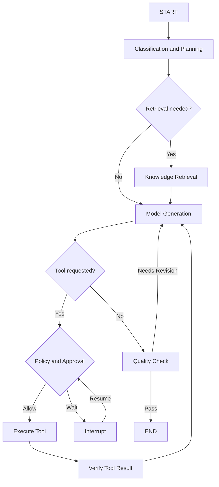
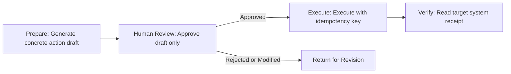
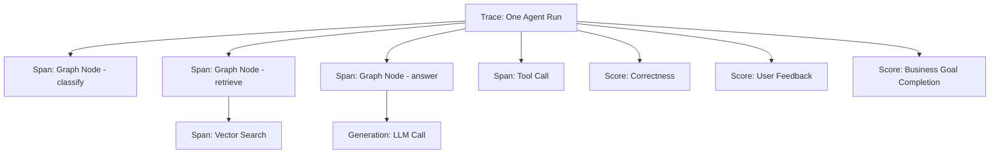
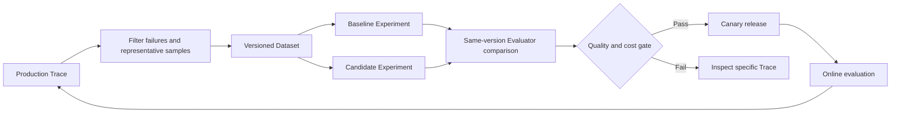
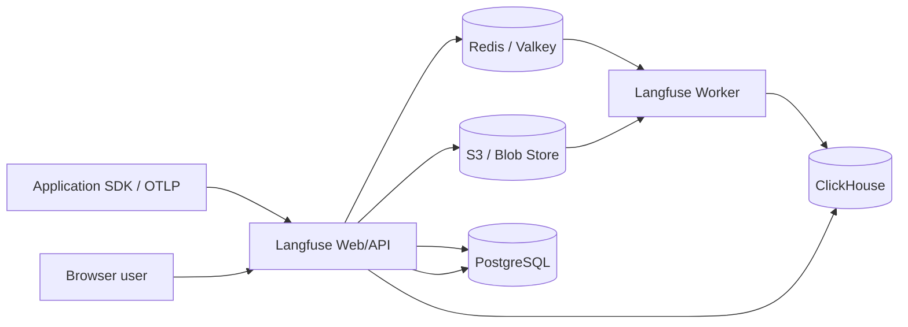
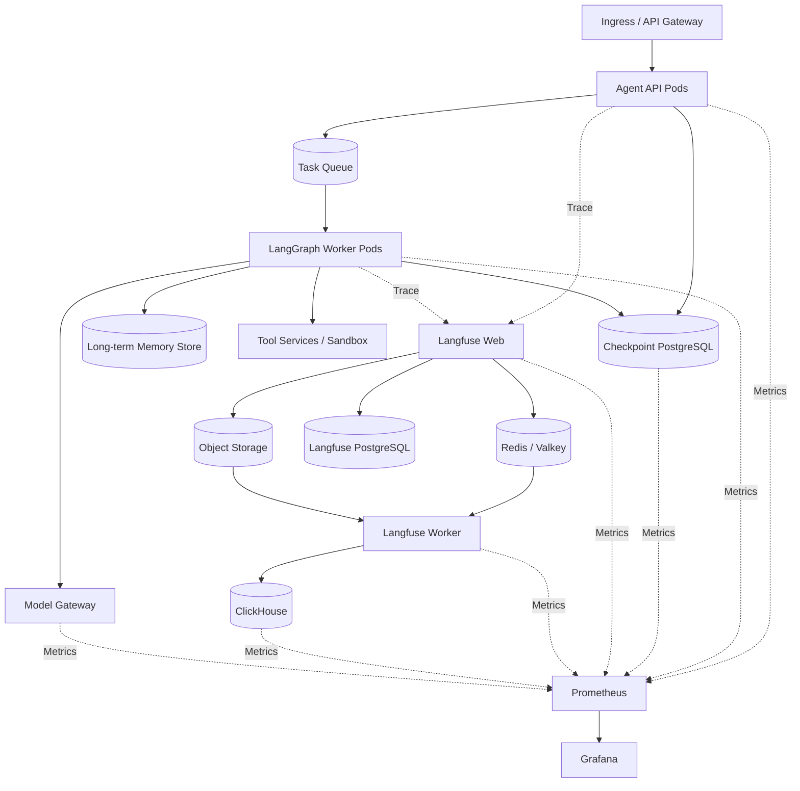

# Langfuse and LangGraph Technical Overview: Agent Orchestration, Observability, and Evaluation Loop

LangGraph and Langfuse often appear together in Agent technology stacks, and are also frequently grouped into the same product category because of their similar names. In reality, they operate at different layers: **LangGraph is responsible for making Agents run according to state and control flow, while Langfuse is responsible for recording, analyzing, and evaluating that run.**

A simple analogy: LangGraph is like a production line controller, deciding which station a workpiece passes through first, where to restart after a failure, and when to wait for a human signature; Langfuse is like a quality and traceability system, recording each station's duration, inputs and outputs, cost, errors, and scores, and turning online defects into the next round of test cases.

The two can be used independently. LangGraph can connect to LangSmith, OpenTelemetry, or self-built observability; Langfuse can also trace any Python, JavaScript, OpenTelemetry, or other Agent Framework. The value of combining them is forming a complete "execute—observe—evaluate—improve" loop.

## One-Page Summary

1. **LangGraph is a low-level Agent orchestration framework and runtime.** Its core abstractions are State, Node, and Edge; its key capabilities are loops, branching, parallelism, Streaming, Checkpoint, Durable Execution, and Human-in-the-loop.
2. **Langfuse is an open-source LLM Engineering Platform.** It covers Trace, Prompt Management, Token and cost, user feedback, Dataset, Experiment, human annotation, and automated evaluation.
3. **LangGraph Checkpoint is not Langfuse Trace.** Checkpoint saves business state that can continue execution; Trace saves execution evidence for observation and analysis. Deleting a Trace should not prevent task recovery, and replaying a Trace is not equivalent to recovering a business transaction.
4. **LangGraph does not require LangChain.** Its official positioning is a low-level Orchestration Runtime; you can use LangChain model and tool integrations, or directly call your own model gateway and business APIs.
5. **Langfuse does not run Agents.** It does not schedule nodes, resume threads, execute tools, or roll back external side effects for LangGraph.
6. **Production LangGraph must use a persistent Checkpointer.** The in-memory Checkpointer is only suitable for local development; Thread State and cross-Thread long-term memory should also be designed separately.
7. **Interrupt saves state and waits for resumption, but node code may re-execute.** Side effects before and after approval should be idempotent; external writes need idempotency keys, status queries, and business receipts.
8. **Langfuse self-hosting is not just a Web Pod.** The current architecture includes Web, Worker, PostgreSQL, ClickHouse, Redis/Valkey, and S3-compatible object storage; production environments need to consider scaling, backup, and upgrades separately.
9. **Agent observability cannot stop at "how many times the model was called."** It must also record Graph Version, Thread/Run, node paths, tool parameter summaries, approval waits, model and Prompt versions, Token, cost, and final business results.
10. **Kubernetes is suitable for hosting this combination, but three planes need to be separated.** LangGraph belongs to the execution control plane, Langfuse belongs to the LLM observability and evaluation plane, and Prometheus/Grafana belongs to the infrastructure and service health plane.

## 1. What Problems Do the Two Solve Respectively

| Dimension | LangGraph | Langfuse |
| --- | --- | --- |
| Product positioning | Low-level orchestration framework and runtime for long-running, stateful Agents | Observability, Prompt, evaluation, and experimentation platform for LLM applications |
| Core objects | State, Node, Edge, Thread, Checkpoint, Store, Interrupt | Trace, Observation, Generation, Score, Prompt, Dataset, Experiment |
| Whether it executes models and tools | Yes, called by application nodes | No, records calls and their results |
| Whether it saves recoverable business state | Checkpointer saves Thread state | Trace is for analysis and should not bear business recovery |
| Whether it supports human intervention | `interrupt()` pause and `Command` resume | Can record approval Spans, feedback, and human Scores |
| Whether it manages Prompts | Prompts are written in the application or other systems | Provides Prompt versioning, tagging, and fetching capabilities |
| Whether it performs evaluation | Must be self-written or connected to an external platform | Dataset, Experiment, Score, Judge, annotation queue |
| Self-hosted form | Python/JS application or Agent Server | Web + Worker + multiple data stores |
| Main alternatives | Hand-written while-loops, implicit Agent state, fragile workflows | Scattered logs, hand-maintained Prompt files, ad-hoc evaluation scripts |

[LangGraph official overview](https://docs.langchain.com/oss/python/langgraph/overview) defines it as a low-level orchestration framework and runtime for building, managing, and deploying long-running, stateful Agents. [Langfuse](https://langfuse.com/docs) positions itself as an open-source LLM Engineering Platform. Technical boundaries should be judged by responsibility, not by the "Lang" in the name.

## 2. LangGraph: Writing Agents as Explicit State Graphs

The simplest Agent is often a loop: call the model, parse Tool Calls, execute tools, append results to messages, then call the model again. This style is short in demos, but in production it encounters problems such as invisible state, difficult failure recovery, hard-to-insert approvals, and difficult branch testing.

LangGraph rewrites it as an explicit graph:



Each Node in the graph is a function that reads State and returns a State Update; Edges determine the next Node; Conditional Edges, `Command`, or `Send` can implement conditional routing, state updates, and parallel Map-Reduce.

### 2.1 State

State is the explicit data structure shared between nodes. It should not be just an endlessly growing message list; it can also include:

- Current goal, plan, and completion conditions;
- User, tenant, Thread, and request identity;
- Retrieval results and sources;
- Tool calls, external resource IDs, and business receipts;
- Approval status, risk level, and wait reason;
- Retry count, budget, and deadline;
- Final result and verification evidence.

LangGraph State can be described using `TypedDict`, Dataclass, or Pydantic Model. Each field can also define a Reducer to decide whether to overwrite, append, or custom-merge on parallel or multiple updates. Nodes should return Updates rather than arbitrarily mutating shared objects in place. [Graph API](https://docs.langchain.com/oss/python/langgraph/use-graph-api)

### 2.2 Node

A Node can be deterministic code, or it can call models, retrieval, tools, or subgraphs. Good nodes typically satisfy:

- Single responsibility, with clear input/output Schemas;
- External calls have timeouts, retries, and error classification;
- Return raw facts and resource IDs rather than just a summary;
- Independently testable;
- Can determine whether safe replay is possible after failure;
- Do not write long-term Secrets into State.

### 2.3 Edge and Control Flow

LangGraph supports sequences, conditional branches, loops, parallel nodes, Map-Reduce, and subgraphs. Complex Agents do not have to leave all decisions to the model:

| Decision | Recommended implementation |
| --- | --- |
| Fixed compliance process | Ordinary Edge and deterministic code |
| Branching based on explicit fields | Conditional Edge |
| Model decides next tool | Tool Call + controlled routing |
| Batch of independent subtasks | `Send` / Map-Reduce |
| Reusing a complete capability | Subgraph |
| High-risk actions | Interrupt + external approval |

The closer a decision is to finance, permissions, production releases, and deletions, the more code and policy should determine the path; models are suitable for intent, unstructured information, and open-ended analysis.

## 3. Checkpoint, Thread, and Long-Term Memory

LangGraph persistence includes two different systems:

| Mechanism | Scope | What it saves | Typical use |
| --- | --- | --- | --- |
| Checkpointer | Single Thread | Graph State Snapshot of each execution step | Continue conversation, pause/resume, failure recovery, Time Travel |
| Store | Cross-Thread | Application-defined Key-Value data | User preferences, facts, cross-session long-term memory |

A Thread is identified by `thread_id`. When a Graph is compiled with a Checkpointer, each step can produce a Checkpoint; subsequent calls use the same `thread_id`, and the Runtime knows which state to continue from.

```python
from langgraph.checkpoint.memory import InMemorySaver
from langgraph.graph import MessagesState, StateGraph, START, END

def answer(state: MessagesState):
    return {"messages": [{"role": "assistant", "content": "已收到"}]}

builder = StateGraph(MessagesState)
builder.add_node("answer", answer)
builder.add_edge(START, "answer")
builder.add_edge("answer", END)

graph = builder.compile(checkpointer=InMemorySaver())
config = {"configurable": {"thread_id": "demo-thread-001"}}
graph.invoke(
    {"messages": [{"role": "user", "content": "继续处理昨天的任务"}]},
    config=config,
)
```

`InMemorySaver` is lost after a process restart and is only suitable for development. Production should use a persistent implementation such as PostgreSQL, and define backup, retention, deletion, and tenant isolation. The official persistence documentation also distinguishes Checkpointer from Store: [LangGraph Persistence](https://docs.langchain.com/oss/python/langgraph/persistence).

### 3.1 Checkpoint Is Not a Task Scheduler

Checkpoint can save "where the task stopped," but a self-built application still needs to solve "who wakes it up, and when":

- Which Worker continues after an HTTP request is interrupted;
- How unfinished Runs are re-enqueued after a Pod restart;
- Who receives approval events when an Interrupt waits for days;
- How timers, Webhooks, and external callbacks are associated with Threads;
- How concurrent writes to the same Thread avoid conflicts;
- How to prevent old messages from waking a Thread again after cancellation.

When using LangGraph Agent Server, part of the persistence infrastructure is managed by the Server; when fully self-built, API, Queue, Worker, Scheduler, and idempotency controls are still needed. "Having a Checkpoint in the database" does not by itself automatically produce execution.

### 3.2 State Retention Cannot Grow Indefinitely

Long conversations accumulate messages, tool results, and multiple Checkpoints. The following need to be defined separately:

- What information is retained in the Context;
- How many historical versions of Checkpoints are retained;
- Whether raw tool outputs go to the database or object storage;
- When long-term memory is updated, expires, and deleted;
- How user deletion requests cover derived summaries and evaluation data.

Reference: [Agent Memory Technical Overview](agent-memory-technology-overview.md).

## 4. Interrupt and Human Approval

`interrupt()` can pause a Graph inside a node, hand JSON-serializable information to the caller, and resume via `Command(resume=...)` on the same Thread:

```python
from langgraph.types import Command, interrupt

def approval_node(state):
    decision = interrupt({
        "action": "create_pull_request",
        "repository": state["repository"],
        "diff_summary": state["diff_summary"],
    })
    return {"approval": decision}

# 第一次执行会在 interrupt 处暂停并保存状态
paused = graph.invoke(input_state, config=config)

# 审批完成后使用同一个 thread_id 恢复
resumed = graph.invoke(Command(resume={"approved": True}), config=config)
```

An important semantic of Interrupt is that on resume, the node may re-execute from the beginning. Therefore, database writes, payments, message sending, or resource creation placed before `interrupt()` must be idempotent, or moved to a separate node after approval. [Interrupts](https://docs.langchain.com/oss/python/langgraph/interrupts) explicitly requires that side effects before an Interrupt should be safely replayable.

It is recommended to split approval into three steps:



This way, even if approval waits for hours or the Worker changes, the execution node can still query whether the action has already been completed based on the action ID.

## 5. LangGraph's Capability Boundaries

LangGraph provides orchestration primitives, but it does not automatically complete an entire enterprise Agent platform:

| Capability | Does LangGraph directly solve it | What still needs to be added |
| --- | --- | --- |
| State graphs and loops | Yes | Business State Schema and stop conditions |
| Checkpoint and recovery | Yes | Production database, scheduling, concurrency, and retention policies |
| Human-in-the-loop | Yes | Identity, approval UI, authorization, and audit |
| Model and tool calls | Integrable | Model gateway, credentials, Schema, rate limiting |
| Code or browser isolation | No | Container, VM, or Agent Sandbox |
| Tool permissions | No | Policy Engine, least-privilege identity, target system validation |
| External transaction rollback | No | Idempotency, compensation, business workflows |
| End-to-end observability and evaluation | Can emit events | Langfuse, LangSmith, Phoenix, OTel, etc. |
| Multi-tenant product UI | No | API, frontend, quotas, billing, and operations systems |

It is suitable as the orchestration runtime for a Harness, rather than stuffing all Harness components into one library. Reference: [Agent Harness Technical Overview](agent-harness-technology-overview.md).

## 6. Langfuse: From Trace to Continuous Evaluation

Ordinary logs are suitable for recording "a certain interface errored," but LLM applications also need to answer:

- Which retrieval, nodes, and tools did the user input pass through;
- Which model, Prompt, and configuration produced the final answer;
- How many Tokens, how much time, and how much cost each step consumed;
- Why a tool was called, and whether its returned result was used correctly;
- Which type of user or input has degraded quality;
- Whether a new version outperforms the baseline on the same test set;
- Whether online bad samples enter subsequent regression.

Langfuse uses Trace and Observation to express this execution chain. An Agent Run usually corresponds to one Trace; internal model calls can be recorded as Generations; retrieval, tools, and nodes can be recorded as Spans or other Observations; then Scores, Prompt Versions, Sessions, and Users are associated.



### 6.1 Observability

Langfuse can record inputs, outputs, models, token usage, cost, latency, errors, metadata, and hierarchical relationships. It answers semantic questions about LLM applications and does not replace Prometheus monitoring of Pods, CPU, GPU, queues, and databases.

The two systems should be correlated through a common ID:

```text
trace_id
run_id
thread_id
request_id
tenant_id
graph_version
prompt_version
model_revision
deployment_id
```

where `thread_id` represents LangGraph state continuity, and `trace_id` represents one observable execution. A single Thread can produce multiple Traces; do not force the two IDs to share the same semantics.

### 6.2 Prompt Management

Langfuse Prompt Management supports prompt versions, tags, variables, and retrieval from the SDK. In production, you should still record:

- Prompt name, immutable version, and deployment tag;
- Summary or secure hash of the filled-in variables;
- Chat Template, Tool Schema, and System Policy versions;
- Application code commit and model version;
- Cache hits and the fallback version when retrieval fails.

Prompts are not the full version of the application. Switching only the Prompt tag without recording the Graph, tool, and retrieval versions still makes experiments unreproducible. [Prompt Management](https://langfuse.com/docs/prompt-management/overview)

### 6.3 Dataset and Experiment

Langfuse Dataset stores inputs, optional expected outputs, and metadata; an Experiment runs a specific application version against a Dataset, producing results and Scores. Evaluation methods can include:

- Deterministic code rules;
- External evaluation scripts or business system receipts;
- Manual scoring and Annotation Queue;
- LLM-as-a-Judge;
- Aggregated metrics for the entire Run.



Comparable experiments require fixing the Dataset Version and Evaluator Version, and recording the application commit, model, and Prompt. A fixed dataset version does not mean deterministic model output; you should repeat runs or report confidence intervals, and not treat a single random generation as a stable conclusion. [Compare experiments](https://langfuse.com/docs/evaluation/experiments/compare-experiments)

### 6.4 What Langfuse does not do

- Does not store business Checkpoints that LangGraph can directly restore;
- Does not schedule Graph Nodes or execute Tools;
- Does not automatically prove LLM output correctness;
- Does not replace model gateway authentication, quotas, and routing;
- Does not replace Prometheus/Grafana infrastructure monitoring;
- Does not replace business database transactions and auditing;
- Does not automatically satisfy privacy and compliance requirements just because Traces exist.

## 7. Langfuse self-hosted architecture

As of this article's update, Langfuse v4 self-hosting consists of two types of application containers and four types of storage:



| Component | Primary responsibility | Production concerns |
| --- | --- | --- |
| Langfuse Web | UI, API, receiving Traces, querying data | Horizontal scaling, Ingress, authentication, rate limiting |
| Langfuse Worker | Asynchronous consumption and event processing | Queue Lag, CPU scaling, failure retries |
| PostgreSQL | Transactions and control-plane data | HA, backups, connection pools, migrations |
| ClickHouse | Analytical queries for Traces, Observations, and Scores | Shards/replicas, disk, Merge, TTL |
| Redis/Valkey | Queue and Cache | Availability, memory, persistence policy, eviction |
| S3/Blob Store | Raw events, multimodal inputs, large exports | Lifecycle, encryption, versioning and capacity |

The official approach currently uses queued ingestion: the Web component receives Traces in batches, first writes events to object storage, and places references into Redis; the Worker then reads them and writes to ClickHouse. This lets the ingress absorb traffic bursts, and also means monitoring cannot look only at API 2xx responses—you must also watch object storage writes, Redis queue backlog, and the Worker's final ingestion into ClickHouse. [Self-host Langfuse](https://langfuse.com/self-hosting)

### 7.1 Why so much storage is needed

LLM Traces often have three characteristics at the same time:

- High write volume and many fields, suited to columnar analysis;
- Control data such as projects, members, and Prompts requires transactions;
- Raw events and multimodal artifacts are large, suited to object storage.

Forcing all data into a single PostgreSQL makes early deployment simple, but it is hard to simultaneously satisfy high-throughput Traces, complex analytics, and large-object cost. Langfuse's architecture splits these workloads across ClickHouse, PostgreSQL, and object storage, at the cost of a larger operational surface.

### 7.2 What to watch for in Helm deployment

The current official Helm Chart can deploy the application and data stores, and can also connect to external PostgreSQL, ClickHouse, Redis, and object storage. The new Chart uses the ClickHouse Operator; if all storage is provided by external services, there is no need to install the corresponding Operator for the built-in ClickHouse. [Kubernetes Helm deployment](https://langfuse.com/self-hosting/deployment/kubernetes-helm)

Recommended for production:

- Web and Worker use separate Deployments and HPAs;
- Databases use independent failure domains, persistent volumes, and validated backup/restore;
- For large-scale scenarios, prioritize evaluating managed PostgreSQL, Redis, and object storage;
- Plan ClickHouse Keepers, shards, and replicas based on ingestion and query load;
- Validate Schema Migration and storage compatibility in a replica environment before Helm upgrades;
- Use an external Secret Manager for Secrets; do not commit them in Values;
- Configure different rate limits and SLOs for SDK ingestion and UI queries;
- Restrict access between Web, Worker, and each storage via NetworkPolicy;
- Define separate retention periods for Traces, objects, and Checkpoints.

## 8. How to connect LangGraph and Langfuse

Langfuse's LangChain integration uses a Callback Handler to listen to LangChain/LangGraph events. A basic integration approach is:

```python
from langfuse.langchain import CallbackHandler

langfuse_handler = CallbackHandler()

result = graph.invoke(
    {"messages": [{"role": "user", "content": "分析订单失败原因"}]},
    config={
        "configurable": {"thread_id": "thread-20260914-001"},
        "callbacks": [langfuse_handler],
        "metadata": {
            "tenant_id": "team-a",
            "graph_version": "orders-agent@8f4c2ab",
            "environment": "staging",
        },
    },
)
```

The actual installation method and SDK initialization parameters should follow the current [Langfuse LangChain/LangGraph Integration](https://langfuse.com/integrations/frameworks/langchain). For organizations that need unified semantics across frameworks, OpenTelemetry can also be used, but you must first define your own attribute versioning and data masking rules.

### 8.1 What to add after automatic Tracing

The Callback can automatically collect model and Chain events, but the following business fields usually need to be explicitly added by the application:

- Thread, Run, user, and tenant;
- Graph and Node versions;
- Tool business action ID;
- Approval request, approver, wait duration, and decision;
- Retry reason and the Checkpoint used for recovery;
- Final business completion condition;
- User feedback and downstream system receipts.

Automatically collected function names do not equal stable business semantics. It is recommended to use long-term stable names for key Spans, such as `retrieve_policy`, `prepare_refund`, `approve_refund`, `execute_refund`, to avoid dashboards breaking completely after function refactoring.

### 8.2 Avoiding duplicate Traces

If LangChain Callback, OpenTelemetry auto-instrumentation, and model SDK instrumentation are enabled at the same time, multiple duplicate Observations may be generated for the same call. When integrating, first draw a clear hierarchy:

```text
Trace: agent_run
  Span: graph_node
    Span: retrieval_or_tool
    Generation: model_call
```

Choose one place to create the root Trace; other integrations should only append child Spans. Before load testing, verify that the hierarchy, Tokens, and cost for a single request are counted only once.

## 9. A production observability model

### 9.1 Semantic and quality views in Langfuse

| Dimension | Metrics or fields |
| --- | --- |
| Quality | Correctness, Groundedness, Tool Success, Task Completion, human feedback |
| Model | Model, Prompt Version, Temperature, Token, Cost, Finish Reason |
| Agent | Node Path, Loop Count, Tool Call, Retry, Interrupt, Handoff |
| User | Tenant, User, Session, Use Case, Feature Flag |
| Version | App Commit, Graph Version, Retriever, Tool Schema, Evaluator Version |

### 9.2 System health views in Prometheus/Grafana

| Component | Metrics |
| --- | --- |
| LangGraph API | QPS, P95/P99, 5xx, Active Run, Queue Depth |
| Worker | Consumption rate, retries, timeouts, task age, Pod restarts |
| Checkpointer | Connection pool, write latency, lock waits, database capacity |
| Langfuse Web | Ingestion QPS, response latency, error rate |
| Langfuse Worker | Queue Lag, processing rate, failed batches |
| ClickHouse | Insert, Query, Merge, Replica, Disk, Keeper |
| Redis/Valkey | Memory, Queue Length, Eviction, connection count |
| Object Storage | Write failures, latency, capacity, lifecycle |
| Model Serving | TTFT, TPOT, Token/s, KV Cache, Queue, GPU |

### 9.3 Why the two cannot be merged into a single dashboard

Prometheus excels at low-cardinality time series and alerting, and is not suited to turning full Prompts, Tool parameters, and every node trace into Labels. Langfuse excels at drilling into a single execution by Trace, and is also not suited to replacing infrastructure alerting for nodes, disks, and databases.

The typical on-call troubleshooting path is:

1. Grafana detects an anomaly in P95 or error rate for a version;
2. Jump to Langfuse via `deployment_id`, the time window, and `trace_id`;
3. Locate in the Trace whether the issue is retrieval, model, tool, or approval wait;
4. Add representative failures to the Dataset;
5. After fixing, run an Experiment, and release only when it passes.

## 10. Kubernetes reference architecture



### 10.1 Execution plane

The Agent API handles submission, queries, cancellation, and approval callbacks; the Worker executes the Graph. Long-running tasks should not be bound to a single client HTTP connection. The Queue holds Run references, and the Checkpoint database holds state; together they complete recovery.

### 10.2 Data plane

It is recommended to separate the LangGraph Checkpoint PostgreSQL from the Langfuse metadata PostgreSQL into independent databases or instances. The two have different Schemas, upgrades, retention, and failure blast radii; sharing a high-privilege account to save one database will spread observability platform failures into task recovery.

### 10.3 Observability plane

Langfuse ingestion should not block the main business. The SDK uses batched and asynchronous sending with reasonable timeouts; when Langfuse is temporarily unavailable, the Agent should degrade per policy or buffer locally, and must not re-execute business nodes with side effects just because observability failed.

### 10.4 Network and permissions

- Agent Worker only accesses the model gateway, allowed tools, and the Checkpointer;
- Langfuse Web/Worker only accesses its own storage;
- ClickHouse, PostgreSQL, and Redis are not directly exposed to the public network;
- Ingestion keys, database credentials, and model secrets are managed separately;
- Namespace, ServiceAccount, NetworkPolicy, and Secret are split by responsibility;
- Passwords, tokens, cookies, identity documents, and sensitive business fields are masked by default in traces.

## 11. Capacity and Scaling

### 11.1 LangGraph Worker

The Worker bottleneck is not necessarily CPU. A single Run may spend a large amount of time waiting on the model, tools, or approvals. It is recommended to monitor:

- Number of runnable tasks and age of the oldest task;
- Active model calls and tool calls;
- Node execution duration distribution;
- Loop and retry counts per Run;
- Checkpoint write latency;
- Number of tasks waiting on interrupts;
- Per-tenant concurrency and budget.

Scale primarily on Queue, task age, and active calls; use CPU/memory as guardrail metrics. Approval waits should not occupy Worker processes for long periods; save a Checkpoint and release the execution slot instead.

### 11.2 Langfuse Web and Worker

Scale the Web side horizontally on ingestion QPS, response latency, and CPU; scale the Worker side on Redis Queue Lag, processing rate, and CPU. Scaling only Web makes the ingress look healthy while the backend backlog keeps growing.

### 11.3 Storage

- PostgreSQL: watch connections, IOPS, WAL, backups, and table growth;
- ClickHouse: watch Insert Batch, Part, Merge, query concurrency, and disk;
- Redis: watch queue backlog, memory, and Eviction;
- Object storage: watch write failures, Lifecycle, and large-object costs.

[Langfuse Scaling](https://langfuse.com/self-hosting/configuration/scaling) provides starting resource recommendations, but real capacity depends on the number of Observations per Trace, Prompt/Output size, sampling ratio, retention period, and query patterns — it cannot be estimated from request count alone.

## 12. Data Security and Privacy

LLM traces are often more sensitive than ordinary access logs, because they may simultaneously contain raw user input, retrieved documents, model answers, tool parameters, and business receipts. It is recommended to split the collection policy into four layers:

| Data | Default Policy | Reason |
| --- | --- | --- |
| Passwords, API Keys, Cookies, authentication headers | Never collect | Leakage grants direct access |
| Identity documents, payment, medical, and other sensitive fields | Mask before collection or do not collect | High privacy and compliance risk |
| Prompt and Output body | Sample by environment, tenant, and use case | High debugging value, but large data volume and risk |
| Tokens, latency, model, version, and error codes | Collect by default | Suitable for capacity, regression, and cost analysis |

Also define:

- Project and tenant access isolation;
- Dual masking at both SDK side and server side;
- Retention periods for Trace, Dataset, Score, and object storage;
- Re-review when adding production traces to a Dataset;
- How user deletion propagates to ClickHouse, PostgreSQL, object storage, and backups;
- Whether LLM-as-a-Judge may send sensitive content to another model provider;
- Approval for export, sharing, and public links.

## 13. How to Make the Evaluation Loop Reliable

### 13.1 Start from Business Failures

Do not create dozens of abstract scores first. Collect real failures first: wrong policy answers, wrong tool calls, missed approvals, stale citations, overly long loops, abnormal costs. Define observable, reproducible completion criteria for each failure class.

### 13.2 Layered Scoring

| Layer | Example | Recommended Evaluator |
| --- | --- | --- |
| Schema | JSON fields complete, types correct | Deterministic code |
| Retrieval | Target document hit, citation exists | Gold ID / Recall / Human |
| Tool | Correct action, correct parameters, successful receipt | Business rules and tool mocks |
| Content | Accurate, faithful, helpful | Human + calibrated Judge |
| Process | No privilege escalation, correct approval placement, can stop | Graph Path assertions |
| Business | Ticket resolved, refund correct, user satisfied | Downstream system results |

LLM-as-a-Judge suits semantic evaluation, but should be calibrated with human samples, keep the Judge model and Prompt version recorded, and be combined with deterministic rules. A fluent answer may cite the wrong source; a differently worded correct answer may be misjudged by string matching.

### 13.3 Versions Must Be Reproducible

Each Experiment must at minimum pin:

```text
dataset_version
application_commit
graph_version
prompt_version
model_and_parameters
retriever_and_index_version
tool_schema_version
evaluator_version
dependency_lock
```

The candidate version and baseline use the same Dataset and Evaluator, then compare aggregate scores, key samples, newly introduced failures, tokens, cost, and latency. A rising average score cannot cover a high-risk sample flipping from pass to fail.

## 14. Common Misconceptions

### Misconception 1: Having LangGraph Means Having a Reliable Task System

Graph and Checkpoint provide key primitives, but production still needs Queue, Worker lifecycle, concurrency control, idempotency, cancellation, compensation, and release systems.

### Misconception 2: Having Langfuse Means Knowing Whether the Model Is Correct

Langfuse can store evidence and run Evaluators, but correctness still depends on Dataset, Ground Truth, scoring definitions, and human calibration.

### Misconception 3: Trace Can Replace Checkpoint

Trace is for observability and may be sampled, masked, written with delay, or deleted per retention policy; Checkpoint is for recovery and requires consistent State and concurrency semantics. The two should be linked by ID, not substituted for each other.

### Misconception 4: Node Success Equals Business Success

HTTP 200 may only mean the request was received. The Graph should read the business receipt or final resource state, and Langfuse should record outcomes rather than only request status.

### Misconception 5: Collecting All Prompts Is Necessary for Troubleshooting

Full collection increases the exposure surface and storage cost. Body content can be retained by error, version, tenant, risk, and sampling policy; all other requests only need structured metrics and a safety summary.

### Misconception 6: Langfuse Dashboard Can Replace Grafana

Langfuse is suited for viewing Trace, Token, cost, and quality; Grafana is suited for nodes, Pods, queues, databases, and SLOs. The two sets of evidence are more effective when cross-linked via Trace ID and Deployment ID.

## 15. When to Use and When Not to Use

### LangGraph Is Suitable When

- The task involves loops, branching, parallelism, human waits, or failure recovery;
- Explicit control of State and Node is required;
- Custom models, tools, and persistence are needed;
- High-level Agent Frameworks cannot express the business control flow.

If it is a single Prompt, a fixed three-step ETL, or a fully deterministic business transaction, ordinary functions, queues, or workflow engines may be simpler.

### Langfuse Is Suitable When

- Unified tracing across models and frameworks is needed;
- Prompt versioning, Dataset, Experiment, and Score are needed;
- Production bad samples should become regression data;
- Self-hosting and data control requirements exist.

If there are only a few internal calls, ordinary OpenTelemetry traces are already sufficient, or the team does not yet have an evaluation process, improving structured logging and basic metrics first may be more cost-effective.

### Combined Use Is Suitable When

- The Agent is already in production and needs both task recovery and quality explanation;
- Node Path, Tool Call, and model Generation need to be in the same Trace;
- Production failures need to drive LangGraph version regression;
- Business completion, model quality, token cost, and infrastructure SLO need joint analysis.

## 16. Implementation Checklist

### LangGraph

- [ ] State Schema distinguishes facts, derived results, and sensitive data;
- [ ] Production uses a persistent Checkpointer, not an in-memory implementation;
- [ ] Thread, Run, user, and tenant IDs are explicit;
- [ ] No non-replayable side effects before Interrupt;
- [ ] External writes have idempotency keys, queries, and receipts;
- [ ] Loops, tokens, cost, and wall-clock time have upper bounds;
- [ ] Pod restart, duplicate messages, concurrent recovery, and cancellation have been exercised;
- [ ] Checkpoint and long-term Store have retention and deletion policies.

### Langfuse

- [ ] Trace hierarchy and naming are stable, avoiding duplicate instrumentation;
- [ ] Model, Prompt, Graph, Tool, and data versions are recorded;
- [ ] Sensitive fields are masked before sending;
- [ ] Queue Lag and final ingestion are monitored beyond Web 2xx;
- [ ] Datasets come from representative production samples and have passed privacy review;
- [ ] Evaluators are versioned and human-calibrated;
- [ ] PostgreSQL, ClickHouse, Redis, and object storage have completed backup/restore drills;
- [ ] Trace, Score, Dataset, and large objects each have retention periods.

### Kubernetes

- [ ] Agent API, Worker, Langfuse Web, and Worker scale independently;
- [ ] Checkpoint DB and observability DB are isolated in failure domains and credentials;
- [ ] NetworkPolicy only opens required paths;
- [ ] PDB, rolling upgrades, and migration order have been validated;
- [ ] Prometheus/Grafana and Langfuse use a common correlation ID;
- [ ] Observability platform failure does not trigger business action replay;
- [ ] Long interrupts do not occupy Worker execution slots;
- [ ] Per-tenant limits on concurrency, tokens, task duration, and trace ingestion.

## 17. Conclusion

LangGraph makes Agent state and control flow explicit; Langfuse makes model calls, tool traces, cost, and quality observable. The former answers "how does a task continue reliably," and the latter answers "what happened in this run and whether the result is worth releasing."

When combining the two on Kubernetes, the most important thing is not successfully installing the Helm Chart, but keeping responsibilities clear: Checkpoint is recoverable state, Trace is analytical evidence; Agent Worker executes business, Langfuse Worker handles observability; Prometheus detects system anomalies, Dataset and Experiment prevent quality regression. Building versioning, permissions, retention, and acceptance processes around these boundaries is what turns an Agent Demo into a sustainably running engineering system.

## References

- [LangGraph overview](https://docs.langchain.com/oss/python/langgraph/overview)
- [LangGraph Graph API](https://docs.langchain.com/oss/python/langgraph/use-graph-api)
- [LangGraph Persistence](https://docs.langchain.com/oss/python/langgraph/persistence)
- [LangGraph Interrupts](https://docs.langchain.com/oss/python/langgraph/interrupts)
- [Langfuse documentation](https://langfuse.com/docs)
- [Langfuse Observability](https://langfuse.com/docs/observability/overview)
- [Langfuse Prompt Management](https://langfuse.com/docs/prompt-management/overview)
- [Langfuse Datasets](https://langfuse.com/docs/evaluation/experiments/datasets)
- [Langfuse Evaluation Concepts](https://langfuse.com/docs/evaluation/core-concepts)
- [Langfuse Compare Experiments](https://langfuse.com/docs/evaluation/experiments/compare-experiments)
- [Langfuse LangChain/LangGraph Integration](https://langfuse.com/integrations/frameworks/langchain)
- [Self-host Langfuse](https://langfuse.com/self-hosting)
- [Langfuse Kubernetes Helm](https://langfuse.com/self-hosting/deployment/kubernetes-helm)
- [Langfuse Scaling](https://langfuse.com/self-hosting/configuration/scaling)
- [Agent Harness Technology Overview](agent-harness-technology-overview.md)
- [Agent Memory Technology Overview](agent-memory-technology-overview.md)
