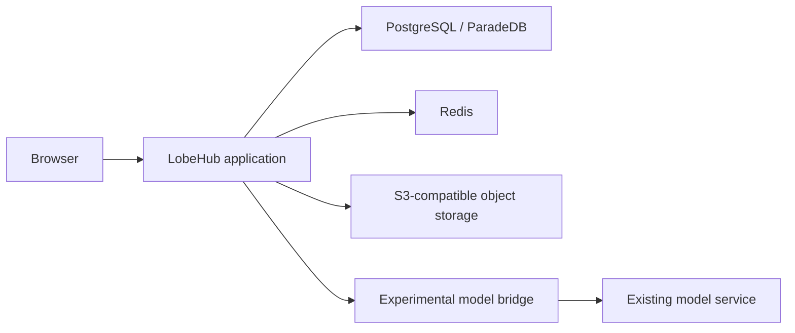

# LobeHub on Kubernetes in Practice: Model Chat, Custom Assistants, and Tasks

LobeHub provides a workspace for models and agents: users can connect models, create assistants, and organize conversations and tasks. We deployed it in a Kubernetes test cluster, connected an existing OpenAI-compatible model path, and tried multi-turn chat, a custom Kubernetes operations assistant, and task management.

**Observed results:** the web interface, account registration, streaming chat, follow-up questions, assistant creation, and task creation worked; conversations remained available after a page refresh. A task reached “Awaiting review” after about 4 minutes 37 seconds, but its execution details did not show an assistant response; the deliverable remains unverified. The embeddings endpoint returned 404, and network issues affected the skills marketplace and recommended templates. This does not establish that memory, online content, or the full server-side tool execution stack works.

Screenshots show the actual desktop interface in the light theme; internal model identifiers have been masked. Addresses, credentials, and environment identifiers have also been removed. Model responses are experimental output, not verified operational conclusions.

## 1. Its role in the system

LobeHub is a user-facing AI workspace: the browser provides interaction, the server stores accounts, conversations and settings, and an external model service performs inference. Internet access, tool use, code execution and knowledge retrieval each depend on additional services, interfaces and permissions. Consult the official [v2.3.2 release](https://github.com/lobehub/lobehub/releases/tag/v2.3.2) and [version-pinned deployment example](https://github.com/lobehub/lobehub/blob/v2.3.2/docker-compose/deploy/docker-compose.yml) for the version and dependencies.



This is the **path tested here**, not an official production topology. The bridge depends on an office computer remaining online; it helps validate the interface in a network-constrained test cluster but does not establish production availability. We did not deploy the separate Agent Gateway from the official Compose file or validate server-side sandboxes, browser tools, or internet search.


*Figure 1: The desktop workspace after sign-in, with the chat entry and recent topic. The model identifier is masked.*

## 2. Environment and deployment

| Component | Configuration used | Scope checked |
| --- | --- | --- |
| Kubernetes | Separate test namespace | No changes to business workloads in other namespaces |
| LobeHub | `lobehub/lobehub:2.3.2`, one replica | Web UI, chat, assistant and task interfaces |
| Database | `paradedb/paradedb:latest-pg17`, one replica | Database migrations; `pg_search` and `vector` extensions loaded |
| Cache | Redis 7, one replica | Application startup and basic use |
| Object storage | MinIO, S3-compatible interface | Service and initialization Job ready; file retrieval was not verified |
| Storage | 10 GiB database and 5 GiB object-storage persistent volumes | Conversation available after refresh; disaster recovery not tested |
| Access | Local `kubectl port-forward` | No public ingress created |

The official Compose example uses ParadeDB, Redis and RustFS. This experiment substituted MinIO for RustFS to test a basic S3-compatible deployment. `latest-pg17` is the floating database image tag actually used; production deployments should choose a validated fixed version or digest and check upgrade compatibility.

We prepared a separate namespace, two persistent volumes, a database, a cache and object storage. After initializing the bucket, we started LobeHub. Initial database setup failed because the filesystem had created `lost+found` in the mount directory. Pointing `PGDATA` to its `pgdata` subdirectory allowed initialization to finish. Application migrations completed and the four long-running components reached Ready.

Use Secrets for credentials rather than placing actual keys in YAML or source control:

```yaml
- name: OPENAI_API_KEY
  valueFrom:
    secretKeyRef:
      name: model-credentials
      key: api-key
- name: OPENAI_PROXY_URL
  value: http://model-endpoint.example:8080/v1
- name: OPENAI_MODEL_LIST
  value: "-all,+example-model"
```

The model address is illustrative. Supply the database password, `AUTH_SECRET`, `KEY_VAULTS_SECRET`, and object-storage credentials through Secrets or an existing secret manager as well. Set `APP_URL`, check the storage class and access policy, and inspect the application startup logs.

```bash
kubectl -n lobehub-lab get pods,pvc
kubectl -n lobehub-lab logs deploy/lobehub -c lobehub --tail=100
kubectl -n lobehub-lab port-forward --address 127.0.0.1 svc/lobehub 19010:3210
```

The namespace and port are examples. The endpoint is accessible only on the machine running the forwarding command and stops when that command exits. Ordinary Service addresses were unreachable in this test cluster; headless Services restored dependency connectivity. This is an observation about this environment, not a LobeHub requirement.

## 3. Connecting a model: OpenAI compatibility does not cover every API

The model bridge initially passed its health check, but chat failed. Request-path inspection showed that the workspace called `/v1/responses`, while the existing bridge only supplied `/v1/chat/completions`; a separate `/v1/embeddings` request also returned 404. Explicitly selecting Chat Completions by turning the provider's Responses API switch on and then off made the chat request return HTTP 200, followed by a complete response in the page.


*Figure 2: Model provider settings with the Responses API switch off. The model identifier is masked; the fields do not expose the server-side credential and address.*

Model discovery, connection checks, streamed text, tool calls and embeddings are separate capabilities. **Only streaming text chat was verified here.** The bridge has no embeddings endpoint, so memory retrieval still reports an error; tool calls were not tested. A selectable model does not prove every feature of the model or provider is configured.

## 4. Experiment one: chat and a follow-up

The first question asked the assistant to explain the relationship between Deployment, Pod and Service. A follow-up asked whether the Service entry changes when scaling to 5 replicas. The page returned both responses; the second discussed the ClusterIP, DNS and backend Pods. After refreshing and reopening the topic, the conversation remained available. Following a rolling restart of the application Pod, the previous topics remained readable and a new conversation also received a response.


*Figure 3: The real conversation and follow-up. The model output is shown unchanged and should be checked against the actual network implementation.*

This demonstrates the browser-to-model text path and conversation retrieval after a refresh. It is not a performance benchmark or a database restart, backup recovery, or cross-node migration test.

## 5. Experiment two: a Kubernetes operations assistant

Choose “Add assistant” on the home page and enter a name, role and description. In its profile, select the connected model. The core instruction asked the assistant to summarize the situation, organize its response into read-only checks, possible causes and verification steps, and distinguish facts from hypotheses.


*Figure 4: Creating the operations assistant in the UI.*


*Figure 5: The role and core instruction in the assistant profile. The model identifier is masked.*

We asked for read-only troubleshooting steps for a Pending Pod in a test cluster and requested a distinction between facts and unverified hypotheses. The model suggested branching on `spec.nodeName` and inspecting Pod events and node state. It **did not connect to the Kubernetes API or execute any commands**; it generated advice from the natural-language question alone.


*Figure 6: The assistant's actual response, preserved as shown. Not every command or claim in it is correct.*

A review found several issues. `kubectl get resourcequota -o describe` is not a valid output format; use `kubectl describe resourcequota`. The claim that most causes can be ruled out when no `FailedScheduling` event is present is too strong: events may expire or be absent. Its wording about Pending and `ContainerCreating` is also imprecise: the former is a Pod phase, while the latter is normally a container waiting reason. **The screenshot proves product behavior; it is not a ready-to-run incident response guide.** The [Kubernetes Pod lifecycle documentation](https://kubernetes.io/docs/concepts/workloads/pods/pod-lifecycle/) defines phases.

## 6. Experiment three: linking a task to an assistant

On the Tasks page we created a to-do item to organize a Pending troubleshooting checklist and assigned it to the operations assistant. The list and details showed the task, assignee and run action.


*Figure 7: The task was created and assigned to the operations assistant. “To do” does not mean it has executed.*


*Figure 8: Task details before running, including the description, assistant, model and status. The model identifier is masked.*

After clicking “Run”, an execution record appeared and the task entered “In progress”, then reached “Awaiting review” after about 4 minutes 37 seconds. However, opening execution details showed only the instruction and assistant avatar, with no visible response or inspectable deliverable. **The status changed, but the deliverable remains unverified**; further investigation is needed before claiming complete delivery. No Kubernetes tools were connected, and this experiment did not establish that any cluster resource was read or modified.


*Figure 9: The run record shows about 4 minutes 37 seconds and an awaiting-review status; this does not prove that the response or deliverable was saved.*

## 7. Limitations and production checks

- **The basic stack is not highly available.** The application, database, cache and object storage are single instances; backup recovery, Pod failover and multi-replica concurrency were not tested.
- **The model path depends on an external bridge.** Requests fail if the office computer or port-forward stops. Production needs stable connectivity, scoped permissions, timeouts and monitoring.
- **Memory, marketplace and tool execution are not validated.** Embeddings returned 404, marketplace requests encountered connectivity errors, and the separate Agent Gateway was not deployed.
- **A prompt is not a security boundary.** If Kubernetes or other tools are connected later, enforce actual capabilities with separate identities, least privilege, approvals and audit.
- **Displayed answers are not necessarily correct.** The experiment surfaced invalid commands and overconfident conclusions; operators must check evidence and command syntax.

LobeHub is useful to explore as a unified entry point for chat, assistant configuration and tasks. A production evaluation should also cover identity, backups, the model gateway, vector services, tool execution isolation and observability, then validate the chosen version end to end.
