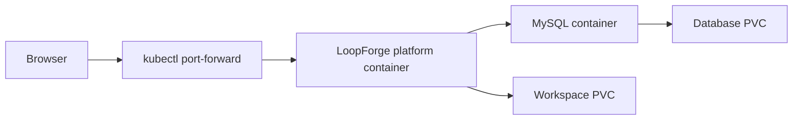

# Tencent LoopForge on Kubernetes: Scripts, Approval, Rework, and Restart Recovery

A coding agent can modify code, but it may not consistently test, seek review, and wait for acceptance as a team requires. [LoopForge](https://github.com/Tencent/LoopForge), open-sourced by Tencent's Lighthouse team, combines roles, scripts, human approvals, and run records into repeatable standard operating procedures (SOPs). [Project introduction](https://developer.cloud.tencent.com/article/2779233)

We deployed LoopForge in an isolated Kubernetes test environment and ran its built-in script-and-approval workflow, including a rejection and recovery from a Pod restart while awaiting approval. **A follow-up test ran a real model-backed Agent against synthetic code; real repository changes, PR creation, and Docker sandboxing remain untested.** The real screenshots show the light desktop UI; browser information has been cropped, and Chinese text in the original UI is retained.

## 1. Environment and architecture

| Item | Configuration used |
| --- | --- |
| LoopForge | Official `v0.3.4` image, source tag commit `ffaed1574eb4a232581d0ee1cbba46cc01fb2675` |
| Kubernetes | Test cluster v1.30.4, single-replica Deployment |
| Database | MySQL 8.0.46; the official Compose example uses MySQL 8.4, while this is a single test with 8.0 |
| Storage | One 5 GiB PersistentVolumeClaim (PVC) each for the database and workspace |
| Network | Local `kubectl port-forward`; no public ingress |
| Execution | Trusted scripts execute locally in the platform container; no host Docker socket is mounted |
| Model and repository | No model in the first round; the follow-up used DeepSeek-V4.1-Flash without connecting a real repository |



In this conceptual diagram, MySQL and the platform share one Pod and MySQL listens only on loopback inside the Pod. This single-instance arrangement supports the test; it is not a highly available deployment. Cluster names, internal addresses, and registry addresses are omitted.

The official Compose setup mounts the host Docker socket to create task sandboxes. The project notes that socket access controls the host Docker daemon. We did not mount it and followed the documented no-socket route for the script demo. **Scripts execute directly inside the platform container, not in a separate sandbox, and must be trusted.** A real agent sandbox needs a separate isolated execution environment. [Official deployment guide](https://github.com/Tencent/LoopForge/blob/v0.3.4/docs/deployment.md)

## 2. Deployment and access

1. Create a dedicated namespace, two PVCs, and a dedicated Secret for database and session credentials.
2. Run MySQL and LoopForge containers with the database bound to `127.0.0.1`. Enable platform authentication, set the workspace and database connection, and disable self-registration. Mount neither the host Docker socket nor a Kubernetes service-account token.
3. After the first successful start, initialize the observability columns and demo project using `migrations/001_run_obs_generated_columns.sql` and `migrations/seed/` from the same source version. Match migrations to the image version and check prerequisites before modifying an existing database.
4. Access the workspace through local port forwarding; after creating the first administrator, confirm unauthorized self-registration is disabled. The following uses an example namespace and port:

```bash
kubectl -n loopforge-lab rollout status deployment/loopforge
kubectl -n loopforge-lab port-forward deployment/loopforge 19846:8080 --address 127.0.0.1
```

Then open `http://127.0.0.1:19846/`. The test cluster could not pull the official image directly, so we relayed it and compared its source and destination configuration and layers before an actual cluster pull. Do not put an internal registry, real Secrets, or production configuration in a public deployment example.

## 3. The workflow: script, human approval, completion

In the demo project, open workflow templates and select “Platform check · script & approval.” The designer has three nodes: generate a report, wait for human confirmation, and finish acceptance. Approval can also send work back to report generation.


*Figure 1: The real workflow designer in the test environment. Solid lines show normal progression; the red dashed line shows the rework path.*

### Experiment 1: Complete an approval

After starting the workflow, the report script completed and generated the `welcome` artifact. The run then entered `waiting` and the gate entered `waiting_approval`. After we checked the report and approved it, the final script completed and generated the `completed` artifact.


*Figure 2: A separate real run stopped at the approval page; it was approved with the page button after the screenshot.*

This verifies that the human gate stopped downstream work and that the report was readable. No model was called; it does not validate code generation or AI review.

### Experiment 2: Reject and rerun

We ran the same SOP again and sent the ready approval back to report generation. That node executed again with `attempt=2` and `reworkCount=1`. The gate waited for another decision and the run succeeded after approval.

The final green status alone is insufficient: inspect node attempts, rework counts, and corresponding artifacts. This covers one rework path in the built-in example, not arbitrary dependency graphs or concurrency conflicts.

### Experiment 3: Restart the Pod while awaiting approval

We stopped a run at the human gate and restarted the entire Deployment Pod containing both platform and database containers. After readiness and re-establishing port forwarding, the same run still awaited approval. Once approved, the final node succeeded and four artifact snapshots were visible. During restart, the platform container failed to connect while the database was not ready and restarted twice before recovering. Production deployments should wait for database readiness and use bounded retries.


*Figure 3: Real run details after restart and approval: all three nodes completed. Token and tool-call counts are 0, confirming no model call. The displayed time is one UI record, not a performance benchmark.*

This demonstrates that this particular **waiting-for-approval** run retained its state across a Pod restart and could continue, depending on persistent storage and database state. It does not prove in-place recovery of a running Agent process, streamed response, or external side effect. Node failure, PVC failure, and multi-replica high availability were not tested.


*Figure 4: Desktop history for three validation runs; an additional UI approval demo was completed after this screenshot. The success rate describes these examples only and is not a reliability metric.*

### Experiment 4: Use a real model to repair code

After the script experiments, we added a trusted local-execution SOP: create a defective `clamp` function and three tests, have Codex CLI call DeepSeek-V4.1-Flash to read and modify the sample, run unit tests in a separate script step, then request human approval. The model was reached through an experiment-specific office-machine bridge that passes through the streaming Responses API; the real service address and credentials are omitted.


*Figure 5: The real model-backed run shows sample preparation, Codex repair, independent testing, and human approval. The UI Sandbox label is a run identifier; it does not mean this run used a separate Docker sandbox.*

Before the repair, two of three tests failed. The model generated code that bounds the value by the lower and upper limits, and all three independently run tests passed. In this run, the Agent first requested human confirmation after the repair. Once confirmed, the test node ran, and the workflow stopped again at the configured human approval before completing. The platform reported 181,197 total tokens for the Agent node, including 77,568 cached-read tokens. These are single-run UI statistics, not typical task cost or actual billing.


*Figure 6: The independent test node saved passing results for values inside the range and at the lower and upper boundaries. This is the test artifact, not a claim by the model.*


*Figure 7: The same run's trace records publication of the code artifact, the Agent's request for human confirmation, and approval of the gate, providing evidence for reviewing the execution.*

We also first verified model tool use and the same code repair in a separate Kubernetes test Pod. The LoopForge SOP itself still uses the `local` execution mode: code runs in the platform container. **A separate Docker sandbox was not tested, and this mode is unsuitable for untrusted code.** The experiment used temporary synthetic files and neither modified a real repository nor created a PR.

## 4. What did we learn?

| Question | Observation | What it does not prove |
| --- | --- | --- |
| Can a real model help repair code? | In one sample, the model edited code, independent tests passed 3/3, and approval completed | Real repositories, PRs, or complex project outcomes were validated |
| Can the workflow enforce order? | The run waited for human approval after the report, then completed | Model output is necessarily correct |
| Can work be sent back? | The built-in report node ran a second time after rejection | All complex workflows can repair themselves |
| Does a platform restart lose approval? | One waiting run continued after a Pod restart | A running Agent or process resumes without loss |
| Was sandboxing validated? | No Docker socket was mounted; the script ran in the platform container | Docker isolation or safety for untrusted code was tested |

LoopForge's value is making the process explicit: what each node does, where people approve, where failures return, and where artifacts and records live. Its enterprise value depends on integration with real repositories, model services, testing environments, and existing approvals, not merely on a successful sample workflow.

## 5. How does it compare with CNB?

Cloud Native Build (CNB) is Tencent Cloud's Git and development collaboration platform, covering repositories, continuous integration and continuous delivery (CI/CD), and cloud development environments. Its NPCs (Non-Player Characters, automated roles) can also use AI for development: mention `@CodeBuddy` in an Issue or PR and enable work mode to let it modify code, create a branch and submit a PR. [CNB product overview](https://cloud.tencent.com/document/product/1785/116261) · [NPC documentation](https://docs.cnb.cool/zh/build/npc.html)

Both can help an Agent work on code and deliver changes, but emphasize different parts of the workflow. The LoopForge column refers to v0.3.4 tested here; the CNB column is based on official documentation. **We did not test CNB in this article.**

| Dimension | LoopForge | CNB (Cloud Native Build) |
| --- | --- | --- |
| Primary entry point | Organizes Agents, scripts and human steps around requirements, roles and standard operating procedures (SOPs) | Organizes collaboration around repositories, Issues / PRs and event-driven pipelines |
| Agent execution | Configures executors and models by role and advances them through a workflow; this experiment used Codex and a real model to repair a sample | Use `@` to mention system or custom NPCs in Issues / PRs to reply or review, or modify code and submit PRs in work mode |
| Workflow and human involvement | Visually defines Agent, script, human gate and rework paths; this test covered approval, rejection and resuming approval after restart | Uses `.cnb.yml` in the repository to declare build tasks triggered by push, PR, API, schedule or NPC events; delivery can still go through PR review |
| Tests and delivery | Script tests and artifact review can be steps in a workflow; this experiment did not verify real repositories or PRs | Repository events can trigger tests, image builds and delivery pipelines, with artifacts and development environments integrated into the platform |
| Deployment | Open-source software that teams can deploy and operate themselves, including the database, execution environment, credentials and upgrades | The official community edition is SaaS; the enterprise edition is deployed into a designated Tencent Cloud Virtual Private Cloud (VPC). Confirm provisioning and network terms with Tencent Cloud |
| Evidence in this article | Real runs and screenshots: synthetic code repair, three independent tests, approval and restart recovery | Public documentation only; there was no matched comparison of results or costs using the same task, model and environment |

CNB's NPCs can handle Issues, write code and submit PRs, so describing CNB as only a pipeline service would miss a major capability. LoopForge concentrates on combining multiple roles, deterministic scripts, human confirmation and rework into a reusable workflow. [CNB trigger rules](https://docs.cnb.cool/zh/build/trigger-rule.html) · [CNB build overview](https://docs.cnb.cool/zh/build/intro.html) · [LoopForge v0.3.4](https://github.com/Tencent/LoopForge/tree/v0.3.4)

For example, to fix a function and add tests, a team whose repository already lives in CNB can first try its native Issue-to-NPC-to-PR flow and existing pipelines. A team that needs an observable, reusable multi-role process for implementation, independent testing, human approval and rework can evaluate LoopForge. Where an existing code platform and self-hosted orchestration are both required, another option to explore is using LoopForge for orchestration and the code platform for PRs and CI. **This is an architectural possibility, not a tested integration of LoopForge with CNB repositories, permissions, events or callbacks.** Before adopting it, pilot a dedicated repository and verify credential scope, event idempotency, test-result reporting, approval ownership and code egress boundaries.

## 6. Next steps and production boundaries

The Agent executor has been connected to a model, but the LoopForge workflow did not run its code changes in a separate execution environment. A useful next experiment would use a dedicated test repository and isolated worker to validate code changes, test-failure retries, human review, and PR delivery, followed by interruption and recovery tests. Do not mount a shared cluster node's Docker socket as a substitute for an isolation design.

Production evaluation should also cover identity and project permissions, credential storage, egress and data boundaries, runtime isolation, auditing, database backup and recovery, and queue and concurrency limits. One Pod, one database, and one recovery experiment are not a high-availability or security certification.

## References

- [Tencent/LoopForge official repository](https://github.com/Tencent/LoopForge)
- [v0.3.4 deployment guide](https://github.com/Tencent/LoopForge/blob/v0.3.4/docs/deployment.md)
- [Tencent Cloud developer community introduction](https://developer.cloud.tencent.com/article/2779233)
