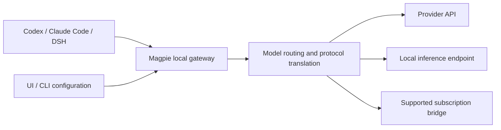

# Magpie Explained: Model Management and a Local Gateway for Coding Agents

> This article covers [yetone/magpie](https://github.com/yetone/magpie), not the unrelated Magpie method for generating fine-tuning data. It is based on public materials and upstream documentation; **we have not installed it, connected an account, or tested it**. Check the actual version and provider terms before use.

## What problem does it solve?

A developer may use Codex, Claude Code, and DeepSeek Harness alongside different model APIs, local models, and subscriptions. Each tool has its own configuration, protocols, and authentication. Magpie manages providers and models in one place, runs a local model gateway, and writes the chosen model to each agent's configuration. The project lists desktop, terminal UI, CLI, Web UI, and Docker options for macOS, Windows, and Linux. See the [project README](https://github.com/yetone/magpie) and [getting-started guide](https://github.com/yetone/magpie/blob/main/site/public/docs/start.html).

Its main value is reducing switching overhead across tools and models. It is not a training framework and does not execute code or provide a sandbox; the agent and its runtime environment retain responsibility for execution and filesystem permissions.

## Architecture and request flow

This is a conceptual diagram, not a captured request. The default gateway address is `127.0.0.1:3425`. The documentation describes support for OpenAI Chat, Responses, Anthropic Messages, and Gemini formats, with translation for features such as streaming and tool calls before routing to the configured upstream. Models commonly use `provider/model` identifiers. Tool calling, reasoning content, images, and context behavior vary across models: connectivity does not imply identical semantics. [Source](https://github.com/yetone/magpie#how-it-fits-together)

When a model is selected, Magpie updates the client's configuration. The documentation says it writes model and provider settings in `~/.codex/config.toml` for Codex and relevant environment variables in `~/.claude/settings.json` for Claude Code. A new session is generally required; changes to Codex's model list also require restarting the app or CLI. Configuration edits may conflict with existing proxies, environment variables, or team settings, so back up and record the original values first. [Source](https://github.com/yetone/magpie/blob/main/site/public/docs/start.html)

## What does it offer?

| Capability | What the project describes | What to check |
| --- | --- | --- |
| Provider management | API keys, custom compatible endpoints, and some subscription accounts | Whether the provider permits the access method; model names, quotas, and costs |
| Agent model selection | Different models for different tools and saved configuration profiles | Local configuration edits and whether sessions need restarting |
| Routing groups | Order, rotation, usage-based strategies, and fallback models | Changes in quality, cost, and data destination on fallback |
| Protocol translation | Multiple common model API formats | Actual compatibility of streaming, tools, multimodal inputs, and reasoning parameters |
| Privacy masking | Optional rules and local model-based detection | Disabled by default; false negatives and positives; no substitute for data classification |
| Usage records | Usage and routing information | Log contents, retention, sensitive data, and access controls |

The documentation also describes discovering some locally signed-in agent accounts. It says subscription discovery can be disabled in privacy settings or for one run using `MAGPIE_NO_ACCOUNTS=1`. Before first use, understand which accounts and local credentials the application reads; a client key and an upstream provider key serve different purposes. [Source](https://github.com/yetone/magpie)

## Fallback is not free compute

With multiple accounts or models in a routing group, the documentation describes rotation, ordering, and usage-based strategies. With one account and no fallback group, upstream errors still reach the client. Switching models can change tool-call formatting, prompt caching, response quality, cost, and data destination. Safe retry after a streaming interruption also depends on what was already emitted and whether tools produced side effects. Record both sides of a fallback and make side-effecting tools idempotent or subject to human approval.

A subscription is not automatically a general-purpose API. A technically functional bridge does not establish that account sharing, automatic switching, or third-party clients are authorized. Check each subscription's terms, account limits, and enterprise policies before procurement or use.

## How does it compare?

| Tool category | Main object managed | Comparison |
| --- | --- | --- |
| Magpie | Local agent model configuration and model requests | Suited to individuals switching between tools and providers |
| [LiteLLM Proxy](https://docs.litellm.ai/docs/proxy/quick_start) | Shared model APIs for multiple applications | Better suited to a centralized gateway, with governance and operations still required |
| [HarnessRouter](harnessrouter-overview.md) | Agent harness tasks and lifecycle | Focuses on tasks, events, and execution environments; can be layered with a model gateway |
| Native agent configuration | A single tool's model and authentication | Fewer dependencies in simple setups, but managed separately per tool |

These categories overlap; their protocols and features are not identical. Magpie can sit between an agent and a model, but it does not automatically provide Kubernetes scheduling, durable tasks, code sandboxing, or enterprise tenant isolation.

## Security and enterprise boundaries

1. **Local by default does not mean data stays local.** Requests ultimately go to the selected upstream, potentially including source code, logs, and tool output.
2. **Masking is disabled by default.** The project offers masking, but rules can miss business data. Validate with sanitized samples even after enabling it; do not treat it as a privacy or compliance guarantee.
3. **Govern subscriptions and credentials separately.** Review code and dependencies, verify release provenance, and understand account discovery, storage, and permissions. Avoid entering real keys in command lines where shell history may retain them.
4. **Do not expose the local gateway directly.** The default loopback address is for local access. The official reference describes requiring an enabled gateway key for network sharing. Remote access also calls for separate assessment of TLS, access control, auditing, and isolation; forwarding alone does not make it an enterprise gateway. [Source](https://github.com/yetone/magpie/blob/main/docs/reference.md)
5. **Supply chain and rollback.** Install on a test machine or separate OS account, record original configuration, and verify uninstall and recovery. Do not start by executing an unreviewed remote installation script on a production workstation.

## A low-risk trial

Choose one test agent and an authorized test API. Back up configuration, install in an isolated environment, and read the project documentation. Use prompts without sensitive data to check plain text, streaming, and read-only tool calls; then test an invalid key, rate limiting, and fallback routing. Record the model, API version, cost, errors, and actual route. Finally, restore the agent configuration and verify recovery. This is a proposed trial; it has not been performed for this article.

If you only occasionally switch one client, its native configuration may suffice. For enterprise identity, budgets, auditing, and multi-user isolation, assess a centralized gateway. Magpie is best evaluated first in a small personal-workstation trial with multiple agents, before adopting a more complex architecture.

## References

- [Magpie repository and README](https://github.com/yetone/magpie)
- [Magpie getting-started guide](https://github.com/yetone/magpie/blob/main/site/public/docs/start.html)
- [Magpie reference](https://github.com/yetone/magpie/blob/main/docs/reference.md)
- [LiteLLM Proxy quick start](https://docs.litellm.ai/docs/proxy/quick_start)
