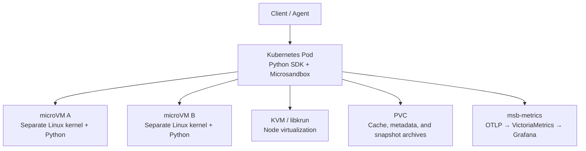

# Microsandbox on Kubernetes: Code Execution, Live Fork, and Memory Snapshot Recovery

Before executing generated code, an Agent can create a separate environment and destroy it afterward. Taking this further, can an environment with loaded dependencies and a running program be copied for several task branches? If the hosting Pod is recreated, can the program retain its previous execution state?

This experiment runs **Microsandbox 0.7.8** in an existing Kubernetes test cluster. It covers code execution, filesystem separation, four concurrent microVMs, Live Fork, and the difference between full and disk snapshots. The most useful result: **after recreating the hosting Pod, the service restored from a full snapshot retained its original in-memory random value, counter, process PID, and guest boot ID.**

With the guest image cached, median creation latency was **241.0 ms**; a short Python command in an already running environment took **28.0 ms** at the median. These are small-sample results from one node with a fixed configuration. The measurement definitions, failed attempts, and actual resource curves follow.

Node, registry, and environment identifiers are anonymized. [Code, raw measurements, and monitoring time series](https://github.com/runzhliu/aik8s/tree/main/examples/microsandbox-kubernetes) are available for reproduction.

## 1. Where Microsandbox fits

Microsandbox is a sandbox runtime for code execution. This article uses its local Python SDK: the application creates a microVM through the SDK and executes commands using the userspace of an OCI image with a separate guest kernel. On Linux, KVM—Kernel-based Virtual Machine—provides hardware virtualization; the runtime stack uses libkrun. [Pinned source](https://github.com/superradcompany/microsandbox/tree/v0.7.8)

The kernel boundary is a key difference from ordinary containers, which generally share the host kernel. Here, each guest uses its own Linux kernel. The host runs a 5.10-series kernel, while the guest actually reported `6.12.111`. This demonstrates execution inside a separate guest; a few functional checks do not constitute a complete security assessment.



Kubernetes hosts the application, selects its node, assigns outer resources, and mounts storage. The SDK manages guests, commands, Fork, snapshots, and destruction. One Pod can host multiple microVMs; **they do not automatically become separate Kubernetes Pods or receive individual placement decisions from kube-scheduler**.

This experiment does not deploy the Microsandbox cloud service. The workbench shown below is an SDK lab page supplied with this article, not the official Console. At the time of review, the hosted cloud has its own Dashboard; screenshots of that service cannot prove a successful local deployment. [Official Cloud documentation](https://github.com/superradcompany/microsandbox/blob/v0.7.8/docs/cloud/overview.mdx)

## 2. Deployment conditions: KVM from an unprivileged Pod

| Item | Configuration used |
| --- | --- |
| Kubernetes / container runtime | 1.30.4 / containerd 1.7.14 |
| Architecture / host kernel | x86_64 / Linux 5.10 series |
| Microsandbox SDK, runtime, and metrics exporter | All pinned to 0.7.8 |
| Each guest | 1 vCPU / 512 MiB |
| Hosting container requests / limits | 1 CPU, 2 GiB / 4 CPU, 8 GiB |
| Data volume | 8 GiB PVC, backed by node-local storage in this experiment |
| Device | `/dev/kvm` allocated through an existing device plugin |
| Container permissions | `privileged: false`, `allowPrivilegeEscalation: false`, `RuntimeDefault` seccomp |
| Network and host configuration | Ordinary Pod networking; no host network, CNI, or KVM module changes |

The official Docker example requires a usable `/dev/kvm`, rather than blanket privileged mode. This experiment reuses the cluster's existing KubeVirt device plugin. Requesting `devices.kubevirt.io/kvm: "1"` gives the Pod device access together with the corresponding device-cgroup permission. [Official container instructions](https://docs.microsandbox.dev/how-to/docker/docker)

```yaml
securityContext:
  privileged: false
  allowPrivilegeEscalation: false
  seccompProfile:
    type: RuntimeDefault
resources:
  requests:
    cpu: "1"
    memory: 2Gi
    devices.kubevirt.io/kvm: "1"
  limits:
    cpu: "4"
    memory: 8Gi
    devices.kubevirt.io/kvm: "1"
```

`devices.kubevirt.io/kvm` is an access allocation exposed by the device plugin. It does not mean exclusive ownership of a physical device, or unlimited guest capacity inside the Pod. Four guests configured with one vCPU each still share the container's outer 4-CPU limit. No KubeVirt virtual-machine resources were created, and existing virtual machines were not involved in the snapshot experiment.

Run `msb doctor` inside the final Pod to confirm the version, KVM device, and read/write access before attempting a real start. Hardware virtualization support on the node alone does not prove that the container can use it.

## 3. Two image caches, and the image-pull failure encountered

containerd pulls the image hosting the Pod; Microsandbox pulls or imports the guest image separately. **A Python container image cached on the node is not automatically present in Microsandbox's local image store.**

The hosting image contains Python 3.12, the pinned SDK, required dynamic libraries, and `msb-metrics` downloaded from the same release with its SHA-256 verified. The official SDK wheel bundles matching `msb` and libkrunfw binaries, avoiding mixed runtime versions.

The first attempt to pull the guest image directly from the internal registry failed. After adding the registry certificate, Python HTTPS requests could access the registry interface, but the SDK pull still reported a connection error. The registry's authentication challenge also contained an HTTP token URL. There is insufficient evidence to attribute the SDK failure specifically to that URL, so this is not established as a runtime defect.

To continue testing execution, the experiment used the officially supported offline import path and retained the failed attempt:

```bash
docker pull --platform linux/amd64 python:3.12-slim
docker save -o guest.tar python:3.12-slim
sha256sum guest.tar

# Run inside the Microsandbox container, not another machine's image store.
msb load --input /data/guest.tar --tag python-lab:local
```

The guest uses an internal mirror of an existing Python 3.12 slim image. Its actual OCI manifest digest was `sha256:2b4f19dae3a777dfc3b76730bda1e82e1f66ab2a2686fa93ca78edbfb4f04ffe`; the archive hash is recorded in the accompanying data. Record the digest of your own image when reproducing the experiment, because floating tags can change. Subsequent creation uses `PullPolicy.NEVER`, so the timing excludes image download. [Official local-image import](https://github.com/superradcompany/microsandbox/blob/v0.7.8/docs/examples/docker/local-images.mdx)

## 4. Initial checks: creation, execution, separation, and timeout


*An actual running page. The two failures came from the initial managed-job restriction on full capture. Corrected attempts are recorded separately, without overwriting failures. This is not the official Console.*

| Check | Request and acceptance criteria | Measured result |
| --- | --- | --- |
| Creation with a cached image | 10 new guests, 1 vCPU / 512 MiB each, individually checked with Python | 10/10; P50 241.0 ms, minimum 227.0 ms, maximum 340.8 ms |
| Execution in a running guest | Run `sum(range(101))` 20 times in the same guest | 20/20 returned 5050; P50 28.0 ms, minimum 27.4 ms, maximum 52.0 ms |
| Kernel and filesystem separation | Compare two guests' boot IDs; write a file only in A and check B | Different boot IDs; B cannot see A's file |
| File round trip | Host → guest → host, comparing SHA-256 | Matching contents and hash |
| Execution deadline | Apply a 2-second deadline to a 20-second sleep, then issue a probe | `ExecTimeoutError` after 2.003 seconds; guest remains usable |
| Concurrent tasks | Four guests, each running a 90-second SHA-256 loop | All four completed; execution phase lasted 90.080 seconds |

Creation latency is client wall-clock time from calling `Sandbox.create()` until return. It includes local initialization and guest readiness, but excludes the subsequent Python command. Execution latency covers command submission through receiving its exit result. Neither should be compared directly with vendor boot figures using a different timing boundary.

The minimal call below omits the complete experiment's deadlines, assertions, failure records, and additional cleanup handling:

```python
import microsandbox as msb

sandbox = await msb.Sandbox.create(
    "example",
    image="python-lab:local",
    cpus=1,
    memory=512,
    pull_policy=msb.PullPolicy.NEVER,
    max_duration=180,
)
try:
    out = await sandbox.exec("python", ["-c", "print(sum(range(101)))"], timeout=10)
    assert out.exit_code == 0 and out.stdout_text.strip() == "5050"
finally:
    await sandbox.stop(timeout=15)
    await msb.Sandbox.remove("example")
```

## 5. Live Fork: copy running memory, then let branches diverge

To distinguish this from rerunning a script, a small HTTP service runs inside the guest. On startup it generates a random `nonce` and initializes a counter to 41. These values reside only in the guest service's process memory; neither its source nor its guest disk files contain the nonce. The client reads the state over guest loopback and separately saves the expected value for assertions before performing Fork.

```python
child = await source.fork("branch")
```

Fork took **572.1 ms** in this experiment, with the following assertions:

1. Source and child initially had identical nonce, counter, PID, and boot ID values.
2. Incrementing only the child left the source at 41 while the child reached 42.
3. A file created in the child was absent from the source, verifying disk separation after copy-on-write.

Identical PID and boot ID values are expected when copying execution state. They do not mean the branches continue sharing one changing Python variable; the second assertion demonstrates independent execution.

This can copy an environment with loaded dependencies into several search, repair, or test branches. Copying does not automatically isolate external database writes, email delivery, or API side effects. Those still require idempotency keys, transactions, or task-level compensation.

### 5.1 Why the first attempt failed: active managed jobs block full capture

The initial service was launched with `exec_detached()`. Both Fork and the full snapshot returned:

```text
full capture and fork are unavailable while managed jobs are active;
wait for or terminate those jobs first
```

Reviewing the v0.7.8 runtime control path shows an explicit protection condition. This was not evidence that Kubernetes or KVM lacked Fork support. [Relevant source](https://github.com/superradcompany/microsandbox/blob/v0.7.8/crates/runtime/lib/runner/control/executor.rs)

The corrected experiment uses a short command to launch a background service inside the guest, waits for that command to finish, and then captures the environment. The Python service remains in the guest. This resolves the experiment's invocation conflict; **it does not establish transparent resumption of arbitrary active managed jobs in v0.7.8**. Agents depending on managed jobs, terminal sessions, or streaming output need validation against their actual task model. This example alone cannot justify a promise that every long-running task can be snapshotted directly.

## 6. After Pod recreation: restoring disk is different from restoring memory

The experiment creates two `.msb` archives from the same prepared service: a full snapshot and a disk-only snapshot. The source guest is then stopped and removed. Next, the outer Deployment Pod is recreated, its UID is confirmed to have changed, and the archives are restored from the PVC.

```python
await msb.Snapshot.create_archive(
    "ready-full", "/data/ready-full.msb",
    from_sandbox="source", full=True,
)

restored = await msb.Sandbox.restore(
    "/data/ready-full.msb", name="restored", max_duration=300,
)
```

| Check | Full snapshot | Disk-only snapshot |
| --- | --- | --- |
| Capture latency | 2.196 seconds | 79.2 ms |
| Archive size in this experiment | 25,320,130 bytes | 861,184 bytes |
| Restore latency in the new Pod | 809.4 ms | 286.8 ms |
| Test file | Preserved | Preserved |
| Original HTTP service | Immediately accessible after restore | Not running; requires a new start |
| Nonce existing only in RAM | Matches the original | New value after restarting the service |
| Guest boot ID | Matches the original | Changed |
| Process PID and counter | Original PID and counter 41 | New service initializes counter to 41; this alone does not prove memory retention |

Both restore timings cover only `Sandbox.restore()`, excluding Kubernetes Pod recreation. Memory and file assertions are performed after return. The full archive is small because the guest used little actual memory and the archive is compressed. **This does not imply that a task filling 512 MiB with data would still need only a 25 MB archive.**

The results demonstrate recovery of guest execution state across hosting-process recreation on the same node and runtime, with the original PVC and image cache still available. [Official snapshot semantics](https://github.com/superradcompany/microsandbox/blob/v0.7.8/docs/sandboxes/snapshots.mdx)

They do not cover recovery across nodes, CPU model changes, node failure, or loss of the storage system. The node-local PVC used here cannot automatically migrate to another node. Resumption in this article refers only to the controlled guest service. Remote connections, credential expiry, external service state, and Agent scheduling records still require higher-level recovery logic.

## 7. Where resources go with four concurrent microVMs


*Actual monitoring. The application tracks active guests; outer container metrics come from that container's own cgroup and include Python and VMM processes. The failure count retains the initial two rejected operations.*

During the 90-second SHA-256 workload, four 1-vCPU guests drove the hosting container to a peak of **4.009 CPU cores**, with a peak working set of approximately **412.3 MiB**. CPU usage is a 30-second `rate()`; working set is container memory usage minus inactive file cache. The outer 4-CPU limit aligns with the four CPU-bound tasks. These are not four independent Kubernetes resource allocations.


*Native metrics for the four `cpu-*` guests. Each guest approaches one CPU core; configured memory is displayed separately from actual consumption.*

The official `msb-metrics` collector reads the shared-memory registry for the same Unix user and `MSB_HOME`, then exports through OpenTelemetry Protocol (OTLP) HTTP. This experiment sends data directly to the existing VictoriaMetrics `/opentelemetry/v1/metrics` receiver. Only a scrape object for the lab service itself and dashboards were added; existing collection settings were unchanged. [Official metrics documentation](https://github.com/superradcompany/microsandbox/blob/v0.7.8/docs/observability/msb-metrics.mdx), [VictoriaMetrics OTLP integration](https://docs.victoriametrics.com/victoriametrics/integrations/opentelemetry/)

| Measurement | Aggregate peak in the four-guest window | Interpretation |
| --- | --- | --- |
| `microsandbox.cpu.utilization` | 4.000 | CPU core equivalents; a busy 1-vCPU guest reports approximately 1, not 1% |
| `microsandbox.memory.usage` | 261.6 MiB | Memory in use inside the guests, reported by the runtime |
| `microsandbox.memory.host_resident` | 255.4 MiB | Host-resident backing for guests; a different accounting basis from guest used memory |
| `microsandbox.memory.limit` | 2 GiB | Four configured allocations of 512 MiB, not actual resident memory |
| Hosting container working set | 412.3 MiB | Includes application and runtime overhead; not equivalent to guest memory |

Native metric and label names retain their dots. Use a complete selector when querying:

```promql
sum({__name__="microsandbox.cpu.utilization","sandbox.name"=~"cpu-.*"})
```

Short-lived guests may exit before the next sample. The native collector also accepts recent samples for a limited period, and the query engine has its own lookback window. Consequently, metric tails do not identify destruction times precisely, and native series counts must not be treated as the number of currently running guests. Cleanup is verified using SDK lifecycle operations, the final inventory, and device-descriptor checks.

## 8. Reproduction and access

The [example directory](https://github.com/runzhliu/aik8s/tree/main/examples/microsandbox-kubernetes) contains the Dockerfile, Kubernetes manifest renderer, lab page, experiment scripts, collection configuration, and dashboards. Registry, node, and storage class are parameters; private endpoints and credentials are excluded.

```bash
python3 examples/microsandbox-kubernetes/render.py \
  --test-node kvm-worker \
  --image registry.example.org/lab/microsandbox:0.7.8 \
  --storage-class local-test \
  --otel-endpoint http://metrics-receiver:8428/opentelemetry/v1/metrics \
  --output .local/microsandbox-install

kubectl apply --dry-run=server -f .local/microsandbox-install/install.json
kubectl apply -f .local/microsandbox-install/install.json
kubectl -n microsandbox-lab port-forward svc/microsandbox-lab 18950:9118
```

After completing `msb load` with the actual guest archive, open `http://127.0.0.1:18950/` and click Run suite, or invoke:

```bash
curl -X POST http://127.0.0.1:18950/api/suite
curl http://127.0.0.1:18950/api/state
```

A 202 response to `POST` only means the request was accepted. Each check's record in `/api/state` determines its result. Once both snapshot archives have been prepared, recreate the lab Pod, reestablish port-forwarding, and call `/api/restore`. Confirm that preparation succeeded and the original PVC will be mounted before taking this step.

The current script samples outer container resources for the cgroup v1 layout tested here. Other layouts require adapting that sampler; official guest metrics follow an independent OTLP path. The workbench is intended for controlled experiments. Its unauthenticated task-trigger endpoints should not be exposed directly to a public network.

## 9. Implications for an Agent platform

Microsandbox's local SDK path fits teams that want applications to create execution environments directly and need to evaluate process-memory copying and snapshots. It can provide a tool-execution layer. Task queues, multi-node placement, tenant quotas, snapshot catalogs, permissions, and external side effects still require platform design.

Alongside the [BoxLite experiment](boxlite-kubernetes-practice.md), both embedded SDKs can use KVM from one Kubernetes Pod. This article focuses on Microsandbox full snapshots and Live Fork; the earlier BoxLite article focuses on disk recovery. Different test coverage does not prove that either product lacks the other's tested capability, and measurements from different versions, kernels, and permission settings do not establish a performance ranking.

Compared with [OpenKruise Agents](openkruise-agents-kubernetes-practice.md), which provides a more direct Kubernetes-controller, warm-pool, and lifecycle-resource model, the work required to bring each environment into cluster-native governance is also part of the selection decision.

At the end of this experiment, all test guests were stopped and removed, and KVM device descriptors returned to zero. The lab application, image cache, snapshot archives, and evidence remain available for inspection. The experiment validates execution and recovery paths; production multitenancy still requires tests of resource density, concurrent creation, storage growth, failure recovery, and permission boundaries.
