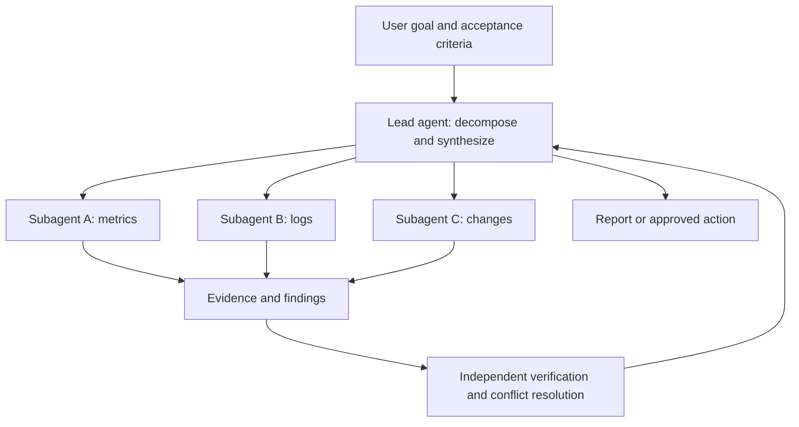
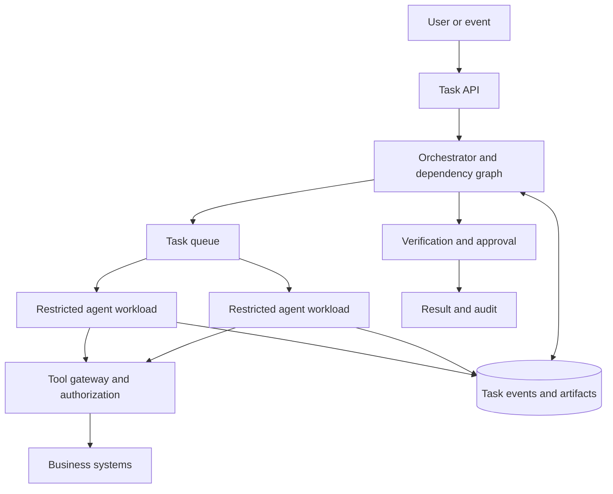

# Multi-Agent and Subagent Collaboration: From Parallel Work to Governed Teams

Completing a complex task with an agent may require searching documentation, reading code, querying metrics, designing a solution, and verifying results. A natural idea is to let the agent act like a team lead, delegating these activities to several subagents in parallel.

These capabilities have reached coding assistants, agent SDKs, and enterprise platforms. But adding agents does not automatically make a task faster or more accurate: it introduces decomposition, context transfer, file conflicts, synthesis, budget, and recovery problems. This article reviews publicly available material through **November 4, 2026**. Product descriptions come from official documentation and research results from particular experiments; **we have not independently reproduced those products or papers**.

## Key Takeaways

1. **A subagent is an execution process with its own task and context**, often created by a lead agent and reporting back. It need not use a different model or have its own sandbox or machine.
2. **Clear, loosely coupled work is the best parallel candidate**: investigate metrics, logs, and recent changes separately, for example. Concurrent writes to the same file and strictly ordered transactions need care.
3. **The collaboration pattern matters more than the number of roles**: delegation, handoffs, fixed workflows, and peer communication suit different jobs. Decide who makes decisions, who can write, and how results are accepted.
4. **Context isolation is not security isolation**: separate conversations do not imply separate filesystems, credentials, or networks. Verify boundaries in the runtime, identity, and policy.
5. **Recent research supports conditional use of multi-agent systems**: some task and team structures improve outcomes, sometimes at several times the cost, while conflicts can make the combined result worse.
6. **In production, code should own state, permissions, and side effects**, while models handle interpretation and planning. A durable task ledger, budgets, independent validation, and human approval close the loop.

## 1. What Is a Subagent?

An agent typically combines a model, instructions, tools, context, and a driving loop. A lead agent can create a subagent with a specific goal: it reads the context relevant to that task, uses allowed tools, produces a result, and reports back.

“Lead” and “subagent” describe task relationships, not organizational rank or model strength. Multiple independent sessions using the same model can form a multi-agent system; an agent calling several tools in one loop is not necessarily multi-agent. Products use Agent, Worker, Teammate, and Subagent differently, so inspect context, tools, workspace, and lifecycle.

| Commonly confused concept | Main purpose | Do not assume |
| --- | --- | --- |
| Skill | Supplies instructions, knowledge, and procedures on demand | Loading a skill necessarily creates an agent |
| Tool / MCP | Connects an agent to external capabilities, data, or actions | Every tool call is an autonomous agent |
| Subagent | Gives an independent execution loop a subtask and receives its result | It has a separate operating system or fewer privileges |
| Multi-model routing | Chooses different models for requests | Every model is a continuously collaborating agent |
| Parallel sessions | Runs multiple tasks at once | They necessarily know about each other or merge safely |

## 2. Recent Product and Research Developments

| Date | Public development | Significance and boundary |
| --- | --- | --- |
| January 2026 | Google Research analyzed 180 agent configurations | Parallelizable and sequential tasks benefit from different structures; agent count alone is not enough.[Research](https://research.google/blog/towards-a-science-of-scaling-agent-systems-when-and-why-agent-systems-work/) |
| April 2026 | OpenAI updated the Agents SDK, emphasizing memory, sandboxes, and orchestration | Multi-agent execution is being productized alongside workspaces, context, and recovery.[Announcement](https://developers.openai.com/api/docs/changelog) |
| August 2026 | The A2A project announced its move to the Agentic AI Foundation and referenced stable version 1.0 | Agent communication across frameworks and organizations is gaining a common protocol; the protocol does not automatically provide identity governance.[A2A announcement](https://a2a-protocol.org/latest/blog/2026/08/27/a-new-chapter-for-a2a-joining-the-agentic-ai-foundation/) |
| September 2026 | OpenAI announced the Agents API with managed sessions and subagent orchestration | Applications can use a managed runtime but still must govern their own tools and data.[Announcement](https://developers.openai.com/api/docs/changelog) |
| October 2026 | Two coding-agent preprints studied team costs and conflicts in shared repositories | Outcomes and costs depend on task structure and team design; results are not universal performance promises.[Cost study](https://arxiv.org/abs/2610.17471) · [Shared repository study](https://arxiv.org/abs/2611.00314) |

The trend is more than agents chatting: delegation, context compaction, task state, sandboxes, permissions, and human intervention are being brought into one runtime. Cross-vendor protocols and reproducible evaluation remain works in progress.

## 3. Four Common Collaboration Patterns

| Pattern | Control and data flow | Suitable for | Main risk |
| --- | --- | --- | --- |
| Lead-agent delegation | The lead invokes subtasks, receives results, and remains responsible for synthesis | Parallel research, investigating competing hypotheses, code review | Lost findings or a lead-agent bottleneck |
| Handoff | The current agent transfers the subsequent conversation or task to another | Support triage and specialist ownership | Losing the user's objective, permissions, or context |
| Fixed workflow / graph | Code defines nodes, dependencies, parallelism, retries, and joins | Approvals, reports, controlled releases | Workflow design effort and limited adaptation to dynamic tasks |
| Peer collaboration / team | Agents can communicate directly or claim tasks | Parallel development and complex investigations | Noisy messages, duplication, conflicts, and runaway cost |

When a lead invokes an expert as a tool, it usually retains overall control; a handoff can change which agent responds to the user afterward. Hybrid approaches are common: deterministic graphs control critical steps while agents explore within a node. Do not stop at whether a framework claims “multi-agent support”; inspect its state, joins, timeouts, and permissions.[OpenAI orchestration and handoffs](https://developers.openai.com/api/docs/guides/agents/orchestration) · [LangChain multi-agent](https://docs.langchain.com/oss/python/langchain/multi-agent)

## 4. Products and Frameworks

| Product or project | Positioning and capabilities | Selection questions |
| --- | --- | --- |
| Codex | A coding agent can delegate bounded tasks and synthesize results; availability and concurrency depend on environment and configuration | Is the workspace shared? How are concurrent edits isolated?[Official documentation](https://learn.chatgpt.com/docs/agent-configuration/subagents) |
| OpenAI Agents API | Managed sessions and subagent orchestration with creation, messaging, waiting, and interruption | How are environments and credentials inherited? What can the event stream show?[Official documentation](https://developers.openai.com/api/docs/guides/agents-api/multi-agent) |
| Claude Code | Subagents can have configured tools and instructions; Agent Teams supports team sessions, tasks, and messages | Does the deployed version support team mode? How are background work and permissions configured?[Subagents](https://code.claude.com/docs/en/sub-agents) · [Teams](https://code.claude.com/docs/en/agent-teams) |
| OpenClaw | Multi-agent routing configures distinct workspaces, identities, and sessions and also supports delegation | Is sandboxing actually enabled for the workspace? How are cross-session and tool access authorized?[Official documentation](https://github.com/openclaw/docs/blob/main/docs/concepts/multi-agent.md) |
| LangChain / LangGraph / Deep Agents | Provides different building blocks for subagents, handoffs, graph workflows, and context management | Self-hosted or managed? Who owns state persistence and runtime isolation?[Official documentation](https://docs.langchain.com/oss/python/langchain/multi-agent) |
| Microsoft Agent Framework | Provides sequential, concurrent, handoff, group-chat, and manager orchestration patterns | Which components provide approvals, state persistence, and execution environments?[Official documentation](https://learn.microsoft.com/en-us/agent-framework/workflows/orchestrations/) |
| CrewAI | Organizes roles and tasks into a Crew with sequential or hierarchical processes | How are tasks, manager permissions, and checkpoints defined?[Official documentation](https://docs.crewai.com/en/concepts/crews) |
| Google ADK | Development components for composing agents and workflows | Fixed orchestration or dynamic handoffs? How are external agents authenticated?[Official documentation](https://google.github.io/adk-docs/agents/multi-agents/) |
| A2A | Protocol for discovery, tasks, and messages between independent agents | Is cross-service or cross-organization communication needed? How are remote identities and capabilities constrained?[Specification](https://a2a-protocol.org/latest/) |

**SDKs, user-facing products, runtimes, and protocols do not compete at the same layer.** Codex is an interactive coding product; Agents API is an application integration entry point; LangGraph is a framework for orchestrated execution graphs; A2A is an agent-to-agent protocol. Choose the delivery form first, then compare combinations across these layers.

The OpenAI Agents API documentation explains, for example, that a lead and its subagents in one session can share an environment filesystem, and subagents may inherit configured MCP tools and credentials. Separate conversation context therefore does not prove task isolation.[Agents API multi-agent](https://developers.openai.com/api/docs/guides/agents-api/multi-agent)

Claude Code subagents and Agent Teams are related but distinct: the former delegate bounded subtasks, while the latter enables more direct coordination among multiple sessions. Capabilities, availability, and limitations change by version; check the actual runtime and official documentation.

## 5. Why More Agents Are Not Always Faster

A useful approximation is:

**Total time** ≈ decomposition and scheduling + max(parallel task times) + dependency wait + synthesis and verification.

**Total cost** ≈ model calls across agents + tool calls + execution environments + retries and coordination.

This is a discussion model, not an exact billing formula. Parallelism can shorten the critical path for independent work, but it cannot remove the slowest task, shared rate limits, or a database bottleneck. Repeated context, messaging, merging, and retries add cost.

The October 2026 preprint [Scaling Inference-Time Compute with Teams of Coding Agents](https://arxiv.org/abs/2610.17471) found that its teams outperformed a solo agent on ProgramBench but cost roughly **3–7 times** as much. In that experiment, delegating only planning achieved a comparable score to delegation throughout the workflow at about half the cost. These are results for a particular benchmark, models, and configurations, not universal returns or cost multipliers.

The [ParallACT](https://arxiv.org/abs/2611.00314) preprint studied independent tasks in shared code repositories: even individually sensible tasks can fail when combined because interfaces disagree or requirements conflict. The paper reports an example falling from **62% to 16%** in a specific conflicting-task and model setting; that does not imply the same drop for every team.

In practice compare a single agent, one agent calling tools in parallel, a lead with a few read-only subagents, and parallel writes in isolated branches. Use the same tasks, acceptance criteria, and time budgets to measure completion, duration, cost, and rollback rather than deciding team size first.

## 6. Context, Workspaces, and Communication

Each subtask needs at least the user goal, current question, known facts and sources, available tools, allowed actions, expected deliverable, deadline, and stop condition. Too little context leads to misunderstandings; copying all history increases cost and may expose unnecessary information. Prefer a **task summary + necessary evidence references + constraints**, allowing the subagent to read original material when needed.

A result must be more than “done.” Include findings, evidence links or files, checks performed, unverified assumptions, risks, and next steps. The lead should inspect original evidence for critical claims instead of merely concatenating summaries.

A shared filesystem is convenient for read-only investigation, but parallel writes need design:

1. Divide write ownership by directory or module; a lead or designated owner manages shared interfaces.
2. Use separate Git branches or worktrees for high-conflict code, then merge in dependency order.
3. Run cross-module integration tests after merging; separately passing unit tests do not prove the combination works.
4. For writes to external systems, use idempotency keys, version checks, and approvals. Git worktrees cannot isolate a shared database or production API.

For agents across services, MCP primarily connects tools and resources, while A2A primarily offers interoperability for tasks and messages between agents. They can be combined, and not every local subagent needs A2A. An Agent Card or discovery mechanism helps locate a peer; it does not establish trust or business authorization.[A2A and MCP](https://a2a-protocol.org/dev/topics/a2a-and-mcp/)

## 7. Example for Kubernetes Administrators

The following is a **design example, not a production experiment**. A user asks why API Server errors increased in a cluster. After establishing a common observation window and cluster identity, the lead delegates three read-only investigations.

| Role | Read-only input | Expected output | Prohibited action |
| --- | --- | --- | --- |
| Metrics agent | API Server, etcd, and node metrics | Time series, anomaly windows, query definitions, and links | Change monitoring configuration |
| Logs agent | API Server and audit logs | Error types, samples, and time distribution | Export unrelated sensitive logs |
| Change agent | Release, configuration, and event records | List of concurrent changes and evidence | Roll back production changes |

The lead correlates evidence in time, identifies support and counterevidence, and produces testable hypotheses. After a fix is chosen, an independent verifier checks scope, and a change platform enforces identity and approval. After human approval, existing operations systems execute the change. **The ability to propose a fix does not grant authority to execute it.**

For execution environments, security isolation, and long-running recovery, see [Agent Harness](agent-harness-technology-overview.md), [Resuming Long-Running Agent Tasks](agent-long-running-durable-execution.md), and [Agent Sandbox Selection](agent-sandbox-selection.md).

## 8. Production Architecture: Task Ledger, Budgets, and Recovery

At minimum, assign responsibility for:

- **Task ledger**: record task IDs, parent-child relationships, input versions, dependencies, states, attempts, artifacts, and completion conditions; distinguish failure, timeout, cancellation, and unknown outcomes.
- **Reliable delivery**: a timeout does not prove an external action did not happen. Before retrying, check the target system receipt and use idempotency keys; recovery cannot rely only on conversation summaries.
- **Permissions**: grant least privilege per task and separate read-only access, drafts, and writes. Inject secrets server-side rather than embedding them in prompts or results.
- **Resources**: set total concurrency, subtask count, maximum depth, token / money budgets, tool-call limits, deadlines, and cancellation propagation. Apply quotas and fair scheduling by tenant.
- **Observability**: trace parent and child tasks, models, and tools; record queue, execution, join latency, and cost. Audit sensitive actions without retaining unnecessary plaintext.
- **Acceptance and fallback**: an independent verifier checks artifacts and business state. On partial failure, state what completed and what did not run; fall back to one agent or human handling where appropriate.

Kubernetes can provide scheduling, network policies, service accounts, and runtime isolation, but pod count does not equal agent count, and Kubernetes does not automatically ensure recovery, idempotency, or correct permissions. Actual boundaries depend on runtime, credentials, network, shared storage, and external-system design.

## 9. Evaluation and Phased Adoption

Start with useful, low-risk read-only work, then introduce controlled writes. Prepare a fixed task set including parallel work, sequential dependencies, conflicting writes, tool failures, timeouts, and recovery. Use the same inputs, verifier, and budget for each approach.

| Metric | Question to answer |
| --- | --- |
| End-to-end success rate | Does the final deliverable meet business acceptance criteria, rather than merely having all subtasks finish? |
| Total duration and critical path | Is it actually faster than one agent? How long do queues and synthesis take? |
| Total cost | How much do models, tools, execution environments, and failed retries cost? |
| Dependencies and conflicts | Do interfaces match, do post-merge tests pass, and how much rework occurs? |
| Recovery and safety | Do retries duplicate side effects? Were privileges exceeded or data leaked? |
| Human intervention | How much time is spent reviewing, clarifying, and repairing? |

Research such as [AsynCodeBench](https://arxiv.org/abs/2609.32662) is beginning to measure whether cross-agent dependencies are satisfied. Final success is necessary, but observing dependencies and waiting during execution helps locate coordination bottlenecks.

A practical adoption path is **single-agent baseline → two or three parallel read-only subtasks → controlled writes with independent verification → cross-team A2A only if needed**. Keep a rollback path at each step and expand only when quality, time, or human-effort benefits are demonstrated.

## References

- [OpenAI: Codex subagents](https://learn.chatgpt.com/docs/agent-configuration/subagents); [Agents API multi-agent](https://developers.openai.com/api/docs/guides/agents-api/multi-agent)
- [Claude Code: subagents](https://code.claude.com/docs/en/sub-agents); [Agent Teams](https://code.claude.com/docs/en/agent-teams)
- [OpenClaw multi-agent routing](https://github.com/openclaw/docs/blob/main/docs/concepts/multi-agent.md); [LangChain multi-agent](https://docs.langchain.com/oss/python/langchain/multi-agent); [Google ADK multi-agent](https://google.github.io/adk-docs/agents/multi-agents/)
- [A2A protocol](https://a2a-protocol.org/latest/); [Google Research: scaling agent systems](https://research.google/blog/towards-a-science-of-scaling-agent-systems-when-and-why-agent-systems-work/)
- [Scaling Inference-Time Compute with Teams of Coding Agents](https://arxiv.org/abs/2610.17471); [ParallACT](https://arxiv.org/abs/2611.00314); [AsynCodeBench](https://arxiv.org/abs/2609.32662)
