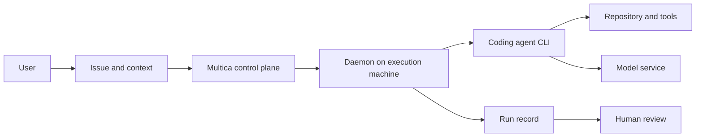

# Multica Survey: Bringing Coding Agents into a Team Task System

When a team uses Codex, Claude Code, and other coding tools, writing code is only part of the problem. Who owns a task, which environment is used, how far execution has progressed, and who reviews the result also need management. Multica attempts to bring these steps into a shared workspace where people and agents collaborate around issues.

**Multica is primarily a task and execution management platform, not a new language model or a runtime that replaces every coding tool.** It connects user-installed and authenticated agent CLIs, assigns work to a daemon on the relevant machine, and associates progress and results with the workspace. This article combines public documentation with a hands-on deployment on a Kubernetes test cluster. It validates functionality, not performance or high availability. [Project repository](https://github.com/multica-ai/multica) · [Project website](https://multica.ai/)

This review examines repository `main` as of 2026-11-06, at snapshot [`994d6977aa03`](https://github.com/multica-ai/multica/tree/994d6977aa03ef69a4c4307819d692d53d71986c). The project changes quickly; check the features, versions, and license of the version you deploy.

## 1. How a task flows

Consider a bug-fix task:

1. A user creates an issue, supplies the problem, acceptance criteria, and repository context, and assigns it to an agent.
2. Multica creates a run record for the trigger; an associated online runtime receives the work.
3. The runtime's daemon starts an installed and authenticated coding CLI. That CLI uses the model, tools, and local environment to perform the work.
4. Execution details and results return to the task context. A person examines the record, diff, and tests before deciding whether to accept them.



This is a logical diagram derived from project documentation; it does not imply every step is a separate process or network call. An agent defines identity, instructions, capabilities, and configuration; a runtime determines the machine and tool; a run records an execution. An agent need not run continuously. If a runtime is offline, identity and history remain, but new tasks wait for an available execution environment. [Agent concepts](https://github.com/multica-ai/multica/blob/main/apps/docs/content/docs/agents.mdx)

## 2. What capabilities does it provide?

| Capability | Purpose | How to interpret it |
| --- | --- | --- |
| Issues and projects | Keep tasks, context, and ownership together | A collaboration entry point; humans still write acceptance criteria |
| Agents and Skills | Store identities, instructions, and reusable methods | Reusable configuration does not guarantee correct model knowledge |
| Runtimes and daemon | Dispatch tasks to coding CLIs on selected machines | Actual execution permissions and network access belong to the execution machine |
| Runs and execution logs | Inspect tool calls, commands, errors, and results | Check logs for sensitive content and define retention |
| Multi-agent teams | Organize collaboration through teams and roles | Parallelism, conflict handling, and costs need measurement |
| Scheduled tasks and messages | Trigger work on a schedule or from workspace messages | Scheduled execution also needs permissions and review |

The project lists CLIs including Codex, Claude Code, OpenCode, and Kimi. Actual features, authentication, models, and versions depend on each CLI. The README also describes steering a running agent, but not every provider supports it; do not assume identical capabilities across adapters. [Project README](https://github.com/multica-ai/multica/blob/main/README.md)

## 3. Connecting DeepSeek Harness

The Multica organization maintains a separate [DSH runtime integration](https://github.com/multica-ai/dsh-multica-runtime). Its README describes a JSONL protocol over standard input/output, tool events, cancellation, and session resumption. It requires a separately installed compatible DSH version and runtime profile.

Multica does not directly bundle a DeepSeek model: it launches DeepSeek Harness through an adapter, and Harness uses the configured model credentials. The README's compatibility range and prerelease versions may change. **Session-resume support does not mean all tool side effects are automatically rolled back or resumed exactly**; checkpoints and duplicate execution require task-specific validation.

## 4. Self-hosting and Kubernetes

The official self-hosted stack includes Web, backend, and PostgreSQL. A machine executing agents also needs the CLI and daemon; both can run on one machine or on separate machines. The repository provides Docker Compose, images, and a Helm Chart, so the control plane can be evaluated on Kubernetes. This does not imply that every task automatically receives an isolated Pod. [Self-hosting guide](https://github.com/multica-ai/multica/blob/main/SELF_HOSTING.md) · [Helm Chart](https://github.com/multica-ai/multica/tree/main/deploy/helm/multica)

A small evaluation can proceed as follows:

1. Deploy Web, API, and PostgreSQL in a test environment; pin versions and configure persistence, backups, and health checks.
2. Prepare a separate, low-privilege execution environment with the Multica CLI, daemon, and one authenticated coding CLI.
3. Create an issue in a test repository asking the agent to fix a small problem and run tests, then review the result manually.
4. Verify offline runtimes, failure retries, concurrent conflicts, execution logs, and credential isolation before team adoption.

The official Compose example binds to localhost by default. Cross-machine access requires HTTPS and reverse-proxy planning; authentication, ingress, WebSocket, database backups, upgrades, and rollback must be validated in the target environment. [Compose configuration](https://github.com/multica-ai/multica/blob/main/docker-compose.selfhost.yml) · [Self-host quickstart](https://github.com/multica-ai/multica/blob/main/apps/docs/content/docs/self-host-quickstart.mdx)

### 4.1 Hands-on test: deployment through one completed task

The official **v0.8.0** Helm Chart was installed into a dedicated test namespace. The frontend, backend, and PostgreSQL formed the control plane; separate 5 GiB persistent volumes backed the database and uploads. The frontend was accessed through a local port-forward, without creating an external Ingress. The workspace, account, and task in the public screenshots are test data; internal addresses and credentials are omitted.

| Item | Configuration or observation |
| --- | --- |
| Kubernetes | Test cluster v1.30.4; components deployed in a dedicated namespace |
| Application and storage | Multica v0.8.0; Web, backend, and PostgreSQL ready; persistent volumes bound |
| Agent runtime | A separate Pod running Multica CLI 0.8.0 and DeepSeek Harness 0.2.2-alpha.2; Kubernetes ServiceAccount token automount disabled |
| DSH integration | Built and installed the separate DSH runtime plugin 0.2.0-private.1 inside the runtime Pod; the probe returned protocol version 1 |
| Model | Existing model service reached through a separate office-workstation bridge; the workstation and bridge must remain online |
| Test task | Explain three common scheduling causes of Pod Pending and provide read-only troubleshooting commands, without accessing or modifying a real cluster |

The sequence was to install the control plane with Helm and wait for Pods and volumes; start a separate runtime Pod and install the CLI, DSH, and bridge plugin; authenticate a test account and connect the runtime; then create an agent, submit a task, and inspect its run. The light-theme screenshots below are from the real test and have not been redrawn.

From the root of the official v0.8.0 source tree, prepare an environment-specific `values.yaml`, then use the following control-plane installation and local access commands. Configure secrets, image registries, and storage for your environment; see the [official chart](https://github.com/multica-ai/multica/tree/v0.8.0/deploy/helm/multica) for the full options.

```bash
helm upgrade --install multica ./deploy/helm/multica \
  --namespace multica-lab --create-namespace --values values.yaml
kubectl -n multica-lab get pods,pvc
kubectl -n multica-lab port-forward svc/multica-frontend 19888:3000
```

The separate runtime Pod also requires a supported CLI, a built DSH plugin, and model configuration. Authenticate interactively with `multica login --token=` before starting the daemon; do not put real tokens in command arguments, images, or public values. The following screenshot shows the runtime actually recognized by the application.


*The test workspace shows one online runtime; the runtime actually runs in a separate Pod in the test cluster.*


*The run shows completion, about 1 minute 35 seconds, and model and command steps. This is one functional demonstration, not a performance benchmark. The displayed cost was not checked against billing and is not a cost conclusion.*


*The agent posted its reply to the task. The screenshot preserves the original model output; its opening paragraph contains the factual error described below.*

The test exercised the path “assignment in the UI → claim by the in-cluster daemon → DSH model and tool calls → reply to the issue.” The run completed with 15 recorded steps. **The opening of the model's answer is inaccurate**, however: `Pending` can occur before scheduling or after a Pod has been bound while its containers are not yet ready, such as during image pulling. `Pending` alone does not prove that a node has not been assigned. Consult [Kubernetes Pod lifecycle](https://kubernetes.io/docs/concepts/workloads/pods/pod-lifecycle/#pod-phase), and inspect `PodScheduled`, the node field, container states, and events together. A complete execution trace does not guarantee a correct answer; human review remains necessary.

**Boundaries of this test:** repository changes, multi-agent parallelism, failure recovery, high availability, and load performance were not tested. The runtime was assembled in a temporary Pod with ephemeral in-container files; it must be reconfigured after Pod recreation and is not a recoverable production deployment. Although automatic cluster token mounting was disabled and no additional Kubernetes role granted, network isolation was not validated and this was not a complete security sandbox; DSH could still execute local commands. Production use needs a dedicated identity, secrets management, persistence, network restrictions, resource quotas, and runtime recovery. The demonstration model bridge depends on the office workstation and is not presented as a recommended production architecture.

## 5. Security boundary and license

The most important boundary is **the machine and operating-system user running the daemon**. The official security model says a default run can access files, credentials, and networks available to that user. Do not assume Multica supplies a filesystem sandbox for every run. Before running untrusted tasks, use a dedicated identity, an isolated environment, minimal credentials, and controlled outbound networking. Workspace permissions and prompts should not replace operating-system isolation. [Official security model](https://github.com/multica-ai/multica/blob/main/apps/docs/content/docs/security-model.mdx)

Self-hosted backend deployment-level anonymous telemetry is enabled by default; the official guide says `DO_NOT_TRACK=1` disables it. Enterprises should check the specific data, network policies, and other telemetry settings in their target version, rather than assuming self-hosting eliminates outbound traffic. [Self-hosting guide](https://github.com/multica-ai/multica/blob/main/SELF_HOSTING.md)

The repository uses the **Multica License**, incorporating the Apache License 2.0 text and additional conditions for hosted services, commercial embedding, and branding; it must not simply be described as pure Apache 2.0. For internal use, external services, or commercial integration, read the [LICENSE](https://github.com/multica-ai/multica/blob/main/LICENSE) for the relevant version and consult whoever is responsible for licensing.

## 6. Relationship to the earlier Super-agent Demo

The earlier [DeepSeek Super-agent Kubernetes Demo](deepseek-superagent-kubernetes-practice.md) connected chat, a Git service, and an agent adapter to explore tasks, code, and human review. Multica is a separate project that provides product components including a workspace, issues, agents, runtimes, and run records.

| Comparison | Multica | Earlier Super-agent Demo |
| --- | --- | --- |
| Goal | Manage team workflows involving humans and coding agents | Verify chat-triggered tasks, code changes, tests, and delivery |
| Task entry | Workspace issues, messages, and other triggers | The demo's chat entry point and task bridge |
| Execution | A daemon starts different agent CLIs | The demo adapter invokes the configured agent |
| Git integration | Depends on what the target version supports | The demo implemented an adapter for the selected Git service |
| Conclusion | An existing workspace to evaluate | Proves a particular demo chain, not a complete product |

Both require validation of identity, repository access, execution isolation, and human review. There was no controlled performance comparison here, so no reliability ranking can be inferred.

## 7. Suitable scenarios and evaluation

Start with well-bounded development work such as dependency upgrades, additional tests, documentation fixes, and reproducible bug fixes. Multi-agent collaboration also requires testing branch conflicts, resource contention, and handoff quality. For production changes, treat agent output as a candidate for review and leave merging and release to existing approval and continuous integration workflows.

Record five categories of acceptance evidence: task completion and human rework, execution time and model cost, task and log traceability, recovery after disconnection or restart, and permission and data isolation. **First validate the full path from assignment to review, then expand automation gradually.**
