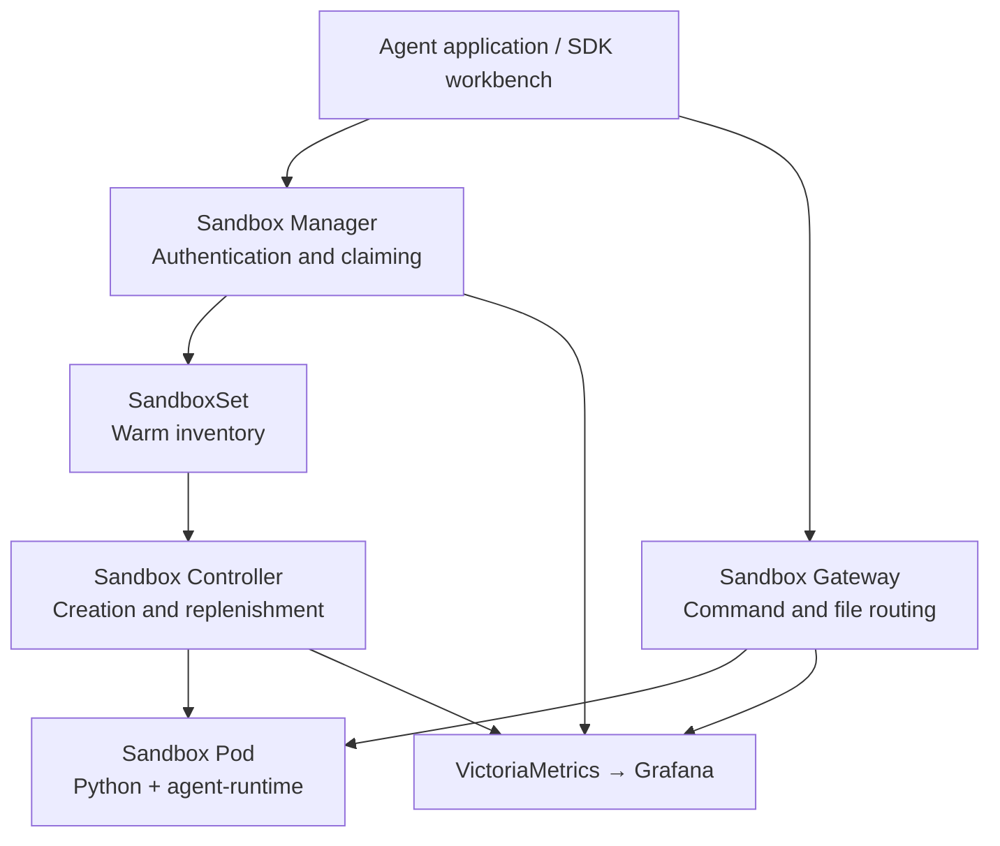

# OpenKruise Agents in Practice: Warm Pools, Sandbox Tasks, and Pause/Resume

Whenever an agent runs Python, analyzes a file, or starts a temporary web service, it needs an execution environment that can be acquired, used, and reclaimed. As demand grows, the platform must also deal with slow preparation, idle capacity, and user sessions whose lifecycles differ from those of their resources.

OpenKruise Agents brings these concerns into the Kubernetes resource model: warm pools prepare environments, claim APIs deliver sandboxes, and controllers maintain state, timeouts, and cleanup. This article deploys v0.6.0 in a Kubernetes test cluster, executes real tasks, and investigates a failed resume operation. Cluster, node, registry, and access details have been anonymized; screenshots show experimental resources only.

## 1. Which Part of an Agent Does It Manage?

OpenKruise Agents is an OpenKruise subproject for agent execution environments. It provides sandbox controllers and E2B-compatible interfaces for agent applications, notebooks, and development workspaces. Model inference, planning, and tool selection remain application responsibilities. [Project repository](https://github.com/openkruise/agents)

The three control-plane components have distinct responsibilities in this experiment:

| Component | Work performed in this experiment |
| --- | --- |
| Sandbox Controller | Reconciles custom resources, creates Pods, maintains warm pools, and handles lifecycles |
| Sandbox Manager | Receives E2B API requests, authenticates callers, and claims, deletes, or resumes sandboxes |
| Sandbox Gateway | Routes data-plane requests to the appropriate sandbox without creating a Service for every sandbox |
| agent-runtime | A component injected into each sandbox that works with envd in the business container to provide command and file operations |

A CRD is a Custom Resource Definition. The Controller Chart installs **8 CRDs**: Sandbox, SandboxSet, SandboxClaim, SandboxTemplate, SandboxUpdateOps, Checkpoint, Commit, and PoolAutoscaler. The Manager Chart adds **4 traffic and security policy CRDs**, giving **12 in total**. Installing those definitions does not enable every capability. [Installation guide](https://openkruise.io/kruiseagents/installation)



The critical distinction is between inventory and delivered environments. `SandboxSet.spec.replicas=2` maintains two unclaimed environments; when a user takes one, the controller creates a replacement. It is not a concurrency limit of two sandboxes for the entire application. Capacity planning must account for warm inventory, active sessions, and terminating Pods together. [Warm pool management](https://openkruise.io/kruiseagents/user-manuals/warmpool-management)

## 2. Environment and Installation

| Item | Experimental configuration |
| --- | --- |
| Kubernetes / runtime | 1.30.4 / containerd 1.7.14, Linux amd64 |
| OpenKruise Agents | v0.6.0; source commit `a1e0811323b71fd9a54efe26b0f4baf19106c84e` |
| Helm Charts | Controller and Manager, both 0.6.0 |
| Control plane | One replica each of Controller, Manager, and Gateway, pinned to one test node |
| Sandbox images | Python 3.12 slim; agent-runtime v0.3.0; no GPUs allocated |
| Warm configuration | `python-tools` keeps 2 idle sandboxes; `python-cold` keeps 0 |
| Python clients | e2b 2.24.0, e2b-code-interpreter 2.4.1, with the upstream customized E2B patch |
| Access | Existing NGINX Ingress reached through localhost port-forward |
| Monitoring | Existing VictoriaMetrics and Grafana, with additional scrape objects and two experimental dashboards |

This scale validates delivery and lifecycle behavior; it does not establish high availability or maximum capacity. The experiment installs no node DaemonSet, changes no host runtime, CNI, or existing monitoring Helm configuration, and does not enable Agentio egress governance, Checkpoint, or image Commit.

Nodes cannot access external image registries directly, so images are mirrored through a relay environment. The amd64 image layers and configuration are checked before deployment. The public [image provenance record](https://github.com/runzhliu/aik8s/blob/main/examples/openkruise-agents/images.source-lock.json) retains official references and digests without private registry addresses.

Official Charts are rendered into manifests and applied with kubectl; **no Helm release is created**. The accompanying [example directory](https://github.com/runzhliu/aik8s/tree/main/examples/openkruise-agents) contains the renderer, verification script, SDK workbench, and monitoring configuration. The renderer explicitly assigns namespaces, restricts experimental webhooks by namespace, and lowers the Charts' relatively large default API client QPS and worker counts.

```bash
helm pull agents-sandbox-controller --repo https://openkruise.github.io/charts \
  --version 0.6.0 --untar --untardir .local/kruise-charts
helm pull agents-sandbox-manager --repo https://openkruise.github.io/charts \
  --version 0.6.0 --untar --untardir .local/kruise-charts

python examples/openkruise-agents/render-lab.py \
  --charts .local/kruise-charts \
  --output .local/kruise-agents-lab \
  --test-node worker-lab
```

Only CRDs use server-side apply; webhooks and the remaining installation resources use ordinary client-side apply. The Controller manages the webhook `template` annotation, so deployment tools must not compete for ownership of that field. Rendered files also contain a generated experimental admin key and must stay local. The example directory documents the application order.

The experiment retains the default plaintext runtime data path and API key authentication; browser access is forwarded locally. The webhook still uses its own HTTPS service. Production deployments must separately validate ingress TLS, component authentication, and network policies rather than copying localhost wiring into a multitenant ingress design.

## 3. Submit a Real Task from a Page

As of October 21, 2026, the pinned v0.6.0 Release, official installation guide, and two Charts do not provide an Agents Web Console. The official organization also hosts `kruise-dashboard`, but its backend resource list covers workloads such as CloneSet, StatefulSet, and DaemonSet without management APIs for Sandbox or SandboxSet in `agents.kruise.io`. It cannot directly serve as an Agents Console. [Installation component inventory](https://openkruise.io/kruiseagents/installation), [Dashboard resource-type implementation](https://github.com/openkruise/kruise-dashboard/blob/5e0bf54df37049e1d356a00a61e1f7a0cda34890/openkruise-backend/handlers/workload.go)

To submit and observe real tasks from a page, this article provides an **SDK demonstration workbench**. Its button calls the real E2B SDK, and its backend connects to the sandbox service deployed for this experiment. It is an accompanying example application, not an upstream Console.


The page submits CSV aggregation code. Its backend claims a sandbox, writes `task.py`, executes Python, reads standard output, and deletes the sandbox. The actual output is East 200, West 95, and North 60, totaling **355**. Only the local backend reads the API key; the browser never receives it.

The essential call sequence is short:

```python
from kruise_agents.patch_e2b import patch_e2b
from e2b import Sandbox

patch_e2b(https=False)
with Sandbox.create(template="python-tools", timeout=180) as sandbox:
    sandbox.files.write("/home/user/task.py", "print(sum(range(1, 101)))")
    result = sandbox.commands.run("python /home/user/task.py", timeout=20)
    print(result.exit_code, result.stdout)
```

This uses `commands.run`, not the code interpreter's `run_code`. A standard Python image plus agent-runtime is sufficient for the former; the latter also needs a code interpreter service. Executing Python in a sandbox does not establish compatibility with every E2B interface. [Claiming sandboxes and SDK capabilities](https://openkruise.io/kruiseagents/user-manuals/sandbox-claim)

## 4. How Much Waiting Does a Warm Pool Remove?

On the same test node, with the same application and runtime images, the experiment performs five sequential warm claims and three zero-inventory creations. Every round executes Python, completes a file round trip, and deletes the sandbox. Warm rounds wait for inventory to replenish before starting. Timing starts at the client call to `Sandbox.create` and ends when the SDK returns its object.

| Creation path | Complete task rounds | Median creation | Minimum | Maximum |
| --- | --- | --- | --- | --- |
| Claim from warm pool | 5/5 | 52.8 ms | 28.9 ms | 768.1 ms |
| Zero warm inventory, create on demand | 3/3 | 2.865 s | 2.820 s | 3.907 s |

A warm pool moves Pod creation and container preparation ahead of the user request. The request mainly pays for claiming, initialization, and route synchronization. A zero-inventory request must prepare a new environment. These on-demand runs **still use images already cached on the node** and exclude external image downloads. Eight requests without a concurrency sweep cannot establish large-scale delivery QPS or tail latency.

Warm capacity has a resource cost. Idle inventory continues consuming resources, and claiming an environment triggers creation of another Pod to replenish it. Counting pool size without active and terminating sandboxes underestimates the budget.

## 5. Separation, Cleanup, and a Resume Failure

| Check | Observed result |
| --- | --- |
| Commands and file operations | All 8 creation rounds passed; calculation returned 5050 and file contents matched |
| Filesystem separation | B could not see the marker written in A; the sandbox IDs differed |
| Pool replenishment | Idle inventory returned to 2 after claims and deletions |
| Authentication | Creation without an API key returned HTTP 401 |
| Timeout boundary | A 20-second request returned HTTP 400; this configuration accepts 30–3600 seconds |
| TTL cleanup | A sandbox with a 30-second timeout later returned HTTP 404; two observations were approximately 29.8–30.3 seconds |
| Stop pause/resume | Passed after adjusting the runtime image reference; the ID remained stable, Pod UID changed, and the root-filesystem marker disappeared |

TTL means Time to Live. Cleanup observations start after the creation API returns, while the server starts its clock earlier; 29.8 seconds therefore does not establish premature deletion. The filesystem check only shows that the tested containers did not share those files. It does not replace kernel isolation, network isolation, or adversarial testing.

### 5.1 Why Was the Sandbox Resuming When Its Pod Was Already Running?

The first complete Stop resume check failed: pausing succeeded and a new Pod started, but the Sandbox remained `Resuming` until NGINX returned 504.

Controller logs provided a more specific explanation than the ingress timeout:

```text
init container image mismatch between spec and status, waiting
container: agent-runtime
specImage: registry.example.com/lab/agent-runtime:v0.3.0@sha256:<manifest-digest>
statusImage: sha256:<image-config-digest>
```

In this containerd 1.7.14 environment, a digest-qualified image reference produced an image identifier in runtime status. The v0.6.0 `isContainersConsistent` check examines init-container images. Its `imageRefsEqual` helper normalizes image names but cannot associate the full reference with a configuration digest, so it keeps waiting for consistency. This check controls the resume state transition; Pod Ready and reconcile-error counters alone can miss the problem. [Pinned source](https://github.com/openkruise/agents/blob/a1e0811323b71fd9a54efe26b0f4baf19106c84e/pkg/controller/sandbox/core/common_control.go#L317)

For this experiment, a dedicated tag was created for **the same runtime image**, its contents were checked, and only the agent-runtime reference was changed. Neither the controller's comparison nor the host was modified. The subsequent test paused in approximately **8.64 seconds** and resumed in **3.14 seconds**, after which command execution worked again. The earlier 504 outcome and later retest remain in the [raw result directory](https://github.com/runzhliu/aik8s/blob/main/examples/openkruise-agents/results/README.json).

This is a verified workaround for the tested environment, not a general recommendation to abandon digest pinning in production. A durable fix should distinguish image names, manifest digests, and image IDs while verifying the actual running content. Making the comparison always return true would not provide that guarantee.

### 5.2 Stop Resume Is Not Memory Checkpoint Restore

The experiment explicitly sets `pauseStrategy.type: Stop`. The source definition is clear: Stop deletes the Pod, losing memory and root-filesystem state; only separately persisted data may survive. [Strategy definitions](https://github.com/openkruise/agents/blob/a1e0811323b71fd9a54efe26b0f4baf19106c84e/api/v1alpha1/sandbox_types.go#L178)

The experiment confirms this boundary: the Sandbox ID stays stable, the Pod UID changes, and the marker under `/home/user` disappears. Stable logical identity helps applications locate an environment again, but it does not restore Python variables, packages installed into the writable layer, or process state.

Hibernate and CPU/GPU state preservation require additional implementations and dependencies. Those paths were neither configured nor validated here, and the Stop timings are not Checkpoint performance measurements.

## 6. Observe Delivery and Controllers Together

Three additional `VMServiceScrape` objects collect Controller, Manager, and Gateway metrics. Controller metrics use authenticated HTTPS, requiring a `/metrics` reader binding for the scraper ServiceAccount. The experiment skips server-certificate verification for that self-signed endpoint; production should supply a trusted CA. Manager delivery metrics and Gateway data-plane metrics are collected separately.


The delivery dashboard observes `sandboxset_available_replicas`, `sandboxset_desired_replicas`, `sandbox_status_phase`, `sandbox_claim_total`, and delivery histograms. Server-side mean duration differs from the earlier SDK client timing. A curve mixing warm and on-demand requests is not the average warm-claim latency either.


The runtime dashboard adds reconcile errors, queue depth, runtime abnormalities, CPU, and resident memory. Sandbox phase is particularly valuable: during the resume failure, containers could run normally and reconciliation did not necessarily throw an error, yet `Resuming` could not complete. Production alerts should cover time spent in phases and end-to-end probes, rather than only Controller availability.

The example directory includes both dashboards and the scrape manifests for an existing monitoring installation. The experiment neither reinstalls the monitoring stack nor replaces its existing scrape configuration.

## 7. How Does It Compare with Kubernetes SIG Apps Agent Sandbox?

The Kubernetes community also maintains [`kubernetes-sigs/agent-sandbox`](https://github.com/kubernetes-sigs/agent-sandbox), a SIG Apps (Special Interest Group Apps) subproject. It requires a separately installed controller and CRDs; it is not a built-in Kubernetes Pod type. This comparison uses [SIG Agent Sandbox v1.0.7](https://github.com/kubernetes-sigs/agent-sandbox/releases/tag/v1.0.7), current as of October 21, 2026, and OpenKruise Agents v0.6.0, the version tested in this article. [SIG Apps project list](https://www.kubernetes.dev/community/community-groups/sigs/apps/)

Their goals overlap substantially: creating execution environments with stable identities, warming them, claiming them, and reclaiming them. The SIG project now includes warm pools, SDKs, and routing; describing it as just a Sandbox CRD would miss those capabilities.

| Dimension | SIG Agent Sandbox v1.0.7 | OpenKruise Agents v0.6.0 |
| --- | --- | --- |
| API groups | Core `agents.x-k8s.io`, extensions `extensions.agents.x-k8s.io` | `agents.kruise.io` |
| CRD scope | Core Sandbox plus optional SandboxTemplate, SandboxClaim, and SandboxWarmPool: 4 in total | The Controller and Manager Charts used here install 12 in total |
| Warm inventory | SandboxWarmPool references a template; a Claim takes an existing environment and the pool replenishes | SandboxSet maintains unclaimed inventory and replenishes it after claims |
| Application access | Its own Python and Go SDKs manage resources through the Kubernetes API, then connect to the sandbox runtime | Manager exposes E2B-compatible APIs, paired with the E2B SDK and agent-runtime |
| Request routing | Provides a Router; SDK/runtime choices also allow direct Pod IP or optional Service connectivity | Manager handles management requests; an independent Gateway routes data-plane requests to sandboxes |
| Additional management resources | Organizes the capabilities above around the core Sandbox and three extensions | Also defines PoolAutoscaler, SandboxUpdateOps, Checkpoint, Commit, and traffic/security policy resources |

See the SIG project's [v1.0.7 CRD directory](https://github.com/kubernetes-sigs/agent-sandbox/tree/v1.0.7/k8s/crds) and [Python SDK documentation](https://github.com/kubernetes-sigs/agent-sandbox/blob/v1.0.7/clients/python/agentic-sandbox-client/README.md) for its resource inventory and connectivity, and the [OpenKruise architecture](https://openkruise.io/kruiseagents/architecture) for component responsibilities. CRD counts describe how capabilities are organized; they do not establish resource overhead or maturity. Although both projects use the name Sandbox, their API groups and fields differ, so manifests are not interchangeable.

### 7.1 API Differences Affect Enterprise Integration

With the OpenKruise access path used in this article, an application backend can claim environments through E2B using a service endpoint and API key, without holding Kubernetes credentials. The SIG project's official SDK calls the Kubernetes API to create and observe resources such as Claims, requiring the corresponding cluster permissions. It then uses the selected connectivity mode for command and file operations. An existing enterprise portal can keep those permissions in its platform backend and expose business APIs to users. Similar command-execution capabilities do not make the two management APIs interchangeable.

Based on these API and resource designs, I would evaluate the SIG project as a general sandbox workload foundation and OpenKruise Agents as an implementation integrating more delivery-management capabilities. Teams with existing authentication, quotas, auditing, and portals that mainly need sandbox resource management should examine the SIG project closely. Teams with E2B applications that want to retain that calling pattern and use sandbox pool and upgrade management can prioritize OpenKruise validation. This judgment concerns integration effort, not performance or reliability rankings.

### 7.2 Pause/Resume and Isolation Depend on the Implementation

In SIG v1.0.7, `operatingMode: Suspended` terminates the backing Pod while retaining the Sandbox object and volumes. Switching back to Running creates a Pod again. This resembles the behavior of the OpenKruise `Stop` path tested here. Neither path should be interpreted as automatically preserving Python variables, processes, or the container writable layer. Memory snapshots require a separate check of runtime and platform implementations. [SIG state and type definitions](https://github.com/kubernetes-sigs/agent-sandbox/blob/v1.0.7/api/v1beta1/sandbox_types.go)

Security boundaries likewise depend on the actual runtime and network policies. The SIG project provides a [gVisor integration example](https://agent-sandbox.sigs.k8s.io/docs/use-cases/gvisor-isolation/), but installing a controller does not establish that nodes have gVisor or Kata isolation. Comparisons need to validate both implementations under the same runtime conditions.

This section reviews official documentation and source code; **SIG Agent Sandbox has not been tested in the same environment**. The earlier 52.8 ms median warm-claim time belongs only to this small OpenKruise experiment. Cross-project performance comparisons must align application images, image caches, warm inventory, resource settings, client timing boundaries, and concurrency. This result cannot be ranked directly against another project's examples or promotional figures.

## 8. Define Resource and State Boundaries Before Adoption

For teams already using Kubernetes and frequently delivering agent execution environments, OpenKruise Agents brings inventory, claiming, state, upgrades, and cleanup into one resource-management workflow. Existing agent applications can connect their execution tools to the SDK, obtain a sandbox, and submit code or file operations without changing their model interface.

Before production adoption, answer several concrete questions: how long requests may wait for inventory, how many extra sandboxes may be created, how users are limited by quotas, whether expiry deletes their data, and which state must survive a Pod replacement. Isolation requirements for ordinary containers, Kata, or other runtime backends must be verified separately; a project's name cannot establish its security boundary.

When comparing alternatives, use the earlier [OpenSandbox experiment](opensandbox-kubernetes-practice.md) and [Firecracker/CubeSandbox selection analysis](firecracker-cubesandbox-enterprise-selection.md), then test the same task for SDK behavior, delivery latency, persistence, isolation, and operational cost. This article validates small CPU sandboxes on one node. It does not cover multitenant load, control-plane high availability, failure migration, or memory snapshots.

## References

- [OpenKruise Agents v0.6.0 Release](https://github.com/openkruise/agents/releases/tag/v0.6.0)
- [Official architecture](https://openkruise.io/kruiseagents/architecture)
- [Warm pool management](https://openkruise.io/kruiseagents/user-manuals/warmpool-management)
- [Pause and resume](https://openkruise.io/kruiseagents/user-manuals/pause-resume)
- [Customized E2B SDK patch used here](https://github.com/openkruise/agents/tree/a1e0811323b71fd9a54efe26b0f4baf19106c84e/sdk/customized_e2b)
