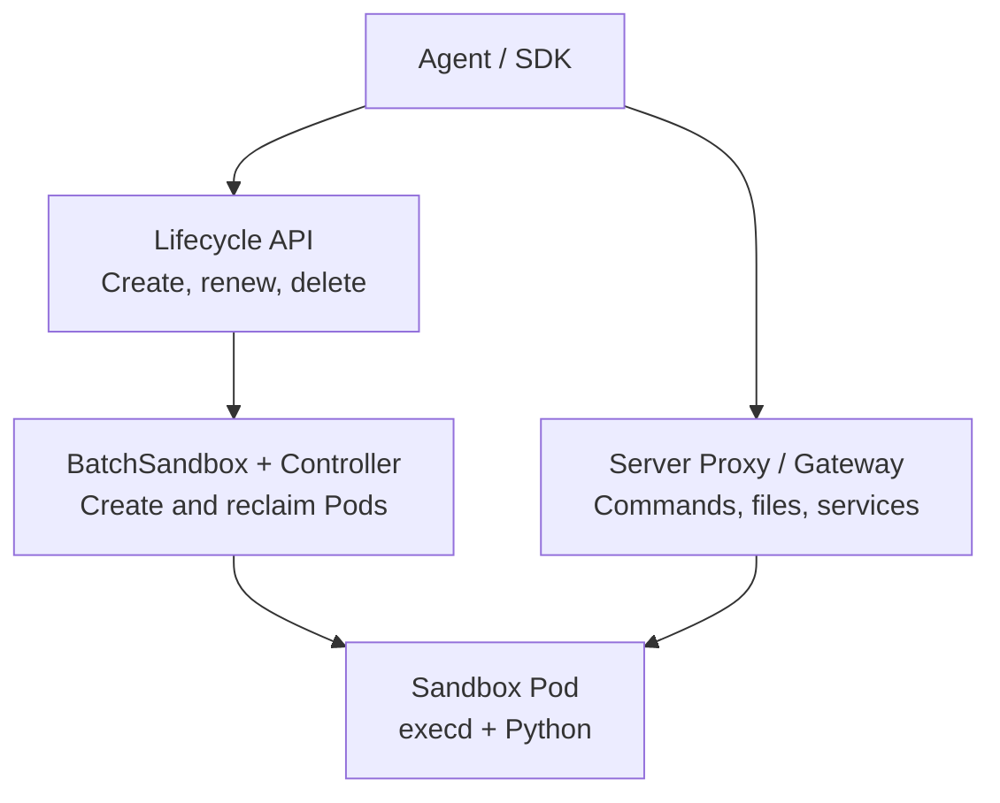

# OpenSandbox on Kubernetes: Official Console, Task Execution, and Automatic Cleanup

An agent needs a working environment to modify code, install dependencies, or run Python analysis. A local executor is convenient, but concurrent tasks require consistent ownership, file separation, access credentials, and resource cleanup.

This experiment deployed **OpenSandbox 1.1.1** in an existing **Kubernetes 1.30.4** test cluster. It exercised real commands, file uploads and downloads, an HTTP service, concurrent tasks, and lifecycle operations, and connected the official Developer Console. The experiment used the container backend on one worker node and required no GPU.

## 1. Project Origin and the Versions Tested

Alibaba initiated OpenSandbox. The original `alibaba/OpenSandbox` URL now redirects to `opensandbox-group/OpenSandbox`, while the official SDK metadata still lists Alibaba Group. The Apache 2.0 project can run on infrastructure you own. [Official repository](https://github.com/opensandbox-group/OpenSandbox), [SDK metadata](https://central.sonatype.com/artifact/com.alibaba.opensandbox/sandbox)

The server, controller, gateway, and SDK were pinned to **1.1.1**. This release fixes missing generated code in the 1.1.0 server Python package. The experiment did not use floating `latest` images. [1.1.1 release notes](https://github.com/opensandbox-group/OpenSandbox/releases/tag/release-1.1.1)

| Component | Actual version or source | Location |
| --- | --- | --- |
| API server, Controller, Ingress Gateway, execd | `release-1.1.1` | Kubernetes |
| Deployment templates | `531700ca18a7fa5fab6a2f25d6dc68a76eddab12` | Rendered from the matching Helm charts |
| Python SDK | `opensandbox==1.1.1` | Local validation program |
| Task image | Python 3.12 slim, linux/amd64 | Sandbox Pod |
| Official Developer Console | Main-branch snapshot `834c839dcf587784c16449aed56c21a5cf71b6d1` | Local Web and BFF connected through port forwarding |

**The Console directory is absent from the 1.1.1 release.** This is therefore a compatibility experiment combining a released backend with a pinned main-branch Console. A visible button does not establish that every feature works in this version combination.

## 2. What It Does on Kubernetes

The API server manages environment lifecycles. The Controller turns custom resources such as `BatchSandbox` into Pods. Inside each sandbox, `execd` exposes commands, files, and execution results. Ingress Gateway provides an entry point for sandbox services. [Architecture for the tested version](https://github.com/opensandbox-group/OpenSandbox/blob/release-1.1.1/docs/architecture/index.md)



Environment creation and command execution follow different paths. After a successful create request, the execution endpoint must still be reachable, commands must actually finish, and output files must be correct. These stages were checked separately.

## 3. Deployment Scope and Resources

A dedicated namespace contained one API server, one controller, and one gateway. Control-plane Pods and test tasks were placed on the same available worker. No node DaemonSet was installed, and the cluster network configuration was not changed.

| Component | CPU request / limit | Memory request / limit |
| --- | --- | --- |
| API server | 100m / 1 CPU | 128 MiB / 512 MiB |
| Controller | 100m / 500m | 128 MiB / 256 MiB |
| Ingress Gateway | 100m / 500m | 128 MiB / 256 MiB |
| Each SDK test sandbox | 100m / 500m | 128 MiB / 512 MiB |

ResourceQuota and LimitRange bounded namespace totals and provided defaults for Init Containers without declared resources. Task Pods disabled automatic ServiceAccount Token mounting, dropped Linux capabilities, and used the `RuntimeDefault` seccomp profile. This validates ordinary container execution; it does not establish virtual-machine isolation.

RBAC, or Role-Based Access Control, was split deliberately. The controller retained the cluster-wide read caches required upstream, while its writes were restricted to the experiment namespace. Server writes were also namespace-scoped. The controller still has cluster-wide reads, including Secret reads, so this lab configuration is not a strict production multi-tenant authorization design.

## 4. Two Dependencies Encountered During Installation

First, installing only the three container-backend CRDs—Custom Resource Definitions—is insufficient for this configuration. The 1.1.1 service factory combines the container backend and Fast Sandbox service; missing API definitions produced background 404 reads. Installing the **7 CRDs** from the matching base component removed these errors. Installing API definitions does not install a Firecracker runtime. [Service factory source](https://github.com/opensandbox-group/OpenSandbox/blob/release-1.1.1/server/opensandbox_server/services/factory.py), [base component](https://github.com/opensandbox-group/OpenSandbox/tree/release-1.1.1/manifests/charts/base)

Second, this gateway version requires cluster-wide read watches even when its data-plane namespace is configured. With only a namespaced Role, it reported that it could not list `BatchSandbox` at cluster scope and failed to become ready. Restoring the upstream read permissions resolved startup without broadening writes.

Image delivery was tested rather than assumed. Connections to one public registry path were reset, while another official registry path worked. Internal copies were then prepared through an image relay, with linux/amd64 image config and layers checked against their sources. No upstream program code was changed.

### Reproducible Configuration

The [companion directory](https://github.com/runzhliu/aik8s/tree/main/examples/opensandbox-kubernetes) contains a sanitized renderer and CSV verification script. The renderer pins the source version, uses official public images, and generates random API and route-signing keys in its output directory.

```bash
git clone --depth 1 --branch release-1.1.1 \
  https://github.com/opensandbox-group/OpenSandbox.git /tmp/OpenSandbox
export OPENSANDBOX_SOURCE=/tmp/OpenSandbox
export OPENSANDBOX_OUTPUT=/tmp/opensandbox-lab
python examples/opensandbox-kubernetes/render-lab.py

kubectl create namespace opensandbox-lab
kubectl apply --server-side --field-manager=opensandbox-lab \
  -f /tmp/opensandbox-lab/crds.yaml
kubectl apply --dry-run=server -f /tmp/opensandbox-lab/install.yaml -o name
kubectl apply -f /tmp/opensandbox-lab/install.yaml
```

Check ownership before applying over existing resources; the example does not resolve conflicts with another installation. Restricted networks need their own image mapping. Keep generated keys, configuration, and cluster access files out of public repositories.

## 5. Official Web UI: Login and Environment Creation

The official Developer Console uses a React single-page application and a FastAPI BFF—Backend for Frontend. After browser login, the BFF maintains the session and calls the Lifecycle API, rather than storing a long-lived API Key in browser storage. [Console documentation at the pinned snapshot](https://github.com/opensandbox-group/OpenSandbox/blob/834c839dcf587784c16449aed56c21a5cf71b6d1/console/README.md)


The experiment signed in through the tenant developer tab. In “创建沙箱” (Create sandbox), it entered `python:3.12-slim`, retained the `tail -f /dev/null` entrypoint, set CPU, memory, and timeout, and clicked Submit. The page opened the new environment details; refreshing showed `Running`.


This is the official interface, and the Python environment shown was actually created through its form. Console Web and BFF ran locally, while the execution environment ran in Kubernetes. The entire Console was not deployed as an in-cluster application in this experiment.

Two separate local forwards connected the lifecycle service and execution gateway:

```bash
kubectl -n opensandbox-lab port-forward svc/opensandbox-server 38080:80
kubectl -n opensandbox-lab port-forward svc/opensandbox-ingress-gateway 38089:80
```

The BFF's `LIFECYCLE_API_BASE` pointed to `http://127.0.0.1:38080/v1`, and the frontend used the upstream Vite proxy to reach the local BFF. The tenant configuration Key must match a Key accepted by the backend. Login, creation, overview, and details were verified; this lab account mapping is not a production tenant-isolation test.

## 6. Submitting an Actual Task

The Console creates a working environment. An SDK or agent executor then sends files and commands to it. This experiment used an independently verifiable task: upload 6 sales records, aggregate them by region inside the sandbox, download JSON, and verify the input-file hash.

The essential calls are shown below; the complete program is `verify.py` in the companion directory:

```python
connection = ConnectionConfig(
    domain="127.0.0.1:38080",
    api_key=os.environ["OPENSANDBOX_API_KEY"],
    use_server_proxy=True,
)
sandbox = await Sandbox.create(
    "python:3.12-slim",
    connection_config=connection,
    timeout=timedelta(minutes=10),
    resource={"cpu": "500m", "memory": "512Mi"},
    secure_access=True,
)
try:
    await sandbox.files.write_files(entries)
    execution = await sandbox.commands.run("python /tmp/analyze.py")
    result = await sandbox.files.read_file("/tmp/result.json")
finally:
    await sandbox.kill()
    await sandbox.close()
```

`use_server_proxy=True` lets the local SDK reach execution endpoints through the server when it cannot directly reach Pod IPs. `entries` contains the input CSV and Python program constructed by the script. The downloaded `result` must still be parsed and checked; a successful command request alone is insufficient.

The actual results were:

| Acceptance check | Result |
| --- | --- |
| Input records | 6 |
| Total amount | 400 |
| East / West / North | 150 / 100 / 150 |
| Input-file readback | Matching content and SHA-256 |
| Python execution | Exit code 0 and expected JSON |
| Deliberately failing command | Exit code 7 and preserved stderr |

The same environment also started a Python HTTP service. The execution proxy returned its **1,426-byte** HTML report with status 200, demonstrating an actual reachable service as well as short command execution.

## 7. Verify Both Authentication Layers

The lifecycle API Key and execution-endpoint token serve different purposes. Results were:

| Request | Result |
| --- | --- |
| Lifecycle API without a Key | HTTP 401 |
| Lifecycle API with the correct Key | HTTP 200 |
| Gateway with routing headers retained but Secure Access removed | HTTP 401 |
| Gateway with all endpoint headers | HTTP 200 |

The execution proxy also requires the security headers returned with the endpoint. A handwritten HTTP request containing only the API Key initially received 401; supplying the complete SDK endpoint headers made it succeed. Agent integrations should therefore retain the full endpoint information.

Keep routing headers when testing gateway authentication. Removing every header can produce a missing-route 400; that is not a successful authentication test.

## 8. Startup Times and Four Concurrent Tasks

Timing starts when the SDK requests creation and ends when its execution-endpoint health check succeeds. It includes the API, scheduling, container startup, and access path. It is neither Firecracker boot time nor Kubernetes scheduling time alone.

| Scenario | Samples and outcome | Creation to executable |
| --- | --- | --- |
| First environment | 1 / 1 | 6.187 seconds |
| Serial create, execute, delete | 3 / 3 | 4.133, 3.656, 4.601 seconds |
| First four-way attempt | 3 / 4 ready; 1 timeout | Successful items: 4.656, 4.660, 68.574 seconds; failed item not ready within 90 seconds |
| Independent four-way repeat | 4 / 4 ready | 3.978, 5.279, 5.255, 6.126 seconds |

In the repeat, each environment wrote its own identity to the same path, ran a controlled 45-second CPU task, and read its identity back. All 4 tasks returned correct results and could not read the result file in the retained demo environment. Each was then deleted; all 4 subsequent queries returned 404, and the cluster Pod inventory confirmed cleanup.

The initial readiness tail remains relevant. Logs place the slow request in the execution endpoint's `/ping` access phase. The evidence does not establish whether networking, the proxy, or the application caused it. The repeat demonstrates that this run completed; it does not erase the first failure or establish production capacity or reliability.

## 9. Renewal and Expiry Cleanup

TTL—Time to Live—should reclaim an environment when it expires, rather than merely stop the client waiting. Renewal was first checked by confirming that the new `expiresAt` exceeded the previous value, followed by an independent short-lived environment.

The 1.1.1 create API requires `timeout >= 60` seconds. An initial 30-second request received 422. After changing it to 60 seconds to satisfy the version constraint, the results were:

| Observation | Measurement |
| --- | --- |
| Configured TTL | 60 seconds |
| Creation to executable | 3.685 seconds |
| Executable to query returning 404 | 57.111 seconds |
| Creation request to query returning 404 | 60.802 seconds |
| Kubernetes resource check | Corresponding BatchSandbox and Pod deleted |

TTL starts at server-side creation. The subsequent 57.111 seconds should not be interpreted as early cleanup of a 60-second environment.

## 10. Observing the Running System

One controller metrics endpoint and one VMServiceScrape were added to the existing VictoriaMetrics collection system, with a dashboard provisioned through a ConfigMap. All **77 existing targets were retained; the total became 78**, and the new target was UP. Existing Helm values were not overwritten, and monitoring services were not restarted.


Sandbox count comes from kube-state-metrics; controller metrics come from its native `/metrics`. The peak of **5** includes one retained demo and four concurrent environments, rather than five test tasks. CPU in this screenshot is **controller process CPU**, not total task consumption.

| Metric | Observation in this window | Interpretation |
| --- | --- | --- |
| Controller target | UP = 1 | The scrape endpoint is reachable |
| Running sandbox | Peak 5 | Demo plus concurrent environments |
| Reconcile errors | 0 | No recorded controller reconciliation errors; not proof of universal client success |
| Queue depth | Sampled maximum 0 | No queue observed at 15-second sampling; instantaneous queuing remains possible |
| Controller CPU | Maximum about 0.00433 cores | Small controller overhead in this small experiment |
| Reconcile P95 | Window maximum about 42.2 ms | Rolling native-histogram estimate, not end-to-end startup time |

Execution-proxy network requests can still fail after the controller has reconciled a workload. An SDK readiness timeout and zero controller errors can therefore coexist. Following the whole request path is more useful than checking controller health alone.

## 11. What This Experiment Establishes

OpenSandbox provides usable interfaces for requesting environments, running commands, exchanging files, exposing services, and reclaiming resources. Its official Console also makes environment creation and state visible. These capabilities fit an agent's tool-execution layer.

No model was connected to perform an autonomous task here. The CSV program is a deterministic execution-chain check, not an evaluation of agent planning or answer quality. This container-backed experiment also does not validate Firecracker, gVisor/Kata, memory snapshots, egress policy, or Credential Vault.

The server uses one replica and SQLite on `emptyDir` for inexpensive validation. Recovery of history after server replacement was not tested. Long-running tasks require additional checks for persistence, snapshots, session resumption, and idempotent external actions. Visible Pause and Resume buttons do not substitute for those checks.

For an actual agent integration, begin by moving one independently verifiable task to remote execution, then check ownership and cleanup after cancellation, timeout, and retries. Investigate the initial concurrent readiness tail before expanding usage.

## References and Evidence

- [OpenSandbox 1.1.1](https://github.com/opensandbox-group/OpenSandbox/releases/tag/release-1.1.1)
- [Deployment documentation for the tested version](https://github.com/opensandbox-group/OpenSandbox/blob/release-1.1.1/docs/deployment/index.md)
- [Pinned official Console snapshot](https://github.com/opensandbox-group/OpenSandbox/tree/834c839dcf587784c16449aed56c21a5cf71b6d1/console)
- [Sanitized reproduction programs](https://github.com/runzhliu/aik8s/tree/main/examples/opensandbox-kubernetes)
- [Measurements and metric samples](../../assets/rag-agent/opensandbox-kubernetes/evidence.json)
- [Agent Sandbox selection](agent-sandbox-selection.md), [Agent long-task recovery](agent-long-running-durable-execution.md)
