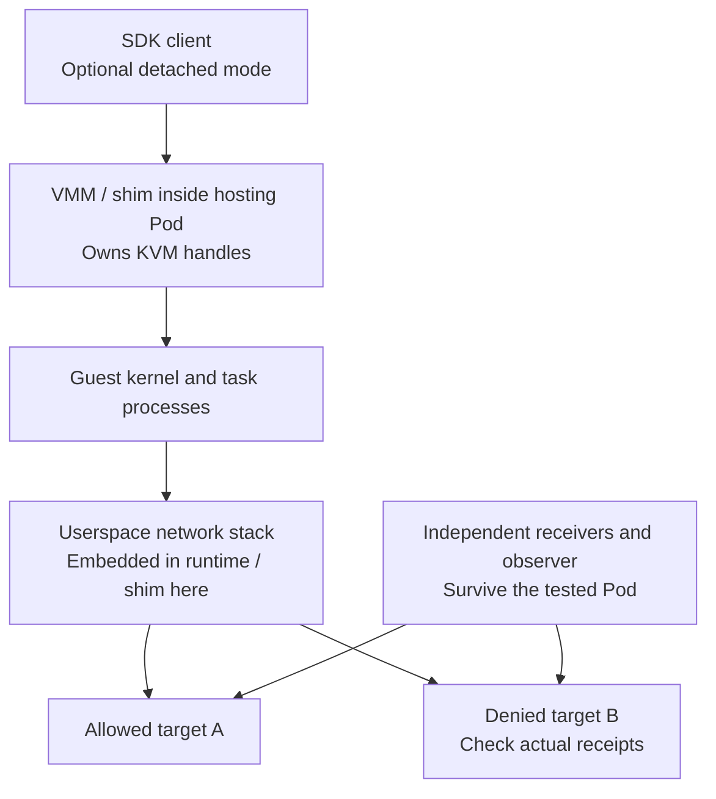

# When a Sandbox Pod Dies: Measured microVM, Network Policy, and Control-Plane Failures

After placing a microVM inside a Kubernetes Pod, an easily overlooked question is whether the SDK client, the process running the virtual machine, and the component enforcing network policy share a failure boundary. If one fails, does the VM stop, lose connectivity, or continue networking without restrictions?

This isolated experiment completed **six microVM fault scenarios and one control-plane outage scenario**. With detached mode enabled, both Microsandbox and BoxLite guests continued running after their SDK clients were killed, while existing allowlists remained effective. Killing the VMM or recreating its hosting Pod stopped the original guest's outbound requests. In a separate control, an OpenSandbox task Pod kept executing after both its API and Controller had exited.

These results cannot be collapsed into a claim that Pod failure is harmless. The failed process, guest survival, and traffic path must be examined separately. [Reproduction code and complete measurements](https://github.com/runzhliu/aik8s/tree/main/examples/sandbox-fault-injection) are public; addresses, nodes, registries, and environment identifiers are anonymized.

## 1. Establish the process boundaries first

VMM means Virtual Machine Monitor. KVM, Kernel-based Virtual Machine, provides kernel virtualization interfaces; the VMM creates vCPUs, maps memory, and handles virtual devices. KVM VM resources are associated with file-descriptor references. Creating a VM does not make it run independently of every userspace process. [KVM API documentation](https://docs.kernel.org/virt/kvm/api.html)



In both embedded-runtime experiments, the SDK client was an additional process started through `kubectl exec`, **not container PID 1**. Killing it is different from terminating the hosting container. Both explicitly used detached mode; the results must not be generalized to default lifecycle settings.

| Fault action | Actual termination scope | Verification used |
| --- | --- | --- |
| SDK `SIGKILL` | Python client creating and managing the guest | Match this experiment's worker precisely, then reconnect from a new client |
| VMM `SIGKILL` | Process holding KVM VM / vCPU handles | Inspect `/proc` descriptors and require exactly one target |
| Hosting Pod recreation | Runtime and guest inside the dedicated test Pod | Verify changed Pod UID and cessation of receiver traffic |
| OpenSandbox control-plane stop | API and Controller Deployments | Wait for all corresponding Pods to be deleted before observation |

The script operates only inside the dedicated fault Pod's process namespace and verifies that PID 1 is the experiment's idle process. It does not kill processes by name across the host.

## 2. Test conditions and two controlled targets

| Item | Configuration |
| --- | --- |
| Kubernetes / node | 1.30.4 / one KVM-capable x86_64 node |
| Microsandbox | SDK and runtime 0.7.8, locally embedded |
| BoxLite | SDK and runtime 0.10.7, locally embedded |
| Each microVM | 1 vCPU / 512 MiB, Python 3.12 slim userspace |
| Fault-hosting containers | Limits of 2 CPU / 2 GiB; separate runtime homes from the original labs |
| Permissions | Unprivileged Microsandbox with device-plugin KVM allocation; existing privileged lab configuration for BoxLite |
| OpenSandbox | Service and SDK 1.1.1, ordinary container backend, separate task and control-plane Pods |
| Network targets | IPv4 addresses of two dedicated test Pods, each serving HTTP on 8080 |
| Network probes | Visit A then B in each round; 500 ms interval, 1-second request timeout, fresh TCP connections |

A and B run the same small HTTP receiver. It records request times, case identifiers, and counts independently of the tested runtime; the guest separately records success or failure for each access. Requests disable connection reuse and environment-provided proxies, preventing an unintended alternate egress path.

Unrestricted controls first establish that both destinations are reachable from guests. Microsandbox then uses default-deny with only A's IP and TCP 8080 allowed; BoxLite lists only A's IP in `allow_net`. Their policy granularity differs. This experiment compares connectivity to the same destinations, without claiming identical rule expressiveness.

Each fault has at least 12 seconds of baseline observation and another 12 seconds after the fault action completes. Calls and checks add varying overhead, so before/after counts need not match. Raw results retain the complete post-fault window. A separate settled window excludes its first two seconds without replacing the original denominator.

## 3. The SDK dies; the guest and allowlist remain


*Actual evidence viewer populated from guest records and independent receivers, not an official product Console. Before → after means HTTP receipts during the baseline and post-action windows.*

After the Microsandbox SDK was killed, allowed-target receipts changed from **29** in the baseline window to **24** afterward; the denied target remained at **0**. A new client reconnected successfully, observed the same guest boot ID, and found the original probe still executing.

BoxLite produced **25 → 24** allowed receipts and **0 → 0** denied receipts. A new client also reconnected to the same guest boot ID.

In these configurations, the SDK process is not the sole owner of guest execution or network enforcement. Detached mode leaves the runtime alive and its restrictions operating. It does not free the guest from container lifecycle: if container PID 1 exits or the entire container is cleaned up, detached mode cannot be assumed to protect its child processes. [Microsandbox detached lifecycle](https://github.com/superradcompany/microsandbox/blob/v0.7.8/docs/sandboxes/lifecycle.mdx), [BoxLite cross-process example](https://github.com/boxlite-ai/boxlite/blob/v0.10.7/examples/python/03_lifecycle/share_across_processes.py)

## 4. When the VMM dies, Pod Ready is insufficient

The killed process was `msb` for Microsandbox and `boxlite-shim` for BoxLite. Before injection, both held `anon_inode:kvm-vm` and vCPU handles, preventing an ordinary management process from being mistaken for the VMM.

| Check | Microsandbox | BoxLite |
| --- | --- | --- |
| Baseline allowed / denied receipts | 25 / 0 | 25 / 0 |
| Complete post-fault window receipts | 1 / 0 | 0 / 0 |
| Receipts after excluding the initial two seconds | 0 / 0 | 0 / 0 |
| Guest command channel | Unavailable | Unavailable |
| Final KVM process check | 0 | 0 |

Microsandbox's single tail request arrived approximately **105 ms** after the kill command returned. No packet capture was taken, so its precise cause—such as in-flight data or receiver scheduling—is not established. The record is retained rather than rewritten as instantaneous cessation. No more allowed requests arrived in the remaining window, and no denied requests arrived.

This failure also demonstrates why outer Pod Ready status cannot represent every microVM's health. The SDK container's main process may remain alive after an individual VMM has exited. Production monitoring needs execution probes, runtime state, KVM-process checks, and application endpoints together.

## 5. A retained PVC does not automatically resume a guest

Both dedicated hosting Pods were recreated. Once the new Pod was ready, neither guest `start()` nor `restore()` was invoked. Original guests no longer sent requests; both post-fault receipt counts were **0 / 0**, and the new containers had no original VMM KVM handles.

A PVC retains runtime directories, caches, and committed state. It does not guarantee continued process execution. This is consistent with the earlier [Microsandbox memory-snapshot experiment](microsandbox-kubernetes-practice.md): that experiment explicitly saved a full snapshot and actively restored it from a new Pod. This experiment created no pre-fault snapshot and performed no restore.

Recovery therefore requires three separate designs:

1. **File recovery:** persistent volumes retain dependencies, workspaces, and files so a guest can restart.
2. **Execution-state recovery:** a completed full snapshot can restore guest memory and processes, subject to runtime and hardware compatibility.
3. **Agent task recovery:** task steps, idempotency keys, and external side effects need their own durable state; guest memory alone is insufficient.

## 6. Can the network proxy be killed independently? Two non-applicable cases

A network stack is a functional boundary, not necessarily a process boundary.

Microsandbox's local traffic traverses a host-side userspace stack where the runtime checks policy. This deployment exposed no separate network-proxy PID to terminate. [Network model for this version](https://github.com/superradcompany/microsandbox/blob/v0.7.8/docs/security/network.mdx)

Although BoxLite uses gvproxy, version 0.10.7 integrates it as a library through FFI, the Foreign Function Interface, creating the network instance inside the shim. The actual process list contained the worker, isolation wrappers, and the KVM-owning shim, with no independent gvproxy process. [GvproxyInstance implementation](https://github.com/boxlite-ai/boxlite/blob/v0.10.7/src/boxlite/src/net/gvproxy/instance.rs)

Consequently, independent network-proxy process termination is recorded as **not applicable** for both tested local versions. VMM termination is not relabeled as a separate proxy test. Standalone egress proxies and sidecars require testing a deployment that actually uses that architecture.

## 7. OpenSandbox: the task runs after API and Controller exit


*This group configures no egress policy, so both A and B are allowed. Zero denied-target receipts are not an acceptance criterion; the page explicitly displays N/A.*

Starting with an idle OpenSandbox test installation, the experiment created one task and launched the probe. API and Controller replicas were then set to zero. The script waited for every corresponding Pod to be deleted, observed for 15 seconds, and restored the original replica counts.

The results were:

- A and B each received **23** baseline requests and **30** requests after the entire control plane had exited.
- After control-plane recovery, the task Pod UID was unchanged; the task had not been recreated.
- The task was deleted afterward, and both API and Controller returned to their original single ready replica.

This demonstrates that the execution process in the tested ordinary-container backend does not require the API or Controller to remain continuously alive. It does not establish that management functions remain available, and it does not test an OpenSandbox egress-sidecar failure or KVM backend. This group provides no network-policy security conclusion. [Architecture for the tested version](https://github.com/opensandbox-group/OpenSandbox/blob/release-1.1.1/docs/architecture/index.md)

Ordinary containers can report the same boot ID as other containers on the node. The identity check therefore uses the task Pod UID; an unchanged boot ID must not be presented as proof of microVM isolation.

## 8. CubeSandbox requires a separate look at node networking

No CubeSandbox faults were injected in this experiment. This section reviews pinned-version documentation.

CubeSandbox v0.7.0 places Cubelet, its network runtime, and optional egress components in the compute Big Pod. Its documentation explicitly warns that recreating this Pod in that version's Pod-network configuration changes the network namespace and interrupts existing sandbox networking. TAP-device and CubeVS-hook placement matters more than CubeAPI survival alone. [v0.7.0 architecture](https://github.com/TencentCloud/CubeSandbox/blob/v0.7.0/docs/guide/kubernetes/architecture.md), [Upgrade disruption](https://github.com/TencentCloud/CubeSandbox/blob/v0.7.0/docs/guide/kubernetes/upgrade.md)

This does not establish that policy loss opens every network path. Losing interfaces or forwarding paths can first cause disconnection. Where some host state survives, programs, maps, routes, and proxies must be checked for consistency. `hostNetwork` changes network-namespace lifetime but does not automatically solve every VMM, policy-restoration, and proxy-availability problem.

CubeSandbox therefore needs separate API, Cubelet, VMM, Big Pod, and CubeEgress fault tests. Conclusions from these two embedded SDK deployments cannot simply be transferred to it.

## 9. What does “the policy remains” actually mean?


*Actual monitoring. Restricted cases include only the six formal measurements; unrestricted controls are shown separately. Traffic curves use an eight-second rate window, so peaks and declines do not identify exact process-exit times. Dashboard counters cover complete runs, including preflight and cleanup, rather than the sum of the specific before/after windows in the text.*

Separate these three states:

| Layer | What is stored or enforced | What to verify during failure |
| --- | --- | --- |
| Persistent policy | Kubernetes NetworkPolicy objects, runtime configuration, platform metadata | Rule presence and correct revision |
| Kernel data plane | eBPF programs/maps, iptables/nftables, interfaces, and network namespaces | Attachments, interface replacement, stale or missing rules |
| Userspace data plane | Local network stacks, egress proxies, domain checks, and credential injection | Process survival and whether failure blocks traffic or falls back to direct access |

A Kubernetes NetworkPolicy object does not automatically disappear with a workload Pod, but enforcement requires a supporting network plugin. Paths such as `hostNetwork` also have implementation-dependent limitations. This experiment did not stop a CNI or policy Agent and did not validate standard Kubernetes NetworkPolicy failure behavior. [Kubernetes documentation](https://kubernetes.io/docs/concepts/services-networking/network-policies/)

What the experiment establishes is narrower: **for these versions, rules, and short IPv4 HTTP connections, no denied-target access was observed after SDK termination.** VMM and Pod faults primarily stopped execution and communication. This does not prove that every failure path is fail-closed, meaning that failures preserve blocking.

Production acceptance should additionally test networking before rule loading, replay of the same policy revision after restart, established long-lived connections, DNS and IPv6 bypasses, and direct-access fallback when an egress proxy is unavailable. Recovery should establish restrictions before releasing workload traffic, rather than letting a restored guest run temporarily under permissive defaults.

## 10. Reproduction and untested cases

The [example directory](https://github.com/runzhliu/aik8s/tree/main/examples/sandbox-fault-injection) includes controlled receivers, the guest probe, SDK workers, exact PID verification, a single-case controller, a manifest renderer, and a dashboard. It reuses the earlier two labs' PVCs with separate runtime homes, leaving their original workbenches intact.

```bash
python3 examples/sandbox-fault-injection/run_case.py \
  microsandbox sdk \
  --context lab-cluster \
  --attempt a01 \
  --evidence-dir .local/sandbox-fault-evidence
```

First prepare dedicated Pods, import the guest image, and establish localhost forwarding to both receivers as described in the directory. Use a unique attempt identifier each time, pass unrestricted controls first, and then run restricted scenarios. The script records before/after observations and cleans up its guest in `finally`; delete the fault Deployments after the complete experiment.

Other attempts remain in the public results. BoxLite's first control produced no real requests because of a probe-file copy-path problem and cannot count as a passed policy test. It was rerun after copying from a regular file. An interrupted SDK case is excluded from formal results. OpenSandbox's subsequent attempt, which strictly waited for all control-plane Pods to exit, is the formal result.

Untested cases include CubeSandbox fault injection, CNI/NetworkPolicy Agent failures, IPv6/DNS, long-lived connections, OOM victim selection, node power loss, and cross-node recovery. At completion, all fault guests were reclaimed, both fault-runtime Deployments were removed, the OpenSandbox control plane was restored, and the original five virtual machines remained running. Receivers and the read-only observation page remain available for evidence inspection.
